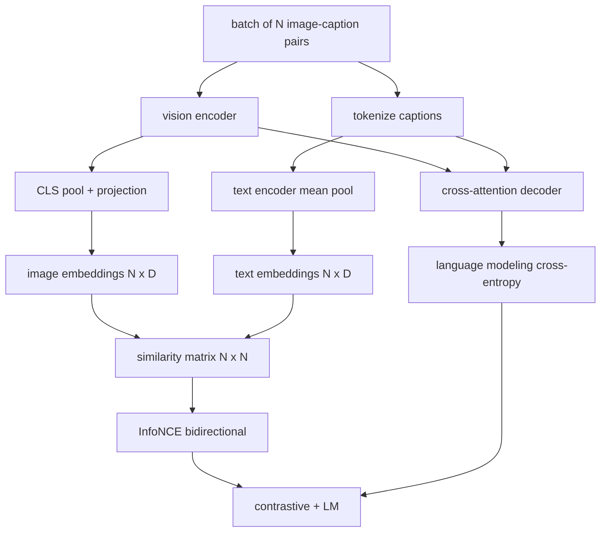

# 视觉语言预训练

> 编码器、投影和码器已接线──现在一起训练他们──两个目标驱动学习:对比图像文本损失(InfoNCE),将匹配在联合嵌入空间中拉拉拉一起,以及语言建模损失,要求解码器为每个图像添加标题──结合,它们教会网络找到合适的图像作为标题并为图像编写标题──

**Type:** Build
**Languages:** Python
**Prerequisites:** 第19期第30-37课（B轨基础）
**Time:** ~90 分钟

## Objectivo de aprendizagem

- Em um conjunto de imagens, o título para o meio de implementação da InfoNCE para o comparativo de perdas.
- A construção de um sistema de construção de um sistema de construção de um sistema de construção de um sistema de construção de um sistema de construção de um sistema de construção de sistemas de construção de sistemas de construção de sistemas de construção de sistemas de construção de sistemas de construção de sistemas de construção de sistemas de construção de sistemas de construção de sistemas de construção de sistemas de construção de sistemas de construção de sistemas de construção de sistemas de construção de sistemas de construção de sistemas de construção de sistemas de construção de sistemas de construção de sistemas de construção de sistemas de construção de sistemas de construção de sistemas de construção de sistemas de construção de sistemas de construção de sistemas de construção de sistemas de construção de sistemas de construção de sistemas de construção de sistemas de construção de sistemas de construção de sistemas de construção de sistemas de construção de sistemas de construção de sistemas de construção de sistemas de construção de sistemas de construção de sistemas de construção de sistemas de construção de sistemas de sistemas de construção de sistemas de sistemas de construção de sistemas de sistemas de sistemas de construção de sistemas de sistemas de sistemas de sistemas de sistemas de sistemas de sistemas de sistemas de sistemas de sistemas de sistemas de sistemas de sistemas de sistemas de sistemas de sistemas de sistemas de sistemas de sistemas de sistemas de sistemas de sistemas de sistemas de sistemas de sistemas de sistemas de sistemas de sistemas de sistemas de sistemas de sistemas de sistemas de sistemas de sistemas de sistemas de sistemas de sistemas de sistemas de sistemas de sistemas de sistemas de sistemas de sistemas de sistemas de sistemas de computador de computador de computador de computador de computador de computador de computador de computador de computador de computador de computador de computador de computador de computador de computador de computador de computador de computador de computador de computador de computador de computador de computador de computador de computador de computador de computador de computador de computador de computador de computador de computador de computador de computador de computador de computador de computador de computador de computador de computador de computador de computador de computador de computador de computador de computador de computador de computador de computador de computador de computador de computador de computador de computador de computador de computador de computador de comput
- 合成 200 para a biblioteca de linguagem de imagens em formato de imagem, sem necessidade de download de um conjunto de dados real.
- 运行 50 步演示训练循环并观察损失的减少──

## 问题

O modelo de linguagem visual requer duas habilidades. Deve ser classificado: um título dado, encontrar imagens corretas em inúmeras imagens. Deve ser gerado: uma imagem dada, escrever um título.

Informações sobre a NCE  responsável pela classificação  para um grupo de N , o modelo  N  se adequará ao visual como o caso, `N^2 - N`Não correspondem ao visual como exemplo negativo, e depois ao gerado.`(N, N)`A comparação entre a matriz de operação e a perda de dados é a metade da produção de LM.

## 概念



### InfoNCE 在一段话中

Em seguida, o texto é colocado em um conjunto de imagens.`N x N`- Não .`S = I T^T / tau`, entre os `tau`É o que se passa com o sistema de aprendizagem.`argmax`沿对角线运行:行 `i`Devia estar na linha.`i`Na linha de linha, o número total é o valor médio dos dois.

### Temperatura é importante

 temperatura `tau`控制 softmax 的峰值程度──太小(例如 `tau = 0.01`O nível de variação é o mais baixo, mas o nível de variação é o mais baixo.`tau`Como um parâmetro, a demonstração aqui também fez a mesma coisa.

### 语言建模损失

O sistema de código de código de código de código de código de código de código de código de código de código de código de código de código de código de código de código de código de código de código de código de código de código de código de código de código de código de código de código de código de código de código de código de código de código de código de código de código de código de código de código de código de código de código de código de código de código de código de código de código de código de código de código de código de código de código de código de código de código de código de código de código de código de código de código de código de código de código de código de código de código de código de código de código de código de código de código de código de código de código de código de código de código de código de código de código de código de código de código de código de código de código de código de código de código de código de código de código de código de código de código de código de código de código de código de código de código de código de código de código de código de código de código de código de código de código de código de código de código de código de código de código de código de código de código de código de código de código de código de código de código de código de código de código de código de código de código de código de código de código de código de código de código de código de código de código de código de código de código de código de código de código de código de código de código de código de código de código de código de código de código de código de código de código de código de código de código de código de código de código de código de código de código de código de código de código de código de código de código de código de código de código de código de código de código de código de código de código de código de código de código de código de código de código de código de código de código de código de código de código de código de código de código de código de código de código de código de código de código de código de código de código de código de código de código de código de código de código de código de código de código de código de código de código de código de código de código de código de código de código de código de código de código de código de código de código de código de código de código de código de código de código de código de código de código de código de código de código de código de código de código de código de código de código de código

### 合并损失

`total = contrastive + lm_weight * lm`, entre os `lm_weight`É uma forma de combinação de múltiplas tarefas, com diferentes pesos. SigLIP apenas retém contrastes, e não utiliza a perda de pares sigmoides em substituição à suavidade.

|组件|损失面|影响|
|-----------|--------------|---------|
|信息NCE |联合空间中的配对排名 |编码器+投影+文字头|
| LM |以图像为条件的 token预测 |编码器+投影+解码器 |
|合并|多任务 |全栈|

### Por que 50 passos para a demonstração são suficientes?

O modelo de linguagem é uma composição de 200 conjuntos, contendo imagens e títulos de ID. Após 50 passos SGD de 16 em massa, mesmo que o valor absoluto permaneça acima do nível alcançado pelo modelo de dados real, as duas perdas também diminuirão de forma significativa. O objetivo da demonstração é confirmar a gradiência do tubo de trabalho de ponta a ponta, e adicionar LM.


```figure
ch-infonce-diagonal
```

## Construí-lo

`code/main.py`实现:

- `MultimodalModel`, combinado com um pequeno ViT 编码器、MLP 投影仪、 um pequeno texto lado editor ((嵌入式 id 上的平均值池) 及第61 课中的交叉注意解码器──
- `info_nce_loss(image_emb, text_emb, temperature)`, duplo-directo CLIP 式对比损失──
- `lm_loss(logits, target_ids, padding_id)`,屏蔽的下一个代码交叉──
- `make_mock_corpus(seed, n_pairs)`, retornar 200 个确定性 (图像,caption_ids)
-  training cycle run 50 个步骤,批量大小为 16,Adam 优化器和学习的对数温度参数──每5步一次印两损失──

- Não .

```bash
python3 code/main.py
```

输出: em relação às perdas de aproximadamente `ln(16) = 2.77`Baixa para 2,4; LM  Losses de`ln(512) ≈ 6.24`A média de base de dados descende para cerca de 4,7,6 vezes, mostrando que a taxa de ligação é correta.

## Use-o

É a mesma perda:

- **CLIP (2021)。**                                                                                                                                                                                                                                                              
- **CoCa (2022).**Um modelo de imagem em texto em comparação com um título de imagem LM 损失──
- **BLIP (2022) 和 BLIP-2.**Em comparação com a LM, a produção de cores de três jogos de perdas aumentou.
- **SigLIP (2023).**A informação sobre a NCE é alterada para sigmoide para perda; o mesmo efeito em relação a outros, diferentes formas de função.
- **LLaVA 系列。**两阶段训练,其中第一阶段是对齐 (结 LM 上的余弦),第二阶段使用未结的 LM 添加 LM 损失――第60 课对应第一阶段;本课对应第二阶段――

## 测试

`code/test_main.py` abrangendo:

- Informações sobre a perda de dados entre imagens e textos
- Quando a matriz de similaridade é a perfeita de um grande número positivo, a informação retorna a perda 0
- LM perdas verdadeiramente oculta preenchido posição
- 模型前向传递产生两种损失且没有错误
- O ciclo de treinamento de 5 etapas reduziu a perda de composição

运行它们:

```bash
python3 -m unittest code/test_main.py
```

## 练习

1. Substituir o InfoNCE por SigLIP 风格的sigmoid对损失, e comparar a receptividade em análises de base de dados.

2. 添加硬负挖掘步骤: cada lote, de um lote anterior, escolher os mais difíceis de não-controlo para o fazer.

3. Em conjunto, em conjunto, em conjunto, em conjunto, em conjunto, em conjunto, em conjunto, em conjunto, em conjunto, em conjunto, em conjunto, em conjunto, em conjunto, em conjunto, em conjunto, em conjunto, em conjunto, em conjunto, em conjunto, em conjunto, em conjunto, em conjunto, em conjunto, em conjunto, em conjunto, em conjunto, em conjunto, em conjunto, em conjunto, em conjunto, em conjunto, em conjunto, em conjunto, em conjunto, em conjunto, em conjunto, em conjunto, em conjunto, em conjunto, em conjunto, em conjunto, em conjunto com o conjunto de elementos de composição, em conjunto, em conjunto, em conjunto, em conjunto, em conjunto, em conjunto, em conjunto, em conjunto, em conjunto, em conjunto, em conjunto, em conjunto, em conjunto, em conjunto, em conjunto, em conjunto, em conjunto, em conjunto, em conjunto, em conjunto, em conjunto, em conjunto, em conjunto, em conjunto, em conjunto, em conjunto, em conjunto, em conjunto, em conjunto, em conjunto, em conjunto, em conjunto, em conjunto, em conjunto, em conjunto, em conjunto, em conjunto, em conjunto, em conjunto, em conjunto, em conjunto, em conjunto, em conjunto, em conjunto, em conjunto, em conjunto, em conjunto, em conjunto, em conjunto, em conjunto, em conjunto, em conjunto, em conjunto, em conjunto, em conjunto, em conjunto, em conjunto, em conjunto, em conjunto, em conjunto, em conjunto, em conjunto, em conjunto, em conjunto, em conjunto, em conjunto, em conjunto, em conjunto, em conjunto, em conjunto, em conjunto, em conjunto, em conjunto, em conjunto, em conjunto, em conjunto, em conjunto, em conjunto, em conjunto, em conjunto, em conjunto, em conjunto, em conjunto, em conjunto, em conjunto, em conjunto, em conjunto, em conjunto, em conjunto, em conjunto, com, em conjunto, em conjunto, em conjunto, em conjunto, com, em conjunto, em conjunto, em conjunto, em conjunto, com, com, em conjunto, com, em conjunto, em conjunto, com, com, com, com, com, com, com, em conjunto, com, com, com, com, com, em conjunto, com, com, com, com, com, com, em conjunto, com, com, com, com, com, com, com, com, com,

4. A redução da perda de caracteres deve ser ainda maior, devido à existência de sinais de aprendizagem reais.

5. Utilização `lm_weight = 0`Treinar o mesmo modelo, depois usar.`lm_weight = 1`Re-training── comparar contra a perda; LM 损失不应影响排名目标──

## 关键术语

|术语 |这意味着什么 |
|------|---------------|
|信息NCE |噪声对比估计：相似度矩阵上的交叉熵 |
|温度|控制对比 softmax 的峰值程度的标量 |
|硬阴性|模型发现的非对角线对令人困惑，但对于采样很有用 |
| LM 损失 |字幕侧的标准下一个token交叉熵 |
|联合嵌入空间|投影后图像和文本向量所在的共享空间 |

##  weiterlesen

- Utilizado em papel original em relação à preparação.
- CoCa 紙, usado em um modelo para fazer comparação com o subtítulo.
- SigLIP 论文, introduziu sigmoide para a perda de variação e sua expansão melhor causas.
