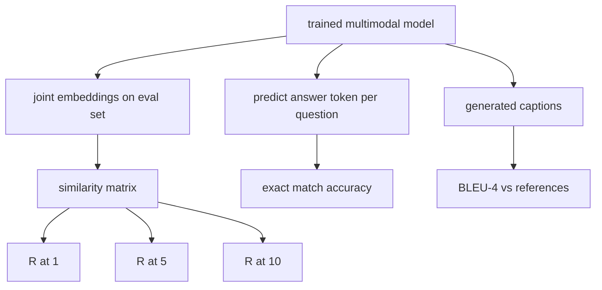

# 多模态评估

> O curso é uma metade do ciclo. A outra metade é a medição. Este curso é baseado em três áreas de avaliação: R@1、R@5、R@10; R@1 para o teste de imagem; R@1 para o teste de imagem; R@2 para o teste de imagem; R@2 para o teste de imagem; R@2 para o teste de imagem.

**Type:** Build
**Languages:** Python
**Prerequisites:** 第19期第58-62课（Track E基础：编码器、Transformer、投影、交叉注意力融合、预训练）
**Time:** ~90 分钟

## Objectivo de aprendizagem

- Baseado em imagem e cabeçalho embutidos entre a matriz de similaridade calculado Recall@K。
- 根据将(图像、问题) calcula a precisão do VQA 准确度 do modelo de mapeamento até resposta fixa.
- A partir de gerar e referências, a sequência de tokens calcula BLEU-4, sem necessidade de qualquer armazenamento externo.
-  a execução de todos os três avaliações, em função da construção de um conjunto de sistemas integrados sobre o modelo de formação de 62

## 问题

Quando a perda de treinamento tende a estabilizar-se, é muito provável que anunciemos que o modelo multimodelo já está concluído. A medida de perda de treinamento é adequada à distribuição do treinamento. Não pode medir se o modelo pode ser classificado em batimentos reservados, responder a perguntas ou escrever títulos aceitos pela humanidade.

- **检索（R@1，R@5，R@10）。**Para enquirir, os títulos são construídos em conjunto; cada imagem da cadeia de avaliação é classificada por restrinho; o relatório é comparado com a forma de execução da imagem em 1 、 、 5 、 、 10 、 ∼ ∼ ∼ ∼ ∼ ∼ ∼ ∼ ∼ ∼ ∼ ∼ ∼ ∼ ∼ ∼ ∼ ∼ ∼ ∼ ∼ ∼ ∼ ∼ ∼ ∼ ∼ ∼ ∼ ∼ ∼ ∼ ∼ ∼ ∼ ∼ ∼ ∼ ∼ ∼ ∼ ∼ ∼ ∼ ∼ ∼ ∼ ∼ ∼ ∼ ∼ ∼ ∼ ∼ ∼ ∼ ∼ ∼ ∼ ∼ ∼ ∼ ∼ ∼ ∼ ∼ ∼ ∼ ∼ ∼ ∼ ∼ ∼ ∼ ∼ ∼ ∼ ∼ ∼ ∼ ∼ ∼ ∼ ∼ ∼ ∼ ∼ ∼ ∼ ∼ ∼ ∼ ∼ ∼ ∼ ∼ ∼ ∼ ∼ ∼ ∼ ∼ ∼ ∼ ∼ ∼ ∼ ∼ ∼ ∼ ∼ ∼ ∼ ∼ ∼ ∼ ∼ ∼ ∼ ∼ ∼ ∼ ∼ ∼ ∼ ∼ ∼ ∼ ∼ ∼ ∼ ∼ ∼ ∼ ∼ ∼ ∼ ∼ ∼ ∼ ∼ ∼ ∼ ∼ ∼ ∼ ∼ ∼ ∼ ∼  ∼ ∼                                                                                                                                                     
- **视觉问答（完全匹配）。**给定(图像,问题),模型输出一个答案token──精确匹配是每个样本一个:预测答案是否等于参考答案?评估集的平均值──
- **字幕 (BLEU-4)。**O que é um exemplo de um modelo de referência?

Cada medida é uma função fina. Este curso irá construí-las todas com código, portanto, a matemática é específica, e a superfície ainda está sob seu controle.

## 概念



### De similaridade em matrizes

Construir imagens e títulos entre inserções `(N, N)`余弦相似度矩阵── para cada linha, em conformidade com a similaridade, é organizado em sequência. Recall@K é o número de divisões de sequências em que o índice de coras está localizado na posição anterior de K.

### VQA 精确匹配

 Para cada imagem, problema, resposta), para a imagem para codificação, inserção de problemas, através de decodificador de integração, e leitura do seguinte token.  Para comparar o token id da previsão com o id de referência.

### BLEU-4

```math
\text{BLEU-4} = \text{BP} \cdot \exp\big(\text{mean}(\log p_1, \log p_2, \log p_3, \log p_4)\big)
```

Entre eles `p_n`é a precisão de n 元语法 após modificação ((aparece em qualquer referência o número de cortes de n 元语法 gerados em qualquer referência, exceto o número total de n 元语法 gerados em qualquer referência),`BP`É simples punição:

```math
\text{BP} = \begin{cases} 1 & \text{当生成长度} > \text{参考长度} \\ \exp(1 - r/g) & \text{否则，其中 } r \text{ 为参考长度，} g \text{ 为生成长度} \end{cases}
```

Para alguns.`p_n`Para um pequeno exemplo de zero, é necessário fazer uma planejamento. Para a implementação, o método de Chen 和 Cherry é o mais seguro para qualquer número de zero, moléculas e divisórias adicionadas.

### 综合评估套件

Um conjunto de avaliação de 50 amostras é construído em memória com sementes reservadas, com base no mesmo modelo de base de linguagem utilizada na secção 62.

- `pairs`A informação sobre o uso de dados e de dados
- `vqa`O que é o problema?
- `caps`:50 个(图像, reference_caption_ids,...])条目, cada imagem mais de 3 个引用。

O conjunto foi determinado entre as sementes e mantido na base de linguagem do treinamento, portanto, o indicador é baseado em dados nunca vistos no modelo de cálculo.

|指标|范围 |随机基线 (N=50) |
|--------|-------|------------------------|
| R@1 | 0 到 1 | 0.02（1/N）|
| R@5 | 0 到 1 | 0.10 |
| R@10 | 0 到 1 | 0.20 |
| VQA EM | 0 到 1 | 1 / 词汇 |
| BLEU-4 | 0 到 1 |小但非零 |

Para os treinos de 50 passos que funcionam em dados sintéticos, os indicadores de previsão não são muito altos; eles são esperados para cima da linha de base, é o conteúdo da demonstração de exames.


```figure
ch-recall-window
```

## Construí-lo

`code/main.py`实现:

- `recall_at_k(sim_matrix, k)`, em duas direcções , voltando .`[0, 1]`Número de pontos de circulação
- `vqa_exact_match(predictions, references)`, voltem .`int`Valor médio igual ao igual.
- `bleu4(generated, references, smoothing=True)`, tem vários referências:
- `build_eval_suite(seed, n_samples, vocab_size, max_len)`, retornar à lista de avaliações de três determinadas características:
- `evaluate(model, suite)`, ele funciona todos os três indicadores e volta .`dict`Numero e número.
- Uma demonstração, carregando um modelo multimodelo de novo início na aula 62, para avaliá-lo, então para fazer um treino de 50 passos e avaliá-lo novamente, imprimir antes/após indicadores.

- Não .

```bash
python3 code/main.py
```

输出: antes/posteriormente do gráfico de medida mostra o retorno de quase que o tempo para o modelo de aprendizagem de sinais de melhoria, VQA  melhoria superior ao tempo, BLEU-4  melhoria( estrutura de composição suficiente para alcançar 4 克 de precisão de melhoria)

## Use-o

Cada indicador é diretamente mapeado para a base de produção:

- **检索。**MS-COCO 5K val、Flickr30K、ImageNet 零样本都是同一相似性矩阵上的 R@K 问题──将合成 eval 替换为真实文件,函数签名保持不变──
- **VQA。**VQA v2、GQA、OK-VQA utiliza o mesmo formato de correspondência precisa, usando soft-acc e não EM)
- **BLEU-4.**MS-COCO 字幕、NoCaps、Flickr30K 字幕均使用BLEU-4加 CIDER 和 METEOR──添加 CIDER 是另一项功能──

Para o verdadeiro teste de base, por favor.`build_eval_suite`Substituição para o verdadeiro programa de carga e conserva função.

## 测试

`code/test_main.py` abrangendo:

-recall@k em perfeito estado de similaridade recaída 1.0, recaída 0.0 ((k < N)
- recall@k 尊重 `k <= N`A limite
- Quando gerado de azul4  totalmente igual a um de citações, retornar 1.0
- azul4 在不相交词汇上 回归 0.0
- Vqa  Precisamente correspondência igual a proporção de equivalência
- constru_eval_suite  retornar número de parâmetros esperados  vqa 项和标题条目数

运行它们:

```bash
python3 -m unittest code/test_main.py
```

## 练习

1. CIDER em n-grams, usando TF-IDF, que irá recompensar informações abundantes em tokens.

2. Implementar a precisão de VQA: cada problema tem várias respostas pessoais, se houver correspondência, a precisão é`min(human_count / 3, 1)`❖ Copia VQA v2──

3. 添加 `bleu4`A sequência de geração do NaN é processável e não vai cair.

4. Com R@K 一起计算平均倒数排名 (MRR) ⋅ MRR é muito sensível à posição fora do topo do K do projeto que está no topo do K; R@K é muito sensível ao facto de estar no topo do K ⋅

5. Durante o treino, cinco pontos de verificação avaliaram o funcionamento do modelo, e desenharam uma curva de aprendizagem.

## 关键术语

|术语 |这意味着什么 |
|------|---------------|
| R@K |正确匹配出现在前 K 个结果中的查询比例 |
|精确匹配 |最简单的VQA评分：预测答案等于参考|
| BLEU-4 | 1 到 4 克精度的几何平均值，带有简洁性代价 |
|多参考|字幕指标接受每个图像的多个参考字幕 |
|保留 |评估集是从与训练语料库不相交的种子中采样的 |

##  weiterlesen

- Utilizado em fórmulas de precisão e dados de dados de estatística VQA v2 论文.
- Utilizado para TF-IDF 加权 n-gram 字幕的CIDEr 论文──
- BLEU 原始版本(Papineni 等人,2002) para uso em transformações de forma simples.
- Utilizando o guião de avaliação de subtitulos de MS-COCO para a implementação de normas.
