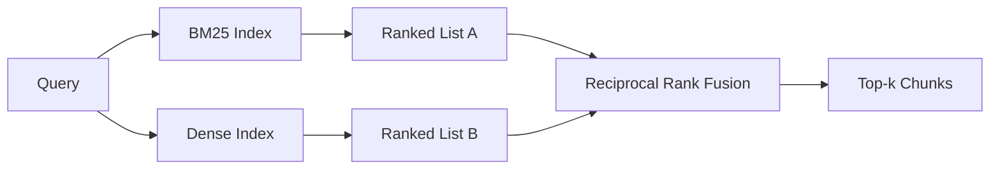

# BM25 e pesquisa de mistura de inserções densas

> 词汇和语义检索 相反的查询分布失败──具有倒数排名融合的混合检索不会插值,而是投票 - 并且投票在每个查询类别上获胜──

**Type:** Build
**Languages:** Python
**Prerequisites:** 第 11 阶段课程 04（嵌入）、06（RAG）；第 19 阶段 Track B 基础（第 20-29 课）；第 19 阶段第 64 课（分块策略）
**Time:** ~90 分钟

## Objectivo de aprendizagem
- De acordo com Robertson e Spark Jones, a fórmula desde o início da implementação do BM25, tem um aumento de dados, uma padronização de tamanho de arquivo e uma regulação de dados.
- Empregar um pesquisador de densidade sobre a configuração de segurança para que o ciclo de descarga funcione.
- 完全按照 Cormack、Clarke 和 Buettcher, como publicado em 2009, realiza a concentração de níveis de números, e explica por que ocupa o lugar dominante no valor de divisão de números.
- 调整 RRF k 常数和每种模态权重,并小型固定 语料库上读取权重──

## 问题

Quando o envio de pesquisas traz o material de linguagem que contém um símbolo de palavras, o envio de pesquisas é feito em um formato de texto.`AbortMultipartOnFail`A pesquisa será feita através do BM25 em microsecondas para retornar a função Go . A mesma pesquisa embutida está localizada na fronteira de três semelhanças, e o pesquisador intenso irá classificar o arquivo errado em primeiro lugar.

Quando a consulta é interpretada como um texto distante da biblioteca de linguagens, a pesquisa intensiva ganha. Os usuários perguntam como lidar com a eliminação de um texto.

A seleção entre os dois não é um todo invariable. A distribuição da consulta é a variação. Produzir RAG sistemas de processamento dos dois tipos a partir do mesmo ponto, portanto, o processo de pesquisa deve ser processado simultaneamente.

## 概念



### BM25 一段话

BM25                                                                                                                                                                                                                                                                                                                                                                                                                                                                                                                            `k1`控制词频和度;默认值 1.5 是已发布的建议, você não deve mover-se em situação sem base.`b` controle de duração do arquivo Importância; valores-factor 0.75 Indica que os arquivos mais longos serão punidos, mas não lineares.

IDF 公式使用平滑的 Robertson 和 Spark Jones 定义,即 `log((N - df + 0.5) / (df + 0.5) + 1)`Quando um termo aparece em mais de metade das bibliotecas de línguas, o aumento no日志 irá manter o valor da IDF. Isto é importante para pequenas bibliotecas de línguas, pois, tecnicamente, a palavra de uso é muito rara.

字段加权可让你告诉 BM25, a correspondência no nome do símbolo é mais importante do que a correspondência na escrita correta. Implementar é multiplicar o número de termos no processo de indexação, e não o número de termos no momento da avaliação. Assim, pode manter a matemática igual, evitando que cada campo tenha uma pontuação individual.

### Uma secção de pesquisa

Utilize um modelo de inserção que irá inserir cada bloco em um determinado volume de direção. Em consulta, a inserção de consulta, em função da similaridade, realiza uma sequência de restantes para cada bloco, e retorna para o modelo anterior. O modelo é a variação de qualidade que determina.

Este curso usa uma embuxação baseada em hash baseada em determinação, portanto, você não precisa de rede de manipulação de dados.

### 倒数秩融合, já publicado

两个排名榜――对于任一列表中出现的每一位候选人,将其倒数排名贡献相加――论文使用 2009`1 / (k + rank)`,k é igual a 60 como valor em ordem.

Quando k = 60 时, a contribuição do ranking 1 é 1/61, a contribuição do ranking 10 é 1/70 ⋅ contribuição diminui lentamente, por isso os candidatos ainda votam ⋅ menor k ⋅ superior.

Há duas coisas que podemos fazer.`k`常数── a sobreposição de peso de cada modelo, de modo que, quando você tiver evidências prévias de que uma delas é melhor na sua biblioteca de conteúdos, você pode aumentar o BM25 ou a densidade── a contribuição de classificação multiplicada pelo peso é o princípio mais simples de realizar; ele manteve a forma de degradação de grau e manteve-se sem padrão──

### Por que a fusão é melhor do que o percentual

BM25 分数 não é limitado e depende da base de linguagem.`alpha * bm25 + (1 - alpha) * cosine`需要每一个语料库 alpha 调整,并且每次重新索引时都会中断――基于等级融合则否――两个等级在不同模式下具有可比性――自2010年以来, RRF 基线已发布在每个公共TREC赛道上都击败分数插值――

Isto é o mesmo que você ouviu nos documentos da Vespa e da Weaviate sobre RankFusion e RRF. Eles chegaram à mesma conclusão: a menos que você tenha provas muito fortes para inserir valor, ou então manter baseado em classificação.

```figure
rrf-fusion
```

## Construí-lo

`code/main.py`实现:

- `tokenize(text)`- 快速正则表达式token器──
- `BM25Index`- O que é que é?`add`和 `search`E também pode ser modificado.
- `mock_embed`- Não.`DenseIndex`- a mesma determinação que a do § 64 do Classe, por conseguinte, o bloco tem uma comparabilidade:
- `rrf(rankings, k, weights)`- 多模态权重融合已发布的多模态权重融合──
- `HybridRetriever`- Combinado com o BM25 e o denset.
- Uma demonstração .`main()`,carregar uma pequena ficha 语料库, executar três perguntas especificamente para mostrar as vantagens e deficiências de cada pesquisador, e imprimir a classificação de cada modelo gerado e a lista de integração:

- Não .

```bash
python3 code/main.py
```

Não há nenhuma informação sobre o que é um sistema de classificação de dados, mas é um sistema de classificação de dados que é um sistema de classificação de dados.

## 调整旋

|旋钮|默认|何时调高|何时调低|
|------|---------|----------------|------------------|
| BM25 k1 | 1.5 |文档中的术语会重复，且你希望频率更重要 |文档很短，术语重复主要是噪音 |
| BM25 b | 0.75 |长文档确实每个词携带的信息更少 |文档长度与主题无关 |
| RRF k | 60 |较深排名的候选仍应投票 |Top-1 应该占主导 |
| BM25 weight | 1.0 |语料库包含字面标识符，查询也按字面匹配 |查询多为用户改写 |
| Dense weight | 1.0 |查询多为改写或语义表达 |查询多为字面表达 |

 reiniciar a aplicação do instrumento de avaliação do n.o 68 no conjunto de consultas reservadas para fazerem os ajustamentos, em vez de fazerem-se de forma direta.

## 演示将隐藏的故障模式

**词汇外token。**A IDF do BM25 é calculada de acordo com o conteúdo da base de dados, portanto, apenas a contribuição de termos da consulta é zero. Embutidos densos geram a mesma visão de um veículo. Para os identificadores de conteúdo fora da base de dados, o modelo de densos retorna ao vizinho que parece razoável, mas erróneo.

**停止token统治。**BM25 针对单词the在语料库中产生统一的排名──过索引器中停止token或接受高 IDF 术语自然占主导地位──

**跨模态的内容相同。**Se a sua base de linguagem for pequena o suficiente, até o top-1 do BM25 e o top-1 intenso, então a RRF fornecerá o mesmo top-1 do mesmo vizinho. Este é um comportamento correto, não um fracasso, mas faz a integração parecer invisível.

## Use-o

Modelo de produção:

- 索引 BM25 正在处理中;瓶是词频字典,而不是向量──
- Em um armazenamento individual, você usará HNSW (HNSW)
- E segue a condução de duas consultas; a fusão é a constante constante do conjunto de conjuntos.
- Manter cada pesquisa em seu destino, para que os reorganizadores possam ver quais modelos votam para apoiá-la.

## 发货

Seção 66                                                                                                                                                                                                                                                                                                                                                                                                                                                                                                                           

## 练习

1. - Não .`mock_embed`替代为供应商提供的真实模型──重新运行演示并报告 只有密集排名在释义查询上的变化──
2. 添加第三种模式:单独索引的块摘要并融合为第三排名列表──测量增益──
3. Para a RRF, o valor de K é o valor do recall@k 曲线.
4. O BM25F é um sistema de comparação de dados que permite a obtenção de dados de dados.

## 关键术语

|术语 |人们怎么说|它实际上意味着什么 |
|------|-----------------|------------------------|
| BM25 | “词汇搜索” | idf x 饱和 tf x 长度归一化的概率排名 |
|参考文献 | “等级融合”|各个排名列表的 1 / (k + 排名) 之和； k = 60 默认 |
| k1 | “TF 饱和度” |控制重复术语停止添加更多分数的速度 |
|乙| “长度惩罚” | 0 表示忽略文档长度，1 表示完全标准化 |
|场加权 | “符号提升”|在索引期间重复token以增强该字段中的匹配|
|基于排名与基于分数的融合 | “为什么 RRF 优于线性”|不同模式下的排名具有可比性；分数不|

##  weiterlesen

- Cormack、Clarke、Buettcher,倒数排名融合优于孔多塞和个人排名学习方法,SIGIR 2009
- Robertson、Walker、Beaulieu、Gatford、Payne,Okapi no TREC-3(原始 BM25 论文)
- [Vespa：使用 BM25 和 Embeddings](https://docs.vespa.ai/en/tutorials/hybrid-search.html) realizar análises mistas
- [Weaviate：混合搜索](https://weaviate.io/developers/weaviate/search/hybrid)
- 第 11 阶段 第 06 课 - RAG 基础知识
- No 19 阶段 No 64 课 - 分块器的输出 在此编制索引
- 第19 阶段 第66 课 - 消耗融合的顶-k 的交叉编码器 重排序器
