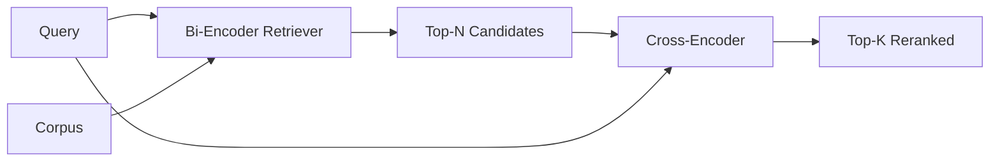

# 交叉编码器 重排序

> O quadrilha de código é o mais inteligente leitor, também o mais lento. Utilizado como um quadrilha de código superior de segunda classe, ele em si tem valor.

**Type:** Build
**Languages:** Python
**Prerequisites:** 第11期第06课（RAG）、第11期第07课（高级RAG）；第 19 阶段 Track B 基础（第 20-29 课）；第 19 阶段第 65 课（混合检索喂养此阶段）
**Time:** ~90 分钟

## Objectivo de aprendizagem
-  através da entrada de forma parametros e cada consulta, se tornou uma divisão entre dois codificadores, um revisor e um redistribuidor.
- Desde o início, implementando um pequeno código de transferência como um bloco transformador, ele consome um pacote de perguntas e publicações.
- 连接两阶段检索然后重新排序管道: usando o chefe de pesquisa barato检索前 N, usando o código de transporte N 重新排序为前 K, retornar K。
- Em uma pequena base de material de texto, a medida de atraso e o peso da qualidade, e a seleção correta de um orçamento de atraso determinado.

## 问题

O duplo codificador irá mapear query e arquivo no mesmo vector space e em sequência de restantes cordas. Estas duas formas de codificação nunca verão o outro. O modelo deve comprimir todo o conteúdo útil no arquivo para um único vector, sem considerar a consulta. É uma rápida referência para cada documento inserido uma vez, query para cada consulta inserida uma vez e é a única maneira de classificar a escala da base de conteúdos.

O preço é a precisão. Dois documentos com o mesmo tema inteiro podem ter quase as mesmas inserções, mesmo que um deles tenha respondido a uma pergunta e o outro não tenha respondido.

交叉编码器通过一起阅读查询和文件来解决这个问题――该模型接收 `[query] [SEP] [document]`Como uma sequência única, executando a atenção plena em toda a ligação, e gerando um número de símbolos relacionados.

成本就是吞吐量──双编码器嵌入一次并永久查询的情况下,交叉编码器每个查询,文档) 对运行一次──对于包含1000万文档的语料库,每个查询需要进行1000万次前向传递──在请求预算中无法运行──

A solução é a seguinte: 分阶段── utilizar o binário 编码器检索前 N 个── usar o binário 编码器将 N 重新排序为 top-K── N 很小(50到200), 交叉编码器质量提升集中在重要的地方──总延迟保持在请求预算内── 总质量是交叉编码器质量,其上限是双编码器在N处的召回率──

## 概念



### Forma de entrada de um código de transferência

标准包装为`[CLS] query_tokens [SEP] document_tokens [SEP]`◊ CLS  posição de saída é enviada para a saída de um único eixo de referência.

22M parametros交叉编码器( já publicado`ms-marco-MiniLM-L-6-v2`权重等级) é um ponto de produção típico.`bge-reranker-v2-m3`) para ser retido para re-requisito ou re-requisito de página inicial de menor dimensão.

### Por que esta aula é um treino de crianças?

O verdadeiro crossover editor é um modificador de código transformador. Durante a produção, você carrega um ponto de verificação e executa-o. Neste curso, nosso objetivo é mostrar-lhe a forma do modelo e a forma da curva de qualidade de atraso, em vez de treinar o mais avançado ordenador.`nn.Module`, que contém um bloco transformador, vários cabeças de atenção, em caso predeterminado, para 4 cabeças, e um cabeças de regresso, é iniciado a partir de uma semente determinada, de modo que a demonstração pode ser reproduzida, sem necessidade de peso no disco.

 Modelo de brinquedo aprender a forma correta da biblioteca de linguagem fixa: relatórios de consulta-documentos em relação a não relacionados a números de previsão mais altos.

### 延迟与质量

O tubo de dois estágios tem um parametro ajustável: N. Em conjunto de consultas reservadas, N. será de 5 a 100, ou seja, pode ser obtido curva.

|N |第 2 阶段的 recall@1 |每个查询的交叉编码器前向传递 |延迟 |
|---|--------------------|---------------------------------------|---------|
| 5 | 0.62 | 0.62 5 |低|
| 20 | 0.81 | 0.81 20 |中等|
| 50 | 50 0.86 | 0.86 50 | 50高|
| 100 | 100 0.86 | 0.86 100 | 100非常高|

Os números acima são apenas uma indicação da forma, e não o valor de medida da fixação. A forma é real. Há 20 a 50 candidatos em torno de um ponto de virada, para que a reordenação seja aumentada até o ponto de virar.

A partir da curva de avaliação, a seleção N adicionada ao orçamento de atraso. O encoder de transferência não pode aumentar a taxa de recarga de N em relação a uma taxa de recarga de N em dupla formatura, por isso, o N reduz a qualidade, não apenas a atraso.


```figure
rerank-funnel
```

## Construí-lo

`code/main.py`实现:

- `CrossEncoder`- Um pequeno .`torch.nn.Module`:token embutidos, um bloco de transformador com várias cabeças de atenção e anterior, produzindo uma quantidade média de valor de cabeças.
- `tokenize_pair(query, document)`- Envolver duas letras em uma série de identificação, seu tipo de identificação marginalidade, determinação e etc.
- `train_tiny(pairs)`- para a manipulação de tokens ((questionamento, documentação, correlação) três listas de supervisão de um período de treinamento, para que o modelo possa produzir um número razoável de pontos no conjunto.
- `rerank(query, candidates, top_k)`- Produção de contacto.
- `pipeline(query, retriever, top_n, top_k)`- Os dois tipos.
- 演示 `main()`, de modo que o número 65 de classes carregasse material de texto, pesquisasse o número N, re-requise para o número K, e imprimava duas listas, e relatasse o atraso de cada fase.

- Não .

```bash
python3 code/main.py
```

Output mostra o top-N do duplo programador 交叉编码器的 top-K以及时间序摘要──交叉编码器的调用需要更长时间,但不会运行在完整的语料库──当选择双编码器排名第二或第三的答案时,两阶段总数保持在请求预算范围内──

## 演示将隐藏的故障模式

**交叉编码器不对称。** `rerank(q, d)`和 `rerank(d, q)`É diferente. Sempre primeiro, se não tiveres trocado de memória, a memória vai cair.

**N 太低，无法暴露该 bug。**Se a configuração N = K, o crossover codeador não pode reorganizar; ele só pode reorganizar o peso. Elevador parece para zero.

**训练数据泄漏到评估中。**Se o treinamento do token manual contém uma consulta de avaliação, o re-requisito parece muito estranho.

**生产权重很密集。**22M parameto de cross-codeador em float32 时为 88MB── em compromissos inferiores a 100 milímetros de p95 之前规划模型服务器的内存──

**批处理很重要。**O programa de programação de programação de programação de programação de programação de programação de programação de programação de programação de programação de programação de programação de programação de programação de programação de programação de programação de programação de programação de programação de programação de programação de programação de programação de programação de programação de programação de programação de programação de programação de programação de programação de programação de programação de programação de programação de programação de programação de programação de programação de programação de programação de programação de programação de programação de programação de programação de programação de programação de programação de programação de programação de programação de programação de programação de programação de programação de programação de programação de programação de programação de programação de programação de programação de programação de programação de programação de programação de programação de programação de programação de programação de programação de programação de programação de programação de programação de programação de programação de programação de programação de programação de programação de programação de programação de programação de programação de programação de programação de programação de programação de programação de programação de programação de programação de programação de programação de programação de programação de programação de programação de programação de programação de programação de programação de programação de programação de programação de programação de programação de programação de programação de programação de programação de programação de programação de programação de programação de programação de programação de programação de programação de programação de programação de programação de programação de programação de programação de programação de programação de programação de programação de programação de programação de programação de programação de programação de programação de programação de programação de programação de programação de programação de programação de programação de programação de programação de programação de programação de programação de programação de programação de programação de programação de programação de programação de programação de programação de programação de programação de programação de programação de programação de programação de programação de programação de programação de programação de programação de`_batch_encode`中执行此操作, é usado `torch.tensor(...)`构建批量 id 和 type-id 张量并运行一次前向传递──跳过批处理,延迟会乘以 N──

## Use-o

Modelo de produção:

- A utilização de dois codificadores, de um codificador de divisão e de um N                                                                                                                                                                                                                                                                                                                                                                                                                                                                                                          
- 通過 (query, document_id) 哈希缓存重排器的输出──稳定语料库上的相同查询会重排成相同顺序;缓存命中可以免费降低延迟──
- 记录排名第 1 的交叉编码器分数──top-1 分数低于语料库特定值的查询是域外命中;让LLM表达我不确定──

## 发货

Seção 68                                                                                                                                                                                                                                                                                                                                                                                                                                                                                                                           

## 练习

1. N de 5 扫到 50,并绘制重排输出回忆@1──找到该 fixture 上的拐点──
2. A partir daí, a máquina de codificação de divisão pode ser usada para medir a diferença entre os valores de cada período e os valores de cada período.
3. Utilize o token CLS 头替换平均值池── comparar a receita do fixo──
4. Adicionar um segundo cabeçalho de codificação de divisão, para prever se a resposta no arquivo é assim.
5. A determinação será substituída por um modelo de duplo codificador na classe 65 e duas fases serão ligadas.

## 关键术语

|术语 |人们怎么说|它实际上意味着什么 |
|------|-----------------|------------------------|
|双编码器 | “矢量检索器” |独立编码查询和文档；余弦对它们进行排名 |
|交叉编码器 | “重排” |联合编码(query, doc)；输出一个相关标量 |
|两级管道 | “检索并重排” |便宜的检索器返回 N，昂贵的重排器保留 K |
| N（候选预算）| “重新排列池” |每个查询交叉编码器得分的候选者数量 |
|平均池头 | “最后隐藏的平均值” |将编码器的最后一层输出平均为一个向量 |

##  weiterlesen

- Nogueira, Cho,Passage Re-ranking com BERT,2019 年 - 规范的交叉编码器排名论文
- Reimers, Gurevych,Sentence-BERT: usar siamese BERT 网络的句子嵌入,2019 年 - 关于双编码器与交叉编码器
- [SentenceTransformers 交叉编码器文档](https://www.sbert.net/examples/applications/cross-encoder/README.html)
- [BGE Reranker v2 模型卡](https://huggingface.co/BAAI/bge-reranker-v2-m3)
- 第 19 阶段 第 65 课 - 混合检索器 养此重新排序阶段
- No 1o , o artigo 68.o , n.o 1 , é aplicável aos Estados-Membros .
