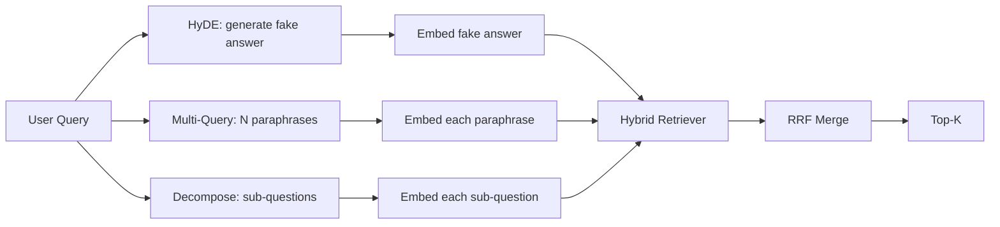

# 查询重写:HyDE、多查询和分解

> A consulta de usuário não é a que o seu pesquisador quer. Reescrever compensa a diferença anterior à pesquisa, de modo que o conteúdo que o índice vê é mais próximo da resposta.

**Type:** Build
**Languages:** Python
**Prerequisites:** 第 11 阶段课程 04（嵌入）、06（RAG）；第 19 阶段 Track B 基础（第 20-29 课）；第 19 阶段第 64 和 65 课
**Time:** ~90 分钟

## Objectivo de aprendizagem
- 实现假设文档嵌入 (HyDE): gerar um falso resposta, embutida, em função desse veículo em vez de um veículo de consulta para fazer pesquisa.
- 实现多查询扩展: tornar uma consulta reescritura para N个释义, cada uma revisão, através de um número de fases de concentração, concentração e concentração.
- 实现查询分解:将复杂问题分为子问题,按子问题检索,合并──
- Compare os resultados de três autores em uma competição,并解释每种策略何时获胜──
-                                                                                                                                                                                                                                                               

## 问题

Um documento no seu livro de texto diz: AbortMultipartOnFail vai suspender o S3 segmentado de upload, e reduzir o orçamento de reexame de cada balde quando o upload falha. Não há palavras comuns para o questionamento e o documentário.

修复方法在查询触及检索器之前重写查询. 2023年论文 Precise Zero-Shot Dense Retrieval without Relevance Labels(Gao 等人) introduziu HyDE: Requirements LLM 编写一篇能回答查询的文档,嵌入这个假设文档,并将其嵌入用于检查向量.

两种近亲技术与HyDE相结合――多查询扩展(Use Microsoft's GraphRAG 术语) gerar uma consulta de N 个释义并检索每个释义,然后合并――分解(em 2024 Stanford DSPy 工作中流行为子查询分解) O nosso time vai fazer o que vai acontecer quando a transmissão falhar e o orçamento acabar:

Este curso irá realizar estes três projectos e executá-los em função da mesma base de linguagem fixa.

## 概念



### HyDE 详细信息

HyDE Utilizando LLM 编写的假设文档向量替换用户的查询向量──提示很短:

```
You are a domain expert. Write a one-paragraph passage that answers the question
below. Use the same vocabulary and phrasing the documentation in this domain would
use. Do not refuse. Do not say you do not know.

Question: {user_query}

Passage:
```

A resposta do LLM como resposta ao facto é errada, porque o LLM não sabe o seu material de texto. É bom. O pesquisador não se preocupa com a verdade, apenas com o token de distribuição.

Na produção, você vai limitar o arquivo de hipóteses para duas a três frases. As hipóteses mais longas vão coletar mais ruído. As palavras mais curtas vão perder o sinal de palavras necessário para HyDE.

### Dois inquéritos

O que é o mais simples de um usuário:

```
Rewrite the following question in {N} different ways. Each rewrite must preserve
the original intent. Number them 1 to {N}. Do not add explanations.
```

检索每个释义的顶-k――将 N个排名列表与RRF 合并((与第65 课中的算法相同) ∼廉价、并行、确定性──

Quando a frase do usuário é uma das muitas maneiras igualmente eficazes de fazer perguntas, muitas consultas ganham e qualquer reescritura é melhor. Quando todas as reescrituras são igualmente ruins, falham, porque a versão original é tão ruins.

### 详细分解

单一检索不能满足多方面的问题――分解要求 LLM 将问题拆成子问题,系统再检索每个子问题――提示:

```
The following question may require information from multiple distinct topics.
Decompose it into a list of sub-questions. Each sub-question must be answerable
independently. If the question is already atomic, return it unchanged.

Question: {user_query}
```

检索每个子问题――合并―― Para o problema de conter palavras-chave, mais de palavras comparadas ou dois temas não relacionados, a descomposição é um instrumento correto.

### Porque existem estas três coisas?

O sistema de produção opera estas três estratégias, e para cada consulta seleciona estratégias adequadas (§ 69).

## 模拟 LLM

O curso é realizado offline. O LLM é um pequeno formulário de pesquisa para consulta de usuários, bem como um formulário de pesquisa para consulta de usuários que não foram encontrados.

- 对于每一个固定 查询:书面假设段落、三个释义和分解结果──
- 对于未知查询:确定性转换: obter o conteúdo da consulta, através da mesma palavra-chave, mapear para expandir, e depois retornar o resultado.

A forma da simulação é importante, não os dados. Durante a produção, você vai substituir a simulação pelo modelo real.


```figure
cd-hyde-vector
```

## Construí-lo

`code/main.py`实现:

- `MockLLM`- A definição acima é substituída.
- `HyDERewriter`- 调用LLM编写假设文档,将重写机输出返回为`RewriteResult`, que contém textos e análises de quesitos que devem ser utilizados.
- `MultiQueryRewriter`- 调用LLM进行N个释义, retornar à lista de consultas
- `DecomposeRewriter`- 调用LLM para fazer a desintegração, retornar o problema.
- `retrieve_with_rewriter`- 采用重写机和检索机,运行重写,融合结果──
- Uma demonstração, em fixação, executar três redescrevedores e imprimir qual estratégia primeiro retornar o documento.

重复使用第 65 课中的检索器形状(混合 BM25 + dense) ・・・融合 ainda é o mesmo RRF。 único novo formato é a interface do gravador, é muito pequeno。

- Não .

```bash
python3 code/main.py
```

输出是每个策略的排名和最终摘要―― HyDE 获胜在措辞不匹配的查询中. 更多查询在释义方差查询中. 获胜在多主题查询中. 解散在多主题查询中. 获胜在多主题查询中. 后备方案 (无重写机) 失败在至少三中之一中.

## 演示将隐藏的故障模式

**HyDE 对语料库特定标识符的幻觉是错误的。**O modelo inventou um nome de função. Em seguida, o modelo de desenvolvimento de um modelo de desenvolvimento de um modelo de desenvolvimento de um modelo de desenvolvimento de um modelo de desenvolvimento de um modelo de desenvolvimento de um modelo de desenvolvimento de um modelo de desenvolvimento de um modelo de desenvolvimento de um modelo de desenvolvimento de um modelo de desenvolvimento de um modelo de desenvolvimento de um modelo de desenvolvimento de um modelo de desenvolvimento de um modelo de desenvolvimento de um modelo de desenvolvimento de um modelo de desenvolvimento de um modelo de desenvolvimento de um modelo de desenvolvimento de um modelo de desenvolvimento de um modelo de desenvolvimento de um modelo de desenvolvimento de um modelo de desenvolvimento de um modelo de desenvolvimento de um modelo de desenvolvimento de desenvolvimento de um modelo de desenvolvimento de desenvolvimento de um modelo de desenvolvimento de desenvolvimento de um modelo de desenvolvimento de desenvolvimento de um modelo de desenvolvimento de desenvolvimento de um modelo de desenvolvimento de desenvolvimento de um modelo de desenvolvimento de desenvolvimento de um sistema de desenvolvimento de desenvolvimento de um sistema de desenvolvimento de desenvolvimento de projetos de desenvolvimento de projetos de desenvolvimento de projetos de desenvolvimento de projetos de desenvolvimento de projetos de desenvolvimento de desenvolvimento de projetos de desenvolvimento de desenvolvimento de desenvolvimento de projetos de desenvolvimento de desenvolvimento de desenvolvimento de desenvolvimento de desenvolvimento de desenvolvimento de desenvolvimento de desenvolvimento de desenvolvimento de desenvolvimento de desenvolvimento de desenvolvimento de desenvolvimento de desenvolvimento de desenvolvimento de desenvolvimento de desenvolvimento de desenvolvimento de desenvolvimento de desenvolvimento de desenvolvimento de desenvolvimento de desenvolvimento de desenvolvimento de desenvolvimento de desenvolvimento de desenvolvimento de desenvolvimento de desenvolvimento de desenvolvimento de desenvolvimento de desenvolvimento de desenvolvimento de desenvolvimento de desenvolvimento de desenvolvimento de desenvolvimento de desenvolvimento de desenvolvimento de desenvolvimento de desenvolvimento de desenvolvimento de desenvolvimento de desenvolvimento de desenvolvimento de desenvolvimento de desenvolvimento de desenvolvimento de desenvolvimento de desenvolvimento de desenvolvimento de desenvolvimento de desenvolvimento de desenvolvimento de desenvolvimento de desenvolvimento de desenvolvimento de desenvolvimento de desenvolvimento de desenvolvimento de desenvolvimento de desenvolvimento de desenvolvimento de desenvolvimento de desenvolvimento de desenvolvimento de desenvolvimento de desenvolvimento de desenvolvimento de desenvolvimento de desenvolvimento de desenvolvimento de desenvolvimento de desenvolvimento de desenvolvimento de desenvolvimento de desenvolvimento de desenvolvimento de desenvolvimento de desenvolvimento de desenvolvimento de desenvolvimento de desenvolvimento de desenvolvimento de desenvolvimento de desenvolvimento de desenvolvimento de desenvolvimento de desenvolvimento de desenvolvimento de desenvolvimento de desenvolvimento de desenvolvimento de desenvolvimento de desenvolvimento de desenvolvimento de desenvolvimento de desenvolvimento de desenvolvimento de desenvolvimento de desenvolvimento de desenvolvimento de desenvolvimento de desenvolvimento de desenvolvimento de desenvolvimento de desenvolvimento de desenvolvimento de desenvolvimento de desenvolvimento de desenvolvimento de desenvolvimento de desenvolvimento de desenvolvimento de desenvolvimento de desenvolvimento de desenvolvimento de desenvolvimento de desenvolvimento de desenvolvimento de desenvolvimento de desenvolvimento de desenvolvimento de desenvolvimento de desenvolvimento de desenvolvimento de desenvolvimento de desenvolvimento de desenvolvimento de desenvolvimento de desenvolvimento de desenvolvimento de desenvolvimento de desenvolvimento de desenvolvimento de desenvolvimento de desenvolvimento de desenvolvimento

**多查询重写全部收敛。**弱模型会产生三个几乎相同的释义―― N 次检索返回相同的顶-k―― RRF 合并并不是比单检索好――在重写提示中添加显式多样性指令并通过Jaccard 检测重复项――

**分解过度分割。**O separador transformará o problema atômico em uma lista. Todos os exames retornam ao mesmo arquivo, mas a classificação diminuiu.

**延迟成倍增加。**HyDE 需要花费一次LLM 通话费用──多查询花费一次LLM 调用生成 N 次再写,然后生成 N 次检索──分解需要一次LLM 调用分解,然后进行M 次检索──检索并行进行;LLM 电话是发言权──

## Use-o

Modelo de produção:

- 按查询长度选择每一个查询策略: atom短查询得到多查询,复杂多子句查询得到分解,行话重查询得到HyDE──
- 通过查询哈希缓存重写器输出──许多查询重复──
- E assim, todos os três conjuntos de resultados são executados, e os três conjuntos de resultados são integrados em um, utilizando RRF.

## 发货

O curso 69 irá colocar a fase do redator em frente ao revisor do curso 65 e colocar-a antes do revisor do curso 66 e o revisor do curso 68 irá avaliar o recall do revisor para melhorar o seu processo de recall.

## 练习

1. 实现 RAG-Fusion (多查询的 2024年变体), em que o rewriewer's释义有意多样化, em seguida, re-排序步骤 (第 66 课) seleccionar lista final:
2. 添加第四种策略:step-back prompting(向LLM 问问更一般问题,检索该问题,然后再缩小范围)
3. 通过添加问题是原子的头来训练分解器识别原子查询―― 测量前后的过分率――
4. Utilize o modelo real para substituir o modelo LLM.
5. Para cada reescritura, a porcentagem de confiança é aumentada.

## 关键术语

|术语 |人们怎么说|它实际上意味着什么 |
|------|-----------------|------------------------|
|海德 | “伪造文件检索”| LLM写出答案；嵌入并检索它而不是查询 |
|多查询 | “释义扩展”| N次重写查询；检索N次，按RRF合并|
|分解 | “子查询分割” |多主题查询拆分为子问题，单独检索 |
|原子查询 | “单一主题” |如果不发明假子问题就无法分解 |
|后退一步| “抽象查询”|提出更一般性的问题，检索，然后缩小范围 |

##  weiterlesen

- 高、马、林、Callan,无相关标签精确零样本密集检索(HyDE),2023
- 微软研究院, 检索的多查询扩展
- 斯坦福大学 DSPy,多跳 QA 的子查询分解
- [LlamaIndex 查询转换文档](https://docs.llamaindex.ai/en/stable/optimizing/advanced_retrieval/query_transformations/)
- 第 11 阶段 第 07 课 - 高级 RAG 模式
- 第 19 阶段 第 65 课 - Requisitor fornecido por gravadores
- No 19 阶段 No 68 课 - 测重写器提升的评估
