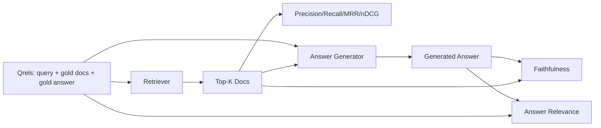

# RAG  avaliação: precisão, recall, MRR, nDCG, fidelidade, resposta

> Se você não puder avaliar simultaneamente a pesquisa e a resposta, não poderá transportar sistemas.

**Type:** Build
**Languages:** Python
**Prerequisites:** 第11期第06课（RAG）、10（评估）；第 19 阶段 Track B 基础（第 20-29 课）；第 19 阶段课程 64, 65, 66, 67
**Time:** ~90 分钟

## Objectivo de aprendizagem
- 根据黄金 qrel 计算四个检索指标: precision@k、recall@k、MRR(平均倒数排名) e nDCG@k。
- 計算兩答案等级指标: fidelidade (cada proposta é baseada na pesquisa feita) e correlação (resposta resolvida)
- Construir um documento de avaliação 端到端读取的固定 qrels 文件(查询、黄金文档 ID、黄金答案文本) 
- 读取 读取 读取 读取 读取 读取 读取 读取 读取 读取 读取 读取 读取 读取 读取 读取 读取 读取 读取 读取 读取 读取 读取 读取 读取 读取 读取 读取 读取 读取 读取 读取 读取 读取 读取 读取 读取 读取 读取 读取 读取 读取 读取 读取 读取 读取 读取 读取 读取 读取 读取 读取 读取 读取 读取 读取 读取 读取 读取 读取 读取 读取 读取 读取 读取 读取 读取 读取 读取 读取 读取 读取 读取 读取 读取 读

## 问题

RAG  sistemas há pelo menos quatro partes ativas: separador, pesquisador, reorganização, gerador. Qualquer uma delas pode levar a respostas erradas.

O usuário relata erro de resposta. É porque o bloco de segmentação interrompeu a resposta? É porque o pesquisador não colocou o pedaço em cima-k? É porque o pesquisador colocou o pedaço correto em primeiro lugar? É porque o gerador negligenciou o pedaço e criou o conteúdo? É apenas com a resposta que não se pode julgar. Você precisa:

- Indicador de pesquisa, utilizado para avaliar os resultados do pesquisador.
- A classificação dos indicadores é feita para avaliar a posição dos blocos corretos na ordem.
- 忠实地对生成器是否停留在检查到的上下文进行评分──
- A correlação entre as respostas e as avaliações resolveu-se completamente o problema.

Este curso é fixado em documentos que construem todos os seis indicadores. A avaliação é offline e determinante; na produção, você vai colocar um juiz de LLM em simulação para um juiz real.

## 概念



### 精度@k

Se o ouro tem 3 arquivos, e o top 3 retornar dois dos arquivos e um arquivo erróneo, então precisão@3 é 2 / 3。 Quando o custo do bloco de pesquisa não relacionado é muito alto, o gerador perdeu um token sobre ele, ou o bloco destruiu a resposta), por favor use precisão。

### recall@k

Se o ouro tem 3 arquivos e o top 5 contém todos esses três arquivos, então recall@5 é 1.0♦ Quando o custo da resposta é muito alto, use o recall(

Na produção RAG, o indicador geralmente citado é recall@k;; gerar pode facilmente remover blocos não relacionados; não pode criar respostas a partir de blocos que nunca viu.

### MRR(平均倒数排名)

 Para cada consulta, encontrar a primeira posição de documentos relacionados na lista de rankings.  O número de reversões da classificação é de 1/ posição.  O valor médio de todo o conjunto de perguntas.

MRR sobre o peso da posição 1 é muito grande.

### nDCG@k

標準化贴现累积收益──完整公式为每检索到的文档分配增益──通常为 1表示相关,0表示不相关), baseando-se no número de opções de desconto, procura和, e depois subtrai-se do DCG ideal.

NDCG 适应分级相关性:黄金可以说文档 A 是 3,文档 B 是 2,文档 C 是 1──MRR 和recall@k 将所有内容平化为二进制──当语料库每查询有多部分相关文档时,请使用nDCG──

### 忠诚

Para cada declaração da resposta gerada, verifique se a seguinte secção acima da solicitação apoia a declaração.

A fidelidade captura o modelo de desenvolvimento de conteúdo do gerador de falhas. Mesmo que o pesquisador retorne o bloco correto, o gerador de ilusão também ficará danificado.

Este curso, através de um julgamento de determinação simulada para alcançar a fidelidade, deve examinar se o token de cada declaração é igual ao valor de sobreposição da pesquisa anterior.

### 答案相关性

答案是否真正解决问题?忠诚问答案是否基于上下文?──答案相关性问答案是否基于问题?──答案一个忠诚但偏离主题的答案在忠诚方面得分高,在相关性方面得分低──一个简短的题,切题的答案在相关性方面得分高,但在忠诚方面得分低──标准实现也使用M作为判断:

## Ferramentas

```python
{
  "qid": "q1",
  "query": "what is the abort threshold for multipart uploads",
  "gold_doc_ids": ["d1", "d3"],
  "gold_answer_substring": "three failed parts",
  "graded_relevance": {"d1": 3, "d3": 2},
}
```

Cada consulta leva consigo:
- - Não.
- Identificação de identidade de ouro (ID) utilizada para precisão/recurso/MRR,
- 分级相关性字典 (→ NDCG)
- 黄金答案字串(como referência de cada qrel de dados de conservação; a fidelidade nesta classe é através de base de pesquisa acima e abaixo em vez de estas filamentas para julgar a retirada de declarações para calcular) ⋅

Durante a produção, você pode fazer estes eventos. Este curso fornece um conjunto de construção manual, portanto, a avaliação pode ser feita de forma imediata.


```figure
ci-rag-metric-ladder
```

## Construí-lo

`code/main.py`实现:

- `precision_at_k(retrieved, gold, k)`- 字面定义──
- `recall_at_k(retrieved, gold, k)`- 字面定义──
- `mean_reciprocal_rank(retrieved_list_of_lists, gold_list)`- Valor médio da consulta:
- `ndcg_at_k(retrieved, graded_relevance, k)`- DCG/IDCG                                                                                                                                                                                                                                                                                                                                                                                                                                                                                                                        
- `extract_claims(answer)`- A resposta deve ser dividida em formas de frase.
- `faithfulness(claims, context_texts, judge)`- Parte da reivindicação que foi apoiada
- `answer_relevance(question, answer, judge)`- 判断答案是否解决问题──
- `MockJudge`- a determinação dos tokens de avaliação, a fim de avaliar a operação;
- `evaluate_pipeline(pipeline_fn, qrels, ks)`- 运行每个指标的协调器──
- 针对 qrel 运行三种管道变体(分块基线、混合检索、混合 + 重新排名)并印标签的演示──

- Não .

```bash
python3 code/main.py
```

输出显示单指标中每个变体的精度@k、recall@k、MRR、nDCG@k、忠诚度和答案相关性──混合检索行在召回方面击败分块器基线;重新排序在MRR上击败混合行──

## 读取标志来诊断故障

|症状|可能的原因 |修复什么问题 |
|---------|-------------|-------------|
|低召回率@k，低精度@k |分块剪切答案或检索器找不到它 |分块边界（第 64 课）或检索器模态（第 65 课） |
|不错的召回率@k，低 MRR |右块位于 top-k 中但不在位置 1 |重新排序（第 66 课）|
|高MRR，低忠诚度|尽管上下文正确，生成器仍然发明内容 |生成提示；强制引用或拒绝 |
|忠诚度高，相关性低 |答案有根据但偏离主题 |查询重写器（第 67 课）或生成提示 |
|均四高，用户仍抱怨|评估集不具有代表性 |使用真实用户查询扩展 qrels |

## 演示将隐藏的故障模式

**LLM-as-judge 偏差。**模型判断自己的输出时,往往会认为它比实际情况更忠实―― usar uma série de modelos diferentes do gerador para julgar, ou fazer uma classificação manual sobre a amostra―

**Qrel 腐烂。** Com a mudança da base de linguagem, a resposta do ouro também mudará―                                                                                                                                                                                                                                                     

**忠诚度微观检查错过了宏观声明。**A fidelidade de cada frase pode ser aprovada, enquanto a estrutura da resposta geral produzir erros.

**Recall@k 掩盖了每个查询的失败。**A taxa média de retorno de 90% pode ocultar uma pergunta em um caso de perda geral.

## Use-o

Modelo de produção:

- Para cada testeador ou gerador de mudanças de execução avaliação.
- Mantém um indicador de cada consulta, quando o usuário se queixar, procure um código de código correspondente, veja se ele será capturado.
- Para o Qrel  realizar em diferentes camadas: 20 colunas de fumos de inquéritos que operam no CI; 200 colunas de regresso que operam por noite; 2000 colunas de inquéritos que operam por semana.

## 发货

Seção 69 - Conectar todo o tubo (分块器、检索器、重排器、生成器), e direcionar este sistema de execução de avaliação de fim em fim.

## 练习

1. Adicionar o quinto índice de pesquisa: hit-rate@k。将其与recall@k 进行比较──当它们不同时进行解释──
2. 实行分级忠诚度:0(不支持) 、1(部分支持) 、2(完全支持) ∼相应地更新标标─
3. Usar modelos reais para usar os modelos de julgamento.
4. 添加查询类片(字面、释义、多主题) 报告──每片标──
5. 添加答案长度标标并将其与忠诚度相关联──绘曲线──

## 关键术语

|术语 |人们怎么说|它实际上意味着什么 |
|------|-----------------|------------------------|
|精度@k | “命中率超过检索” | top-k 中黄金的比例 |
|recall@k | “命中了 gold 吗”| top-k 中包含 gold chunk 的比例 |
| MRR | “第一击位置”| 1 的平均值/第一个相关文档的排名 |
| nDCG@k | “分级排名质量”| top-k 上的 DCG 除以理想 DCG |
|诚信| “接地气” |检索到的上下文支持的答案声明的比例 |
|答案相关性 | “它解决了这个问题吗？” |答案是否符合问题的意图 |
|问题 | “金标”|带标签的查询集及其黄金文档和答案 |

##  weiterlesen

- Buckley, Voorhees, avaliação avaliação de medidas de estabilidade,SIGIR 2000 - 关于排名指标的规范论文
- Jarvelin、Kekalainen,IR 技术的基于累积增益的评估 - nDCG 论文
- [Ragas：RAG 管道的自动评估](https://docs.ragas.io)
- [人择，评估 RAG](https://www.anthropic.com/news/evaluating-rag)
- 第 11 阶段 第 10 课 - 评估框架基础
- 第 19 阶段课程 64-67 - 处评估组件
- No 19 阶段 第 69 课 - 本次评估评分的端到端管道
