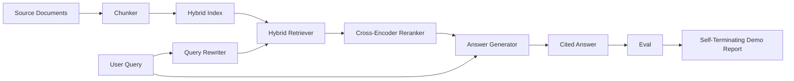

# 端到端 RAG 系统

> 组件的六课――一根管道――一评估循环――一自动终止的演示――这是您交付的系统――

**Type:** Build
**Languages:** Python
**Prerequisites:** 第11期第06课（RAG）、10（评估）；第 19 阶段 Track B 基础（第 20-29 课）；第 19 阶段课程 64, 65, 66, 67, 68
**Time:** ~90 分钟

## Objectivo de aprendizagem
- A partir de então, o sistema de análise de dados pode ser utilizado para a análise de dados.
- 实现一个答案生成器,通过块点引用其声明,并具有低信任性拒绝回归功能──
-  Avaliação da aplicação do n.o 68 de um bom conjunto de tubos, e demonstração de que as fases de construção em cada indicador são melhores do que os componentes individuais.
- Construir uma demonstração de CLI de encerramento automático, que captará uma base de linguagens fixas, executará um conjunto de consultas fixas e irá retomar o relatório de resumo.

## 问题

Os seis componentes isolados não podem provar nada. O reprogramador pode ser usado em recall@5 mas não pode ser usado em recall@5 do sistema, pois o reprogramador não pode classificar o conteúdo do reprogramador. O reprogramador pode aumentar o MRR no conjunto de candidatos, mas não pode tratar os candidatos de um real duplo programador, porque o recalque do duplo programador é muito baixo. O reprogramador pode aumentar o documento de ouro em uma única consulta e interromper a próxima consulta, porque o LLM simula a hipótese de regresso de regresso.

O teste de integração é um conjunto de tubos para executar o mesmo dispositivo de ponta a ponta, com o mesmo indicador, e usando um arquivo de redirecionador que conectará todos os conteúdos juntos. Este é o conteúdo desta aula. Se o indicador do tubo de integração for superior ao indicador de demonstração independente de cada fase, você já provou o sistema.

## 概念



### 接线选择

O tubo é um pequeno quadro. Cada fase é uma função com uma assinatura clara.

|舞台|输入|输出|
|-------|-------|--------|
|块块|文档正文 |块记录列表 |
|检索器 |查询字符串 | Top-N chunk 记录 |
|重写器（可选）|查询字符串 |重写列表+假设|
|重新排序 |查询，候选人 |带有交叉分数的 Top-K 块记录 |
|发电机|查询，top-K Chunk 记录 |带有引文的答案字符串 |

Quando cada assinatura está estável, a combinação é muito simples.`Pipeline`O grupo contém cinco fases e os seus movimentos em ordem.`query`方法── cada fase é intercambiable: entre diferentes blocos, detectores, reescritores, re-re-registores ou geradores, os tubos ainda podem funcionar──

### 带引文的答案生成器

O gerador de eletrônicos é o último, também o mais fácil de danificar.

1. 取出前 K 个重新排序的块──
2. O máximo de escolha de dois textos contendo o maior nível de pesquisa de sobreposição de blocos de tokens de conteúdo.
3. Emite uma resposta, a resposta é a ligação de uma frase de cada bloco selecionado, cada frase depois de uma.`[doc_id:chunk_index]`- Não.
4. Se não houver blocos sobrepostos acima do valor de rejeição, então é emitido 我不知道且不带引用──

Na produção, você pode usar um modelo de sugestão para substituir para um verdadeiro LLM:

```
You are answering a question using only the snippets below.
Cite every claim with the anchor in parentheses.
If the snippets do not answer the question, say "I do not know".

Question: {query}

Snippets:
{enumerated chunks with anchors}

Answer:
```

O caminho de rejeição de baixa confiança é a razão total para a classificação de um codificador registado em 1 por cento. Se for inferior ao valor da base de texto, o gerador irá rejeitar.

### Desde o fim da apresentação

A demonstração imprime todos os conteúdos de um ponto a outro. Imprime uma consulta em cada fase, em quatro pontos fixos, uma avaliação de execução, uma lista de indicadores, se todos os indicadores da secção 68 estiverem em conformidade com o valor definido na demonstração, o resultado é zero.

Esta é a forma de CI 冒烟测试. O sistema de fluxo de corrente de corrente é intencionalmente rigoroso, por isso qualquer regresso de uma das seis partes do curso conduzirá ao fracasso da demonstração.


```figure
rag-pipeline-flow
```

## Construí-lo

`code/main.py`实现:

- `Chunk`- 穿穿所有阶段的记录 (se utilizar o chunk_index e o doc_id 扩展第 64 课的形状) ⋅
- `Chunker`- From第 64 课中选择策略 (definição de um método de selecção)
- `HybridIndex`- 捆绑 BM25 + 密集 + RRF de partir do § 65 课――
- `Rewriter`(可选) - De acordo com a existência de um termo de duração e de ligação, escolha HyDE,多查询,分解之一, do n.o 67 do curso.
- `Reranker`- 第 66 课中训练过的交叉编码器, usando um conjunto de treinamento mais pequeno, por isso pode ser recebido em poucos segundos.
- `Generator`- gerador de simulação de determinação com referência e baixa confiança
- `Pipeline`- Use-Back `Result(answer, top_k, latency_ms_per_stage)`de `query(question)`方法组成五个阶段──
- `run_demo()`- 摄取语料库,运行三个 fixture 查询,运行评估,印结果,并按值设置退出代码──

- Não .

```bash
python3 code/main.py
```

输出是一段印印的查询追踪、完整评估表和最终通过/失败状态──在默认 fixture上返回退出代码 0──

## 演示将隐藏的故障模式

**分块器边界漂移。**Se você trocar entre o processo de avaliação de tokens e a demonstração de estratégias de blocos, o ID do documento de ouro não será re-arrelado.

**Reranker 训练集泄漏到 eval 中。**O treino de três grupos de 14 do curso 66 inclui uma consulta semelhante à consulta de avaliação.

**模拟生成器隐藏了幻觉风险。**O modelo não pode produzir ilusões, pois só sai do bloco de pesquisa até a publicação do texto.

**无流式传输。**O tubo retornará à resposta completa no final de cada fase. O sistema de produção irá transmitir as saídas das máquinas e dos motores.

**延迟是离线的。**模拟 LLM 调用是恒定时间──真正的LLM电话占主导地位──在请求范围内规划延迟预算;本课程的每阶段计时时仅仅测 CPU 工作──

## Use-o

Modelo de produção:

- O arquivo do tubo será enviado para um redator com uma interface de fase definida.
- Em cada fase envolvida, a avaliação é executada antes da conclusão. Se a avaliação for baixa, a conclusão não será realizada.
- Manter um seguimento dos indicadores de cada operação de CI, para que possa regressar ao seu período de troca.
- Adicione 20 sub-conjuntos de fumos de consulta (recurso de ensaios), tempo de execução não excede 30 segundos; recurso completo de ensaios de ensaios de ensaios por noite.

## 发货

O documento de tubulação deste curso é a forma adotada pela restante parte do curso do curso do trecho F. O curso seguinte será adicionado à automação de captação, ao aumento de índices, à remoção e ao nível de serviço superior.

## 练习

1. Em redescritor adicionar cada consulta estratégia selector: 第 67 课的启发式 (长度,连词,行话比例)
2. Em env 标志后面添加对生成器的真正 LLM 调用──默认为模拟──测量延迟增量──
3. Expansão de demonstrações para obter cargas de material de linguagem real`--corpus path`标志──重新运行评估和值检查──
4. Para fazer um bloco de papel`--strategy`标志── medir a contribuição de cada estratégia para o recall de fim em fim──
5. Adicionar o fluxo gerador de interface e inserir-o no eval.

## 关键术语

|术语 |人们怎么说|它实际上意味着什么 |
|------|-----------------|------------------------|
|管道| “RAG 管道”|从摄取到引用答案的撰写阶段|
|引文锚| “来源链接” |每个声明附加的 (doc_id, chunk_index) 引用 |
|低置信度拒答| “我不知道” |当重排器 top-1 分数低于阈值时，生成器不返回答案 |
|smoke set | “CI 评估”|每次 PR 检查中运行的最小 qrels 子集 |
|阶段接口| “函数签名”|各个管道阶段的稳定输入输出类型 |

##  weiterlesen

- [人择、建筑搜索与检索](https://www.anthropic.com/news/contextual-retrieval)
- [Pinterest，MCP 内部搜索](https://medium.com/pinterest-engineering)- 参考生产架构
- [Ragas：RAG 管道的自动评估](https://docs.ragas.io)
- 第 11 阶段 第 06 课 - RAG 基础知识
- 第 19 阶段课程 64-68 - 组成组件
