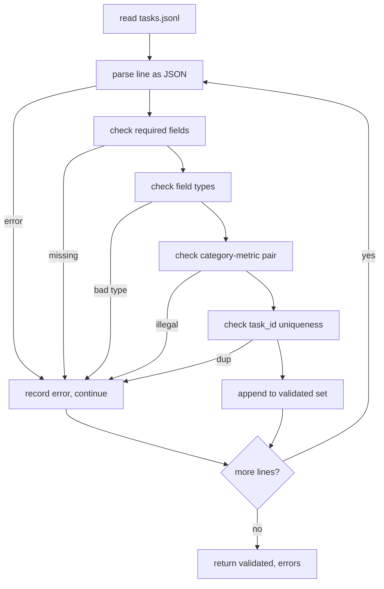

# 任务规范格式

> 评估安全带的好坏取决于其任务执行的合同―― Antes de escrever uma única função de avaliação, por favor, junte-se a JSONL 形和量词汇――

**Type:** Build
**Languages:** Python
**Prerequisites:** 19期B轨地基
**Time:** ~90 分钟

## Objectivo de aprendizagem


```figure
ci-task-spec-gate
```

-  define um JSONL  missão de registro de padrão, em uma forma que compreende o cálculo, vários tipos de seleção, código de execução, categorias e libertas.
- 固定量名称的封闭词汇表, de modo que o curso de baixa frequência (71-73) possa ser dividido em um único parágrafo.
- A menor quantidade de amostras e regras de processamento posterior são designadas como parte da tarefa, em vez de parte do corredor, portanto, a mesma dica gerará o mesmo objetivo entre os modelos.
- Implementar um verificador rigoroso, rejeitando o registro de erros de formato até que o operador chegue.
- Publicar um conjunto de fichas contendo 10 missões, para cada ramo da norma de teste, para que o verificador tenha algo real que possa──

## Por que é que é que temos de resolver as regras?

A velocidade do estudo de código de cálculo é mais rápida do que a velocidade do teste de cálculo.

Esta forma leva em conta a ideia de BIG-bench、HELM 和 lm-eval 风格线束, mas o seu nome é nosso.

## 记录形状

任务是单行上的 JSON对象──线束读取 `tasks.jsonl`Não é possível que o registro seja interrompido, mas não executado.

```json
{
  "task_id": "arith_001",
  "category": "arithmetic",
  "prompt": "Compute the result. Question: 17 + 24\nAnswer:",
  "targets": ["41"],
  "metric_name": "exact_match",
  "few_shot_examples": [
    {"prompt": "Question: 2 + 2\nAnswer:", "completion": "4"}
  ],
  "post_process": "strip_whitespace",
  "metadata": {"difficulty": "easy"}
}
```

necessariamente`task_id`- Não.`category`- Não.`prompt`- Não.`targets`- Não.`metric_name`- Não.`post_process`- Não.`few_shot_examples`和 `metadata`É possível escolher.

## 字段规则

`task_id`É uma cadeia sem espaço. O verificador força a unificação de todo o arquivo.

`category`Sim `arithmetic`- Não.`mcq`- Não.`code_exec`- Não.`classification`- Não.`summary`之一── esta categoria limita qual medida e tratamento posterior é legal── para o objetivo de letra única,`code_exec`任务必须使用 `metric_name = code_exec`- Não .`mcq`任务必须使用 `metric_name = exact_match`- Não.

`prompt`É um código não-caído. O testador proíbe o controle de espaço e rejeita a indicação de que o texto original contém um pequeno número de blocos de imagem.

`targets`É uma lista de caracteres não-caídos.`exact_match`, qualquer elemento correspondente é considerado.`f1`和`rouge_l`, o maior gol de vitória.`mcq`, lista contém apenas um elemento:

`metric_name`Sim `exact_match`- Não.`f1`- Não.`bleu_4`- Não.`rouge_l`- Não.`accuracy`- Não.`code_exec`之一──词汇是封闭的──新标需要新教训和新条例──

`few_shot_examples`Sim `{prompt, completion}`Para a lista de testes, a lista será limitada a oito artigos, para a limitação de sugestões.

`post_process`Sim `none`- Não.`strip_whitespace`- Não.`lower`- Não.`extract_letter`- Não.`extract_code_block`- Não.`extract_first_line`之一── cada regra tem um comportamento de determinação──verificador proibição de conjunto

## 验证器 comportamento



O verificador retorna duas listas: registros verificados e registros de erros, que contêm infrações de regras e erros. Se a lista de erros não estiver vazia, o operador recusa a inicialização, a menos que se configure um código.`--allow-bad-tasks`- Não.

## Minha visão

O corredor irá mostrar que alguns exemplos anteriores estão conectados a um segmento de dados em aberto. Cada modelo funciona com o mesmo código, portanto, a única diferença é a origem do modelo em si.

```python
def render(task):
    parts = []
    for ex in task.get("few_shot_examples", []):
        parts.append(ex["prompt"] + " " + ex["completion"])
    parts.append(task["prompt"])
    return "\n\n".join(parts)
```

## 后处理规则

后处理步骤在生成后、指标之前运行── é de determinação e de estado não-estado──

- `none`返回字符串不变──
- `strip_whitespace`Para que não se esqueça de fazer isso.
- `lower`- Não, não.
- `extract_letter`返回与 `[A-E]`匹配的第一个字符, para MCQ.
- `extract_code_block`返回第一个三重反引号隔离块主体, para execução do código
- `extract_first_line`返回第一非空行, para o cálculo do valor do valor do valor do valor do valor do valor do valor do valor do valor do valor do valor do valor do valor do valor do valor do valor do valor do valor do valor do valor do valor do valor do valor do valor do valor do valor do valor do valor do valor do valor do valor do valor do valor do valor do valor do valor do valor do valor do valor do valor do valor do valor do valor do valor do valor do valor do valor do valor do valor do valor do valor do valor do valor do valor do valor do valor do valor do valor do valor do valor do valor do valor do valor do valor do valor do valor do valor do valor do valor do valor do valor do valor do valor do valor do valor do valor do valor do valor do valor do valor do valor do valor do valor do valor do valor do valor do valor do valor do valor do valor do valor do valor do valor do valor do valor do valor do valor do valor do valor do valor do valor do valor do valor do valor do valor do valor do valor do valor do valor do valor do valor do valor do valor do valor do valor do valor do valor do valor do valor do valor do valor do valor do valor do valor do valor do valor do valor do valor do valor do valor do valor do valor do valor do valor do valor do valor do valor do valor do valor do valor do valor do valor do valor do valor do valor do valor do valor do valor do valor do valor do valor do valor do valor do valor do valor do valor do valor do valor do valor do valor do valor do valor do valor do valor do valor do valor do valor do valor do valor do valor do valor do valor do valor do valor do valor do valor do valor do valor do valor do valor do valor do valor do valor do valor do valor do valor do valor do valor do valor do valor do valor do valor do valor do valor do valor do valor do valor do valor do valor do valor do valor do valor do valor do valor do valor do valor do valor do valor do valor do valor do valor do valor do valor do valor do valor do valor do valor do valor do valor do valor do valor do valor do valor do valor do valor do valor do valor do valor do valor do valor do valor do valor do valor do valor do valor do valor do valor do valor do valor do valor do valor do valor do valor do valor do valor do valor do valor do valor do valor

需要本列表以外的规则的任务属于新课程──

## 本课不做什么

Não é necessário que o código seja aplicado. Não é necessário que o código seja aplicado.

10 个任务 fixture 覆盖两个算术项,两个 MCQ项,两个代码执行项,两个分类项和两个摘要项,验证器通过所有10条规则,一个单独的 fixture (`tasks_bad.jsonl`) irá tocar cada regra, e o número de erros que o verificador retorna é exactamente o mesmo que estes erros.

## Como é que o meu nome é "Codex"

`main.py`Definindo`TaskSpec`- Não.`validate_task`- Não.`validate_file`E o CLI é o ponto de entrada.`load_fixtures`染和后处理辅助员 位于验证逻辑旁边, portanto, o corredor da 75a classe só precisa importar um único módulo

De cima para baixo`main.py`然后读取 `code/tests/test_spec.py` A avaliação fixa cada regra de avaliação e cada comportamento de tratamento posterior.`main.py`Apresentação do fundo da prova de um conjunto de fichas e a impressão de resumos.

## Mais adiante

O real conjunto de avaliação é o de um padrão de crescimento de uma coluna de classes. A mudança é a de um padrão de crescimento de classes. A mudança é a de um padrão de avaliação.
