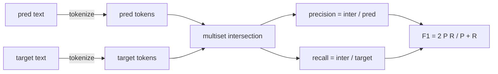
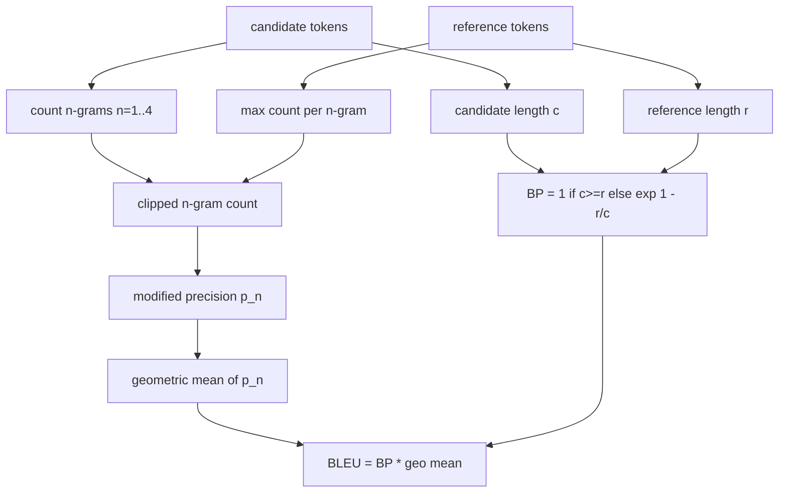

# 经典指标

> BLEU、ROUGE-L、F1、 Precisamente correspondência、 Precisação rate。 Cinco indicadores ainda ocupam a maioria dos números de avaliação de LLM já publicados。 Desde o princípio da primeira sexualidade, cada indicador é realizado, assim você só sabe o significado dos números。

**Type:** Build
**Languages:** Python
**Prerequisites:** 第 19 期 Track B 基础，第 70 课
**Time:** ~90 分钟

## Objectivo de aprendizagem


```figure
cd-bleu-overlap
```

- 通過明确的符号化规则实现符号级精确匹配、F1 和准确性──
- Desde o início  implementação BLEU-4: Modificação n 元语法精度, n de geometria média igual a 1 a 4,简洁性损失──
- Utilizando a maior sequência pública e a combinação F-beta de precisão e recorrência para realizar ROUGE-L.
- 调度第 70 课中的 metric_name 字段, para que o cursor mantenha o seu estado de indicado
- Utilização de modelos de trabalho em vez de de referências de terceiros para o comportamento fixo.

## Por que re-realizar

Você vai ler o relatório de BLEU 28.3 e outro relatório de BLEU 0.283 papers. Você vai encontrar duas bibliotecas de ROUGE-L divisão diferença de 10 por cento, porque uma biblioteca interrompe para escrever pequeno, e outro livro não interrompe. O método mais rápido de parar a mistura é auto-editar índice, e então se direcionar para a linha e aplicação de planejamento do determinotófono. Depois, os números entre as publicações de comparação tornam-se apenas um problema de configuração de quantidade de leitura, em vez de debater bibliotecas.

A F1 é um conjunto de tokens. A parte mais difícil é selecionar tokens e esforçar-se para isso.

## Tokenization

O que é que é ?`re.findall(r"\w+", text.lower())`──小写,保留连续的单词字符(字母、数字和下划线), eliminar todos os outros caracteres──每个标标识都使用这个精确的分词器──runner没有选择权──如果您交换分词器,您将运行不同的基准测试──

```python
TOKEN_RE = re.compile(r"\w+", re.UNICODE)
def tokenize(text):
    return TOKEN_RE.findall(text.lower())
```

É uma simplificação intencional. A configuração de produção será preocupada com o CJK, abreviatura e identificador de código. O ponto fundamental desta aula é que o gerador de tokens é um conjunto, e não um roteiro.

## 精确匹配

```python
def exact_match(pred, targets):
    return float(any(pred.strip() == t.strip() for t in targets))
```

Cada tarefa retorna a 1.0 ou 0.0;; a concentração do conjunto de dados é o valor médio;; é a força principal do cálculo, MCQ e tarefas de classe curta;;

## F1

 Configuração para previsão e metas de tokens múltiplos clusters── precisão é múltiplos clusters de divisão de previsão de múltiplas clusters── taxa de convocação é a mesma de divisão de múltiplas clusters de metas── F1 é o ajuste e o valor médio── deve ser realizado para tratar de空预测和空目标边缘情况──



Para as tarefas multi-objectivos, nós escolhemos a melhor F1 na lista de objetivos. Isto é em conformidade com o comportamento do SQuAD, amplamente relatado na literatura.

## BLEU-4

O BLEU é um indicador de tradução automática de normas, que ainda aparece no trabalho de resumo. A fórmula que usamos é o BLEU-4, de categoria de frase, para cada previsão e referência a divisão de frações, com padrões de simplificação e para o número de n 元语法计数 posteriores a modificações.

Para cada candidato-referência, nós contamos a n igual a 1、2、3、4 horas de precisão de gramática após a modificação. A precisão de modificação é efetuada através de qualquer referência.



A regra do planeamento é o método que Lin 和 Och diz: antes de tomar o número, adicionar 1 a cada n elementos de moléculas e divisórias de precisão. Quando se cita 4 gramas não correspondentes e não se mantém perto do valor desbalançado do candidato, isso pode ser evitado.`log 0`- Não.

## 脂-L

ROUGE-L Comparar a sequência de tokens de candidato e a maior sub-sequência pública da sequência de tokens de referência. LCS  Captura de palavras sequência não forçar continuidade, é por isso que é a quantidade de resumo padrão.`lcs / reference length`, precisão para`lcs / candidate length`,并与F-beta 结合,其中对称F1 形式的β 等于1──

```python
def lcs_length(a, b):
    n, m = len(a), len(b)
    dp = numpy.zeros((n + 1, m + 1), dtype=int)
    for i in range(n):
        for j in range(m):
            if a[i] == b[j]:
                dp[i+1, j+1] = dp[i, j] + 1
            else:
                dp[i+1, j+1] = max(dp[i+1, j], dp[i, j+1])
    return int(dp[n, m])
```

Numpy 表使实现清晰易读;纯Python 列表也可以工作──选择ROUGE-L 的任务为每个任务支付 $O(n m)$成本── For keeping in milissegundos abaixo da típico resumo de comprimento──

## 准确度

Para classificação de tarefas, a precisão diminui para a precisão de correspondência: se a previsão coincide com o primeiro objetivo padronizado da lista, obtemos 1 分.`metric_name`Não é necessário fazer uma comparação de caracteres dentro do corredor.

## 派遣合同

单一入口点是 `score(metric_name, prediction, targets)`- Voltou.`[0, 1]`O número de pontos de transferência do centro. O corredor não será dividido de acordo com o nome do indicador. Ele será transferido para o chamado e escrever o resultado.

```python
def score(metric_name, pred, targets):
    if metric_name == "exact_match":
        return exact_match(pred, targets)
    if metric_name == "f1":
        return max(f1_score(pred, t) for t in targets)
    if metric_name == "bleu_4":
        return max(bleu4(pred, t) for t in targets)
    if metric_name == "rouge_l":
        return max(rouge_l(pred, t) for t in targets)
    if metric_name == "accuracy":
        return accuracy(pred, targets)
    raise ValueError(f"unknown metric_name: {metric_name}")
```

`code_exec`Na secção 72                                                                                                                                                                                                                                                                                                                                                                                                                                                                                                                          

## 本课不做什么

Não utiliza modelos. Não faz a padronização para além do alcance alcançado pelas regras de tratamento posterior da secção 70. Não calcula a sua área de confiança. Não executa o BLEURT ou o BERTScore.

## Como é que o meu nome é "Codex"

`main.py`Definir cada indicador como uma função livre, adicionando-se ao processo de regulação.`_reference_examples`块中── Esta demonstração foi feita em oito exemplos de procedimentos de regulação de execução e imprimido o número de indicadores de cada um.`code/tests/test_metrics.py`O teste foi feito em um espaço de tempo, com um volume de referência fixo e um volume de referência fixo.

De cima para baixo`main.py` Estas funções são organizadas de forma complexa.

## Mais adiante

 Classic indicator is necessary, but still not enough── they reward surface overlap and neglect meaning── uma vez que você confia no classical bottom layer, a solução é basear-se em um modelo de indicativos em diferentes layersBLEURT、BERTScore、GEval)── é a última aula.
