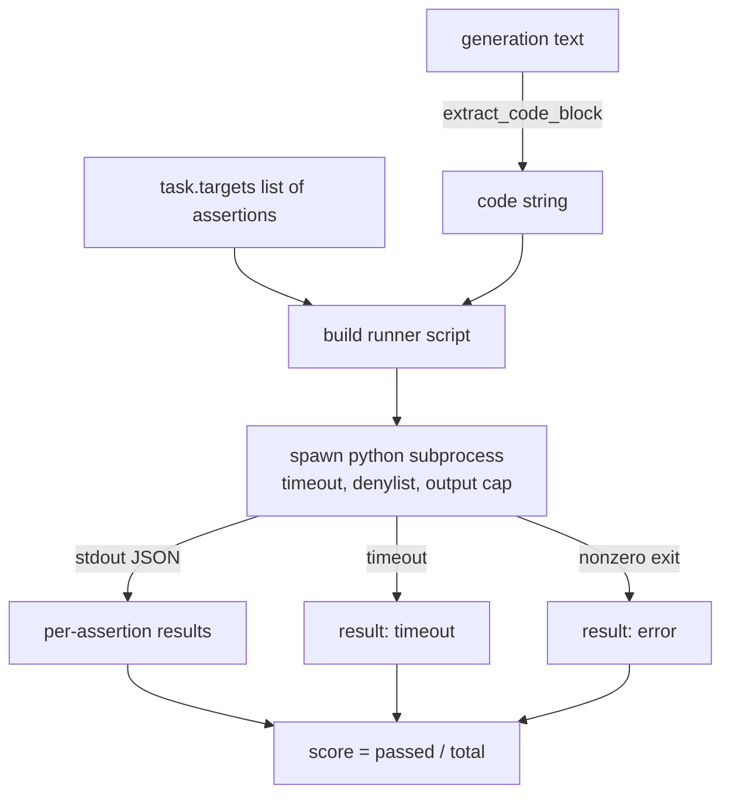
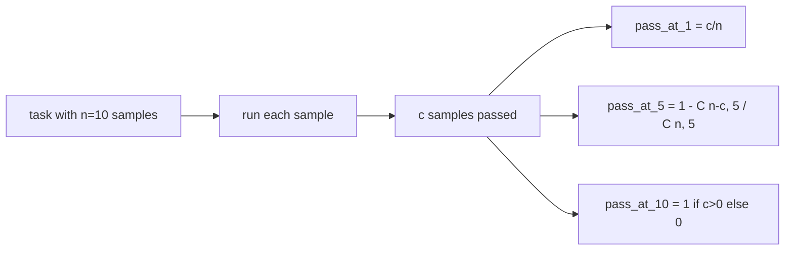

# 代码 executar índice

> O código de produção é correto após o teste. O instrumento de avaliação deve extrair o código, executá-lo em caso de não causar o colapso da máquina principal.

**Type:** Build
**Languages:** Python
**Prerequisites:** 第 19 期 Track B 基础，第 70 和 71 课
**Time:** ~90 分钟

## Objectivo de aprendizagem


```figure
sandbox-runner
```

- E é uma forma de correspondência com as regras de tratamento posterior na secção 70 do liberty form generating in提取代代码块──
- Em processo de isolamento de lista de rejeição de entrada e saída, executar código de candidato.
-                                                                                                                                                                                                                                                               
- 計算從一個模型進行多代采取樣式任務的通過-at-k─
- O sistema de correio de dados é um sistema de correio de dados de dados de dados de dados de dados de dados de dados de dados de dados de dados de dados de dados de dados de dados de dados de dados de dados de dados de dados de dados de dados de dados de dados de dados de dados de dados de dados de dados de dados de dados de dados de dados de dados de dados de dados de dados de dados de dados de dados de dados de dados de dados de dados de dados de dados de dados de dados de dados de dados de dados de dados de dados de dados de dados de dados de dados de dados de dados de dados de dados de dados de dados de dados de dados de dados de dados de dados de dados de dados de dados de dados de dados de dados de dados de dados de dados de dados de dados de dados de dados de dados de dados de dados de dados de dados de dados de dados de dados de dados de dados de dados de dados de dados de dados de dados de dados de dados de dados de dados de dados de dados de dados de dados de dados de dados de dados de dados de dados de dados de dados de dados de dados de dados de dados de dados de dados de dados de dados de dados de dados de dados de dados de dados de dados de dados de dados de dados de dados de dados de dados de dados de dados de dados de dados de dados de dados de dados de dados de dados de dados de dados de dados de dados de dados de dados de dados de dados de dados de dados de dados de dados de dados de dados de dados de dados de dados de dados de dados de dados de dados de dados de dados de dados de dados de dados de dados de dados de dados de dados de dados de dados de dados de dados de dados de dados de dados de dados de dados de dados de dados de dados de dados de dados de dados de dados de dados de dados de dados de dados de dados de dados de dados de dados de dados de dados de dados de dados de dados de dados de dados de dados de dados de dados de dados de dados de dados de dados de dados de dados de dados de dados de dados de dados de dados de dados de dados de dados de dados de dados de dados de dados de dados de dados de dados de dados de dados de dados de dados de dados de dados de dados de dados de dados de dados de dados de dados de dados de dados de dados de dados de dados de dados de dados de dados de dados de dados de dados de dados de

## Por que é necessário um processo isolado

Interior`exec`Existe segurança e estabilidade.`while True: pass`Para sempre, para sempre, para sempre, para sempre.`import shutil; shutil.rmtree('/')`确实像听起来如灾难性──解决方法是为每个候选人生成一个新的 Python 解释器,在 stdin 上传递代码,将断言结果写入 stdout,并在溢出时终止该进程──主机 eval 进程继续运行──

HumanEval、MBPP、BigCodeBench 和 LiveCodeBench etc. A avaliação real usa o processo de desenvolvimento de um sistema de dados. Algumas camadas do Docker estão no topo.

## 代码执行任务的形状

`code_exec`任务携带  missão`targets`O operador de gerar é extraído de blocos de código isolados, em torno dele construem ferramentas de teste, e depois executam os resultados.



- É o número .`[0, 1]`O corredor retorna à mesma forma: o processo de colapso do subprocesso é mapeado para o código de erro padronizado, em vez de para cima e para cima.

## 拒绝名单

 rejeitar lista é baseado em importação  Antes de executar o código candidato, o guião de corrida irá reescrever a importação de módulos de risco para a iniciação `ImportError("denied")`Depressa de conservação:`os.system`- Não.`subprocess`- Não.`socket`- Não.`requests`- Não.`urllib`- Não.`urllib.request`- Não.`urllib.error`- Não.`urllib.parse`- Não.`ctypes`- Não.`shutil`- Não.`http.client`- Não.`asyncio.subprocess`- Não.

Não vamos fingir que é um arma de fogo. Não podemos deixar de usar qualquer código de resistência.

```python
DENIED = {
    "os.system": True,
    "subprocess": True,
    "socket": True,
    "shutil": True,
    "requests": True,
    "urllib": True,
    "ctypes": True,
}
```

Nós passamos por cima.`import sys`E um passo em frente.`os.system`O candidato é o candidato a candidato a candidato.`main.py`- Não.

## 挂钟超时

Cada processo tem um orçamento padrão de três segundos.`subprocess.run(..., timeout=t)`Se superar, o corredor será capturado.`TimeoutExpired`, Terminar o processo, e registrar as tarefas `timeout`退出原因──该任务分数为零──runner继续进──

Cada missão pode passar por cima do tempo .`task.metadata.timeout_s` para a configuração                                                                                                                                                                                                                                                           

##  输出上限

O processo pode estar inundado de dados, consumindo todo o seu processo de armazenamento.`exit_code = error`, Detalhes de informação`"output overflow"`Quando uma geração de pessoas não se preocupava com a redação de um ciclo sem limites impresso, isso surgiu na prática.

##  através de-k

Pass-at-k é um calculador humano e amigo de uso imparcial.`n`独立样本和其中的 `c`Por aqui, por aqui.`n`De grandeza por`k`A probabilidade de que a solução seja aprovada é:

```text
pass_at_k(n, c, k) = 1 - C(n - c, k) / C(n, k)
```

- Não .`n - c < k`时, molécula não definida, valor为 `1` Realizar o tratamento direto da situação da margem.`pass_at_k(n, c, k)`供排行榜层使用──



## 退出代码

Corredor de volta para cada missão de cinco resultados:

- Quando cada afirmação passa por`pass`- Não.
- `assertion_fail`Quando o código funciona, mas pelo menos há uma afirmação que falha.
- `syntax_error`Quando o código não é introduzido ou há erros de linguagem.
- `timeout`Quando o tempo chega...
- `error`Para qualquer outra falha, incluindo rejeição de lista de destino e saída de saída.`"output overflow"`(Sobre a superfície)

O número de divisões ainda é zero. O código de saída é o valor do dados. O curso pode decidir se o super-hora será para zero ou para perda de dados.

## 本课不做什么

Não lhe dá uma verdadeira caixa de sabão. Não executa código não confiável de rede aberta. Não lida com tarefas em estado, como arquivos de I/O ou de rede de conexão.

## Como é que o meu nome é "Codex"

`main.py`Definindo`extract_code`- Não.`run_candidate`- Não.`score_code_exec`和 `pass_at_k`△子进程runner脚本构建为字符串,并作为 `-c`传递给新Python 解释器──`code/tests/test_exec.py`O teste de teste de teste de teste de teste de teste de teste de teste de teste de teste de teste de teste de teste de teste de teste de teste de teste de teste de teste de teste de teste de teste de teste de teste de teste de teste de teste de teste de teste de teste de teste de teste de teste de teste de teste de teste de teste de teste de teste de teste de teste de teste de teste de teste de teste de teste de teste de teste de teste de teste de teste de teste de teste de teste de teste de teste de teste de teste de teste de teste de teste de teste de teste de teste de teste de teste de teste de teste de teste de teste de teste de teste de teste de teste de teste de teste de teste de teste de teste de teste de teste de teste de teste de teste de teste de teste de teste de teste de teste de teste de teste de teste de teste de teste de teste de teste de teste de teste de teste de teste de teste de teste de teste de teste de teste de teste de teste de teste de teste de teste de teste de teste de teste de teste de teste de teste de teste de teste de teste de teste de teste de teste de teste de teste de teste de teste de teste de teste de teste de teste de teste de teste de teste de teste de teste de teste de teste de teste de teste de teste de teste de teste de teste de teste de teste de teste de teste de teste de teste de teste de teste de teste de teste de teste de teste de teste de teste de teste de teste de teste de teste de teste de teste de teste de teste de teste de teste de teste de teste de teste de teste de teste de teste de teste de teste de teste de teste de teste de teste de teste de teste de teste de teste de teste de teste de teste de teste de teste de teste de teste de teste de teste de teste de teste de teste de teste de teste de teste de teste de teste de teste de teste de teste de teste de teste de teste de teste de teste de teste de teste de teste de teste de teste de teste de teste de teste de teste de teste de teste de teste de teste de teste de teste de teste de teste de teste de teste de teste de teste de teste de teste de teste de teste de teste de teste de teste de teste de teste de teste de teste de teste de teste de teste de teste de teste de teste de teste de teste de teste de teste de teste de teste de teste de teste de teste

De cima para baixo`main.py`◊流道模板是承重件──着断言循环, até que você possa prever que ele escrever o processo JSON 信封──

## Mais adiante

Uma vez que a forma do processo funciona, o próximo problema é a transportabilidade. Diferentes versões do Python em Windows tratam SIGKILL de forma diferente. A solução mais limpa é colocar o operador no Docker 镜像. O próximo passo é substituir as palavras de prova com o documento de teste de unidade real, para avaliar a função do CI.
