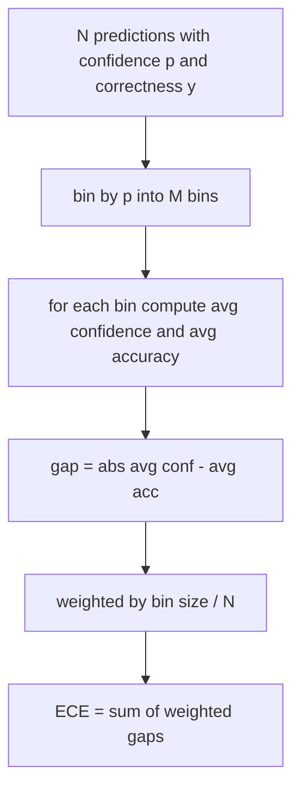
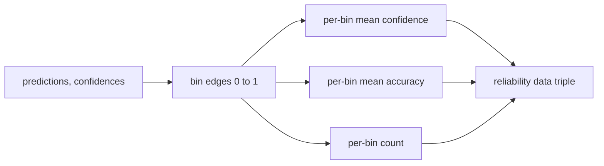

# 困惑度和校准 (concursão e formação)

> Se o seu modelo tiver 90% de confiança em 1000 respostas e responder correctamente a 600, então mostra que não passou por uma boa calibração. A calibração é metade da avaliação confiável. A outra metade é confusão, diz-lhe se o modelo considera que o texto reservado é confiável.

**Type:** Build
**Languages:** Python
**Prerequisites:** 第 19 期 Track B 基础，第 70 和 71 课
**Time:** ~90 分钟

## Objectivo de aprendizagem


```figure
cd-reliability-diagram
```

- 根据模型适配器提供的代币负对数概率计算保留语料库上的代币级困惑度──
- 根据分箱预测概率计算分类器或多项选择评估的预期校准误差 (ECE) ⋅
- 計算 Brier 分数 (Brieer) (em tradução livre)
- Construir dados de gráficos de confiança e precisão necessários para a curva de precisão e confiança.
- Todos os três estão ligados à linha de avaliação para que o corredor possa ser o melhor.`perplexity`- Não.`ece`和 `brier`编号附加到模型报告中──

## 困惑 dizer-te o que

困惑度是每个代币的指数平均负对数似然──越低越好──困惑度为 1 significa modelo para cada token real distribuição probabilidade 1──词汇量大小的困惑意味着模型是统一的并且没有学到任何东西──实际数字介于两者之间:WikiText-103 上的强大 2026年基本模型大约为8至12──

O instrumento em si não calcula a probabilidade numérica. Estes são provenientes do modelo adaptador. O instrumento aglutina: ele obtém cada token na lista de probabilidade numérica.

```python
def perplexity(neg_log_probs, token_counts):
    total_nll = sum(neg_log_probs)
    total_tokens = sum(token_counts)
    return math.exp(total_nll / total_tokens)
```

O implementar o tratamento de um token em margem de situação e afirmar que a probabilidade de números é negativa.`log p`Não é?`-log p`O adaptador gerará menos de 1 confusão, é impossível.

## O que é medidas CE?

                                                                                                                                                                                                                                                                                                                                                                                                                                                                                                                             



标准公式在 `[0, 1]`Use 10 binos de tamanho igual e grande.`bins`参数, para que o operador possa escolher entre o lançamento de um determinado (10) e um determinado (15) comparativo.

O ECE, por causa do tamanho das caixas e das amostras, tem uma diferença. Usando 10 bin e 100 previsões, você não pode distinguir 0,02 ECE e ruído de cada tipo.

## Brier 分数是 ECE 没有的

O ECE só se preocupa com a diferença média. Se o modelo tem muita confiança em metade das caixas de dados, e falta de confiança na outra metade, então a sua ECE pode ser menor, ao mesmo tempo que a calibração local também é muito ruim.

Para o resultado, o Brier é.`mean((p_i - y_i)^2)` Ele se descompõe em confiabilidade, resolução e incerteza.

```python
def brier(p, y):
    return float(np.mean((p - y) ** 2))
```

## Informações

A função retorna a três matrizes: cada bin 平均信頼度、 cada bin 平均精度和每bin 计数──.



返回的元组是调用层绘图或计算自定义 ECE 变体(自适应 ECE、扫描 ECE等) 返回的元组──我们返回 numpy 数组,因此下游代码不必进行转换──

## 置信来源

A ferramenta não é de confiança, mas é de softmax.`[0, 1]`Para muitas tarefas de seleção, a confiança natural é `softmax over option log-likelihoods` Para o texto livre, a confiança natural é a probabilidade de auto-relatamento ou a média de um modelo em relação a um índice de similaridade numérica.

##                                                                                                                                                                                                                                                                                                                                                                                                                                                                                                                              

- Todas as previsões são erradas: a ECE é a confiança média, a Brier é o alto valor, a confusão é a visão do modelo sobre o texto.
- Propostas de avaliação de desempenho:
- P=0,5 时完全不确定预测因子: cada pré-conhecimento está no mesmo bin, então ECE é `|0.5 - accuracy|`O limite é de 0,25 por ano, porque é o que quer que seja.`y`É 0 ou é 1,`(0.5 - y)^2 = 0.25`- Não.
- 空输入:ECE、Brier 和可靠性返回 `0.0`(或零填充数组) ∼ Para a situação de zero tokens, Perplexidade  retornar `NaN` Estes caminhos não emitem alertas; o corredor verifica estes valores e decide se o relatório ou o salto.

Estes casos foram incluídos em testes. Os modelos reais no teste de base real não os atingem, mas os adaptadores ou pequenos amostras defeituosos os atingem, e os operadores não devem cair.

## 调度

校准不像F1 那样是针对每个任务的指标――这是每个模型的报告――runner累积在整个评估过程中`(confidence, correct)`Para,并计算一次 ECE、Brier 和可靠性数据──困惑性, com base na base de textos reservados, é calculado com uma avaliação separada das tarefas individuais.

Interface é:

```python
report = CalibrationReport.from_predictions(confidences, correct)
report.ece          # float
report.brier        # float
report.reliability  # tuple of three numpy arrays
report.populated_bins  # int
```

`PerplexityResult.from_token_nll(neg_log_probs, token_counts)`返回 困惑度和平均负对数似然──

## 本课不做什么

Não utiliza modelos. Não realiza softmax. Não calcula a confiança de saída de tokens. É o trabalho do adaptador. Não realiza uma temperatura de contração ou de contração de volume.

## Como é que o meu nome é "Codex"

`main.py` definição `perplexity`- Não.`expected_calibration_error`- Não.`brier_score`- Não.`reliability_diagram`和 `CalibrationReport`- Não .`PerplexityResult`O modelo de dados é baseado em uma previsão global de fatos básicos conhecidos: um modelo de boa calibração, um modelo de confiança excessiva e um modelo de falta de confiança.`code/tests/test_calibration.py`O teste central fixa a situação de cada margem e o valor de referência da variação de previsão geral.

De cima para baixo`main.py` A ordem das funções de um modelo a outro é de um modelo de um modelo de um modelo de um modelo de um modelo de um modelo de um modelo de um modelo de um modelo de um modelo de um modelo de um modelo de um modelo de um modelo de um modelo de um modelo de um modelo de um modelo de um modelo de um modelo de um modelo de um modelo de um modelo de um modelo de um modelo de um modelo de um modelo de um modelo de um modelo de um modelo de um modelo de um modelo de um modelo de um modelo de um modelo de um modelo de um modelo de um modelo de um modelo de um modelo de um modelo de um modelo de um modelo de um modelo de um modelo de um modelo de um modelo de um modelo de um modelo de um modelo de um modelo de um modelo de um modelo de um modelo de um modelo de um modelo de um modelo de um modelo de um modelo de um modelo de um modelo de um modelo de um modelo de um modelo de um modelo de um modelo de um modelo de um modelo.

## Mais adiante

A calibração é o eixo mais facilmente ignorado em avaliações publicadas. A maioria das classificações informa um número de precisão e diz que é concluído. Um modelo que vence na precisão e falha na Brier é um modelo que tem um escore inferior em precisão, mas com confiança relata um modelo de incerteza pior em uma produção de depósitos. Uma vez que o tubo de calibração está em posição, adicione um enraizamento de temperatura no pedaço de verificação reservado, recalcule a ECE, e observe o enraizamento de espaços.
