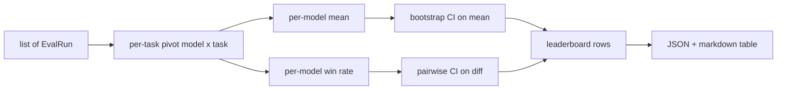
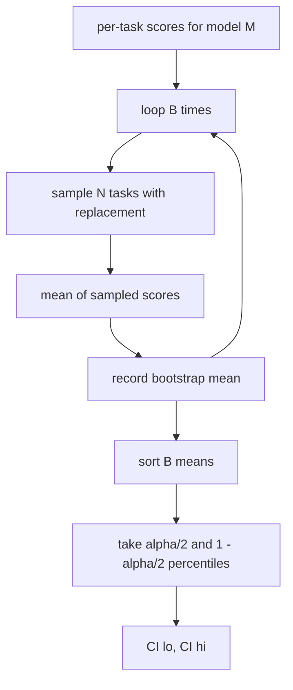

# 排行榜聚合

> Cada tarefa é fácil de classificar. Cada modelo de tarefa transversal é mais difícil de classificar. A aparência estatística na lista de previsão de milhares de pessoas é a parte que todos saltam.

**Type:** Build
**Languages:** Python
**Prerequisites:** 第19期B轨基础，第70、71、73课
**Time:** ~90 分钟

## Objectivo de aprendizagem


```figure
ci-leaderboard-ci
```

- Reunir vários modelos e cada tarefa de cada tarefa num modelo completo em cada linha.
-                                                                                                                                                                                                                                                               
-  Rating de modelos em termos de valor médio e taxa de vitória,并解释每个模型何时是正确的总结──
- 计算每个模型的平均分和成对差异的引导置信区间──
- Para o Rango de Rango de Output para o relatório JSON e o Marcado de Outro, o corredor da 75a classe pode ser coletado para o CI  comentários.

## 输入的形状

聚合器使用 `EvalRun`记录列表:

```python
@dataclass
class EvalRun:
    model_id: str
    task_id: str
    metric_name: str
    score: float          # in [0, 1]
    category: str
```

第 75 课中的 runner为每一个`(model, task)`Para emitir um registro. O agregador não se importa como o número de pontos é gerado.`[0, 1]`- Não.

## 输出

出来三张表:



排行榜行包含:`model_id`- Não.`mean_score`- Não.`mean_ci_lo`- Não.`mean_ci_hi`- Não.`win_rate`- Não.`tasks_completed`E para cada categoria de valores médios.`categories`Mapa.

##  padronização

Se uma missão for marcada`[0, 1]`, outro trabalho foi feito .`[0, 100]`, , , , , , , , , , , , , , , , , , , , , , , , , , , , , , , , , , , , , , , , , , , , , , , , , , , , , , , , , , , , , , , , , , , , , , , , , , , , , , , , , , , , , , , , , , , , , , , , , , , , , , , , , , , , , , , , , , , , , , , , , , , , , , , , , , , , , , , , , , , , , , , , , , , , , , , , , , , , , , , , , , , , , , , , , , , , , , , , , , , , , , , , , , , , , , , , , , , , , , , , , , , , , , , , , , , , , , , , , , , , , , , , , , , , , , , , , , , , , , , , , , , , , , , , , , , , , , , , , , , , , , , , , , , , , , , , , , , , , , , , , , , , , , , , , , , , , , , , , , , , , , , , , , , , , , , , , , , , , , , , , , , , , , , , , , , , , , , , , , , , , , , , , , , , , , , , , , , , , , , , , , , , , , , , , , , , , , , , , , , , , , , , , , , , , , , , , , , , , , , , , , , , , , , , , , , , , , , , , , , , , , , , , , , , , , , , , , , , , , , , , , , , , , , , , , , , , , , , , , , , , , , , , , , , , , , , , , , , , , , , , , , , , , , , , , , , , , , , , , , , , , , , , , , , , ,`[0, 1]`No entanto, o índice deve ter retornado a um número.

## 平均值和胜率

Os dois programas de classificação servem a objetivos diferentes.

O índice médio é um modelo de valor médio do índice de cada tarefa. Este é o relatório de classificação numérica do título. É muito sensível a valores anormais e desequilíbrios de tarefas.

胜率计算模型在同一任务上击败所有其他模型的频率──对于每一个任务,得分最高的模型获胜平分)──胜率等于获胜次数除了模型得分的任务数──它对异常值和尺度差异不太敏感,但会丢失信息──

```python
def win_rate(model_id, runs_by_task, all_models):
    wins, total = 0, 0
    for task_id, runs in runs_by_task.items():
        scores = {r.model_id: r.score for r in runs if r.model_id in all_models}
        if model_id not in scores:
            continue
        total += 1
        best = max(scores.values())
        if scores[model_id] >= best:
            wins += 1
    return wins / total if total else 0.0
```

O corredor da 75a classe 默认按平均排名排列; Markdown 列的胜率也保留在那里,以便用户偏好这种视角时使用──

## Autopsia

Cada modelo tem um valor médio de reanalisar a avaliação de um trabalho.`B`E depois,`alpha`级别获取百分位间隔──



Para a comparação, nós guiamos a diferença de cada tarefa.`score_A - score_B`, obtém percentual de intervalos e relata-o. Usuário lê o intervalos não incluem o zero. Se for verdade, a diferença é evidente no plano de água alfa.

低级助手`bootstrap_mean_ci`- Não.`bootstrap_pairwise_diff`) considera que`B=1000`; public聚合器`aggregate`- Não.`pairwise_diffs`) Considera-se`b=500`, portanto, a demonstração e o teste manterem o rápido.

## 类别

Se configurado `EvalRun.category`, polímero também irá relatar o valor médio de cada categoria.`math`- Não.`reasoning`- Não.`code`- Não.`safety` Pode deixar o corredor descobrir se o modelo é bom em geral, mas o código é fraco, isto é, a média do título é informação oculta

## Marcação de dados

排行榜呈现为 Markdown 表:

```text
| Rank | Model | Mean | 95% CI | Win rate | Tasks |
|------|-------|------|--------|----------|-------|
| 1    | gpt   | 0.78 | 0.74-0.82 | 0.62 | 50 |
| 2    | claude| 0.75 | 0.71-0.79 | 0.34 | 50 |
| 3    | random| 0.10 | 0.07-0.13 | 0.04 | 50 |
```

O programa é dividido em duas partes:

## 本课不做什么

Não é um modelo de execução. Não é uma escala de escala. Não é uma escala de escala. Não é uma escala de escala. Não é uma escala de escala.`weight`O código de instrução será mantido em estado aberto, mas ignorado no agregador. Se necessário, pode ser adicionado em curso posterior.

## Como é que o meu nome é "Codex"

`main.py`Definindo`EvalRun`- Não.`LeaderboardRow`- Não.`aggregate`- Não.`bootstrap_mean_ci`- Não.`bootstrap_pairwise_diff`和 `render_markdown`O projeto constitui um conjunto de três modelos e 12 missões, agrupando-se e imprimindo uma lista de diferentes tipos de trabalho.`code/tests/test_leaderboard.py`O teste central fixa o bootstrap, o marcado de dados, a situação da margem de vitória e o comportamento de entrada em espaço.

De cima para baixo`main.py` Dados de forma`EvalRun`- Não.`LeaderboardRow`O primeiro é o aglutinador, o terceiro é o bootstrap, o último é o rolamento.

## Mais adiante

O próximo passo natural é a importância da tarefa de parceria, e não o modelo de orientação desparceria. Se o modelo A e B executam as mesmas cem tarefas, o teste apropriado é o programa de orientação de parceria que realizamos para a diferença de tarefas individuais. Além disso, você também precisa de um programa de orientação de nível de série de tarefas de respeito.
