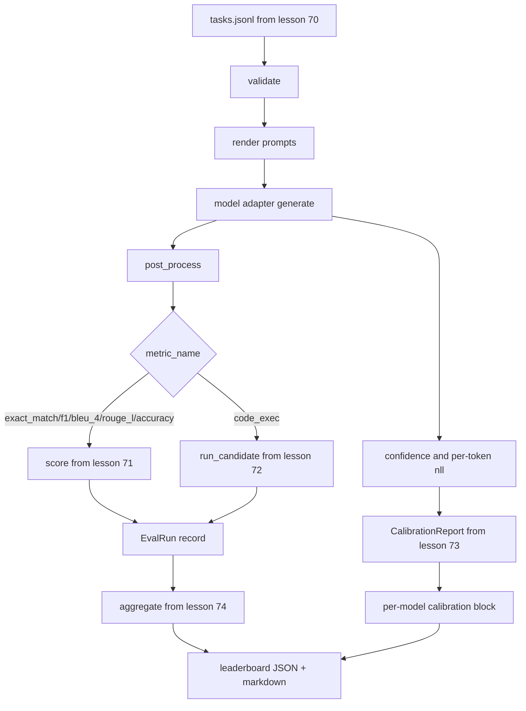

# 端到端评估运行器

> 五堂管道安装课,一堂水课, 跑步者读取第70课中的任务规范,通过适配器调用模型,对第71课和第72课进行评分,附加第73课中的校准报告,并发发出第74课中的排行列, 演示自闭终止──

**Type:** Build
**Languages:** Python
**Prerequisites:** 第 19 期 Track B 基础，第 70 至 74 课
**Time:** ~90 分钟

## Objectivo de aprendizagem


```figure
eval-grid
```

- Definir qualquer modelo (模拟、本地、API) pode ser feito através de um pequeno método de satisfação da superfície.`ModelAdapter`- Não.
- Em fixação JSONL 文件上运行评估, em work池并行执行任务──
- Uma subsecção irá medir a camada de combustão (exact_match、F1、BLEU-4、ROUGE-L、code_exec) com a camada de classificação.
- 发出每个模型的 `EvalRun`记录并将其直接输入排行榜聚合器──
- Simultaneamente, a saída de JSON  relatório e o marcdown; em operações líquidas, em saída zero desde o fim, em verificações ou em operações fracassadas, em saída não zero.

## - O que é?



runner é um ponto de integração. Em cada aula de 70 a 74 , tem um módulo escrito pelo runner.

## 适配器接口

O adaptador é o intervalo entre corredor e qualquer modelo.

```python
class ModelAdapter:
    model_id: str

    def generate(self, prompt: str, task: TaskSpec) -> Generation: ...
```

`Generation`É um tipo de dados, com:

- `text`Modelo: modelo de forma livre
- `confidence`- Não .`[0, 1]`Número de pontos de intervenção, indicando a probabilidade de resposta do modelo auto-relatório
- `token_nll`: geradotoken of opções negativas para números semelhantes ao total
- `token_count`: genertoken de número de opções

Os modelos de transporte de veículos em linha de linha fornecem três tipos de equipamentos:`RuleBasedAdapter`(determinação, quase perfeita),`NoisyAdapter`(excesso de confiança, frequente erro)`BiasedAdapter`(擅长一类,糟糕于另类) . O show foi executado em todos os três no fim da 70a aula.

## Não executar

runner utilização `concurrent.futures.ThreadPoolExecutor`O número de linhas de trabalho em conformidade com o modelo é menor do que o número de tarefas. O número de linhas de trabalho é suficiente, pois o modelo de execução é um sistema de I/O.

Para testes de segurança, o corredor está aberto.`run_eval(adapters, tasks, parallel=False)`, para que o teste possa determinar a execução.

## 单遍评分循环

 Para cada tarefa:

1. 染提示(alguns tiros 前加上提示正文)
2. O que é que é o que é?
3. De acordo com as regras da tarefa, a produção e o tratamento posteriores são realizados.
4. 调度到度量层──
5. Utilize o número de indicadores e construção de dados`EvalRun`- Não.
6. - Não .`(confidence, correct)`Para a admissão ao ensino secundário

对于精确匹配样式标标 (para especificar o que é um modelo de`exact_match`- Não.`accuracy`- Não.`code_exec`),`correct`O sinal é`score >= 1.0`, para os indicadores de classificação,`score >= 0.5`O sinal é`score >= 0.5`                                                                                                                                                                                                                                                              `_correct_from_score`No meio, e o operador não será aberto à cobertura pública.

## 聚合

Depois de cada missão ter resultado, o corredor será convocado para a classe 74.`aggregate`和 `pairwise_diffs`E também no número 73 .`CalibrationReport.from_predictions`△输出是一个 JSON 信封:

```json
{
  "leaderboard": [...],
  "pairwise": [...],
  "calibration": {
    "model_id_a": {"ece": 0.04, "brier": 0.10, "populated_bins": 8, ...},
    ...
  },
  "summary": {
    "tasks": 10,
    "models": 3,
    "wall_seconds": 1.2
  }
}
```

O corredor também vai marcar o marcador de dados para que o usuário possa colar os resultados para o PR 评论中。

## Desde o fim da apresentação

O show será executado em 10 fixas de aula 70                                                                                                                                                                                                                                                                                                                                                                                                                                                                                                                  

清洁运行标准是:

- § 70 课中验证的每项任务──
- § 71 e § 72                                                                                                                                                                                                                                                                                                                                                                                                                                                                                                                         
- § 73                                                                                                                                                                                                                                                                                                                                                                                                                                                                                                                            
- A classificação será baseada em regras de adaptadores rigorosamente classificados em cima de adaptadores de cada vez.

Se qualquer um deles interromper, o executor sairá com um valor não zero e aparecerá um erro estruturado no JSON.

## 本课不做什么

Não realiza o processo de gerenciamento ou parte do gerenciamento; o adaptador volta para a geração a cada vez que o adaptador for usado. Não realiza o re-teste ou o cache.

## Como é que o meu nome é "Codex"

`main.py`É um grupo.`_load_sibling` importar o programa de ajuda de outros cinco módulos de curso, o programa de ajuda através de rotas relativas para analisá-los.`Generation`- Não.`EvalReport`和 `ModelAdapter`É definido por:

De cima para baixo`main.py`◊ Browse import, então chequear `run_eval`E depois é .`_score_one`E depois é o adaptador. A última apresentação é o ponto de entrada.

`code/tests/test_runner.py`Testes de interface de adaptador fixo, ciclo de um único canal, correlação com sequência e efetividade, área de classificação e formato de rede JSON.

## Mais adiante

Este corredor é o terreno.`(task_id, model_id, model_version)`Os resultados do controle de chave são armazenados, acompanhados, divididos em custos, por operação, de dólares e tokens, de volta à taxa de regresso, de restrições de pesquisa, de estratégias de amostragem de missões e de formatos de saída de fluxos de longos conjuntos.

模拟工作后,为真正提供程序添加适配器──选择一个免费级别,写三十行水,看排列榜亮起──然后添加第二个提供程序并让线束完成工作──
