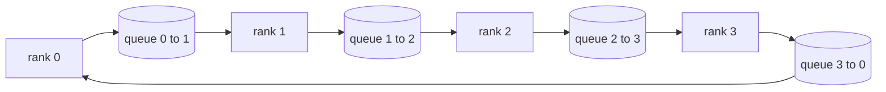

# Desde zero realizando operações coletivas

> O conjunto de quatro operações coletivas é todo redução, transmissão, reúne e reduzir.`multiprocessing.Queue`A rede de construção de uma vez, em função da referência para a realização de verificação deles, o resto do órbito é transformado em tubos.

**Type:** Build
**Languages:** Python
**Prerequisites:** 第 19 阶段 Track C 课程 42-49
**Time:** ~90 分钟

## Objectivo de aprendizagem

- Em duas vezes de transmissão, a realização do ciclo reduzi-lo todo (precedendo a redução do disperso e depois a coleta) e a demonstração da quantidade de comunicação por elemento 2 (N-1) /N 字节。
- Em`multiprocessing.Queue`Sobre o ponto de envio sobre o ponto de envio construção de propagandas, tudo reunido e reduzido.
- De acordo com o mesmo input.`torch.distributed`Glo 参考验证每个原语──
- Defender a escolha do arco e do arco em termos de forma de grupo 延迟下限和带宽上限.

## 问题

N 级上的简单将张量 N 次发送到根并广播 N 次。 cada rank 带宽缩放为$O(N)$, o anel se torna um copo, e o hang-lock é o mais lento do link multiplicado por N.$T/N$de$2(N-1)$块, portanto cada rank 字节 下降到$2T(N-1)/N$A árvore tudo reduz em N pequeno e em N alto atrasado, porque a profundidade é$\log_2(N)$Salta em vez de salta$2(N-1)$                                                                                                                                                                                                                                                              

 Cada quadro de treinamento distribuído que você vai ler neste tutorial depende de estas quatro linguagens originais。 PyTorch DDP irá reduzir a gradiência com cada barril de parâmetros em um allreduce 同步。 ZeRO  através de reduce_scatter para o estado do optimizador fazer um pedaço, e através de allgather 广播更新的参数。 FSDP irá tornar-se completo em todo o conjunto com reduce_scatter。

## 概念



### 分两次进行所有减

Em cada um dos passos, todos os blocos de N1 são redutores, em cada um dos passos, todos os blocos de N1 são redutores, em cada um dos passos, todos os blocos de N1 são redutores, em cada um dos passos, todos os blocos de N1 são redutores, em cada um dos passos, todos os blocos de N1 são redutores, em cada um dos passos, todos os blocos são redutores, em cada um dos passos, todos os blocos são redutores, em cada um dos passos, todos os blocos são redutores, todos os blocos são redutores, todos os blocos são redutores, todos os blocos são redutores, todos os blocos são redutores, todos os blocos são redutores, todos os blocos são redutores, todos os blocos são redutores, todos os blocos são redutores, todos os blocos são redutores.

|原语|每 rank 字节 |步骤|何时使用 |
|-----------|---------------|-------|-------------|
|Ring allreduce| 2T(N-1)/N | 2(N-1) |大 T、fat-pipe 同构集群 |
|Tree allreduce | T log2(N) | 2 log2(N) |小 T 或高延迟链路 |
|广播| T | log2(N) 树 |参数初始化，标量配置|
|allgather| T(N-1)/N | N-1 |分片转发，ZeRO 取消分片 |
|reduce_scatter | T(N-1)/N | N-1 | ZeRO 梯度分片 |

### 队列网格 como substituto da NCCL

NCCL em PCIe e NVLink, operando em menor carga de hardware.`multiprocessing.Queue`Para que você forneça com um único produtor e um único consumidor, o ponto de entrega de pedidos em ponto de entrega. A redução ocorre no espaço de usuário, portanto, você precisa pagar Python, mas o modelo de ligação com o NCCL tudo reduz o mesmo.

### 针对 gloo 进行验证

Cada língua original é testada por unidades, e a sua saída é iniciada no final do mundo em uma mesma quantidade de volume.`torch.distributed` fazer comparação. Se o seu anel reduzir a diferença de gloo em relação ao float32 epsilon, o teste falha.


```figure
ci-ring-allreduce
```

## Construí-lo

`code/main.py`实现:

- `Mesh`类,将 N 个 `multiprocessing.Queue`                                                                                                                                                                                                                                                                                                                                                                                                                                                                                                                             `send(dst, tensor)`和 `recv(src)`- Não.
- `ring_allreduce(mesh, rank, world_size, tensor)`运行两遍算法── Não é o que se passa?
- Para os árvores`broadcast(mesh, rank, world_size, tensor, src)`- Não.
- `allgather(mesh, rank, world_size, tensor)`Utilize N-1 轮换──
- `reduce_scatter(mesh, rank, world_size, tensor)`Como parte de todo o redução.
- `_gloo_reference(op, world_size, tensor)` através `torch.distributed`运行相同输入,并使用 gloo 进行字节相等比较──

- Não .

```bash
python3 code/main.py
```

输出: Compare a linha de linha de linha de linha de linha de linha de linha de linha de linha de linha de linha de linha de linha de linha de linha de linha de linha de linha de linha de linha de linha de linha de linha de linha de linha de linha de linha de linha de linha de linha de linha de linha de linha de linha de linha de linha de linha de linha de linha de linha de linha de linha de linha de linha de linha de linha de linha de linha de linha de linha de linha de linha de linha de linha de linha de linha de linha de linha de linha de linha de linha de linha de linha de linha de linha de linha de linha de linha de linha de linha de linha de linha de linha de linha de linha de linha de linha de linha de linha de linha de linha de linha de linha de linha de linha de linha de linha de linha de linha de linha de linha de linha de linha de linha de linha de linha de linha de linha de linha de linha de linha de linha de linha de linha de linha de linha de linha de linha de linha de linha de linha de linha de linha de linha de linha de linha de linha de linha de linha de linha de linha de linha de linha de linha de linha de linha de linha de linha de linha de linha de linha de linha de linha de linha de linha de linha de linha de linha de linha de linha de linha de linha de linha de linha de linha de linha de linha de linha de linha de linha de linha de linha de linha de linha de linha de linha de linha de linha de linha de linha de linha de linha de linha de linha de linha de linha de linha de linha de linha de linha de linha de linha de linha de linha de linha de linha de linha de linha de linha de linha de linha de linha de linha de linha de linha de linha de linha de linha de linha de linha de linha de linha de linha de linha de linha de linha de linha de linha de linha de linha de linha de linha de linha de linha de linha de linha de linha de linha de linha de linha de linha de linha de linha de linha de linha de linha de linha de linha de linha de linha de linha de linha de linha de linha de linha de linha de linha de linha de linha de linha de linha de linha de linha de linha de linha de linha de linha de linha de linha de linha de linha de linha de linha de linha de linha de linha de linha de linha de linha de linha de linha de linha

## 野外生产模式

Três modos de fazer o base de dinheiro suficientemente forte, pode ser entregue.

**在 allreduce 之前对梯度进行分桶。**O modelo de 1B 参数 possui milhares de gradientes 张量―― cada gradiente é realizado uma vez, reduzindo o pagamento de N 倍的延迟下限―― DDP irá armazenar a gradiência em cerca de 25 MB de blocos, e emitir um allreduce para cada caixinha de armazenamento; 小张量骑大张量的后面――

**通信与计算重叠。**Para trás, em contrapartida, a ordem de cada nível calculada está em ordem. Quando a última fase está pronta, comece a reduzir tudo, enquanto a primeira fase continua a calcular.

**根据消息大小而不是宗教来选择环或树。**NCCL  forneceu um testeiro de toponímia, que pode ser usado para um número de toponímia de ~ 1 MB, para um número de toponímia de ~ 1 MB, para um número de toponímia de ~ 1 MB, para um número de toponímia de ~ 1 MB.

## Use-o

Modelo de produção:

- **PyTorch DDP。**Em direcção ao nível de barril`dist.all_reduce`斗大小可调; para 100Gbit 以太网,默认 25 MB é razoável.
- **DeepSpeed ZeRO。**发出减_scatter para fazer um segmento de gradiente e fazer uma reunião antes de o transmissão para reconstruir o parâmetro completo.
- **FSDP.**Antes de tudo, comece a fazer a eliminação de partes, calcula, depois utiliza o redutor, reduzir e perder as partes.

## 发货

Use第 77-81 课中的队列网格原语──第 77 课把所有减少 接入 DDP──第 78 课把减少_scatter 接入 ZeRO──第 79 课用点对点发送和回复(em vez de coletivos) transmite a ativação do pipeline──第 81 课把这四者组合成端到端演示──

## 练习

1. Adicionar árvore todos reduzir os variações, e, de acordo com a informação,
2. 添加 `recv_timeout_ms`, para que a classificação estagnada apareça um erro de data de encerramento, em vez de ficar sempre pendurada.
3. " Quatro idiomas originais "`multiprocessing.Queue`替换为 TCP 套接字──相同的测试,真线──
4. Adicionar o código de acesso, para que cada linha de dados seja registrada no JSONL.
5. Comparado com o tempo de pendura de um arco em 4 grados de 1KB,1MB,16, de tamanho de 16MB, com experiência em defender o meio-fio.

## 关键术语

|术语 |人们怎么说|它实际上意味着什么 |
|------|----------------|------------------------|
|allreduce| “跨等级总和”|调用后，每个等级都保留相同的简化张量 |
|戒指| “快速拓扑”| N-1 个大小为 T/N 的块绕周期流动两次 |
|树| “日志拓扑”|归约遵循二叉树；深度为 log2(N) 跳 |
|allgather| “连接碎片”|每个等级都以其他等级的碎片结束 |
|reduce_scatter | “平分总和”|每个排名仅以一个块的总和结束 |
|桶| “融合小张量”|将N个小的全部合并为一个大的|

##  weiterlesen

- [PyTorch 分布式：NCCL 集体](https://pytorch.org/docs/stable/distributed.html#collective-functions)
- [Horovod环全减纸](https://arxiv.org/abs/1802.05799)
- NCCL拓和算法选择](https://docs.nvidia.com/deeplearning/nccl/user-guide/docs/index.html)
- [Patarasuk 和 Yuan，带宽最优 allreduce 算法](https://www.cs.fsu.edu/~xyuan/paper/09jpdc.pdf)
- 第 10 阶段 第 05 课 -  分布式训练概述
- 第 19 阶段 第 77 课 - DDP 连接在这些原语之上
