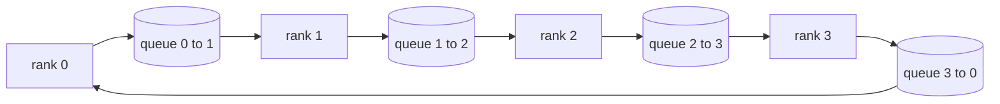

# Desde zero realizando operações coletivas

> O sistema de comunicação coletiva é todo redução, transmissão, reúne e reduz_dispersão.`multiprocessing.Queue`A rede de realização de uma vez, re-controlo de referência para realização de verificação, esta pista  parte restante  é apenas conectado

**Type:** Build
**Languages:** Python
**Prerequisites:** Phase 19 Track C lessons 42-49
**Time:** ~90 分钟

## Objectivo de aprendizagem

- Use dois algoritmos para realizar o anel todo redução, primeiro redução-dispersão, re-agrupar), e provar que cada nível de comunicação é cada elemento.$2(N-1)/N$- Não, não.
- Em`multiprocessing.Queue`上的点对点 enviar 之上实现 emissão、allgather 和 reduce_scatter。
- Para a mesma entrada, us`torch.distributed`Como referência, verifique cada um dos seus idiomas.
- De forma de grupo 延迟下限和带宽上限出发,论证该选环 还是树

## 问题

Em N 个级 上做朴素 allreduce,将把张量向根发送 N 次,再广播回来 N 次.$O(N)$Enlargar, raiz transformar em garrafa, tempo de tempo de limite é o mais lento da linha multiplicando N.$2(N-1)$个大小为 $T/N$de cada um, cada um de cada um.$2T(N-1)/N$, com o aumento da tendência$2T$且永不超出,与集群规模无关. 树全减少在小N、高延迟链路上更优,因为深度是$\log_2(N)$Salta, em vez de$2(N-1)$O bloco mais lento da GPU decide o passo.

Você na pista 里会读的每个分布式训练框架,都依赖于四个原语──PyTorch DDP utiliza cada parâmetro em cubos de cada parâmetro, uma vez todos reduzir para a mesma escala──ZeRO utiliza reduz_scatter 分片优化器状态, reutiliza todos 广播更新后的参数──FSDP Colocar o conjunto em frente 变成所有加减少_scatter──Pipeline parallel 需要跨阶段组播 传活化──实现不了这些四个集体,无法推推训为何住,为何梯度卡不匹配现在排名3以及为何换拓后管道泡泡会翻倍──

## 概念



### 两遍完成的 Ring allreduce

Colocar a quantidade de quantidade em N 个等等的大小小小小小小小小小小小小小小小小小小小小小小小小小小小小小小小小小小小小小小小小小小小小小小小小小小小小小小小小小小小小小小小小小小小小小小小小小小小小小小小小小小小小小小小小小小小小小小小小小小小小小小小小小小小小小小小小小小小小小小小小小小小小小小小小小小小小小小小小小小小小小小小小小小小小小小小小小小小小小小小小小小小小小小小小小小小小小小小小小小小小小小小小小小小小小小小小小小小小小小小小小小小小小小小小小小小小小小小小小小小小小小小小小小小小小小小小小小小小小小小小小小小小小小小小小小小小小小小小小小小小小小小小小小小小小小小小小小小小小小小小小小小小小小小小小小小小小小小小小小小小小小小小小小小小小小小小小小小小小小小小小小小小小小小小小小小小小小小小小小小小小小小小小小小小小小小小小小小小小小小小小小小小小小小小小小小小小小小小小小小小小小小小小小小小小小小小小小小小小小小小小小小小小小小小小小小小小小小小小小小小小小小小小小小小小小小小小小小小小小小小小小小小小小小小小小小小小小小小小小小小小小小小小小小小小小小小小小小小小小小小小小小小小小小小小小小小小小小$(r - s) \bmod N$- Não .$(r + 1) \bmod N$,并从级 $(r - 1) \bmod N$接收 pedaço $(r - s - 1) \bmod N$Depois de passar por N-1 passos, o ranking r                                                                                                                                                                                                                                                                                                                                                                                                                                                                                                                 

| 原语 | 每 rank 字节数 | 步数 | 何时使用 |
|-----------|---------------|-------|-------------|
| Ring allreduce | 2T(N-1)/N | 2(N-1) | 大 T、同构 fat-pipe 集群 |
| Tree allreduce | T log2(N) | 2 log2(N) | 小 T 或高延迟链路 |
| Broadcast | T | log2(N) tree | 参数初始化、标量配置 |
| Allgather | T(N-1)/N | N-1 | 分片 forward、ZeRO unshard |
| Reduce_scatter | T(N-1)/N | N-1 | ZeRO 梯度分片 |

### Usar rede de fila em vez de NCCL

NCCL                                                                                                                                                                                                                                                                                                                                                                                                                                                                                                                           `multiprocessing.Queue`O que acontece é que o usuário deve pagar o pagamento de Python, mas o padrão de roteiro e o anel NCCL reduzem tudo.

### Para fazer um teste

Cada idioma original tem uma unidade de teste: no mesmo tamanho do mundo, na mesma quantidade, coloca sua saída com o uso de um mundo.`torch.distributed`Por exemplo, a primeira fase do teste foi realizada em um laboratório de laboratório de laboratório de laboratório de laboratório de laboratório de laboratório de laboratório de laboratório de laboratório de laboratório de laboratório de laboratório de laboratório de laboratório de laboratório de laboratório de laboratório de laboratório de laboratório de laboratório de laboratório de laboratório de laboratório de laboratório de laboratório de laboratório de laboratório de laboratório de laboratório de laboratório de laboratório de laboratório de laboratório de laboratório de laboratório de laboratório de laboratório de laboratório de laboratório de laboratório de laboratório de laboratório de laboratório de laboratório de laboratório de laboratório de laboratório de laboratório de laboratório de laboratório de laboratório de laboratório de laboratório de laboratório de laboratório de laboratório de laboratório de laboratório de laboratório de laboratório de laboratório de laboratório de laboratório de laboratório de laboratório de laboratório de laboratório de laboratório de laboratório de laboratório de laboratório de laboratório de laboratório de laboratório de laboratório de laboratório de laboratório de laboratório de laboratório de laboratório de laboratório de laboratório de laboratório de laboratório de laboratório de laboratório de laboratório de laboratório de laboratório de laboratório de laboratório de laboratório de laboratório de laboratório de laboratório de laboratório de laboratório de laboratório de laboratório de laboratório de laboratório de laboratório de laboratório de laboratório de laboratório de laboratório de laboratório de laboratório de laboratório de laboratório de laboratório de laboratório de laboratório de laboratório de laboratório de laboratório de laboratório de laboratório de laboratório de laboratório de laboratório de laboratório de laboratório de laboratório de laboratório de laboratório de laboratório de laboratório de laboratório de laboratório de laboratório de laboratório de laboratório de laboratório de laboratório de laboratório de laboratório de laboratório de laboratório de laboratório de laboratório de laboratório de laboratório de laboratório de laboratório de laboratório de laboratório de laboratório de laboratório de laboratório de laboratório de laboratório de laboratório de laboratório de laboratório de laboratório de laboratório de laboratório de laboratório de laboratório de laboratório de laboratório de laboratório de laboratório de laboratório de

```figure
ci-ring-allreduce
```

## Construí-lo

`code/main.py`实现:

- `Mesh`类:把 N 个 `multiprocessing.Queue`接成环,并按级 暴露 `send(dst, tensor)`Com`recv(src)`- Não.
- `ring_allreduce(mesh, rank, world_size, tensor)`Não é o que eu quero.
- `broadcast(mesh, rank, world_size, tensor, src)`- Não, não.
- `allgather(mesh, rank, world_size, tensor)`: Usando N-1 次轮转――
- `reduce_scatter(mesh, rank, world_size, tensor)`Como todo redução de primeira metade.
- `_gloo_reference(op, world_size, tensor)`O mesmo tipo de entrada é o mesmo tipo de entrada .`torch.distributed`, fazer-se-a-ver-se-a-ver-se-a-ver-se-a-ver-se-a-ver-se-a-ver-se-a-ver-se-a-ver-se-a-ver-se-a-ver-se-a-ver-se-a-ver-se-a-ver-se-a-ver-se-a-ver-se-a-ver-se-a-ver-se-a-ver-se-a-ver-se-a-ver-se-a-ver-se-a-ver-se-a-ver-se-a-ver-se-a-ver-se-a-ver-se-a-ver-se-a-ver-se-a-ver-se-a-ver-se-a-ver-se-a-ver-se-a-ver-se-a-ver-se-ver-se-a-ver-se-ver-se-se-a-ver-se-ver-se-se-se-se-se-se-se-se-se-se-se-se-se-se-se-se-se-se-se-se-se-se-se-se-se-se-se-se-se-se-se-se-se-se-se-se-se-se-se-se-se-se-se-se-se-se-se-se-se-se-se-se-se-se-se-se-se-se-se-se-se-se-se-se-se-se-se-se-se-se-se-se-se-se-se-se-se-se-se-se-se-se-se-se-se-se-se-se-se-se-se-se-se-se-se-se-se-se-se-se-se-se-se-se-se-se-se-se-se-se-se-se-se-se-se-se-se-se-se-se-se-se-se-se-se-se-se-se-se-se-se-se-se-se-se-se-se-se-se

运行:

```bash
python3 code/main.py
```

输出:按原语对比排列网与 gloo 输出验证表,以及证明 $2T(N-1)/N$缩放的每级 字节计计器──

## Práctica no ambiente de produção

Três modos podem tornar estas línguas originais mais duras que o que é possível.

**allreduce 前先对梯度分桶。**Um modelo de 10 bilhões de parametros tem 10 mil gradientes de volume. Cada gradiente de volume uma vez reduz, deve pagar N 倍延迟下限.

**让通信与计算重叠。**O nível de cálculo é reduzido em uma fase de cálculo, e o nível de cálculo é reduzido em uma fase de cálculo.

**按消息大小选 ring 或 tree，不要教条。**NCCL 自带拓检测:大约 1 MB 以上选戒,以下选树──交叉点是带宽对延迟超过 1 MB 时带宽项 $2T(N-1)/N$占主导,ring 胜出; inferior a 1 MB 时$\log_2(N)$Salto num número de vantagens. Escrever um estilo de vida, vai perder em grande parte a mensagem errada.

## Use-o

O uso em produção:

- **PyTorch DDP。**Retrogrado                                                                                                                                                                                                                                                                                                                                                                                                                                                                                                                          `dist.all_reduce`◊ bucket 大小可调;100Gbit 以太网下默认 25 MB 合理。
- **DeepSpeed ZeRO。**发 reduce_scatter 分片梯度,forward 前再所有重建完整参数──本课的原语正是 ZeRO 实际发射调用──
- **FSDP。**Para frente, antes todos juntos, coloquem essa camada em pedaços, calculados, reutilizados, reduzidos, dispersos, reduzidos, dispersos, dispersos, dispersos, dispersos, dispersos, dispersos, dispersos, dispersos, dispersos, dispersos, dispersos, dispersos, dispersos, dispersos, dispersos, dispersos, dispersos, dispersos, dispersos, dispersos, dispersos, dispersos, dispersos, dispersos, dispersos, dispersos, dispersos, dispersos, dispersos, dispersos, dispersos, dispersos, dispersos, dispersos, dispersos, dispersos, dispersos, dispersos, dispersos, dispersos, dispersos, dispersos, dispersos, dispersos, dispersos, dispersos, dispersos, dispersos, dispersos, dispersos, dispersos, dispersos, dispersos, dispersos, dispersos, dispersos, dispersos, dispersos, dispersos, dispersos, dispersos, dispersos, dispersos, dispersos, dispersos, dispersos, dispersos, dispersos, dispersos, dispersos, dispersos, dispersos, dispersos, dispersos, dispersos, dispersos, dispersos, dispersos, disperso, disperso, disperso, disperso, disperso, disperso, e disperso, e disperso, e disperso.

## Entrega-o

Em 7781 课中使用这些队列网 原语──第 77 课把所有减少到DDP──第 78 课把减少_scatter 接到ZERO──第 79 课用点对点发送/recv(而不是集体)传递管道 激活──第 81 课把四者组成端到端演示──

## 练习

1. 增加 tree allreduce 变体,并按消息大小在 ring与树之间切换──测出交叉点──
2. 增加 `recv_timeout_ms`Deixe o ranking de um carregador de dados ficar em erro, em vez de ficar sempre pendurado.
3. - Não.`multiprocessing.Queue`换成 TCP socket──同一套测试,真实线路──
4. 加带宽探测 hook,把每级字节计计器记到JSONL──
5. Em 4 个级别, em 1KB、1MB、16MB 张量比较环与树的墙钟时间──用实测为交叉点辩护──

## 关键术语

| 术语 | 人们常说 | 实际含义 |
|------|----------------|------------------------|
| Allreduce | “跨 rank 求和” | 调用结束后每个 rank 持有相同的归约张量 |
| Ring | “更快的拓扑” | N-1 个大小为 T/N 的 chunk 绕环流两圈 |
| Tree | “对数拓扑” | 归约沿二叉树进行；深度为 log2(N) 跳 |
| Allgather | “拼接分片” | 每个 rank 最终持有所有其他 rank 的分片 |
| Reduce_scatter | “把求和切开” | 每个 rank 最终只持有某一个 chunk 的求和 |
| Bucket | “融合小张量” | 把 N 次小 allreduce 合并成一次大的 |

## 延伸阅读

- [PyTorch Distributed: NCCL collectives](https://pytorch.org/docs/stable/distributed.html#collective-functions)
- [Horovod ring allreduce paper](https://arxiv.org/abs/1802.05799)
- [NCCL topology and algorithm selection](https://docs.nvidia.com/deeplearning/nccl/user-guide/docs/index.html)
- [Patarasuk and Yuan, Bandwidth optimal allreduce algorithms](https://www.cs.fsu.edu/~xyuan/paper/09jpdc.pdf)
- Fase 10 Lição 05 - visão geral da formação distribuída
- Fase 19 Lição 77 - DDP cablado em cima destes primitivos
