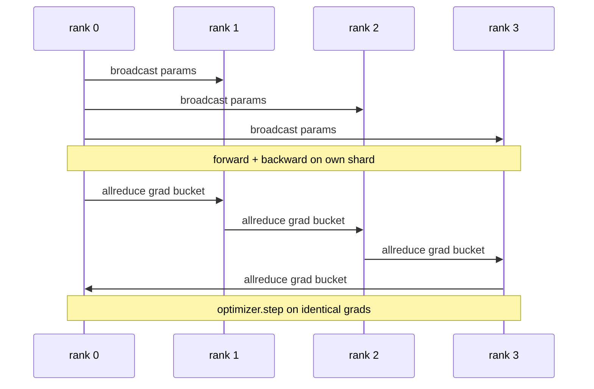

# Desde o início os dados foram seguidos para o DDP

> DistribuídoDataParallel é um 子 sobre todo redução 子. Envolve um modelo, a partir de 0 级 começando a difundir os parâmetros iniciais, de modo que cada nível começa a ser o mesmo, instale um 子 para trás em cada parâmetro de redução 子, o restante é a descida ︎.

**Type:** Build
**Languages:** Python
**Prerequisites:** 第 19 期 Track C 课程 42-49
**Time:** ~90 分钟

## Objectivo de aprendizagem

-                                                                                                                                                                                                                                                                                                                                                                                                                                                                                                                              `DistributedDataParallel`形的包装器,该包装器广播初始参数和后向后减少梯度──
- Spawn N CPU em base de arquivos reuniões de glóu  posterior `torch.multiprocessing.spawn`- Não.
-  através de treinamento de ordem no mesmo dados, o mesmo modelo  e mostrando a equivalência de cada passo para provar a veracidade do gradiente 
- Defender o uso de um reservatório de dados (梯度融合) e de uma rede de dados (重叠) como um dos dois transformadores que transformam o DDP em um DDP de produção.

## 问题

✓ Com 12 GB de atividade, o modelo de 10 bilhões de parâmetros não é adequado para uma GPU de nível de consumo. Mesmo adequado, o treinamento também requer várias semanas de tempo.  Os dados serão divididos em N 个级别, cada nível calcula o sentido dianteiro e o sentido posterior de sua secção, e em cada etapa, cada nível de gradiente será combinado, para que todas as N 个副本保持相同.  A procura e a gradiente é o dispositivo de otimização utilizado.

Se não houver sincronia de gradiente, N 个副本会发生分歧在第二步. O modelo não é mais um modelo treinado em mais dados, mas sim um modelo independente com o peso inicial compartilhado por acaso. Se o sincronia de gradiente não for bem feito, cada parâmetro será um todo reduzido, sem sobreposição, sem barril), a rede se tornará um copo, o GPU irá ficar em um espaço em espera. A tecnologia do DDP torna o gradiente quase gratuita em relação ao cálculo.

## 概念



### DDP necessita de três operações

|舞台|集体|为什么 |
|-------|-----------|-----|
|初始化|从排名 0 开始广播 |每个排名都以相同的参数开始 |
|后退|各梯度的 allreduce |平均梯度是优化器所采用的 |
|有时|缓冲区广播| Batchnorm 运行统计数据保持同步 |

### Por que é o valor médio e não o total?

Todos os redução-SUM exceto em mundo_size obtêm uma média de gradiente. O valor médio para mundo_size é inalterável: a taxa de aprendizagem em primeira classe é válida em quarto grau, pois a amplitude de cada passo não muda.

### Por que usar a barriga de escada?

O transformador tem milhares de parâmetros de volume. Por cada volume, uma única redução vai pagar o total 延迟下限数千倍的费用. DDP vai dividir a gradiência em cerca de 25 MB de caixas de armazenamento, e emitir uma redução para cada caixas de armazenamento.

### Por que fixar a semente?

Cada rank deve ser ajustado`torch.manual_seed(seed + rank)` fazer lavagem, mas调用`torch.manual_seed(seed)` fazer inicialização de parâmetros.                                                                                                                                                                                                                                                          


```figure
ci-ddp-grad-sync
```

## Construí-lo

`code/main.py`实现:

- `MiniMLP`3 Layer MLP, pequeno até suficiente para receber em poucos segundos, grande até suficiente para expor o material.
- `DistributedDataParallel(model, world_size)`: en construção, retornar um embalagem, its `sync_grads`Reduzir a procura e a gradiência de acumulação em tamanho mundial.
- `worker(rank, world_size, ...)`Por Gloo, avanço, retorno, acompanhamento, avanço.`torch.distributed`Inicial de um ciclo de treinamento completo.
- `_reference_single_process_loop(...)`A formação em um nível em ordem em dados iguais, é utilizada para testar a eficácia de parâmetros e fases de testes em cada passo.

- Não .

```bash
python3 code/main.py
```

输出: por fase de treinamento, comparar a perda de um único processo e a experiência de parâmetros com o DDP que funciona em 4 níveis acima.

## 野外生产模式

Três modos permitem que o DDP se endureça para ser enviado.

**查找未使用的参数。**Alguns roteiros de transmissão estão condicionados a saltar os parâmetros (todos os parâmetros não têm escala, mas os parâmetros de transmissão do DDP ainda estão esperando e todos reduzem o bloqueio.`find_unused_parameters=True`Diga ao DDP que os parâmetros que obtêm a gradiência são os custos de cada passo, então, a menos que você tenha o seu rosto na direção da direção, não considere isso.

**静态图优化。**Quando a mudança está estável,`static_graph=True`让DDP 预先计算储备桶调度―― Otimizar a escala é importante: o pré-calculação poupa alguns milésimos de segundo a cada passo, o que é complexo em 10.000 passos―

**梯度累积需要小心。**A taxa de acumulação de K 个微批次, em diferentes etapas, pode aumentar a sua capacidade de produção 10 vezes mais.`no_sync()`Publicado em: http://www.public.com/public.com/public.com/public.com/public.com/public.com/public.com/public.com/public.com/public.com/public.com/public.com/public.com/public.com/public.com/public.com/public.com/public.com/public.com/public.com/public.com/public.com/public.com/public.com/public.com/public.com/public.com/public.com/public.com/public.com/public.com/public.com/public.com/public.com/public.com/public.com/public.com/public.com/public.com/public.com/public.com/public.com/public.public.com/public.pub.pub.pub.pub.pub.pub.pub.pub.

## Use-o

Modelo de produção:

- **PyTorch DDP。**规范的实现―― `torch.nn.parallel.DistributedDataParallel(model)`连接分桶、重叠和 no_sync 上下文──
- **HuggingFace Accelerate。**添加一个处理 `torchrun`环境变量和模型包装的启动器──底层的DDP 相同──
- **Megatron-LM 数据并行。**Juntar DDP e o conjunto de dimensões para um modelo grande; a parte do conjunto de dados é o mesmo modelo de redução total após retrocesso.

## 发货

Seção 78 (Zero)                                                                                                                                                                                                                                                            

## 练习

1. Adicionar um pequeno barril de gradiente configurável, e medir em um modelo mais profundo com cada parâmetro uma aceleração total redução.
2. - Não .`no_sync()`实现为上下文管理器,并验证梯度累积与K个微批次的单进程基线相相相相相相相相相相相相相相相相相相相相相相相相相相相相相相相相相相相相相相相相相相相相相相相相相相相相相相相相相相相相相相相相相相相相相相相相相相相相相相相相相相相相相相相相相相相相相相相相相相相相相相相相相相相相相相相相相相相相相相相相相相相相相相相相相相相相相相相相相相相相相相相相相相相相相相相相相相相相相相相相相相相相相相相
3. Adição`find_unused_parameters`模式, que às vezes salta uma das camadas MLP; se não tiver esse sinal, o funcionamento ficará empenhado em 局。
4. será substituído por`torch.distributed.barrier()`- só sim, sentida a diferença entre o sim baseado em tudo redução e o sim baseado em barreira.
5. 量批量大小为 1、16、256 的梯度同步开销作为步长时间的一部分,并解释缩比例──

## 关键术语

|术语 |人们怎么说|它实际上意味着什么 |
|------|----------------|------------------------|
|DDP | “数据并行” |广播参数并减少每一步梯度的包装器 |
|桶| “保险丝梯度”| N组小都化为一大|
|重叠| “隐藏通讯” |当后面的层仍在向后计算时发出 allreduce |
|无同步 | 「积累」|跳过后向 allreduce 进行梯度累积 |
|查找未使用的 | “分支前进”|减少之前检测无梯度的参数 |

##  weiterlesen

- [PyTorch 分布式数据并行文档](https://pytorch.org/docs/stable/generated/torch.nn.parallel.DistributedDataParallel.html)
- PyTorch DDP interno教程](https://pytorch.org/tutorials/intermediate/ddp_tutorial.html)
- [Li等人，PyTorch分布式：加速数据并行训练的经验](https://arxiv.org/abs/2006.15704)
- 第19 阶段 第 76 课 - O conjunto de estabelecimentos do DDP
- 第 19 阶段 第 78 课 - ZeRO 分片将每个参数的全部减少 换成减少_scatter
