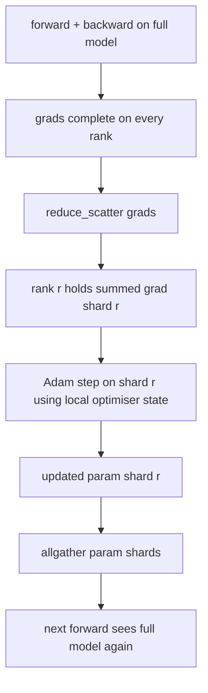

# ZeRO 优化器 estado分片

> Adam para cada parâmetro armazenamento duas estimativas, em formato float32 armazenamento. 7B parâmetro modelo carrega 56 GB de estado de optimizador. ZeRO primeira fase de parâmetro atravessa N 个级别; cada nível tem 1/N de optimizador.

**Type:** Build
**Languages:** Python
**Prerequisites:** 第 19 期 Track C 课程 42-49
**Time:** ~90 分钟

## Objectivo de aprendizagem

- N 个级别的碎片优化器状态(第一时刻、第二时刻、fp32 主副本), portanto, cada nível possui 1/N。
- Utilize reduce_scatter apenas transmite cada nível de seu pedaço de gradiente e, em seguida, todos vão reunir os parâmetros de pedaço de distribuição atualizados para voltar.
- 根据普通 DDP 计算阶段 1、阶段 2、阶段 3 的内存节省表──
- Defender a seleção de 1° estágio, 2° estágio e 3° estágio no modelo de orçamento de grande dimensão e de largura.

## 问题

O Vanilla DDP copiou tudo: o estado do parâmetro 梯度和优化器在每个级别上都完整存在──对于 fp16 中的 7B 参数模型,这意味着每个级别 14 GB 参数、14 GB 梯度和 28 GB 优化器状态── 优化器状态是最大的术语,也是最容易分片的,因为它只触及在步骤期间,而不是在前进或后退期间触及──

O ZeRO faz uma fase 1 para o estado do optimizador fazer fragmentos. Cada nível possui um Adam 时刻. Para trás, ZeRO não reduz o gradiente inteiro e entra em local, mas reduz_scatter, portanto cada nível só recebe o gradiente de seu gradiente total.

## 概念



### Etapas do ZeRO

|阶段|分片对象 |每 rank 内存|每 step 通信|
|-------|----------------|------------------|---------------|
| DDP |无 |params + grads + optim | 1x allreduce |
| ZeRO-1 |optimizer state |params + grads + optim/N | 1x reduce_scatter + 1x allgather |
| ZeRO-2 |optim + grads |params + grads/N + optim/N | 1x reduce_scatter + 1x allgather |
| ZeRO-3 |optim + grads + params |params/N + grads/N + optim/N |每层 1x allgather + 每层 1x reduce_scatter |

A primeira fase é a menor vitória de custo, pois o estado de otimização domina o orçamento. A segunda fase requer gradiente, mas a largura é a mesma. A terceira fase (FSDP) paga as despesas de comunicação por cada nível de frente e de trás, obtendo assim um menor número de parâmetros.

### 记忆数学, números

Para usar o modelo de treinamento de precisão misturada com P 参数:

|术语 |vanilla|ZeRO-1 |为什么 |
|------|---------|--------|-----|
| fp16 参数 | 2P字节| 2P字节|需要转发|
| FP16 梯度 | 2P字节| 2P字节|需要落后|
| fp32 母版 | 4P字节| 4P/N 字节 |只有最优化的人才会使用它 |
| fp32 第一时刻 | 4P字节| 4P/N 字节 |只有最优化的人才会使用它 |
| fp32 第二时刻 | 4P字节| 4P/N 字节 |只有最优化的人才会使用它 |
|总计 | 16P字节| 4P + 12P/N 字节 |   |

N=8 时:vanilha 16P, ZeRO-1 5.5P, baixa 65%。 N=64 时:vanilha 16P, ZeRO-1 4.19P, baixa 74%。

### Por que reduzir_dispersão  melhor do que tudo reduzir-depois-dispartilhar

Todos os redutores fornecem uma demanda e uma escala completa para cada nível. Se apenas for necessário um pedaço de r, então a escala é reduzida. Reduzir os redutores fornece a mesma escala; todos os ramos são redutores, porque todos os redutores são redutores, mas a segunda metade é substituída por outros.


```figure
cd-zero-shard
```

## Construí-lo

`code/main.py`实现:

- `flatten_params(module)`和 `unflatten_into(module, flat)`Para que os parâmetros do modelo sejam enrolados em uma quantidade contínua de volume e desintegrados, a estrutura de planejamento torna a parte de classe em um simples pedaço.
- `ZeroOptimizer(model, world_size, rank, lr)`拥有主副本和亚当时刻的等级碎片──
- `step()`Em um plano de gradiente, a redução de dispersação é aplicada a Adam para a classificação, e todos os parâmetros atualizados são recolhidos novamente.
- Uma demonstração, treinamento de 3 níveis MLP 20 个步骤,并印印每个步骤的内存预算以及普通DDP基线──

- Não .

```bash
python3 code/main.py
```

Output: Período de perda e memória mostram ZeRO-1 em comparação com a duplicação completa do DDP, mantendo um estado de optimizador de 1/N em cada nível.

## 野外生产模式

O ZeRO está a fazer a sua entrega.

**分片检查点很重要。**O estado do ZeRO-1 de um optimizador deve ser classificado de acordo com a classificação; o ponto de verificação deve registrar qual nível possui o que possui.

**混合精度是重点。**O ZeRO é uma técnica de precisão misturada; fp32 主副本是分片的. Em caso de não haver precisão misturada, o ZeRO vai dar ao mestre do fp32 um imposto de memória, sem o correspondente fp16 para o triunfo.

**第一阶段几乎是免费的。**通信在带宽方面与DDP相同──内存节省与N 成线性关系──唯一成本是优化器分片的簿记──生产堆默认为阶段 1,除非参数分片内存也是一个问题;然后第二或第三阶段用通信换取内存──

## Use-o

Modelo de produção:

- **DeepSpeed ZeRO。**参考实现―― `deepspeed_config.json`选择阶段 1/2/3 和分区大小──
- **PyTorch FSDP。**PyTorch 原生等效项── `ShardingStrategy.SHARD_GRAD_OP`É o ZeRO-2; `FULL_SHARD`É o ZeRO-3.
- **HuggingFace Accelerate。**A DeepSpeed e o FSDP estão em uma configuração única.

## 发货

第 79 课 管道并行) é um eje de divisão: o tubo não é através do mesmo modelo para o estado do optimizador para fazer divisão, mas através de um nível para fazer divisão.

## 练习

1.  através da escala de fragmentos expandindo-se para ZeRO-2: cada rank só armazenar a escala de fragmentos, através de um reverso posterior será não-fragmento parte limpa para realizar-se
2. Adicione um analisador de memória, para imprimir em 0                                                                                                                                                                                                                                                                                                                                                                                                                                                                                                                
3. ∆o medir o DDP normal com o ZeRO-1 em cada passo do tempo, e o descompõe em ∆o ∆o ∆o ∆o ∆o ∆o ∆o ∆o ∆o ∆o ∆o ∆o ∆o ∆o ∆o ∆o ∆o ∆o ∆o ∆o ∆o ∆o ∆o ∆o ∆o ∆o ∆o ∆o ∆o ∆o ∆o ∆o ∆o ∆o ∆o ∆o ∆o ∆o ∆o ∆o ∆o ∆o ∆o ∆o ∆o ∆o ∆o ∆o ∆o ∆o ∆o ∆o ∆o ∆o ∆o ∆o ∆o ∆o ∆o ∆o ∆o ∆o ∆o ∆o ∆o ∆o ∆o ∆o ∆o ∆o ∆o ∆o ∆o ∆o ∆o ∆o ∆o ∆o ∆o ∆o ∆o ∆o ∆o ∆o ∆o ∆o ∆o ∆o ∆o ∆o ∆o ∆o ∆o ∆o ∆o ∆o ∆o ∆o ∆o ∆o ∆o ∆o ∆o ∆o ∆o ∆o ∆o ∆o ∆o ∆o ∆o ∆o ∆o ∆o ∆o ∆o ∆o ∆o ∆ ∆o ∆
4. Em ZeRO-1 para realizar a redução de gradiente: deve ser feito através de um local de quantidade quadrada de todos os
5. Utilize allreduce em vez de reduce_scatter                                                                                                                                                                                                                                                                                                                                                                                                                                                                                                                 

## 关键术语

|术语 |人们怎么说|它实际上意味着什么 |
|------|----------------|------------------------|
|ZeRO-1 | “优化器分片”|每个等级拥有 1/N 的 fp32 master + Adam 时刻 |
| ZeRO-2 | “grads 也分片”|每个 rank 在 reduce_scatter 后也会丢弃非本分片的梯度 |
|ZeRO-3 | “分片参数” |每个等级保存 1/N 的 fp16 参数；向前每层allgather |
|master copy| “fp32 权重”|高精度参数复制优化器更新|
|reduce_scatter | “平分总和”|仅提供每个等级其分片的梯度总和 |

##  weiterlesen

- [Rajbhandari 等人，ZeRO：训练万亿参数模型的内存优化](https://arxiv.org/abs/1910.02054)
- [DeepSpeed ZeRO 文档](https://www.deepspeed.ai/tutorials/zero/)
- [PyTorch FSDP 文档](https://pytorch.org/docs/stable/fsdp.html)
- 第 19 阶段 第 76 课 - 本课所涉及的减少_散播和全集
- 第 19 阶段 第 80 课 - ZeRO 状态必须使用的分片检查点
