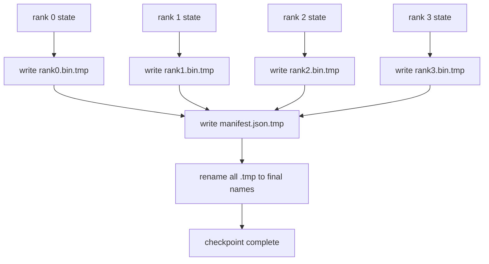

# Número de pontos de inspecção e recuperação atômica

> A forma do ponto de verificação determina se você é um perdedor 30 minutos ou 30 horas. O ponto de verificação faz a mesma inscrição em cada um dos níveis e registra a propriedade na lista. O resumo carrega cada um dos níveis de seu próprio arquivo, em um estado de reconstrução do mesmo mundo pequeno, e o optimizador parece que nada aconteceu.

**Type:** Build
**Languages:** Python
**Prerequisites:** 第 19 期 Track C 课程 42-49
**Time:** ~90 分钟

## Objectivo de aprendizagem

- O ponto de verificação de vários níveis será reservado para cada nível de documentos e um registro de quais níveis possuem.
- Utilize atom write in mode ([[[[[[[[[[[[[[[[[[[[[[[[[[[[[[[[[[]]]]]]]]]]]]]]]]]]]]]]]]), então o colapso no processo de escrita nunca produzirá um ponto de verificação semelhante ao que foi feito.
- A partir do cálculo, verificação de cada nível em fp16 参数 e ZeRO 优化器状态的字节相等状态.
- Proteção da estrutura de limpeza livre de três tipos de falhas:

## 问题

Os pontos de verificação comuns vão ler todos os parâmetros e o estado do optimizador até o nível 0, recolher e escrever em um único arquivo. Para o modelo 70B, a porta de rede de primeira classe fornece um estado de 1.1 TB. A escrita bloqueia todas as outras classes, pois elas estão em vão e aguardam a coleta. O IO 带宽 é o mais lento único da rede de redes de GPU, em vez de aglutinar o bandwidth. Em um conjunto real, a coleta e a escrita de passos podem levar mais tempo do que o tempo de treinamento anterior, o que significa que cada dia de treinamento transmite menos de um ponto de verificação.

O ponto de verificação de 1 TB requer 4 horas para completar uma classe, 4 minutos para completar 64 classes. Além disso, o sistema também fornece um contrato de currículo incompatível: as pequenas mudanças do mundo são verificáveis, a parte da gravação é verificável, e o caminho de carregamento pode ser um grande fracasso, em vez de usar em silêncio dados obsoletos.

## 概念



### 清单架构

```json
{
  "world_size": 4,
  "step": 1234,
  "wall_clock_seconds": 4521,
  "shards": [
    {"rank": 0, "path": "rank0.bin", "sha256": "...", "param_shard_offset": 0, "param_shard_numel": 65536},
    {"rank": 1, "path": "rank1.bin", "sha256": "...", "param_shard_offset": 65536, "param_shard_numel": 65536}
  ],
  "schema_version": 1
}
```

Três jogos são todos de peso.`world_size`Para que o seu grande e grande livro não seja destruído em silêncio.`sha256`Captura de parte ou deteriorado.`param_shard_offset`和 `param_shard_numel`让载体在正确位置重建平面参数张量──

### 原子写入

標準模式:将每个分片写入 `<name>.tmp`,将清单写入 `manifest.json.tmp`,fsync Cada documento, re-nomear fragmentos, última re-nomear lista. , em um único POSIX no mesmo sistema de documentos, o re-nomeamento é atômico: quer o novo documento esteja completamente presente, quer o antigo documento esteja completamente presente. , um grupo de renomeamento não é uma transação, então o re-nomeamento da lista é um ponto de submissão, o carregador irá verificar cada fragmento de acordo com o hash da lista.

### 模式 must defend ên três tipos de falhas

|失败|症状|防御|
|---------|---------|---------|
|世界规模的变化|在 N=8 上恢复，并从 N=4 开始清单 |清单中的 world_size 不匹配，大声失败 |
|分片数量不匹配 |resume 看到的 rank*.bin 文件少于 manifest 中的分片 |枚举分片，验证每个分片都存在 |
|部分写入|分片文件在刷新过程中被截断|加载时进行 sha256 验证 |

Cada defesa rejeitará o seu mau cargo o mais cedo possível; outra opção é a perda silenciosa, que ocorre apenas após 100 passos quando a perda é transformada em NaN.

### Porque é que é um documento de cada nível, e não um grande documento

 através `O_APPEND`Para um arquivo de emissão de escrita é aplicável a escrita de código POSIX, mas na prática, o volume de desvio dentro de um pedaço de texto atravessa uma área de MB de tamanho, e é bloqueado para ocupar o lugar dominante. Quando o sistema de arquivo de nível inferior é em simultâneo, cada nível de arquivo não é necessário e pode beneficiar da articulação.


```figure
ci-sharded-checkpoint
```

## Construí-lo

`code/main.py`实现:

- `ShardManifest`Número de dados, com as seguintes características`to_json`- Não .`from_json`- Não.
- `save_sharded(state_dict_per_rank, dir, step)`Utilizando o modelo de atomismo temporário e depois re-nomeado, cada nível de estado do sistema binário será escrito em seu próprio arquivo, e depois escrito em listação.
- `load_sharded(dir, expected_world_size)`读取清单,验证每个分片的 sha256,并返回每个级别的状态字典──
- 往返测试: construção de cada cadeia de estado, conservação, carga, afirmação,

- Não .

```bash
python3 code/main.py
```

输出:4 个分片文件以及写入的清单,然后通过字节相等验证重新加载──

## 野外生产模式

Três modos de inspecção que tornam o ponto suficientemente firme para realizar o transporte.

**异步写入。**O produto está em um ponto de verificação em um único processo ou linha, para que o treinamento continue.`async_io`O sinal é fazer isso.

**先本地快速磁盘，然后异步上传。**写入本地 NVMe(快速), então异步上传到S3或GCS──两层模式使集群内检查点能够快速恢复,同时将持久副本发送到集群外进行存档──清单携带本地路径;上传清单携带远程路径──

**轮换很重要。**O ciclo de produção mantém o último K 个检查点 (geralmente 3-5 个) e reúne o primeiro ponto de verificação. Se não for reúne, o disco será preenchido no ciclo, e o próximo ponto de verificação falhará.

## Use-o

Modelo de produção:

- **DeepSpeed 检查点。** `deepspeed.save_checkpoint(tag=step)` escrever todos os documentos e indicadores de atividades `latest`- Não.
- **PyTorch FSDP 检查点。** `torch.distributed.checkpoint`Utilize decide cada nível de arranjo `Planner`保存分片状态──
- **NeMo.**Utilize adição de dados`save_to_checkpoint`API 封装 DeepSpeed e FSDP

## 发货

§ 81                                                                                                                                                                                                                                                                                                                                                                                                                                                                                                                            

## 练习

1. 添加异步写入: 在线程中启动保存并让训练继续──阻止下一次保存,直到上一次保存完成──
2. 添加 `last_5_steps`轮换: reter 5 pontos de verificação mais recentes, remover os mais antigos e guardar novos pontos de verificação.
3. Para o ciclo recarregado adicione apenas o caminho de teste rápido do CRC.
4. 添加跨世界小的负载:通过读取清单、连接和重新分片,将分片重新平衡从N=4到N=8──
5. Será publicado em S3 (segunda edição) e será publicado em S3 (segunda edição)

## 关键术语

|术语 |人们怎么说|它实际上意味着什么 |
|------|----------------|------------------------|
|分片检查点 | “按等级保存”|每个rank并行写入自己的分片文件|
|清单 | “索引”|记录分片路径、偏移量和 sha256 的 JSON 文件 |
|原子写| “tmp 然后重命名” |写入 .tmp，然后 POSIX 重命名，以便崩溃使先前的文件保持活动状态 |
|部分写入| “截断的碎片” |写入过程中的崩溃会产生损坏的分片； sha256 抓住它 |
|旋转| “保留最后 K”|在写入新检查点以限制磁盘使用量之前删除最旧的检查点 |

##  weiterlesen

- [DeepSpeed 检查点](https://www.deepspeed.ai/tutorials/checkpointing/)
- [PyTorch torch.distributed.checkpoint](https://pytorch.org/docs/stable/distributed.checkpoint.html)
- [POSIX重命名原子性](https://pubs.opengroup.org/onlinepubs/9699919799/functions/rename.html)
- No 19 阶段 No 78 课 - 此检查点旨在保存的ZERO 状态
- 第 19 阶段 第 81 课 - 端到端演示往返保存的状态
