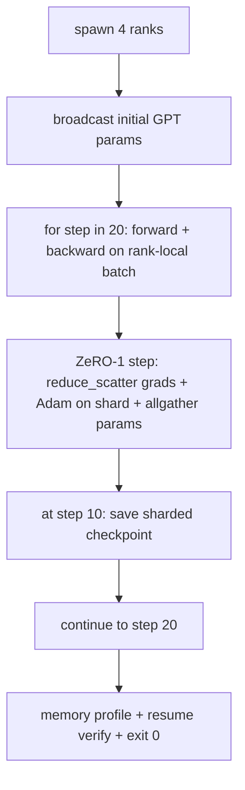

# 端到端分布式训练

> Seção 76 a 80 - Seção 80 - Seção 1 - Seção 1 - Seção 8 - Seção 8 - Seção 8 - Seção 8 - Seção 8 - Seção 8 - Seção 8 - Seção 8 - Seção 8 - Seção 8 - Seção 8 - Seção 8 - Seção 8 - Seção 8 - Seção 8 - Seção 8 - Seção 8 - Seção 8 - Seção 8 - Seção 8 - Seção 8 - Seção 8 - Seção 8 - Seção 8 - Seção 8 - Seção 8 - Seção 8 - Seção 8 - Seção 8 - Seção 8 - Seção 8 - Seção 8 - Seção 8 - Seção 8 - Seção 8 - Seção 8 - Seção 8 - Seção 8 - Seção 8 - Seção 8 - Seção 8 - Seção 8 - Seção 8 - Seção 8 - Seção 8 - Seção 8 - Seção 8 - Seção 8 - Seção 8 - Seção 8 - Seção 8 - Seção 8 - Seção 8 - Seção 8 - Seção 8 - Seção 8 - Seção 8 - Seção 8 - Seção 8 - Seção 8 - Seção 8 - Seção 8 - Seção 8 - Seção 8 - Seção 8 - Seção 8 - Seção 8 - Seção 8 - Seção 8 - Seção 8 - Seção 8 - Seção 8 - Seção 8 - Seção 8 - Seção - Seção - Seção - Seção - Seção - Seção - Seção - Seção - Seção - Seção - Seção - Seção - Seção - Seção - Seção - Seção - Seção - Seção - Seção - Seção - Seção - Seção - Seção - Seção - Seção - Seção - Seção - Seção - Se - Se - Seção - Se - Se - Se - Se - Se - Se - Se - Se - Se - Se - Se - Se - Se - Se - Se - Se - Se - Se - Se - Se - Se - Se - Se - Se - Se - Se - Se - Se - Se - Se - Se - Se - Se - Se - Se - Se - Se - Se - Se - Se - Se - Se - Se - Se - Se - Se - Se - Se - Se - Se - Se - Se - -

**Type:** Build
**Languages:** Python
**Prerequisites:** 第 19 期 Track C 课程 42-49
**Time:** ~90 分钟

## Objectivo de aprendizagem

- Para a formação de um grupo de treinamento, os participantes devem ter a oportunidade de fazer um curso de formação.
- Em pequena biblioteca de linguagem sintética, treinar 2 níveis Transformer 语言模型, atravessar 4 模拟等级 realizar 20 步骤.
- Imprimir cada passo perdido, cada linha de arquivo de configuração de memória e lista de pontos de verificação, tais como os ritmos de recuperação no mesmo mundo pequeno.
- Defender a composição: cada obra pode ser testada independentemente do curso anterior, e este curso prova que são compostas.

## 问题

Capstone é a prova de que cada parte é composta em conjunto. O curso 76 implementar coletivamente. O curso 77 incorporará-as ao DDP. O curso 78 usa-se o sistema de redução de dispersação e de optimização de fragmentos. O curso 79 analisa o sistema de distribuição. O curso 80 conserva um ponto de verificação. Cada aula tem seus próprios testes.

Esta demonstração de curso operação de ponta a ponta e verificação de quatro invariabilidades: a) Redução de perda em 20 passos no ruído flutuante, b) Manter o mesmo número de parâmetros em cada passos, c) Cada escala de optimização em seu interno é igual a ZeRO-1  fórmula 12P/N 字节, bem como d) Piso 10 ponto de verificação em reiniciação de recarregamento de passos, etc.

## 概念



### 迷你 GPT

O modelo é intencionalmente muito pequeno: 2 个Transformer块、嵌入dim 32、4 个注意力头、词汇 64、序列长度 16、批次 4。几千参数。 suficientemente grande para executar cada decisão de linha;;多头注意力运行标准屏蔽路径;LayerNorm 需要同步权重;LM 头是返回词汇的单独线性投影)。 suficientemente pequeno, 4 个 CPU 级别上的 20 个步骤可以在几秒内完成;;

### 组成规则

|课程片段 |它拥有什么 |它留给循环什么？
|--------------|--------------|----------------------------|
| DDP广播 |初始参数同步 |构建时一次调用 |
| ZeRO-1 步骤 |梯度同步、母版更新、参数广播 |每一步调用一次，替换 optimiser.step |
|分片检查点 |保持每等级状态，用 sha256 体现 |通过 allgather 收集状态，调用等级 0 |
|训练循环 |向前、向后、丢失记录 |按顺序调用以上三个 |

O ciclo não sabe sobre a redução ou a distribuição dos documentos.

### Porquê é um pequeno GPT e não apenas um MLP ?

No capítulo 77, o MLP é suficiente para verificar a escala de sintonia. Um pequeno GPT adiciona três coisas: um LM único na palavra (em sua forma de letra) e um LM único na forma de letra.

### Desde o fim significa sair 0

循环运行固定的20 步并退出──没有`while True`, sem interferência humana, sem recuperação de estado externo. Você pode executar em estado de segurança e depois de concluído encontrar o Capstone completo do diário.


```figure
ci-distributed-assembly
```

## Construí-lo

`code/main.py`实现:

- `MiniGPT`O Transformador de 2 camadas de cabeça de LM independente e de auto-atenção.
- `make_corpus(seed, total_tokens)`: determinação de um determinado número de dados.
- `_train_worker`: segundo grau de geração;广播初始化参数,运行循环,调用 ZeRO 步骤,在步骤 10 写入分片检查点──
- `verify_resume`O processo de recarregamento é o primeiro passo do processo de recarregamento.
- `main`A programação de um programa de programação de programação de programas de ensino e de ensino de língua inglesa é uma das principais atividades do programa.

- Não .

```bash
python3 code/main.py
```

输出:20 行丢失表、4 行每列内存配置文件、检查点清单以及成功时的RESUME VERIFIED行──

## 野外生产模式

Três modos completaram a construção do verdadeiro funcionamento.

**每 K 分钟检查一次，而不是每 K 步骤一次。**步骤时间 长度和微批次计数随着变化而变化── não importa o tamanho do modelo, 10 minutos de tempo de verificação capturam o mesmo cálculo── para simplificar a vida, este curso usa um método baseado em etapas; a produção é baseada em pendências──

**及早检测分歧。**O processo de produção é adicionado para trás NaN 防护和丢失尖峰检测器; se a perda no passo saltar mais de 2 vezes, então retornar para o primeiro ponto de verificação, em vez de deixar o optimizador entrar em estado de degradação.

**跨等级聚合内存配置文件。**Cada nível de produção tem um valor máximo e um valor médio de cada nível; este curso é impresso em forma de fórmula correspondente.

## Use-o

Modelo de produção:

- **DeepSpeed.**Em uma configuração combinada DDP + ZeRO + Tubo + Activar checkpoint.
- **PyTorch FSDP。**本机等效项.`FullyShardedDataParallel`和 `ShardingStrategy.SHARD_GRAD_OP`É o ZeRO-2.
- **NeMo 和 Megatron-LM。**Para o maior modelo adicionar a quantidade de juntas; caso contrário, a forma do composto é a mesma.

## 发货

完整曲目到此结束── estes 6 cursos juntos constituem uma verdadeira equipa que irá construir um sistema de treinamento distribuído antes de adotar DeepSpeed; este abstracto foi demonstrado em direção ao globo, e o modelo de falhas já foi implementado──第 17 阶段 (infrastructure and production) é o lugar onde ele se transformará em um verdadeiro cluster ‖

## 练习

1. 添加注意力头的张量并行 分裂并验证损失与单排基线匹配──二级: cada classe metade de cabeça, a atenção de saída são reduzidas──
2. Adicione 4 pequenas partidas de gradiente acumuladas, e prove que a gradiência é igual a uma grande partida de gradiente.
3. Adicione um artigo do caminho de recuperação do passo 10 que começou a ser praticado até o passo 20, e produz a mesma perda final do funcionamento inicial.
4. A partir de agora, o JSONL será adicionado para que o processo possa ser visualizado.
5. Adicione um NaN  Defesa, em perdida pico quando volte para o anterior ponto de verificação, e use um único passo LR  multiplicando o número de pico forçado para executar o rolo.

## 关键术语

|术语 |人们怎么说|它实际上意味着什么 |
|------|----------------|------------------------|
|端到端| “将一切连接起来”|一次运行构成了每个部分，而不是每个部分的单元测试 |
|内存简介 | “每级 GB”|每个等级上保存的参数、梯度、优化器状态的字节数 |
|简历合同 | “保存并加载”|检查点往返后每列状态字节相等 |
|自动终止 | “有界奔跑”|固定步数，完成后退出 0，循环中没有人 |

##  weiterlesen

- DeepSpeed端到端训练教程](https://www.deepspeed.ai/getting-started/)
- PyTorch FSDP进阶教程](https://pytorch.org/tutorials/intermediate/FSDP_advanced_tutorial.html)
- Megatron-LM treinamento脚本参考]https://github.com/NVIDIA/Megatron-LM)
- 第 19 阶段 第 76-80 课 - 本课组成的每首曲子
- 第17 阶段 - vai mover o conjunto para o grupo real
