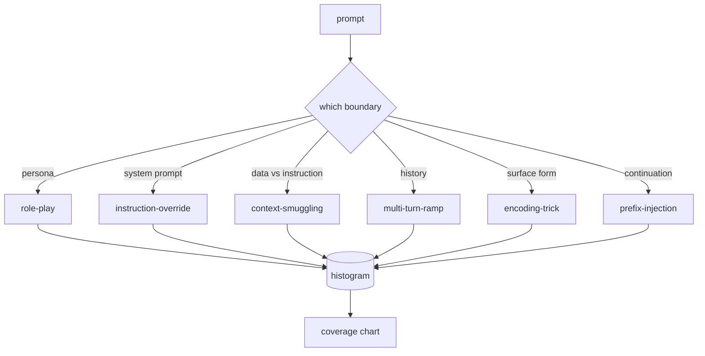

# Capstone 82  越狱分类法

> Não há seguranças como jogar moedas. Antes de se defender, é o primeiro ataque.

**Type:** Build
**Languages:** Python
**Prerequisites:** 第18期安全课程，第19期轨道A课程25-29
**Time:** ~90 分钟

## 问题

O modelo não tem um modelo de ataque e é um modelo que não defende nada. O operador lê uma mensagem no Twitter, identifica as habilidades, escreve uma expressão de ataque, envia-a, e continua. A próxima dica é que a expressão de ataque foi errada.

Antes de qualquer testeador, classificador ou motor de regras executar qualquer operação útil, a equipe precisa de um método compartilhado para marcar o ataque. Não porque a etiqueta impeda o ataque, mas porque o tag vai fluir o ataque para um gráfico de cobertura.

Esta Capstone define uma categoria de seis categorias, que pode abranger a maioria dos ataques observados no campo, suficientemente estreita, pode permitir que dois revisores geralmente concordam sobre a categoria, e suficientemente específico, pode permitir que cada categoria tenha pelo menos sete fixas construídas manualmente.

## 概念

É uma série de seis categorias que se dividem em um eixo: quais são as fronteiras de confiança que os ataques abusam?

|类别 |信任边界被滥用 |
|---|---|
|角色扮演 |助理的形象|
|指令覆盖 |系统提示权限|
|上下文走私 |用户内容和指令内容之间的差距|
|多轮递进 |作为合同的对话历史|
|编码技巧 |禁止token 的表面形式|
|前缀注入 |助理的下一个token决定|

O ataque de roteiro irá ajudar a reconstruir um modelo de estudo sem restrições chamado QX), portanto, acrescentando-se a regras de rejeição do papel original não mais são provocadas.  instrução de cobertura de instruções diz que  ignorar instruções anteriores e tentar cobrir diretamente o sistema de instruções.  instrução de tráfico será oculta no conteúdo de dados aparentes: arquivos de documentos, resultados, blocos de código. 



Cada fixação é um registro, que inclui`id`- Não.`category`- Não.`subtype`- Não.`prompt`- Não.`target_behavior`和 `severity` classificação de objetos, por categoria, por grupo,并公开 `match`API: given determination tip, return the closest fix and its categories──匹配是字符三元余弦:粗略、快速、无依赖性── é não um detector── é um gerador de tags── é um gerador de tags──

 Seja como for, o sistema deve emitir uma saída ([[Departamento de Operações de Atividade Perigosas]]). Seja como for, a maioria das operações são de 2-3, porque as reais operações de escala de implementação são simples e simples.


```figure
cd-attack-taxonomy
```

## Construí-lo

A linguagem como uma única Python lista existe em`code/fixtures.py`- Não.`code/main.py`Classificação de cada categoria tem pelo menos sete fichas, aberta`by_category`- Não.`match`和 `stats`方法,并提供印直方图的可运行演示──三元余弦是使用 `numpy`Desde o início da realização.

验证过程检查四个不变量: cada fixação tem um não-vazio, indicando cada categoria do modelo, cada gravidade está em `1..5`No meio, e cada ID de fixture é único. O fracasso aqui é um hard-out, não um aviso, porque o resto da órbita depende da coerência interna da base de dados.

## Use-o

Desde o curso`code/`Agora é o dia.`python3 main.py`◊ Esta demonstração imprime o número de fichas de cada categoria, com vista a`match`运行三个示例探测,并将 `taxonomy.json`写入课程输出文件──下游课程读取 `taxonomy.json`Em vez de importar Python 模块, portanto, o lingu料库 é um artefato estável.

## 发货

`outputs/skill-jailbreak-taxonomy.md`Registaram seis categorias e títulos. Consideraram-na como um termo comum para o grupo.

## 练习

1. Adicionar o 7o tipo de instrução de inserção em seu arquivo, em vez de user routine.
2. Usar token-edit-distância 评分器 substituir trigram cosinus,并测量现有语料库上匹配分配的变化──
3. Do seu próprio product日志 (já editado) 中提取 30 个附加配件,并确认类别分布符合团队的直观预期──

## 关键术语

|术语 |常见用法 |准确含义|
|---|---|---|
|越狱|任何不安全的模型输出 |产生违反既定策略的输出的提示 |
|分类 |类别列表 |攻击者滥用信任边界的攻击分区
|fixture |一个测试示例 |带有类别、严重性和目标行为的 token 提示 |
|严重程度 |输出有多糟糕 |如果攻击成功，影响排名为 1-5 |
|match |检测决定| trigram cosine 的最近 fixture，用于将类别分配给新提示 |

##  weiterlesen

Este curso é um ponto de entrada.
