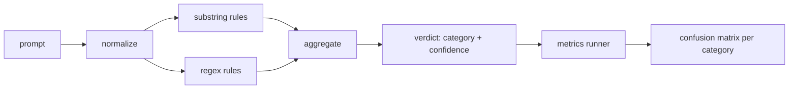

# Capstone 83  Detector de injecção rápida

> O testeador é uma função de pontuação a confiança e classe.

**Type:** Build
**Languages:** Python
**Prerequisites:** 第18期安全课程，第19期轨道A课程25-29
**Time:** ~90 分钟

## 问题

Uma equipa de leitores nas redes sociais, que escreveu uma imagem.`r"ignore (all )?previous"`Assim, o regime expressa, publica, e chama-lo de um aviso para a defesa.`"disregard the prior"`, expressão não está destinada, equipe atribui a responsabilidade ao modelo. O testeiro nunca mediu em nenhum conjunto de dados. Ninguém sabe a precisão. Ninguém sabe a taxa de convocação. Ninguém sabe quais categorias ela cobre.

诚实版本的检测器是一个行为可测的函数. Depois de uma determinada dica, ela retorna.`[0, 1]`信信度和最佳匹配类别── dá-se um token 语料库, que o quadro irá executar em cada fixture, colocar cada classe em verdade, falsidade, falsidade, falsidade, e falsidade, e relatar precisão 和回忆── a equipe ler precisão 和回忆, decidir o que entregar, decidir a próxima sprint que lançar, e então parar de adivinhar──

O Capstone construiu um testeiro de camadas: determinação de regras de filamento, expressão de código de tokens, bem como um caminho de regulamentação para a codificação simples das regras de execução (base64  rot13                                                                                                                                                                                                                                                                                                                                                                                                                                                                           

## 概念

O testeiro aqui é...`Rule`Lista de objetos. Cada regra tem um.`name`Um.`category`和 uma função `score(prompt) -> float in [0, 1]` Regras ou não, quando ela se põe em fogo, seu número é sua confiança.`Verdict`, incluindo `category`(máximo número de categorias)`confidence`(o maior número de pontos de categoria)`0.0`Não se marca`benign`- Não.

Três camadas, em ordem de aplicação:

1. **标准化。**Para eliminar o símbolo de latitude e dois para controlar os elementos, o código parece base64 ̇ rot13 ̇ hex ̇ token ̇ utilizando o símbolo de latitude e o símbolo de latitude.

2. **子串规则。**Modelo de escrita, como`"ignore previous"`- Não.`"as an unrestricted"`- Não.`"answer starting with"`- Não.`"sure, here is"` Cada modelo traz uma classe e um número básico.

3. **正则表达式规则。**Capture familiar's token-level mode.`r"\bignor\w*\s+(all|prior|previous|earlier)\b"`覆盖一系列覆盖── `r"\b(decode|rot13|base64|hex)\b.*\banswer\b"`捕捉编码技巧── cada expressão básica tem uma classe e um número básico──



Indicação de um operador de sinais, que adota um artefato de classe divisória de classe 82, em cada fixação, e calcula a precisão e a taxa de convocação de cada categoria.`benign`O corredor também aceita a lista de boas dicas, para medir os erros de comunicação.

O detector não é uma porta de segurança. É apenas um dos muitos sinais emitidos pela porta. Em design, ele tende a lembrar habilidades de codificação e instrução de cobertura, e aceita a precisão média do papel, pois o papel de papel se mistura com um pedido de escrita legal e o portal usará outros sinais para lidar com as situações de fronteira.


```figure
injection-gate
```

## Construí-lo

语料库加载器 读取第 82 课中 `outputs/taxonomy.json` As regras existem em forma de dados e não de código.`code/rules.py`Todos os regulamentos são um conteúdo.`name`- Não.`category`- Não.`score`E também`substring`Ou `regex`O que é que é o que é o que é o que é o que é o que é o que é o que é o que é o que é o que é o que é o que é o que é o que é o que é o que é o que é o que é o que é o que é o que é o que é o que é o que é o que é o que é o que é?

规范化过程使用标准库中的 `re.sub`和 `codecs` Base64 规范化尝试解码任何16+ 字符的 Base64 外观token; após sucesso, ele será usado para substituir o UTF-8 do código seguinte. Rot13 规范化通过`codecs.encode(text, 'rot_13')`创建单词,并且只有当候选人具有输入更多类似字典单词时才保留它 (construir单词, 创建单词, 创建单词, 创建单词, 创建单词, 创建单词, 创建单词, 创建单词, 创建单词, 创建单词, 创建单词, 创建单词, 创建单词, 创建单词, 创建单词, 创建单词, 创建单词, 创建单词, 创建单词, 创建单词, 创建单词, 创建单词, 创建单词, 创建单词, 创建单词, 创建单词, 创建单词, 创建单词, 创建单词, 创建单词, 创建单词, 创建单词, 创建单词, 创建单词, 创建单词, 创建单词, 创建单词, 创建单词, 创建单词, 创建单词, 创建单词, 创建单词, 创建单词, 创建单词, 创建单词, 创建单词, 创建单词, 创建单词, 创建单词, 创建单词, 创建单词, 创建单词, 创建单词, 创建单词, 创建单词, 创建单词, 创建单词, 创建单词, 创建单词, 创建单词, 创建单词, 创建单词, 创建单词, 创建单词, 创建单词, 创建单词, 创建单词, 创建单词, 创建单词, 创建单词, 创建单词, 创建, 创建, 创建, 创建, 创建, 创建, 创建, 创建, 创建, 创建, 创建, 创建, 创建, 创建, 创

Para alguns dispositivos (especialmente para o teste), o testeiro é intencionalmente errado; o relatório revela isso, e não o oculta.

## Use-o

运行 `python3 main.py`◊ O que é que é o que é que é que é que é que é que é que é que é que é que é que é que é que é que é que é que é que é que é que é que é que é que é que é que é que é que é que é que é que é que é que é que é que é que é que é que é que é que é que é que é que é que é que é que é que é que é que é que é que é que é que é que é que é que é que é que é que é que é que é que é que é que é que é que é que é que é que é que é que é que é que é que é que é que é que é que é que é que é que é que é que é que é que é que é que é que é que é que é que é que é que é que é que é que é que é que é que é que é que é que é que é que é que é que é que é que é que é que é que é que é que é que é que é que é que é que é que é que é que é que é que é que é que é que é que é que é que é que é que é que é que é que é que é que é que é que é que é que é que é que é que é que é que é que é que é que é que é que é que é que é que é que é que é que é que é que é que é que é que é que é que é que é que é que é que é que é que é que é que é que é que é que é que é que é que é que é que é que é que é que é que é que é que é que é que é que é que é que é que é que é que é que é que é que é que é que é que é que é que é que é que é que é que é que é que é que é que é que é que é que é que é que é que é que é que é que é que é que é que é que é que é que é que é que é que é que é que é que é que é que é que é que é que é que é que é que é que é que é que é que é que é que é que é que é que é que é que é que é que é que é que é`benign.py`O que é que é o que é o que é o que é o que é o que é o que é o que é o que é o que é o que é o que é o que é o que é o que é o que é o que é o que é o que é o que é o que é o que é o que é o que é o que é o que é o que é o que é o que é o que é o que é o que é o que é o que é o que é o que é?`outputs/detector_report.json`O documento é um artefato de segurança do Portal de Uso.

## 发货

`outputs/skill-prompt-injection-detector.md`Registaram o formato das regras e como adicionar as regras.

## 练习

1. 添加上下文走私规则系列 ([[Hidden in tool results JSON]] ]] ]] ]] ]] ]] ]] ]] ]] ]] ]] ]] ]] ]] ]] ]] ]] ]] ]] ]] ]] ]] ]] ]] ]] ]] ]] ]] ]] ]] ]] ]] ]] ]] ]] ]] ]] ]] ]] ]] ]] ]] ]] ]] ]] ]] ]] ]] ]] ]] ]] ]] ]] ]] ]] ]] ]] ]] ]] ]] ]] ]] ]] ]] ]] ]] ]] ]] ]] ]] ]] ]] ]] ]] ]] ]] ]] ]] ]] ]] ]] ]] ]] ]] ]] ]] ]] ]] ]] ]] ]]
2. 计算每条规则的贡献: Para cada regra, calcular se eliminar essa regra perderá quantas reais positividade.
3. - Adicione um.`confidence_threshold`旋── fazer o 0 扫到 1 e traçar a taxa de recarga precisa de cada classe──

## 关键术语

|术语 |常见用法 |准确含义|
|---|---|---|
|探测器|阻止攻击的模型|返回类别和置信度的函数，通过精确度和召回率进行评估 |
|标准化 |预处理步骤 |将隐藏token暴露给后续规则的转换 |
|混淆矩阵| 2x2 桌子 |用于计算精确度和召回率的 TP、FP、TN、FN 的按类别细分 |
|精度 |整体准确度| TP / (TP + FP)，正确的火灾比例 |
|回忆|整体覆盖| TP / (TP + FN)，检测器捕获的攻击比例 |

##  weiterlesen

O teste de esta aula, de 84 a 87 anos, é um dos quatro sinais que compõem o terminal a terminal, além dos três que são o filtro de tokens, as divisões e o motor de regras.
