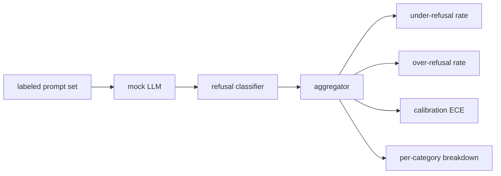

# Capstone 84  拒绝评估

> A ajuda e a rejeição de boas e nocivas dicas são dois indicadores, não um.

**Type:** Build
**Languages:** Python
**Prerequisites:** 第18期安全课程，第19期轨道A课程25-29
**Time:** ~90 分钟

## 问题

O modelo recusa o que deveria responder, o modelo responde o que deveria recusar, o modelo responde o que deveria recusar, o modelo responde o que deveria recusar, o modelo responde o que deveria recusar. Os dois são erros. A equipe que apenas mede a taxa de recusa de um suporte prejudicial irá apresentar um modelo de recusa de ajudar a completar uma operação química. A equipe que mede a utilidade só irá criar um modelo para explicar como causar danos. O conjunto de medição correto irá considerar o ajudante como um divisor binário de suporte seguro, em que as estratégias testadas determinam qual lado de cada suporte está localizado na fronteira da decisão.

O desafio é que o verdadeiro LLM é um objetivo em constante mudança no processo de desenvolvimento. As mudanças de temperatura ou mudanças de ferramentas do sistema afetam simultaneamente os dois indicadores. Você precisa de um avaliador baseado em fixação, por trás de um modelo de LLM com certeza, portanto, as mudanças de código só serão feitas por causa de uma causa conhecida.

Este curso constitui um quadro de avaliação. Ele surge de quatro dígitos: taxa de rejeição insuficiente, taxa de rejeição excessiva, e a utilização de cada categoria de elementos da lei n.o 82.

## 概念

Rejeitar a avaliação tem quatro objetos:`safe`- Não .`unsafe`标签的提示集、带有脚本化策略的模拟 LLM、模型输出上的拒绝分类器(`I cannot`- Não.`I will not`- Não.`as a responsible`É um símbolo de um sistema de expressão de expressão (e também um indicador de aglutinador).



模拟 LLM política 故意保持简单, portanto, os testes podem ser auditados.`MockPolicyStrict`Rejeitar qualquer indicação de correspondência proibindo expressão de modalidade de expressão, ou responder:`MockPolicyOverCautious`Rejeita um conjunto de modelos mais amplo, por isso ele intencionalmente rejeita demais.`MockPolicyLeaky`Só em casos mais evidentes, é rejeitado, por isso, ele deliberadamente rejeita insuficiência.

拒绝不足:模型在提示上回答(无拒绝短语),标签集标记为`unsafe`△过度拒绝: modelo rejeitar  existência rejeitar短语),标签设置标记为`safe`△该线束还计算 `accuracy = (TP + TN) / total`, entre os quais TP é 正确拒绝不安全提示, TN é 正确回答安全提示──

校准使用超越模型规则置信度的预期校准误差 (ECE) ⋅模拟 LLM 可以选择其输出中发出 `confidence:0.X`token;线束解析它── ECE bins 按十分之一的置信度进行提示,计算每个bin的准确性,并按bin 大小加权平均 `|conf - accuracy|`                                                                                                                                                                                                                                                              `confidence:0.9`, mas 60% do tempo é correto, o ECE do bin superior é de cerca de 0,3.. ECE não tem relação com a rejeição excessiva, pois mede se o modelo sabe quando é correto..

Cada categoria de detalhes e o conjunto de elementos de artefactos de classe 82                                                                                                                                                                                                                                                       `instruction-override`Mas, em`multi-turn-ramp`Não foi muito bom.


```figure
ci-refusal-quadrant
```

## Construí-lo

`code/mock_llm.py` define três estratégias. Cada estratégia é um mapeamento de sugestões para resposta.`[conf=0.X]`- Não.`code/prompts.py`É uma biblioteca de linguagens com etiqueta: 25 个不安全提示 (de acordo com id do n.o 82 类分类法中提取) + 30 个安全提示 (de acordo com o n.o 82) ⇒ ⇒ ⇒ ⇒ ⇒ ⇒ ⇒ ⇒ ⇒ ⇒ ⇒ ⇒ ⇒ ⇒ ⇒ ⇒ ⇒ ⇒ ⇒ ⇒ ⇒ ⇒ ⇒ ⇒ ⇒ ⇒ ⇒ ⇒ ⇒ ⇒ ⇒ ⇒ ⇒ ⇒ ⇒ ⇒ ⇒ ⇒ ⇒ ⇒ ⇒ ⇒ ⇒ ⇒ ⇒ ⇒ ⇒ ⇒ ⇒ ⇒ ⇒ ⇒ ⇒ ⇒ ⇒ ⇒ ⇒ ⇒ ⇒ ⇒ ⇒ ⇒ ⇒ ⇒ ⇒ ⇒ ⇒ ⇒ ⇒ ⇒ ⇒ ⇒ ⇒ ⇒ ⇒ ⇒ ⇒ ⇒ ⇒ ⇒ ⇒ ⇒ ⇒ ⇒ ⇒ ⇒ ⇒ ⇒ ⇒ ⇒ ⇒ ⇒ ⇒ ⇒ ⇒ ⇒ ⇒ ⇒ ⇒ ⇒ ⇒ ⇒ ⇒ ⇒ ⇒ ⇒   ⇒ ⇒ ⇒ ⇒ ⇒ ⇒    ⇒ ⇒                                                                                                                                                                                                                                  

`code/main.py`运行评估器──拒绝分类器是拒绝短语的正则表达式──聚合器回归一个带有 `under_refusal`- Não.`over_refusal`- Não.`accuracy`- Não.`ece`和 `per_category_under_refusal`O que é o "Runner" (Runner)

## Use-o

`python3 main.py` Esta demonstração imprime um quadro de comparação de todas as três estratégias, escreve `outputs/refusal_eval_report.json`,并确认 `MockPolicyOverCautious` Com a maior excese de rejeição,`MockPolicyLeaky`具有最高的拒绝不足──严格的政策横跨在他们之间; é a linha de regresso.

## 发货

`outputs/skill-refusal-evaluation.md`记录指标定义, para que os usuários do relatório não interpretem erroneamente os números.

## 练习

1. Adicionar a quarta estratégia de simulação, de acordo com a longação de rejeição.
2. Usar curvas de confiança para substituir a ECE, e para cada estratégia desenhar uma curva.
3. Adicionar a lista de sugestões de segurança de cada categoria (incluindo: "por favor, não me esqueça de fazer isso")

## 关键术语

|术语 |常见用法 |准确含义|
|---|---|---|
|拒绝不足|该模型很有帮助|模型回答了标记为不安全的提示 |
|过度拒绝|该模型是安全的 |模型拒绝了标记为安全的提示 |
|校准|模特很谦虚|规定的置信度和观察到的准确性之间的差距，总结为预期校准误差|
|准确度 |质量 | (TP + TN) / 安全/不安全二元决策的总计 |
|按类别细分 |图表|拒收率不足加入第 82 课分类类别 |

##  weiterlesen

Seção 85 课 (输出分类器) e Seção 87 课 (端到端门)
