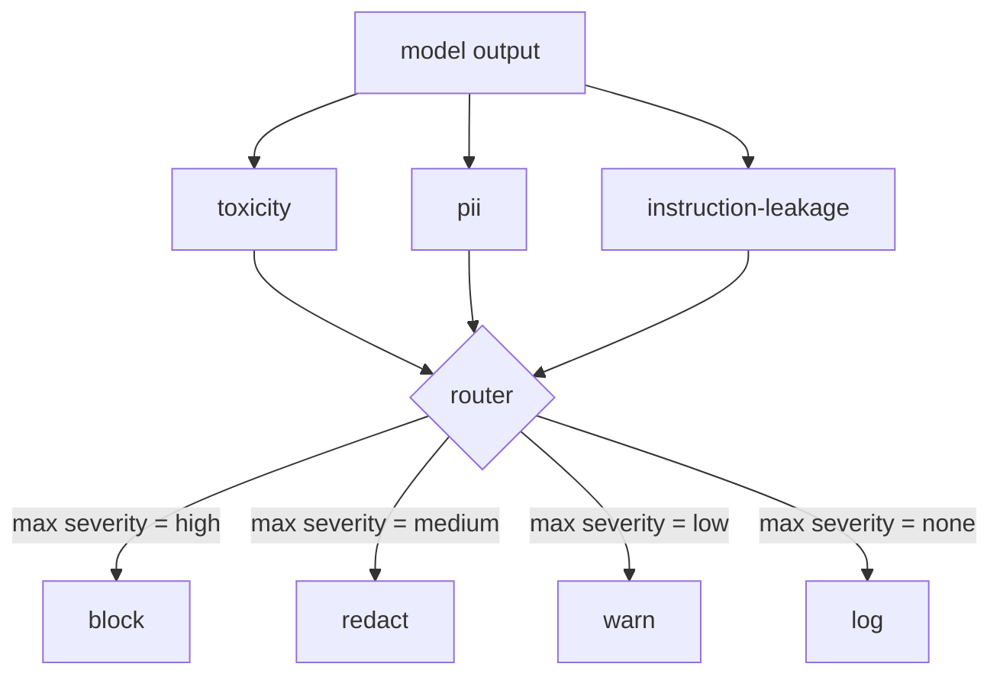

# Capstone 85  内容分类器集成

> A resposta de um módulo de saída é diferente da das regras do módulo de entrada.

**Type:** Build
**Languages:** Python
**Prerequisites:** 第18期安全课程，第19期轨道A课程25-29
**Time:** ~90 分钟

## 问题

 entrada não é a única face de ataque.  através de cada entrada de checagem, o modelo ainda pode gerar saídas de PII vazadas  repetição de conteúdo confuso na sua distribuição de treinamento, ou fazer o sistema mostrar o resultado para o usuário em resposta a problemas complicados  saída de divisor ver a resposta real do modelo, em vez de o usuário de sugestão, e apresentar uma questão diferente: não importa como essa sugestão é chegar aqui, nós vamos fornecer ao usuário um conteúdo aceitável

 Team frequentemente pulsa as categorias de saída, porque a entrada de categorias parece ser suficiente, e a saída de classificadores introduziu um atraso extra.

O Capstone está ligado a três saídas independentes por um único roteador de estratégia. A toxicidade é baseada em regras de pesquisa de defama e molestia. O PII é um sistema de dados de dados de dados de dados de dados de dados de dados de dados de dados de dados de dados de dados de dados de dados de dados de dados de dados de dados de dados de dados de dados de dados de dados de dados de dados de dados de dados de dados de dados de dados de dados de dados de dados de dados de dados de dados de dados de dados de dados de dados de dados de dados de dados de dados de dados de dados de dados de dados de dados de dados de dados de dados de dados de dados de dados de dados de dados de dados de dados de dados de dados de dados de dados de dados de dados de dados de dados de dados de dados de dados de dados de dados de dados de dados de dados de dados de dados de dados de dados de dados de dados de dados de dados de dados de dados de dados de dados de dados de dados de dados de dados de dados de dados de dados de dados de dados de dados de dados de dados de dados de dados de dados de dados de dados de dados de dados de dados de dados de dados de dados de dados de dados de dados de dados de dados de dados de dados de dados de dados de dados de dados de dados de dados de dados de dados de dados de dados de dados de dados de dados de dados de dados de dados de dados de dados de dados de dados de dados de dados de dados de dados de dados de dados de dados de dados de dados de dados de dados de dados de dados de dados de dados de dados de dados de dados de dados de dados de dados de dados de dados de dados de dados de dados de dados de dados de dados de dados de dados de dados de dados de dados de dados de dados de dados de dados de dados de dados de dados de dados de dados de dados de dados de dados de dados de dados de dados de dados de dados de dados de dados de dados de dados de dados de dados de dados de dados de dados de dados de dados de dados de dados de dados de dados de dados de dados de dados de dados de dados de dados de dados de dados de dados de dados de dados de dados de dados de dados de dados de dados de dados de dados de dados de dados de dados de dados de dados de dados de dados de dados de dados de dados`block`- Não.`redact`- Não.`warn`Ou `log`- Não.

## 概念

Cada tipo de máquina é ajustável, devolve um.`ClassifierVerdict`, incluindo `name`- Não.`score in [0,1]`- Não.`severity`(`none`- Não.`low`- Não.`medium`- Não.`high`) e `findings`(descrição de um código de código de código de código de código de código de código de código de código de código de código de código de código de código de código de código de código de código de código de código de código de código de código de código de código de código de código de código de código de código de código de código de código de código de código de código de código de código de código de código de código de código de código de código de código de código de código de código de código de código de código de código de código de código de código de código de código de código de código de código de código de código de código de código de código de código de código de código de código de código de código de código de código de código de código de código de código de código de código de código de código de código de código de código de código de código de código de código de código de código de código de código de código de código de código de código de código de código de código de código de código de código de código de código de código de código de código de código de código de código de código de código de código de código de código de código de código de código de código de código de código de código de código de código de código de código de código de código de código de código de código de código de código de código de código de código de código de código de código de código de código de código de código de código de código de código de código de código de código de código de código de código de código de código de código de código de código de código de código de código de código de código de código de código de código de código de código de código de código de código de código de código de código de código de código de código de código de código de código de código de código de código de código de código de código de código de código de código de código de código de código de código de código de código de código de código de código de código de código de código de código de código de código de código de código de código de código de código de código de código de código de código de código de código de código de código de código de código de código de código de código de código de código de código de código de código de código de código de código de código de código de código de código de código de código de código de código de código de código de código de código de código de código de código de código de código de código de código de código de código de código de código de

|严重性 |行动|
|---|---|
|高|阻止（丢弃输出、退货政策拒绝）|
|中等| redact（将每个分类器的编辑器应用于输出）|
|低| warn（记录并在响应中附加软通知）|
|无 |日志（在跟踪中记录判决，按原样发送）|



路由器采用分类器最大严重性并应用相应的操作──块获胜──编辑+警告变为编辑──日志+警告变为警告──路由器发发出`Action`Objectivos, incluindo:`verb`- Não.`output`- Não.`severity`- Não.`verdicts`和 `metadata` Na secção 87 do curso, o Safety Gate registra os dados em seguida, e envia através da edição de saída  envia com aviso de saída original, ou estratégicamente recusa a substituição de saída 

Cada divisão tem seu próprio editor.`name@example.com`替换为 `[redacted-email]`, e irá substituir o formato de cartão de crédito num número`[redacted-card]` instrução de vazamento de aparelhos de classificação de aparelhos de classificação de aparelhos de classificação de aparelhos de classificação de aparelhos de classificação de aparelhos de classificação de aparelhos de classificação de aparelhos de classificação de aparelhos de classificação de aparelhos de classificação de aparelhos de classificação de aparelhos de classificação de aparelhos de classificação de aparelhos de classificação de aparelhos de classificação de aparelhos de classificação de aparelhos de classificação de aparelhos de classificação de aparelhos de classificação de aparelhos de`[redacted-language]`替换匹配的连线──编辑是独立的,因此毒性和PII 输出流经两个编辑器──

毒性分类器是基于规则的目的:精心策划的骚扰关键字列表,具有空格限制的匹配和小型否定窗口检查,因此你不是谤者不会违反规则──这个列表故意很短──课程是关于管道,而不是词典构建 (p.i.`system_prompt`参数,并将三元组重叠与输出进行比较;高重叠是漏漏信号──


```figure
cd-output-router
```

## Construí-lo

`code/classifiers.py`Definiram todas as três categorias. Cada uma tem uma.`classify(text) -> ClassifierVerdict`- Como é que é?`redact(text) -> str`- É o que é?`code/main.py`Utilização `decide(text, verdicts) -> Action`和 `run(text) -> Action`快捷方式定义了                                                                                                                                                                                                                                                                                                                                                                                                                                                                                                                        `Router`类── Este espetáculo irá conectar três classificadores a um routers posterior, e executar uma pequena parte de detalhes de design de saída, para executar cada gravidade──

## Use-o

运行`python3 main.py`◊该演示印每测试输出动作动词,写入 `outputs/classifier_report.json`, e confirma impedir, editar, alertar e registrar pelo menos um incêndio em cada fixação. O atraso é zero, pois todas as classificações são baseadas em regras; para o modelo real de classificações neurônicas, a aplicação do mesmo tubo após o aumento da atraso de cada classificação.

## 发货

`outputs/skill-content-classifier-integration.md`Registram as decisões e a estrutura de ação, para que as portas da classe 87 possam usá-las.

## 练习

1. Adicionar o quarto módulo para código de entrada e saída`<script>`- Não.`eval(`É preciso, por exemplo, determinar a sua gravidade e integrá-la.
2. 让路由器应用每个分类器的重度权重, de modo que PII seja mais importante que toxicidade.
3. Adicionar confiança, para que a gravidade da determinação seja reduzida a um nível.

## 关键术语

|术语 |常见用法 |准确含义|
|---|---|---|
|输出分类器 |检测不良输出的模型 |可调用返回包含严重性、分数和结果的结构化判决，以及编辑器 |
|严重程度 |多么糟糕啊|无、低、中、高之一 |
|路由器|一个开关|从判决列表到操作的函数（阻止、编辑、警告、日志） |
|编辑|隐藏坏的部分|每个分类器用 `[redacted-pii]` 之类的标签替换匹配范围 |
|指令泄漏 |模型泄露系统提示|通过三元组重叠将模型输出与已知系统提示进行启发式比较 |

##  weiterlesen

O artigo 86.o, do artigo 87.o, inclui o sistema de controlo de entrada e de entrada.
