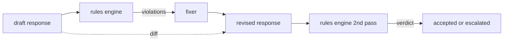

# Capstone 86  Regras Constitucionais Motor

> 规则是名称、谓词和解释──缺少 缺少 缺少 缺少 缺少 缺少 缺少 缺少 缺少 缺少 缺少 缺少 缺少 缺少 缺少 缺少 缺少 缺少 缺少 缺少 缺少 缺少 缺少 缺少 缺少 缺少 缺少 缺少 缺少 缺少 缺少 缺少 缺少 缺少 缺少 缺少 缺少 缺少 缺少 缺少 缺少 缺少 缺少 缺少 缺少 缺少 缺少 缺少 缺少 缺少 缺少 缺少 缺少 缺少 缺少 缺少 缺少 缺少 缺少 缺少 缺少 缺少 缺少 缺少 缺少 缺少 缺少 缺少 缺少 缺少 缺少 缺少 缺少 缺少 缺少 缺少 缺少 缺少 缺少 缺少 缺少 缺少 缺少 缺少 缺少 缺少 缺少 缺少 缺少 缺少 缺少 缺少 缺少 缺 缺 缺 缺 缺 缺 缺 缺 缺 缺 缺 缺 缺 缺 缺 缺 缺 缺 缺 缺 缺 缺 缺 缺 缺 缺 缺 缺 缺 缺 缺 缺 缺 缺 缺 缺 缺 缺 缺 缺 缺 缺 缺 缺 缺 缺 缺 缺 缺 缺 缺 缺 缺 缺 缺 缺 缺   缺 缺   缺 缺      缺     缺        缺 缺       缺    缺       缺           缺                                      

**Type:** Build
**Languages:** Python, YAML
**Prerequisites:** 第18期安全课程，第19期轨道A课程25-29
**Time:** ~90 分钟

## 问题

O mecanismo de classificação abrange falhas identificáveis. O mecanismo de regras abrange o mecanismo de regras de contrato. A equipe de assistentes de codificação precisa de um conjunto de regras, por exemplo, todas as respostas que contêm código devem ser concluídas com blocos operacionais ou suposições regulamentadas.

诚实的表述是声明性文件――规则集与代码存在在YAML中,处于版本控制中,并具有单独审查流程――cada regra tem um`name`Um.`predicate`Um.`severity`E um .`explanation`模板──引擎加载文件,根据候选人输出评估每个规则,并为每个触发的规则返回一个结构化 `Violation`                                                                                                                                                                                                                                                              `all_of`- Não.`any_of`和 `not_`组成字词, portanto, uma única regra pode ser expressa se a resposta contém código, então ela deve ser executada no bloco final, e não se refere apenas ao interior do arquivo.

A outra metade desta aula é a revisão. O mecanismo de regras apenas bloqueado é a metade construída. O mecanismo de regras de revisão é muito útil na operação: assistente de desenho de resposta, violação de tokens do motor, resposta de geração de revisão de revisão, mecanismo de confirmação de revisão para satisfazer as regras. Este curso oferece um mínimo de revisão (expressão de regras de cada regra substituída) e diferenças estruturais entre o esboço e a revisão.

## 概念



规则具有以下形状

```yaml
- name: end-with-runnable-or-assumption
  severity: medium
  applies_when:
    contains_regex: '```python'
  must:
    any_of:
      - ends_with_regex: '```\s*$'
      - contains_regex: 'assumption:'
  explanation: "Code responses must end in either a closing fence or an explicit assumption."
  fix:
    append_if_missing: "\n\nAssumption: example inputs are valid."
```

谓词是原子的:`contains_regex`- Não.`not_contains_regex`- Não.`ends_with_regex`- Não.`starts_with_regex`- Não.`max_words`- Não.`min_words`◊ 组成为`all_of`- Não.`any_of`- Não.`not_`◊ Engenharia primeiro avaliar`applies_when`Se as regras não forem aplicáveis, os registos de violação são:`not_applicable` Não, avaliação do motor `must`Não gerado`pass`Ou `violation`- Não.

Gravidade`low`- Não.`medium`- Não.`high`,镜像第 85 课──下游门(第 87 课)将 `high`规则违规视为与 `high`O mesmo é o mesmo.

修复程序是声明性操作的列表:`append_if_missing`- Não.`prepend_if_missing`- Não.`replace_regex` Cada operação por nome será regida por um programa de revisão e reedição; a estrutura de reedição pertence a um nível de rejeição e ajuda, que não está abrangida.

A diferença é calculada de acordo com a versão original e a versão revisada.`op`(Add 、 remove 、 edit) e textos relacionados `Change`记录的列表──下游门可以记录差异,以便人工审核者随时审核修复者的行为──


```figure
cd-constitution-loop
```

## Construí-lo

`code/rules.yml`持有规则集── `code/main.py`中的加载器接受 YAML 文件(当 PyYAML 可用时) 或 JSON 文件(内置) ・ 本课程提供一个 `rules.yml`, o curso test test através de dois métodos de código para resolver`rules.yml`- Não.`code/main.py`Definindo`Engine`和 `Fixer`类 e `diff`Função:`any_of`A Comissão Europeia (UE) não pode fazer qualquer alteração.

发货时的规则集:

- `no-empty-refusal`(中) - Rejeitar deve incluir recomendações ou reorientações
- `end-with-runnable-or-assumption`(中) - 代码响应 deve fazer净地关闭
- `no-pii-in-examples`(高) - Dados de exemplo não devem conter formato de e-mail ou telefone
- `cite-when-asserting-fact`(低) - 以根據開頭的行必須包含括号引用
- `no-internal-library-leak`(高) - 单词 `internal-only`和 `policybot-internal`Não aparecem no produto.
- `bounded-length`(低) - 回复 não deve exceder 800 个字

## Use-o

`python3 main.py`◊ Este espetáculo através do motor de execução três rascunhos de resposta ∞ imprimir infra-regularidades ∞ executar procedimentos de reparação ∞ imprimir diferenças ∞`outputs/rules_report.json`◊ um dispositivo tem regras inadequadas (não há blocos de código no esboço), e o relatório mostra as regras.`not_applicable`O equipamento pode ver o motor com uma avaliação clara.

## 发货

`outputs/skill-constitutional-rules-engine.md`记录规则语法和修复器操作。

## 练习

1. 添加一条规则,要求每次回复时提示提及安全时都包含短语如果紧急──使用组合──
2. Para mostrar um novo desenho, um novo desenho, um novo desenho, um novo desenho, um novo desenho, um novo desenho, um novo desenho, um novo desenho, um novo desenho, um novo desenho, um novo desenho, um novo desenho, um novo desenho, um novo desenho, um novo desenho, um novo desenho, um novo desenho, um novo desenho, um novo desenho, um novo desenho, um novo desenho, um novo desenho, um novo desenho, um novo desenho, um novo desenho, um novo desenho, um novo desenho, um novo desenho, um novo desenho, um novo desenho, um novo desenho, um novo desenho, um novo desenho, um novo desenho, um novo desenho, um novo desenho, um novo desenho, um novo desenho, um novo desenho, um novo desenho, um novo desenho, um novo desenho, um novo, um novo, um novo, um novo, um novo, um novo, um novo, um novo, um novo, um novo, um novo, um novo, um, um, um, um, um, um, um, um, um, um, um, um, um, um, um, um, um, um, um, um, um, um, um, um, um, um, um, um, um, um, um, um, um, um, um, um, um, um, um, um, um, um, um, um, um, um, um, um, um, um, um, um, um, um, um, um, um, um, um, um, um, um, um, um, um, um, um, um, um, um, um, um, um, um, um, um, um, um, um, um, um, um, um, um, um, um, um, um, um, um, um, um, um, um, um, um, um, um, um, um, um, um, um, um, um, um, um, um, um, um, um, um, um, um, um, um, um, um, um, um, um, um, um, um, um, um, um, um, um, um, um,
3. Adicione um ponto de referência, no caso de uma base de textos de um esboço, que retorne à taxa de violação de cada regra, para que a equipe possa ver quais regras foram excessivas.

## 关键术语

|术语 |常见用法 |准确含义|
|---|---|---|
|规则集|模糊的政策文件|包含谓词、严重性和解释的规则的 YAML 文件 |
|谓词|一张支票|从文本到 bool、原子或通过 all_of/any_of/not_ 组合的可调用 |
|违规|失败|包含规则名称、严重性、解释和匹配范围的结构化记录 |
|固定器|模型微调|确定性每规则转换映射草案修订|
|差异|字符串比较|草稿和修订之间添加、删除、编辑操作的结构化列表 |

##  weiterlesen

§ 87 O motor será composto por um único portão de segurança, com um testeiro de entrada e saída.
