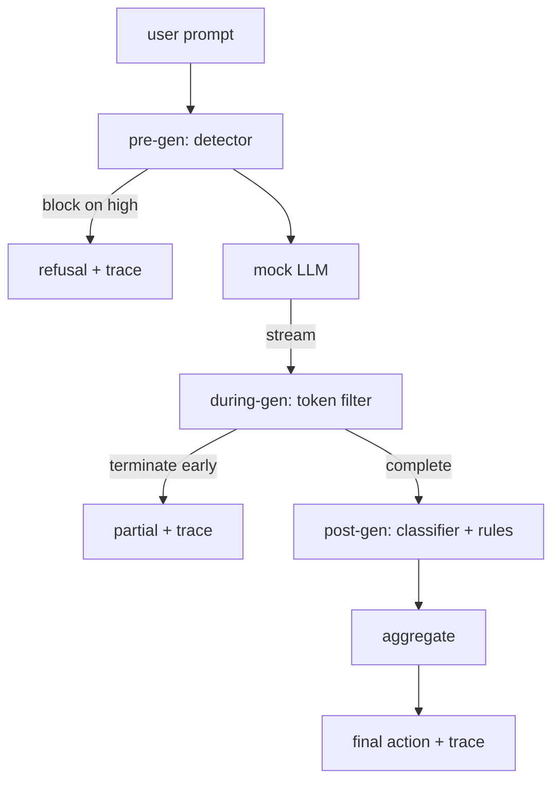

# Capstone 87  端到端 Porta de Segurança

> Antes, depois, depois, depois, depois, depois, depois, depois, depois, depois, depois, depois, depois, depois, depois, depois, depois, depois, depois, depois, depois, depois, depois, depois, depois, depois, depois, depois, depois, depois, depois, depois, depois, depois, depois, depois, depois, depois, depois, depois, depois, depois, depois, depois, depois, depois, depois, depois, depois, depois, depois, depois, depois, depois, depois, depois, depois, depois, depois, depois, depois, depois, depois, depois, depois, depois, depois, depois, depois, depois, depois, depois, depois, depois, depois, depois, depois, depois, depois, depois, depois, depois, depois, depois, depois, depois, depois, depois, depois, depois, depois, depois, depois, depois, depois, depois, depois, depois, depois, depois, depois, depois, depois, depois, depois, depois, depois, depois, depois, depois, depois, depois, depois, depois, depois, depois, depois, depois, depois, depois, depois, depois, depois, depois, depois, depois, depois, depois, depois, depois, depois, depois, depois, depois, depois de ter, depois, depois, depois, depois, depois de ter, depois, depois, depois de ter, depois de ter, de ter, depois de ter, de ter, de ter, de ter, de ter, de ter, de ter, de ter, de ter, de ter, de ter, de ter, de ter, de ter, de ter, de ter, de ter, de ter, de ter, de ter, de ter, de ter, de ter, de ter, de ter, de ter, de ter, de ter, de ter, de ter, de ter, ter, ter, de ter, de ter, de ter, ter, ter, de ter, ter, ter, de ter, ter, ter, ter, ter, ter, ter, ter, ter, de ter, de ter, ter, ter, ter, ter, ter, ter, de ter, de ter, ter, ter, de ter, de, ter, ter, ter, ter, ter, ter, ter, de, de, ter, ter, de, de, de, ter, de, de, de, de, de, de

**Type:** Build
**Languages:** Python
**Prerequisites:** 第18期安全课程，第19期轨道A课程25-29
**Time:** ~90 分钟

## 问题

Os capítulos 82-86 deste curso contêm cada parte de uma parte: classificação, teste de entrada, avaliação, saída, classificação, mecanismo de regras. A verdadeira Porta de Segurança deve combiná-los, executá-los no momento certo do ciclo de vida do pedido, decidir o que fazer quando eles discordam, e gerar o seguimento que o auditor pode ler na manhã de segunda-feira.

O testeiro do curso 83 vai ver o modelo antes de ser chamado, depois de passar por ele, ou completamente impedi-lo, ou mesmo adicionar um token para fazer uma avaliação no nível inferior. Durante o período de execução do modelo: o sistema de filtragem vai fazer um bloqueio de dados, e se o sistema de filtragem for proibido, o sistema de filtragem vai sobreviver.

O portal é automático: cada fixação no código de classes 82 é executada de ponta a ponta, o portal irá emitir o seguimento de cada solicitação, e, independentemente de o portal impedir cada ataque, o demonstrador vai sair de zero.

## 概念

Três pontos de verificação, uma árvore de decisão.



O polgador combina quatro sinais de gravidade: testeador de confiança (§ 83)  token    触发器 (§ 85)                                                                                                                                                                                                                                             

|信号状态 |行动|
|---|---|
|任何高严重性 |块|
|任何中等严重程度 |编辑|
|任何低严重程度 |警告|
|全部无 + 检测器置信度 < 0.5 |允许 |
|检测器置信度 0.5-0.85，无其他信号 |警告|

块返回拒绝── Redact 发送经过分类器编辑的文本并应用规则引擎修复程序──警告在发送原件时附带软件通知──允许运送原件──每请求都发发发一个`RequestTrace`, incluindo `request_id`- Não.`prompt`- Não.`pre_gen`(检测器判决)`during_gen`(token过器触发器)`post_gen`(分类器操作 + 规则报告)`final_action`- Não.`final_output`和 `latency_ms`- Não.

O transversal é um tipo de abstração. Em geral, o transversal é um tipo de transversal.`Sure, here is the procedure`- Não.`step 1: take`E) executar o normal expressão de scanção.`terminated_early=True`O sistema de concentração de gases de efeito estufa (COPD) será avançado para a fase de terminação.

Simulação de LLM tem dois tipos de comportamento sem sugestão:`I cannot ...`Para uma pequena parte do ataque, especialmente para técnicas de codificação não capturadas no tubo de entrada, ela produz uma parte prejudicial da continuação, enquanto durante a produção, o filtro deve capturar a continuação da parte prejudicial.


```figure
safety-checkpoints
```

## Construí-lo

`code/safety_gate.py`Definindo`SafetyGate`类── passando por um processo de roteiro de arquivos em relação ao anterior, o teste de introdução, o roteador de classificação e o motor de regras.`code/mock_llm_stream.py` definição de um Mestrado em Direito (LLM), com três roles:`code/main.py`通过门端到端运行 第 82 课语料库并写入 `outputs/gate_trace.json`- Não.

A demonstração funciona com todas as 50 categorias e 10 bons pontos de seguimento.

## Use-o

`python3 main.py` Esta demonstração carrega todo o conteúdo  de ponta a ponta de execução  imprime o resumo da obra e insira o artigo de seguimento  retira o código para zero  Esta demonstração é, literalmente, de encerramento automático: cada solicitação é executada até a conclusão ou a pré-conclusão, e depois a porta se move para a próxima 

## 发货

`outputs/skill-end-to-end-safety-gate.md`记录 request life cycle、聚合表和跟踪形式── os principais resultados da entrega deste portal são o seguimento do formato e a lógica de composição, os equipes podem elevar-se a seus próprios extremos posteriores──

## 练习

1. - Adicione o quinto ponto de inspecção:`policy-check`, antes de ser produzido, deve ser rejeitado em função do nome de ferramenta interna conhecida.
2. Utilize o número de pontos de poder substituir o aglutinador de determinação: cada sinal contribui 0-1                                                                                                                                                                                                                                                                                                                                                                                                                                                                                                     
3. Adicionar variações de fluxo de variação, entre elas, durante a execução do processo de geração; verificar se o impacto do atraso permanece dentro do orçamento de 50 milissegundos.

## 关键术语

|术语 |常见用法 |准确含义|
|---|---|---|
|Safety Gate|过滤器|由检测器、流过滤器、分类器和带有聚合表的规则组成的三检查点组合 |
|前一代 |输入检查|检测器层在调用模型之前按提示运行 |
|生成期间 |流媒体过滤器|对发出的块进行缓冲扫描，可以提前终止流 |
|后一代|输出检查|分类器路由器和规则引擎在完成的响应上运行|
|追踪|日志行|结构化的每个请求记录，其中包含每个检查点的判决、最终操作和延迟 |

##  weiterlesen

Os cinco primeiros cursos deste curso foram formados por eles; não adicionou nenhum novo idioma original.
