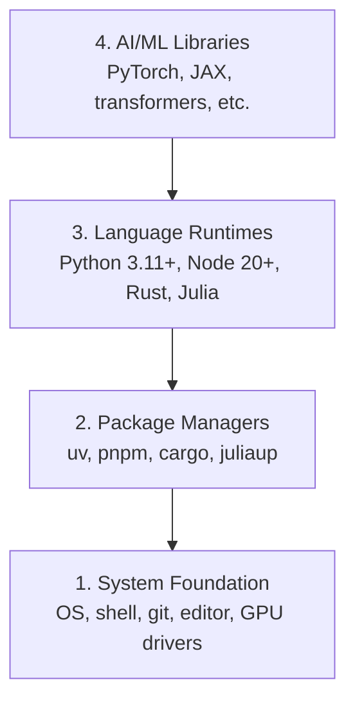

# Dev Çevre

> Senin aletlerin düşünce tarzını şekillendirecek. Bir kere ayarlama, doğru ayarlama.

**Type:** Build
**Languages:** Python, Node.js, Rust
**Prerequisites:** None
**Time:** ~45 分钟

## Öğrenme hedefi
- From零开始设置 Python 3.11+、Node.js 20+ 和 Rust toolchains
- Virtual ortamları ve paket yöneticilerini yapılandırmak, yeniden yapılandırılabilir yapılandırmalar gerçekleştirmek için
- CUDA/MPS 验证 GPU erişim,并运行一个测试 Tensor operasyon
- Sistem, paket, çalıştırma zamanları, yapay zeka kütüphaneleri

## 问题
Python,TypeScript,Rust,Julia ile 500+ bölüm AI mühendisliği derslerini öğreneceksiniz. Eğer çevreniz kötüse, her bölüm öğrenmek yerine mücadele ve araç haline gelir.

Çoğu insan çevre ayarını atlar. Sonra birkaç saat harcarlar. İçe aktarım hatalarını düzeltirler. Versiyon çatışmaları ve eksik CUDA sürücüleri.

## 概念
Bir AI mühendisliği ortamı dört katlı:



Biz alt üstü yüklüyoruz. Her katın alt katından kaynaklanıyor.


```figure
s0-env-stack
```

## Yapın onu.
### 步骤 1: Sistem Temel

Sistemini kontrol et ve temel bileşenleri yükle.

```bash
# macOS
xcode-select --install
brew install git curl wget

# Ubuntu/Debian
sudo apt update && sudo apt install -y build-essential git curl wget unzip

# Windows (use WSL2)
wsl --install -d Ubuntu-24.04
```

### 步骤 2: Python ve UV

Biz kullanıyoruz .`uv`Pip 快 10-100x, ve otomatik olarak sanal ortamları işleyecektir.

```bash
curl -LsSf https://astral.sh/uv/install.sh | sh

uv python install 3.12

uv venv
source .venv/bin/activate  # or .venv\Scripts\activate on Windows

uv pip install numpy matplotlib jupyter
```

验证:

```python
import sys
print(f"Python {sys.version}")

import numpy as np
print(f"NumPy {np.__version__}")
a = np.array([1, 2, 3])
print(f"Vector: {a}, dot product with itself: {np.dot(a, a)}")
```

### 步骤 3: pnpm ile Node.js

TypeScript'te kullanılıyor.

```bash
curl -fsSL https://fnm.vercel.app/install | bash
fnm install 22
fnm use 22

npm install -g pnpm

node -e "console.log('Node', process.version)"
```

İlk kontrol için bir program yapın.`unzip`,缺少时以`Not installing fnm due to missing dependencies.`退出: Linux 上 需要解压一个 zip 归档, MacOS 上则通过 Homebrew 安装──macOS 自带 `unzip`Ubuntu、Debian 和 WSL2 会通过步骤 1 的 apt 命令安装它(( eğer o adımı atladınsa, çalış `sudo apt install -y unzip`)。

**macOS / Apple Silicon（M1/M2/M3/M4）：**Eğer bir işlemi yaparsanız`Error: Cannot install under Rosetta 2 in ARM default prefix (/opt/homebrew)`Dur, sonun Rosetta 2'de olduğunu göster.`arch`输出 `i386`), Homebrew ise orijinal bir arm64 yapılandırmasıdır.`fnm install 22`開始重新运行 上面的命令:

```bash
arch -arm64 brew install fnm
echo 'eval "$(fnm env --use-on-cd)"' >> ~/.zshrc
source ~/.zshrc
```

### 4 adım: Kırıklık

Performans-kritik 课程(inkressi システム)

```bash
curl --proto '=https' --tlsv1.2 -sSf https://sh.rustup.rs | sh

rustc --version
cargo --version
```

### 步骤 5: Julia (Önemli)

Julia'nın iyi matematikli ağır dersleri var.

```bash
curl -fsSL https://install.julialang.org | sh

julia -e 'println("Julia ", VERSION)'
```

### 步骤 6:GPU 设置( Eğer varsa)

**NVIDIA（Linux / Windows）：**

```bash
nvidia-smi

# Install PyTorch with CUDA
uv pip install torch torchvision torchaudio --index-url https://download.pytorch.org/whl/cu124
```

**macOS / Apple Silicon（M1/M2/M3/M4）：**Bu beklenmedik bir durum, bir sorun değil.**不要**传入 `--index-url .../cuXXX`(Bu tekerlekler sadece Linux/Windows için uygundur, montaj başarısız)

```bash
uv pip install torch torchvision torchaudio
```

验证( herhangi bir platform için uygundur):

```python
import torch
print(f"CUDA available: {torch.cuda.is_available()}")           # False on macOS — expected
print(f"MPS available:  {torch.backends.mps.is_available()}")   # True on Apple Silicon
if torch.cuda.is_available():
    print(f"GPU: {torch.cuda.get_device_name(0)}")
```

没有 GPU?没有问题──大多数课程可在CPU上运行──对于训练重的课程,使用Google Colab或云 GPUs──

### Adım 7: Yoluna başlamanızı kanıtlayın

Bu dersten her emir, depodan kaynaklı bir defterden çalışmaktadır.`README.md`和 `phases/`Bu nedenle yeni öğrenciler, bir uyarı yerine açık bir sonuç görürler.

开始完整的入门序列:

```bash
python3 phases/00-setup-and-tooling/01-dev-environment/code/verify.py --route beginner
```

Ya da sadece yolumuzu kontrol et.

```bash
python3 phases/00-setup-and-tooling/01-dev-environment/code/verify.py --route ml-foundations
python3 phases/00-setup-and-tooling/01-dev-environment/code/verify.py --route llm-engineering
python3 phases/00-setup-and-tooling/01-dev-environment/code/verify.py --route agents
python3 phases/00-setup-and-tooling/01-dev-environment/code/verify.py --route mcp
python3 phases/00-setup-and-tooling/01-dev-environment/code/verify.py --route agent-skills
python3 phases/00-setup-and-tooling/01-dev-environment/code/verify.py --route certification
```

Eğer aynı ön inceleme ve kontrol sonrası dersleri kullanmak istiyorsanız seçilebilir araçlar ve bağımlılık, ek olarak `--show-later`缺少后续工具绝对不会阻阻选路

Başarısız olan her gerekli kontrol, denetlenen yol veya giriş hatası, ayrıca kesin bir düzeltme emri verilir. Ajan becerileri ve sertifika yolu da manuel olarak tamamlanmalı olan ev sahibi kontrolünü gösterir, çünkü Python'un yazısı, AI ev sahibi bir beceri bulduğunu kanıtlayamaz, ayrıca seçtiğiniz beceriyi de kanıtlayamaz.

Giriş kontrolü geçince, ilk yürütülebilir derslerin kesin emirlerini basarım:

```text
Ready to start Beginner course.
Next: python3 phases/01-math-foundations/01-linear-algebra-intuition/code/vectors.py
```

## Kullan
Çevreiniz, kontrol ettiğiniz yolları başlatabilir. Sonraki araçlar ve diğer dersler yeniden yüklenmeye ihtiyaç duyar. Tüm teknikler ilk dersinizi engelleyecek değildir. Aşağıda tüm derslerdeki içerikler yer alır:

| Language | Used In | Package Manager |
|----------|---------|-----------------|
| Python | Phases 1-12 (ML, DL, NLP, Vision, Audio, LLMs) | uv |
| TypeScript | Phases 13-17 (Tools, Agents, Swarms, Infra) | pnpm |
| Rust | Phases 12, 15-17 (Performance-critical systems) | cargo |
| Julia | Phase 1 (Math foundations) | Pkg |

## - Söyle.
Bu dersi, herkesin kendi kuruluşunu kontrol etmek için kullanabileceği bir test kitabı oluşturdu.

- Bakın .`outputs/prompt-env-check.md`Bu, bir de hızlı ve yardımcı AI asistanlarının çevre sorunlarını teşhis etmesine yardımcı olabilir.

## 练习
1. 运行验证脚本并修复 herhangi bir başarısızlık
2. Bu derste Python sanal ortamı oluşturun ve PyTorch'u yükleyin.
3. Tüm dört dilde "Merhaba dünya" yazın.

### 提示

**练习 1。**Hızlı bir iş.`python3 phases/00-setup-and-tooling/01-dev-environment/code/verify.py --route beginner`, önce ilk başarısızlıkları düzeltmek, tekrar aşağıdakiları kontrol etmek, tekrar çalıştırmak, tüm gerekli kontroller tamamlanmak için geçerlidir.

**练习 2。**Depoda kök kaydı kullanılır`uv venv` Create environment并 activate, reuse step 6  PyTorch'ı yükle.`python -c "import torch; print(torch.__version__)"`Bu da bir başarıdır.

**练习 3。**Python, Node.js'in TypeScript'ine, Rust ve Julia'ya, farklı bir dosya yazıyor.`python3`- Evet.`npx tsx`(Node.js 不能直接运行)`.ts`文件) 、`cargo run`Ya da`rustc`- Evet.`julia`Her seferinde mesajınızı basmak zorundasınız.
