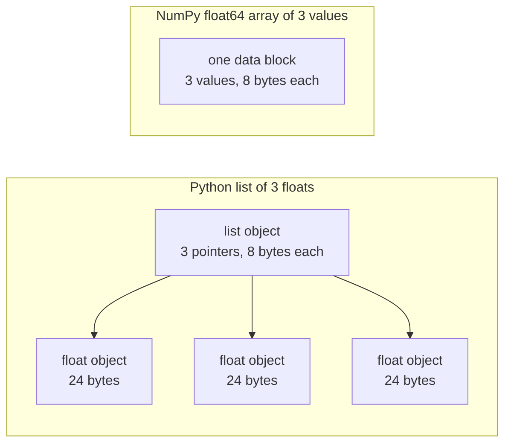

# 面向 AI 工程的Python

> Bu dersdeki kodların çoğu aynı Python'un alışkanlıklı kullanımı yöntemini kullanıyor.

**Type:** Build
**Languages:** Python
**Prerequisites:** 开发环境、Python 环境
**Time:** ~120 分钟

## Öğrenme hedefi

- 阅读课程代码中最常见的习惯用法,解包和f字符串至数据类与推导式──
- Python'da hatalar yapmaz ama hatalar çıkarır.
-  Sadece standart kütüphanesi kullanmak, CSV ve JSON yükleyici oluşturmak, birlikte tohumların veri bölümü ve küçük miktarlı üreticiler kullanmak
- Temel Python ile yazılmış nokta sayısı, ortalama değer ve standart değer hesaplama, hız ve bellek miktarı ölçüm.
-                                                                                                                                                                                                                                                                                                                                                                                                                                                                                                                              

## 问题

Bu aşamada sonraki dersler sıradan Python kullanarak matematik hesaplama ve modeli gerçekleştirir.`dataclasses`Ayrıca 187 dosya kullanıldı.`random.seed`Ya da kurmak`random.Random`Eğer bu alışkanlıkları bilmiyorsan, matematik anlamaya çalışırken dil anlamasına çok meşgul olacaksın.

Python'da hata bilgi vermeyecek, ama yanlış sonuçlara yol açacak davranışlar vardır. İki isim aynı listeye işaret edebilir, bu nedenle bir isim değiştirme listesiyle, diğer bir isim görülen içeriği de değiştirecektir.

Son sorun hızdır. Test bilgisayarlarımızda saf Python döngüsü, bir milyon boşluk sayısal hesaplama noktasına yaklaşık 30 mil saniye gerektirir. NumPy aynı hesaplamaları bir mil saniyeye kadar yapmaz.

## 概念

### 课程代码使用哪些写法 ne yazmak için kullanılır

Biz kullanıyoruz .`ast`模块解析了 `phases/*/*/code/`Altyapıda bulunan 541 Python dosyası bulunmaktadır. Aşağıdaki tabloda, en az bir kez kullanılmış olan bir yapıya göre dosya sayısı bulunmaktadır.

| 结构 | 文件数 | 占比 |
|-----------|-------|-------|
| 函数定义 | 541 | 100% |
| `if __name__ == "__main__":` | 529 | 98% |
| f 字符串 | 517 | 96% |
| 元组解包 | 448 | 83% |
| 类 | 379 | 70% |
| 列表推导式 | 375 | 69% |
| 函数类型标注 | 342 | 63% |
| 生成器表达式 | 326 | 60% |
| 切片 | 314 | 58% |
| `lambda` | 175 | 32% |
| `try` 与 `except` | 120 | 22% |
| `with` 语句 | 96 | 18% |
| 字典推导式 | 93 | 17% |
| 使用 `yield` 的生成器函数 | 14 | 3% |

İçevi durumunun en önemli standart modülleri olduğunu gösteren 541 dosyanın 340'u bulunmaktadır.`from __future__ import annotations`Başlangıç, 276 个导入`dataclasses`- Evet.`math`- Evet.`random`和 `json`模块分别出现在187、175和126 文件中──`collections`70 dosyada görünüyordu.`itertools`Sadece 4 dosya içinde göründü.

没有课程调用 `map()`Ya da`filter()`Bu çalışmaların üstlendiği 140'dan fazla dosya kullanılmıştır.`sorted`- Evet.`min`- Evet.`max`Ya da`.sort`时使用了 `key=`Bu ders, bu listeler arasında en fazla zamanını önde gelen alışkanlıklara göre geçirecektir.

### 名称引用对象

Python'da, değişim nesne adı ile bağlanır. Adının nesneye bağlanması nesneyi kopyalamamaktadır. İki isim aynı listeye atandığında, bir isimden yapılan değişiklikler yoluyla, iki isim de değişmez.

### 列表保存指针,数组保存数值

Python listesi doğrudan depolama sayı değeri değil, depolama göstergesi, her gösterge tam bir Python nesnesini belirtir. 64 sitedeki CPython'da, her gösterge 8 字节, her gösterge.`float`Görevi 24 字节。NumPy `float64`数组则将原始的 8 字节值并排存放在一块内存中──



Listesi döngüsü, her elementin işlenmesi için çok fazla iş yapmalı. Açıklatıcı, her element için bir nesne bulup, her işletim sayısının tipini kontrol ederek, bir Python 浮点 nesnesini oluşturarak sonuçları kaydetmek için bir Python 浮点 nesne oluşturur.

NumPy, orijinal sayısal işlem için aynı işlemleri tamamlayan bir döngü, aynı işlemleri tamamlayan bir işlemdir. Tüm sayısal işlem için yalnızca bir kez veri tipi kontrol edilir, her element için Python nesneyi oluşturmaz.`(x - mean) / std`Bu dersdeki vektör fonksiyonu da bu prensibi izler: Her fonksiyon sadece bir sayı işlemini tamamlar ve sonra onu bir NumPy 调用 olarak değiştirir.

### 列表保存全部元素,生成器每次保存一个

Listesi yönlendirme biçimi, bir sonraki satırdan önce tüm elementleri oluşturur. Yükleyici, bir öğenin oluşturulmasını sağlayan bir element oluşturur.

Bir kere bile geçebilir. Son elementten sonra, her istek açılır.`StopIteration`Bu yüzden ikinci bir kez de.`for`循环拿不到任何元素──训练代码每轮都会读取一次数据集,因此每轮都必须创建新的生成器──

 Ders kodunda çok az bir jeneratör işlevi bulunur, ancak derin öğrenme derslerinde kullanılan veri yükleyiciler, her bir eğitim döngüsünde mevcut olan bu fikirle birlikte, her bir eğitim döngüsünde mevcuttur.

```figure
s0-list-vs-generator
```

## Yapacağın alışkanlıkları öğren.

Bu bölümdeki her kod parçası bağımsız olarak çalıştırılabilir.`python3`运行──代码块 Python 3.11 veya yeni bir sürüm gerektirir, bu da geliştirme ortamı derslerinde kurduğumuz sürümlerdir──

### 1. √ konteyner ve çözülme

Python'da dört çeşit içe girmiş bir depo var.

| 类型 | 示例 | 有序 | 可变 | 在课程中的典型用途 |
|------|---------|---------|------------|---------------------------|
| `list` | `[0.5, 1.2]` | 是 | 是 | 样本、损失、权重 |
| `tuple` | `(32, 784)` | 是 | 否 | 形状、固定记录、字典键 |
| `dict` | `{"lr": 0.01}` | 按插入顺序 | 是 | 配置、词表、JSON 行 |
| `set` | `{"cat", "dog"}` | 否 | 是 | 唯一 token、重叠检查 |

Aşağıdaki kodlar, verim değerlerinin listeden kopyalanmadığını göstermektedir.

```python
weights = [0.5, -1.2, 3.0]
alias = weights
alias[0] = 99.0
print(weights)

independent = list(weights)
independent[1] = 0.0
print(weights, independent)

grid = [[0] * 3] * 2
grid[0][0] = 1
print(grid)

grid = [[0] * 3 for _ in range(2)]
grid[0][0] = 1
print(grid)
```

```text
[99.0, -1.2, 3.0]
[99.0, -1.2, 3.0] [99.0, 0.0, 3.0]
[[1, 0, 0], [1, 0, 0]]
[[1, 0, 0], [0, 0, 0]]
```

İfadeler`[[0] * 3] * 2` Bir dış kat listesi oluşturmak, bunlardan ikisi aynı iç kat listesi yönlendirir.                                                                                                                                                                                                                                                    

Bir satırda bir dizi elementinin bir çok isim vermesi 解包在一行中将序列元素赋予多个名称──带星号的名称收集剩余元素──f 字符串将表达的值嵌入字符串,也可以在冒号之后指定格式──

```python
shape = (32, 784)
batch_size, n_features = shape
first, *middle, last = [1, 2, 3, 4, 5]
x, y = 1.0, 3.0
x, y = y, x

config = {"lr": 0.01, "epochs": 5}
config["seed"] = 7
tokens = ["the", "cat", "sat", "on", "the", "mat"]
vocab = set(tokens)

print(batch_size, n_features, first, middle, last, x, y)
print(config.get("momentum", 0.9), "cat" in vocab, len(vocab))
print(f"lr={config['lr']:.0e} loss={0.123456:.3f} n={60_000:,} {batch_size=}")
```

```text
32 784 1 [2, 3, 4] 5 3.0 1.0
0.9 True 5
lr=1e-02 loss=0.123 n=60,000 batch_size=32
```

- Ne var ki?`dict.get`返回默认值──无论集合大小如何,集合上的 `in`Kontrolün süresi aynıdır.`{batch_size=}`形式同时印名称和值,调试に助力する──

Çekim`a[start:stop:step]`包含 `start`, içermez`stop`◊负索引从末尾开始计数──列表的切片是一个新列表,因此大型列表切片的指针,会复制切片范围内的所有指针──

```python
tokens = ["<s>", "the", "cat", "sat", "on", "the", "mat", "</s>"]
print(tokens[1:-1])
print(tokens[:3], tokens[-3:])
print(tokens[::2])
print(tokens[::-1][:2])
windows = [tokens[i:i + 3] for i in range(len(tokens) - 2)]
print(len(windows), windows[0])
```

```text
['the', 'cat', 'sat', 'on', 'the', 'mat']
['<s>', 'the', 'cat'] ['the', 'mat', '</s>']
['<s>', 'cat', 'on', 'mat']
['</s>', 'mat']
6 ['<s>', 'the', 'cat']
```

### 2. 推导式

推导式通过一个表达式,从可代对象构建列表、字典或集合──它的读法接近其描述的数学运算──

```python
scores = [0.91, 0.42, 0.77, 0.15, 0.66]
labels = [1 if s >= 0.5 else 0 for s in scores]
high = [s for s in scores if s > 0.6]
squares = {i: i * i for i in range(4)}
lengths = {len(word) for word in ["a", "bb", "cc", "ddd"]}
sum_sq = sum(s * s for s in scores)

matrix = [[1, 2, 3], [4, 5, 6]]
transposed = [list(column) for column in zip(*matrix)]
flat = [v for row in matrix for v in row]

print(labels, high, squares, lengths, round(sum_sq, 4))
print(transposed, flat)
```

```text
[1, 0, 1, 0, 1] [0.91, 0.77, 0.66] {0: 0, 1: 1, 2: 4, 3: 9} {1, 2, 3} 2.0555
[[1, 4], [2, 5], [3, 6]] [1, 2, 3, 4, 5, 6]
```

Son sonuncu`if`Sadece bir parça kalsın.`for`Önceki ifade koşullu ifade olabilir, yani`a if condition else b`İki tane.`for`子句'ın işleyiş sırası, iki yerleşim döngüsü ile aynıdır.

圆括号创建生成器表达式──在 `sum(s * s for s in scores)`İçeride,`sum`Her kez bir kare değerini okuyunca Python bir listesi oluşturmaz.`zip(*matrix)`Orta, yıldız sayısı her satır bağımsız bir element olarak aktarılacak,`zip`Aynı konumda bulunan elementler eşleşecek.

### 3. 函数、参数与闭包

默认值让参数变为可选. 关键字实参在调用时明确指定形参名称. 参数列表中单独的.`*`, sonraki parametreleri sadece anahtar kelimelerle aktarılabilir olarak ayarlayacaktır.

```python
def clip(value, low=0.0, high=1.0):
    return max(low, min(high, value))


def train(data, *, lr=0.01, epochs=3):
    return f"{len(data)} samples, lr={lr}, epochs={epochs}"


def make_scaler(factor):
    def scale(values):
        return [v * factor for v in values]
    return scale


print(clip(1.7), clip(-3.0, low=-1.0), clip(0.4, high=0.3))
print(train([1, 2, 3], lr=0.1))
to_percent = make_scaler(100)
print(to_percent([0.25, 0.5]))
```

```text
1.0 -1.0 0.3
3 samples, lr=0.1, epochs=3
[25.0, 50.0]
```

Sadece anahtar kelimelerin sayısını kullanırken,`train(data, 0.1, 3)`Bu şekilde bir tutum olur.`TypeError`❖调用者 must write out `lr=0.1`Bu nedenle iki sayısal değer değişmez.

内部函数  İçeride`scale`Kullanın oluşturmak için işlevi `factor`- Ne kadar istersen.`scale`Hala var, Python'un kalması gerekiyor.`factor` Tutuklu kuruluşcu değişkenliğinin işlevi, tutuklu yapılandırma bölümünün standartlaştırma makinesi kullanılarak tutuklu tutuklu yapılandırma eğitiminin yapılması olarak adlandırılır.

`lambda`Bu isim yoktur, sadece bir ifade işlevi vardır.`key=`函数,第 8 部分会介绍这种用法──

Python execute `def`语句时, sadece bir defa default değerini hesaplayın.

```python
def add_bad(item, bucket=[]):
    bucket.append(item)
    return bucket


def add_good(item, bucket=None):
    if bucket is None:
        bucket = []
    bucket.append(item)
    return bucket


add_bad("a")
print(add_bad("b"))
add_good("a")
print(add_good("b"))
```

```text
['a', 'b']
['b']
```

列表、字典或集合的默认值应使用 `None`, ve fonksiyon içinde yeni nesneler oluşturur.

### 4. Sınıf ve veriler

`@dataclass`装饰器根据带类型标注的字段,生成 `__init__`- Evet.`__repr__`和 `__eq__`❖ Yapılandırma`frozen=True`后, object yaratılmasının ardından değiştirilmez, bir kitaptaki anahtar olarak kullanılabilir veya bir topluluk içine yerleştirilebilir.

```python
from dataclasses import dataclass, field


@dataclass(frozen=True)
class Example:
    features: tuple[float, ...]
    label: int


@dataclass
class TrainConfig:
    lr: float = 0.01
    epochs: int = 5
    hidden: list[int] = field(default_factory=lambda: [64, 32])

    def describe(self):
        return f"lr={self.lr} epochs={self.epochs} hidden={self.hidden}"


ex = Example((1.5, 2.0), 1)
print(ex)
print(ex == Example((1.5, 2.0), 1), len({ex, Example((1.5, 2.0), 1)}))
print(TrainConfig(epochs=10).describe())
try:
    ex.label = 0
except AttributeError as err:
    print(type(err).__name__)
```

```text
Example(features=(1.5, 2.0), label=1)
True 1
lr=0.01 epochs=10 hidden=[64, 32]
FrozenInstanceError
```

`field(default_factory=...)`Her örnek için yeni bir liste sağlanır. Bu, 3. bölümdeki veri sınıfı içindeki ortak öntanımlı değer sorunu çözür.

特殊方法将类与Python 语法连接起来──`len(ds)`调用 `__len__`- Evet .`ds[2]`调用 `__getitem__`- Evet.

```python
class SquaresDataset:
    def __init__(self, n):
        self.n = n

    def __len__(self):
        return self.n

    def __getitem__(self, index):
        if not 0 <= index < self.n:
            raise IndexError(index)
        return index, index * index


ds = SquaresDataset(4)
print(len(ds), ds[2])
print(list(ds))
```

```text
4 (2, 4)
[(0, 0), (1, 1), (2, 4), (3, 9)]
```

Hatta hiç yok.`__iter__`- Nasıl?`list(ds)`İçeride`for`循环也能工作──Python                                                                                                                                                                                                                                                                                                                                                                                                                                                                                                                    `__getitem__`- Tamam .`IndexError`❖PyTorch'in haritalama verileri aynı iki yöntemle kullanılır:`__len__`和 `__getitem__`- Evet.

### 5. 代器与生成器

Bu nesne, her neyse yapılır.`for`循环接受的对象──`iter()`Çekilen çöpten,`next()`Bir element istemek için bir jeneratör daha fazla element istemek için bir jeneratör daha fazla element istemek için bir jeneratör daha fazla element istemek için bir jeneratör daha fazla element istemek için bir jeneratör daha istemek için bir jeneratör daha fazla element istemek için bir jeneratör daha fazla element istemek için bir jeneratör daha fazla element istemek için bir jeneratör daha fazla element istemek için bir jeneratör daha istemek için bir jeneratör daha istemek için bir jeneratör daha istemek için bir jeneratör daha kullanılır.`StopIteration`- Evet.`for`Çeviri değiştirmek için`next()`Ve o da buluştu .`StopIteration`Durdurma.

```python
numbers = [10, 20, 30]
it = iter(numbers)
print(next(it), next(it), next(it))
try:
    next(it)
except StopIteration:
    print("no more items")


def countdown(n):
    while n > 0:
        yield n
        n -= 1


gen = countdown(3)
print(type(gen).__name__)
print(list(gen))
print(list(gen))
```

```text
10 20 30
no more items
generator
[3, 2, 1]
[]
```

函数体中包含 `yield`Bu işlevi oluşturan işlevi oluşturan işlevi oluşturur. Bu işlevi oluşturan işlevi oluşturan işlevi oluşturan işlevi oluşturan işlevi oluşturur.`next()`Şehir bir sonraki işlevle devam edecek.`yield`,并暂停在那里.`list(gen)`Çünkü ilk kez kullanıldığında üreticiler bitmiş.

Üretim makinesi birbiriyle birlikte okunabilir.

```python
import os
import tempfile


def read_rows(path):
    with open(path, encoding="utf-8") as fh:
        header = fh.readline().rstrip("\n").split(",")
        for line in fh:
            yield dict(zip(header, line.rstrip("\n").split(",")))


with tempfile.TemporaryDirectory() as tmp:
    path = os.path.join(tmp, "rows.csv")
    with open(path, "w", encoding="utf-8") as fh:
        fh.write("x,label\n")
        fh.writelines(f"{i * 0.5},{i % 2}\n" for i in range(5))
    rows = read_rows(path)
    print(next(rows))
    print(sum(1 for _ in rows))
```

```text
{'x': '0.0', 'label': '0'}
4
```

`read_rows`Her seferinde bir satır bir dosya kaydedilir.`read_rows`◊ Bu örnekleri kısaca kullanmak için, burada doğrudan bir komutlama yaparak bir bölüm oluşturmak için kullanılır.`csv`- Evet.

```python
import sys

as_list = [i * i for i in range(1_000_000)]
as_generator = (i * i for i in range(1_000_000))
print(sys.getsizeof(as_list), sys.getsizeof(as_generator))
print(sum(as_list) == sum(as_generator))
```

64 sitede CPython'da, list rapor yaklaşık 8 MB, generator yaklaşık 200 字节。`sys.getsizeof`Sadece statistik listenin kendi işaretleri, bütün sayıdaki nesneler de ekstra内存yi ele alır.`tracemalloc` Gerçek zirve değerini ölçmek, biz bunu test ve performans analizi derslerinde kullandık.

### 6. Ün下文管理器与异常

`with`语句体初执行准备代码,再运行语句体,最后执行清理代码──即使语句体抛出异常,清理也会执行──`open()`Geri gönderilen dosyaların nesnesi, dosyaların kapatılmasına sorumlu bir üst-üst-üst yazılım yöneticisidir.

Sınav ve performans analizi dersinde bir bant yazdık.`__enter__`和 `__exit__``Timer`类──`contextlib.contextmanager`装饰器, jeneratörden oluşturulabilir.`yield`之前的代码负责准备,`finally`Çözüm sorumlusu:

```python
import time
from contextlib import contextmanager


@contextmanager
def timer(label):
    start = time.perf_counter()
    try:
        yield
    finally:
        print(f"{label}: {(time.perf_counter() - start) * 1000:.1f} ms")


def parse_label(text):
    try:
        return int(text)
    except ValueError:
        raise ValueError(f"label must be an integer, got {text!r}") from None


with timer("sum of squares"):
    total = sum(i * i for i in range(200_000))

print(parse_label("3"))
try:
    parse_label("cat")
except ValueError as err:
    print("rejected:", err)
```

```text
sum of squares: 9.4 ms
3
rejected: label must be an integer, got 'cat'
```

Makinelerin ölçüm süresi farklı olacak.`except`子句中,写明预期的具体异常,例如 `ValueError`Ya da`KeyError`◊ Not specified异常类型的`except:`Ayrıca yakalayacağım.`KeyboardInterrupt`Bu nedenle Ctrl+C'nin bu çevrimiçiyi durduramayacağından, giriş hatası sırasında, açık mesajın eşsizliği ile atılmalıdır. Eğer mesajınız orijinal geri dönüş bilgisini değiştirirse, eklenir.`from None`- Evet.

### 7. tipi etiketleri 模块 ve ana program koruma

类标记告诉读者函数接受什么、返回什么──Python 运行代码时不会检查这些标记──mypy 等类标记器会在代码运行前读取它们──

```python
from __future__ import annotations

from collections.abc import Iterable, Sequence


def mean(values: Sequence[float]) -> float:
    if not values:
        raise ValueError("mean() needs at least one value")
    return sum(values) / len(values)


def count_tokens(docs: Iterable[str]) -> int:
    return sum(len(doc.split()) for doc in docs)


def main() -> None:
    print(mean([1.0, 2.0, 4.0]))
    print(count_tokens(["the cat sat", "on the mat"]))
    print(mean.__annotations__)


if __name__ == "__main__":
    main()
```

```text
2.3333333333333335
6
{'values': 'Sequence[float]', 'return': 'float'}
```

Kullanım`from __future__ import annotations`Python, her bir işaretini son satırda gösterildiği gibi bir karakter olarak kaydetir.`Sequence`Hiçbir destek gösterme`len()`Ürünler, örneğin listeler veya gruplar;`Iterable`Göstermek için her şey geçerli .`for`循环接受的对象── birçok ders dosyası `typing`导入这些相同的名称,也同样有效──

Her biri .`.py`Dosyalar bir parça.`python3 file.py`Python'un birleştirdiği bir dosya.`__name__`设置为 `"__main__"`Bir başka dosya da içeri girdi.`__name__`则是模块名称──保护条件只在第一种调用`main()`Bu yüzden,`code/tests/`Orta testler aktarılabilir.`main.py`...sürekli bir gösteri başlatmaz.

### 8. 文件、JSON、CSV ve排序

`pathlib.Path`Kullan .`/`拼接路径,并能通过一次调用读取或写入整个文件──请始终指定 `encoding="utf-8"`, çünkü öntanımlı kodlama işletim sistemine bağlıdır.

```python
import csv
import json
import tempfile
from pathlib import Path

rows = [
    {"text": "great movie", "label": 1, "score": 0.93},
    {"text": "boring plot", "label": 0, "score": 0.12},
    {"text": "fine acting", "label": 1, "score": 0.58},
]

with tempfile.TemporaryDirectory() as tmp:
    json_path = Path(tmp) / "reviews.json"
    json_path.write_text(json.dumps(rows, indent=2), encoding="utf-8")
    from_json = json.loads(json_path.read_text(encoding="utf-8"))

    csv_path = Path(tmp) / "reviews.csv"
    with csv_path.open("w", newline="", encoding="utf-8") as fh:
        writer = csv.DictWriter(fh, fieldnames=["text", "label", "score"])
        writer.writeheader()
        writer.writerows(rows)
    with csv_path.open(newline="", encoding="utf-8") as fh:
        from_csv = list(csv.DictReader(fh))

print(from_json == rows)
print(from_csv[0])

by_score = sorted(rows, key=lambda r: r["score"], reverse=True)
print([r["text"] for r in by_score])
print(max(rows, key=lambda r: r["score"])["text"])
print([r["text"] for r in sorted(rows, key=lambda r: (-r["label"], r["text"]))])
```

```text
True
{'text': 'great movie', 'label': '1', 'score': '0.93'}
['great movie', 'fine acting', 'boring plot']
great movie
['fine acting', 'great movie', 'boring plot']
```

JSON 会将数值保留为数值──CSV 返回的每个字段都是字符串,因此你必须转换各字段──按照`csv`文档的要求,打开 CSV文件时应指定 `newline=""`- Evet.

`key=`函数 return Python kullanılarak her elementin değerini karşılaştırır.`sorted`- Evet.`min`和 `max`Bu tür bir işlevi kabul eder. Birinci değer sırasına göre, sadece ikinci değer kullanır.

### 9. 计数、分组与代工具

Bu iki modül, sıradan bir listesi ve metinsiz bir veri yapısı ve nesil araçları sağladı.

```python
from collections import Counter, defaultdict, deque
from itertools import chain, islice, product

labels = ["cat", "dog", "cat", "bird", "cat", "dog"]
counts = Counter(labels)
print(counts.most_common(2))

positions = defaultdict(list)
for i, label in enumerate(labels):
    positions[label].append(i)
print(dict(positions))

recent = deque(maxlen=3)
for loss in [2.0, 1.5, 1.2, 1.1, 0.9]:
    recent.append(loss)
print(list(recent), round(sum(recent) / len(recent), 3))

print(list(product([0.1, 0.01], [16, 32])))
print(list(chain([1, 2], [3], [4, 5])))
print(list(islice(range(100), 5, 10)))
```

```text
[('cat', 3), ('dog', 2)]
{'cat': [0, 2, 4], 'dog': [1, 5], 'bird': [3]}
[1.2, 1.1, 0.9] 1.067
[(0.1, 16), (0.1, 32), (0.01, 16), (0.01, 32)]
[1, 2, 3, 4, 5]
[5, 6, 7, 8, 9]
```

`Counter`统计标签、代码等可哈希元素──首次使用新键时,`defaultdict(list)`Bu nedenle, bölük döngüsü, anahtarın var olup olmadığını kontrol etmemek için geçerlidir.`deque(maxlen=3)`Dördüncü element eklendiğinde, en eski elementleri çıkarır ve son kayıp değerini korumak için bir kaydırma penceresi oluşur.`enumerate`Her unsur ipucu sağlar.

`product`Üst düzey bir ağ.`chain`Bu nesneyi ilk ve son aşamaları göreceğiz.`islice`Herhangi bir jeneratörden parçalar alabilirsiniz.`islice`- Evet.

### 10. Neden değer döngüsü çok yavaş ?

`dis`模块打印解释器 belirli bir işlevi gerçekleştirmek için bir字节码指示.

```python
import dis


def dot(a, b):
    total = 0.0
    for x, y in zip(a, b):
        total += x * y
    return total


dis.dis(dot)
```

- Evet .`FOR_ITER`Bu yönlendirmeye, her element için bir kez uygulanır.

Çevre içinde, bir kısım kodunu gerçekleştirme adımları ne kadar az olursa, hızı da ne kadar hızlı olursa.`sum`- Evet.`map`和 `zip`C 编写──动手构建部分将在纯Python中测量这种效果;现成工具部分则将整个循环转移到NumPy──

## 动手构建

Şimdi yapılandırma sonrası programın gerekli bileşenleri.`code/main.py`, `code/tests/test_main.py`测试──下方每个代码块都可以独立运行──

### 1. adım: Kayıt tipi ve veri kümesi yükleyici

yükleyici CSV veya JSON dosyalarını aynı yapı için okuyacaktır:浮点特征元组,加一个整数标签──

```python
import csv
import json
import tempfile
from dataclasses import dataclass
from pathlib import Path


@dataclass(frozen=True)
class Record:
    features: tuple[float, ...]
    label: int


def row_to_record(row, names, label_field="label"):
    if label_field not in row:
        raise ValueError(f"row has no {label_field!r} field: {row}")
    if set(row) != {*names, label_field}:
        raise ValueError(f"row fields {list(row)} do not match {[*names, label_field]}")
    return Record(tuple(float(row[name]) for name in names), int(row[label_field]))


def load_records(path, label_field="label"):
    path = Path(path)
    if path.suffix == ".json":
        rows = json.loads(path.read_text(encoding="utf-8"))
    elif path.suffix == ".csv":
        with path.open(newline="", encoding="utf-8") as fh:
            rows = list(csv.DictReader(fh))
    else:
        raise ValueError(f"unsupported file type: {path.suffix!r}")
    if not rows:
        return []
    names = [key for key in rows[0] if key != label_field]
    return [row_to_record(row, names, label_field) for row in rows]


with tempfile.TemporaryDirectory() as tmp:
    csv_path = Path(tmp) / "data.csv"
    csv_path.write_text("x1,x2,label\n1.5,60,1\n1.8,82.5,0\n", encoding="utf-8")
    json_path = Path(tmp) / "data.json"
    json_path.write_text('[{"x1": 1.5, "x2": 60, "label": 1}]', encoding="utf-8")
    print(load_records(csv_path))
    print(load_records(json_path))
```

```text
[Record(features=(1.5, 60.0), label=1), Record(features=(1.8, 82.5), label=0)]
[Record(features=(1.5, 60.0), label=1)]
```

İlk satır, özelliklerin adını ve sırasını belirler.`DictReader`和 `json.loads`KEYS SYKURDEN, KEYS IN THE FILE KEEP BY BY BY BY BY BY BY BY BY BY BY BY BY BY BY BY BY BY BY BY BY BY BY BY BY BY BY BY BY BY BY BY BY BY BY BY BY BY BY BY BY BY BY BY BY BY BY BY BY BY BY BY BY BY BY BY BY BY BY BY BY BY BY BY BY BY BY BY BY BY BY BY BY BY BY BY BY BY BY BY BY BY BY BY BY BY BY BY BY BY BY BY BY BY BY BY BY BY BY BY BY BY BY BY BY BY BY BY BY BY BY BY BY BY BY BY BY BY BY BY BY BY BY BY BY BY BY BY BY BY BY BY BY BY BY BY BY BY BY BY BY BY BY BY BY BY BY BY BY BY BY BY BY BY BY BY BY BY BY BY BY BY BY BY BY BY BY BY BY BY BY BY BY BY BY BY BY BY BY BY BY BY BY BY BY BY BY BY BY BY BY BY BY BY BY BY BY BY BY BY BY BY BY BY BY BY BY BY BY BY BY BY BY BY BY BY BY BY BY BY BY BY BY BY BY BY BY BY BY BY BY BY BY BY BY BY BY BY BY BY BY BY BY BY BY BY BY BY BY BY BY BY BY BY BY BY BY BY BY BY BY BY BY BY BY BY BY BY BY BY BY BY BY BY BY BY BY BY BY BY BY BY BY BY BY BY BY BY BY BY BY BY BY BY BY BY BY BY BY BY BY BY BY BY BY BY BY BY BY BY BY BY BY BY BY BY BY BY BY BY BY BY BY BY BY BY BY BY BY BY BY BY BY BY BY BY BY BY BY BY BY BY BY BY BY BY BY BY BY BY BY BY BY BY BY BY BY BY BY BY BY BY BY BY BY BY BY BY BY BY BY BY BY BY BY BY BY BY BY BY BY BY BY BY BY BY BY BY BY BY BY BY BY BY BY BY BY BY BY BY BY BY BY BY BY BY BY BY BY BY BY BY BY BY BY BY BY BY BY BY BY BY BY BY BY BY BY BY BY BY BY BY BY BY BY BY BY BY BY BY BY BY BY BY BY BY BY BY BY BY BY BY BY BY BY BY BY BY BY BY BY BY BY BY BY BY BY BY BY BY BY BY BY BY BY BY BY BY BY BY BY BY BY BY BY BY BY BY BY BY BY`row_to_record`İlk satırın belirlenmiş sırasına göre, her satırın adı olarak okunuyor. Etiket eksikliği, özellik eksikliği veya eksikliği veya dosya türü bilinmeyen zaman, haberlerle gönderilmektedir.`ValueError`, Faydasız dosyaların çalışmaya başladığında, sonrası işlemeyi durdurmak için.`main.py`Ayrıca sunulur.`save_records`Aynı iki biçimi yazmak için kullanılır.

### İkinci adım: birlikte yapılan testlerin eğitim ve testlerin bölünmesi

```python
import random


def train_test_split(items, test_fraction=0.2, seed=0):
    if not 0.0 < test_fraction < 1.0:
        raise ValueError(f"test_fraction must be between 0 and 1, got {test_fraction}")
    if len(items) < 2:
        raise ValueError(f"need at least 2 items to split, got {len(items)}")
    order = list(range(len(items)))
    random.Random(seed).shuffle(order)
    n_test = min(max(1, round(len(items) * test_fraction)), len(items) - 1)
    test = [items[i] for i in order[:n_test]]
    train = [items[i] for i in order[n_test:]]
    return train, test


items = list(range(10))
print(train_test_split(items, seed=1))
print(train_test_split(items, seed=1) == train_test_split(items, seed=1))
print(train_test_split(items, seed=2)[1])
print(items)
```

```text
([9, 7, 5, 3, 0, 4, 1, 2], [6, 8])
True
[5, 9]
[0, 1, 2, 3, 4, 5, 6, 7, 8, 9]
```

`random.Random(seed)`创建私有随机数生成器──`random.seed(seed)`Tüm modüllerin paylaşılan genel jeneratörünü yeniden yerleştirir, bu nedenle diğer kutularda bir kez kullanmak senin dizini değiştirebilir.`random.seed`96 个创建`random.Random`Yeni kodlar kullanmak için özel jeneratör kullanmak gerekir.

函数打乱, bir indeks listesi, bu nedenle giriş listesi değişmez. Aynı tür her zaman aynı bölümü oluşturur.`ValueError`❖ Standartlama gibi herhangi bir adımdan önce, önce veriyi ayırmak gerekir. ❖ Deneyim ve performans analizi derslerinde, zaten gördük ki, eğitim verileri ve test verileri üzerinde birleştirilmek test puanlarının yüksek olmasına neden olur.

### 第3 步: Küçük bir miktar üreticisi

```python
from itertools import islice


def batches(items, batch_size, drop_last=False):
    if batch_size < 1:
        raise ValueError(f"batch_size must be at least 1, got {batch_size}")
    return _batch_iter(iter(items), batch_size, drop_last)


def _batch_iter(iterator, batch_size, drop_last):
    while True:
        batch = list(islice(iterator, batch_size))
        if not batch or (drop_last and len(batch) < batch_size):
            return
        yield batch


print(list(batches(range(10), 4)))
print(list(batches(range(10), 4, drop_last=True)))
squares = (i * i for i in range(7))
print([len(b) for b in batches(squares, 3)])

for epoch in range(2):
    sizes = [len(b) for b in batches(range(10), 4)]
    print(f"epoch {epoch}: {sizes}")
```

```text
[[0, 1, 2, 3], [4, 5, 6, 7], [8, 9]]
[[0, 1, 2, 3], [4, 5, 6, 7]]
[3, 3, 1]
epoch 0: [4, 4, 2]
epoch 1: [4, 4, 2]
```

`islice`En çok zaman içinde çıkardık.`batch_size`个元素──`batches`Sadece ihtiyacım var.`iter()`Bu nedenle, listeyi, dosyaları ve diğer üreticileri kabul etmektedir.`drop_last=True`Bu bölümü kaldırırım.

Bu iş iki işleviye ayrılır çünkü jeneratör işlevi ilk kez.`next()`Eğer kontrolü üretici içinde yerleştirirsek,`batches(data, 0)`Hatanın geri dönmesi, yanlışın antrenman döngüsünün içindeki oluşmasıdır. Dış katı normal bir fonksiyon, bu nedenle hemen kontrol edilebilmektedir.`batches()`Çünkü jeneratör sadece bir element sunar.

### 第4 aşama: Kütle Matematik ve Standardizatör

```python
import math


def dot(a, b):
    return sum(x * y for x, y in zip(a, b, strict=True))


def mean(values):
    if not values:
        raise ValueError("mean() needs at least one value")
    return sum(values) / len(values)


def std(values):
    mu = mean(values)
    return math.sqrt(sum((v - mu) ** 2 for v in values) / len(values))


def make_standardizer(rows):
    columns = list(zip(*rows))
    means = [mean(c) for c in columns]
    scales = [s if s > 0 else 1.0 for s in (std(c) for c in columns)]

    def standardize(row):
        return [(v - m) / s for v, m, s in zip(row, means, scales, strict=True)]

    return standardize


print(dot([1.0, 2.0, 3.0], [4.0, 5.0, 6.0]))
values = [2.0, 4.0, 4.0, 4.0, 5.0, 5.0, 7.0, 9.0]
print(mean(values), std(values))

train_rows = [(1.0, 100.0), (2.0, 300.0), (3.0, 500.0)]
standardize = make_standardizer(train_rows)
print([[round(v, 3) for v in standardize(r)] for r in train_rows])
print([round(v, 3) for v in standardize((4.0, 700.0))])
```

```text
32.0
5.0 2.0
[[-1.225, -1.225], [0.0, 0.0], [1.225, 1.225]]
[2.449, 2.449]
```

 ayar `strict=True`后,两向量长度不同时,`zip`Çıkarım .`ValueError`- Yokmuş.`zip`Daha kısa bir giriş bitince durdu, yanıltıcı cevaplar ile geri döndü.`strict`Python 3.10 veya yeni bir sürüm gerektirir.

`std`Üstelik`n`, bu nedenle, genel standart farkı, ile`statistics.pstdev`Birliği:                                                                                                                                                                                                                                                                                                                                                                                                                                                                                                                           `n - 1`- Evet.

`make_standardizer`Bu sadece bir kez ortalama değer ve standart farkı hesaplamak için bir eğitimden sonra.`standardize`保存这些统计量──将同函数应用于测试行,测试数据就不会影响统计量──常量列的标准差为0,因此标准化器对它使用1作为缩放因子──

### 第5 步:完整运行

`code/main.py`Bu parçaları birleştirmek için, iki den 400 条 kayıt üretir, CSV ve JSON olarak kaydedilir, iki dosyayı yeniden yükler.

Recent Quality Categories Preserve Each Category's Average Characteristics Values, and Predict Average Value Distance From Input Nearest Category。`fit_centroids`Bu yüzden tüm eğitimler de kaydedilmeye gerek yok.`predict` 使用带`key=`函数 of `min()`En son olanları bul.

```bash
python3 phases/00-setup-and-tooling/13-python-for-ai-engineering/code/main.py
```

```text
Python for AI engineering: a standard-library toolkit
data     400 records, CSV and JSON load back unchanged: True
split    320 train, 80 test, records in both: 0
batches  size 48: [48, 48, 48, 48, 48, 48, 32]
scale    train feature means after standardizing: [0.0, 0.0]
model    nearest-centroid test accuracy: raw 0.86, standardized 0.89
speed    dot product of 200,000 floats, best of 5:
           index loop         6.60 ms
           zip generator      5.93 ms
           map + mul          2.89 ms
memory   peak bytes to sum 100,000 squares:
           list              4,000,616
           generator               472
```

İki özellikin boyutları arasında büyük bir fark vardır. İkinci özellikin dağılımı ilkinden 10 kat daha fazladır. Bu nedenle, standartlaşmamış zamanlarda doğrulama oranı daha düşüktür.

### 第6 aşama: hız ve akış ölçümü

```python
import operator
import random
import time
import tracemalloc


def dot_index_loop(a, b):
    total = 0.0
    for i in range(len(a)):
        total += a[i] * b[i]
    return total


def dot_zip(a, b):
    return sum(x * y for x, y in zip(a, b, strict=True))


def dot_map(a, b):
    return sum(map(operator.mul, a, b))


def best_time(fn, *args, repeat=5):
    times = []
    for _ in range(repeat):
        start = time.perf_counter()
        fn(*args)
        times.append(time.perf_counter() - start)
    return min(times)


def peak_bytes(fn):
    tracemalloc.start()
    try:
        fn()
        return tracemalloc.get_traced_memory()[1]
    finally:
        tracemalloc.stop()


rng = random.Random(0)
a = [rng.random() for _ in range(1_000_000)]
b = [rng.random() for _ in range(1_000_000)]
for fn in (dot_index_loop, dot_zip, dot_map):
    print(f"{fn.__name__:15} {best_time(fn, a, b) * 1000:7.2f} ms")

print(peak_bytes(lambda: sum([i * i for i in range(100_000)])))
print(peak_bytes(lambda: sum(i * i for i in range(100_000))))
```

`best_time`報告多次运行中最快一次──机上的其他程序只会增加耗时,因此最小值最接近实际成本──`timeit`模块文档 da aynı önerileri verdi.

Python 3.11'in test hesabı bilgisayarına yüklenmiş, indeks döngüsü yaklaşık 33 ms sürüyor, zip  sürümü yaklaşık 30 ms,`map`版本约14 ms──三者完成相同运算──`map`版本更快,是因为 `map`和 `operator.mul`C 编写,每个元素执行的字节码指令更少──内存结果也与图表一致:列表约4 MB,生成器不到1 KB──

## kullanım

### 标准库版本

Yaptığınız çoğu bileşen, standart kutularında test edilmiş bir sürüm vardır.

| 自己构建的组件 | 标准库 | 说明 |
|-----------|------------------|------|
| `mean`、`std` | `statistics.fmean`、`statistics.pstdev` | 测试会与这些函数比较 |
| `dot` | `math.sumprod` | Python 3.12 或更新版本 |
| `batches` | `itertools.batched` | Python 3.12 或更新版本，返回元组 |
| `best_time` | `timeit.repeat` | 运行期间还会关闭垃圾回收 |
| `peak_bytes` | `tracemalloc` | 相同模块，支持快照和逐行统计 |

```python
import statistics
import sys

values = [2.0, 4.0, 4.0, 4.0, 5.0, 5.0, 7.0, 9.0]
print(statistics.fmean(values), statistics.pstdev(values))

if sys.version_info >= (3, 12):
    import math
    from itertools import batched

    print(math.sumprod([1.0, 2.0, 3.0], [4.0, 5.0, 6.0]))
    print(list(batched(range(10), 4)))
```

```text
5.0 2.0
32.0
[(0, 1, 2, 3), (4, 5, 6, 7), (8, 9)]
```

Python 3.11, bu yüzden `main.py`Kendi kendini gerçekleştirmek için kullanın.`dot`和 `batches`Python 3.11'de bu kod bloğu sadece ilk satır basılıyor.

### Uzd编译后数组执行相同数学运算

Python  ortam derslerinde kurulan virtual ortamda NumPy'yi kurmak, örneğin kullanmak `uv pip install numpy`◊ kursu kod ve test gerekmiyor.

```python
import time

import numpy as np

n = 1_000_000
rng = np.random.default_rng(0)
a = rng.random(n)
b = rng.random(n)
a_list, b_list = a.tolist(), b.tolist()

start = time.perf_counter()
slow = sum(x * y for x, y in zip(a_list, b_list))
python_ms = (time.perf_counter() - start) * 1000

start = time.perf_counter()
fast = float(a @ b)
numpy_ms = (time.perf_counter() - start) * 1000

print(f"pure Python {python_ms:8.2f} ms")
print(f"NumPy       {numpy_ms:8.2f} ms")
print(f"difference  {abs(slow - fast):.1e}")
print(a.dtype, a.itemsize, a.nbytes)
```

Test notu bilgisayarında, NumPy kullanıldığı zaman 1 ms'e kadar değil, saf Python'un sürümü yaklaşık 30 ms'dir. İki sonuçın son sayıları farklıdır, çünkü iki sürüm farklı sırayla artış çarpımı yapar.

Daha hızlı üç nedeni var:

- 数组将原始 `float64`√ √ √ √ √ √ √ √ √ √ √ √ √ √ √ √ √ √ √ √ √ √ √ √ √ √ √ √ √ √ √ √ √ √ √ √ √ √ √ √ √ √ √ √ √ √ √ √ √ √ √ √ √ √ √ √ √ √ √ √ √ √ √ √ √ √ √ √ √ √ √ √ √ √ √ √ √ √ √ √ √ √ √ √ √ √ √ √ √ √ √ √ √ √ √ √ √ √ √ √ √ √ √ √ √ √ √ √ √ √ √ √ √ √ √ √ √ √ √ √ √ √ √ √ √ √ √ √ √ √ √ √ √ √ √ √ √ √ √ √ √ √ √ √ √ √ √ √ √ √ √ √ √ √ √ √ √ √ √ √ √ √ √ √ √ √ √ √ √ √ √ √ √ √ √ √ √ √ √ √ √ √ √ √ √ √ √ √ √ √ √ √ √ √ √ √ √ √ √ √ √ √ √ √ √ √ √ √ √ √ √ √ √ √ √ √ √ √ √ √ √ √ √ √ √ √ √ √ √ √ √ √ √ √ √ √ √ √ √ √ √ √ √ √ √ √ √ √ √ √ √ √ √ √ √
- 循环在编译后的代码中运行──NumPy yalnızca tüm数组 için bir kez veri türü kontrol eder, her element için Python objects oluşturmaz──
- 内存中相邻数值让 NumPy SIMD(单指令多数据) 命令,一条命令处理多个值──

Çok küçük bir sayı için, bir NumPy 调用的固定开销可能超过一个简短的Python 循环――练习 4 会找到 NumPy 在你的机器上开始更快的数据规模――

### 广播

NumPy'nin farklı şekillerin bir diziyi bir araya getirmesine izin ver, kodunuzdaki döngü yazmak zorunda kalmaz.`make_standardizer`Benzer.

```python
import numpy as np

X = np.array([[1.0, 100.0], [2.0, 300.0], [3.0, 500.0]])
mu = X.mean(axis=0)
sigma = X.std(axis=0)
Z = (X - mu) / sigma
print(X.shape, mu.shape, Z.shape)
print(Z.round(3))

norms = np.sqrt((X ** 2).sum(axis=1, keepdims=True))
print(norms.shape, (X / norms).shape)
```

```text
(3, 2) (2,) (3, 2)
[[-1.225 -1.225]
 [ 0.     0.   ]
 [ 1.225  1.225]]
(3, 1) (3, 2)
```

NumPy, son boyuttan önye iki biçimle karşılaştırılır. İki boyut aynı büyüklükte veya birinden 1'e, bunlar uyum içinde bulunur.

| `X` 的形状 | 另一个数组的形状 | 结果 |
|--------------|--------------------------|--------|
| `(3, 2)` | `(2,)`，各列均值 | `(3, 2)` |
| `(3, 2)` | `(3, 1)`，使用 `keepdims=True` 的各行范数 | `(3, 2)` |
| `(3, 2)` | `(3,)`，未使用 `keepdims` 的各行范数 | `ValueError` |

Son bir satır da sık görülen bir hata. Son 2 ve 3'ün karşılaştırıldığında, ikisi de 1 değil.`keepdims=True`                                                                                                                                                                                                                                                              

## - Söyle.

本课产 出 `outputs/prompt-python-review.md`◊ Bu, AI ve veri projelerinin Python kodunun değerlendirme önerisi kelimesidir.

- 共享引用与可变默认参数
- İkinci sıra bitmiş jeneratör
- Yapılandırılmamış tohumlar veya sadece tüm tohumların rastgele sayısı kullanılır
- Testleme koleksiyonunun istatistikleri
- Büyük sayısal sayıların saf Python döngüsü

Bu, bulduğumuz her sorunun rapor edilmesi, konuyla ilgili açıklama ve düzeltme yöntemleri için kullanılır.

## 练习

1. 运行  İşlem`main.py`Orta `run_demo(seed=8)`❖ hangi çıkış değişimi, hangi değişimi sakladığını bul ve neden bölünmüş olduğunu açıkla.
2. Sadece Python ile yazıyorum.`median(values)`◊ Çicik sayı uzunluğu ve çift sayı uzunluğu listesi kullanmak,`statistics.median`Kontrol testi için.
3. 编写 `stream_records(path)`, CSV dosyalarından her seferinde bir üretici olarak çıkış yapılır .`Record`❖ 200.000 ′lik bir dosya oluşturmak, kullanmak`tracemalloc`Benzetmek`stream_records`和 `load_records`Bu da bir şey.
4. Ayrıcalık için saf Python ve NumPy`matvec(matrix, vector)`。 kullan `best_time`尺寸大小为4、64和1024 时的两种实现, NumPy'yi makinenizde daha hızlı bir şekilde başlatın.
5. 编写概念部分所述的语法结构扫描机──对 `phases/*/*/code/*.py`İçinde her dosya kullanılıyor`ast.parse`和 `ast.walk`, istatistik içerir`ast.ListComp`- Evet.`ast.Yield`和 `ast.With`Dosya sayısı, 并与表格比较──

### 提示

**练习 1。**- Evet .`code/main.py`导入 `run_demo`,分別使用 `seed=7`和 `seed=8`调用,再通过 `format_report`印两结果――随机数据的值会变化; 划分大小只取决于 `n`和 `test_fraction`Bu yüzden değişmez.

**练习 2。**Ön sıralama listesi, çetesi uzunluğu orta öğe alırken, çift uzunluğu orta iki öğenin orta değerini alırken kullanılır.`[3, 1, 2]`- Evet.`[4, 1, 3, 2]`                                                                                                                                                                                                                                                                                                                                                                                                                                                                                                                             `statistics.median`Buna göre, ikisi de aynı değer vermeli.

**练习 3。**Okuyucu`code/main.py`Orta `load_records`, çözme adımlarını sakla ama her birini yapma`Record`追加到列表,而是使用 `yield`Çıkartmak için kullanın.`make_dataset(200_000)`配合 `save_records`创建文件,再比较 `peak_bytes(lambda: load_records(path))`和 `peak_bytes(lambda: sum(1 for _ in your_generator(path)))` İçeriye aktarılabilir nesne içi tüketim üreticisi olmalıdır, aksi takdirde `peak_bytes`量只是生成器的创建──生成器版本应报告小得多的峰值──

**练习 4。**纯Python 版本以 `dot`Bu yüzden, her satır için bir kez kullanın.`np.array(matrix) @ np.array(vector)`- Kullanıyorum.`best_time`Ayrılık zaman, her boyut için bir satır çizgi basın.

**练习 5。**Kullan .`Path.read_text`Her dosyayı oku, geç.`ast.parse`解析,再用 `any(isinstance(node, ast.ListComp) for node in ast.walk(tree))`检测一种结构──每个文件只计一次,因为概念部分的表格统计是文件数──

## 关键术语

| 术语 | 人们常说 | 含义 |
|------|----------------|----------------------|
| 可迭代对象 | “可以循环遍历的东西” | `iter()` 接受的对象，例如列表、文件或生成器 |
| 迭代器 | “游标” | `__next__` 方法每次调用返回一个元素，并在结束时抛出 `StopIteration` 的对象 |
| 生成器 | “惰性列表” | 来自 `yield` 函数或生成器表达式的迭代器，按需生成每个元素，且只能遍历一次 |
| 推导式 | “单行循环” | 从可迭代对象构建列表、字典或集合的表达式，可以附带筛选条件 |
| 闭包 | “函数里的函数” | 保留创建它的函数中变量的函数 |
| 数据类 | “结构体” | Python 根据带类型标注的字段，生成 `__init__`、`__repr__` 和 `__eq__` 方法的类 |
| 上下文管理器 | “with 块” | 在 `with` 块开始时运行准备代码、结束时运行清理代码的对象，即使发生异常也会清理 |
| 种子 | “随机数” | 伪随机生成器的起始值；相同种子产生相同序列 |
| 向量化代码 | “快速代码” | 将一个操作应用于整个数组，由编译后的代码执行循环的代码 |
| 广播 | “自动形状匹配” | NumPy 通过重复使用大小为 1 的维度、无需复制数据，来组合不同形状数组的规则 |

## 延伸阅读

- [Python 教程：数据结构](https://docs.python.org/3/tutorial/datastructures.html)Liste, grup, koleksiyon, kitaptaki ve önerilen yöntemler
- [Python 教程：类](https://docs.python.org/3/tutorial/classes.html):作用域、类、代器与生成器──
- [dataclasses](https://docs.python.org/3/library/dataclasses.html): Dekorasyon cihazının tüm seçenekleri,`frozen`和 `field`- Evet.
- [collections](https://docs.python.org/3/library/collections.html)- ...`Counter`- Evet.`defaultdict`- Evet.`deque`及其他容器类型──
- [itertools](https://docs.python.org/3/library/itertools.html)- ...`islice`- Evet.`chain`- Evet.`product`- Evet.`batched`, ve bunları bir araya getirmek için kullanılan bir takım.
- [排序技巧](https://docs.python.org/3/howto/sorting.html):Key fonksiyon, sabit sırayla ve çok önemli sırayla.
- [timeit](https://docs.python.org/3/library/timeit.html): nasıl küçük kod ölçülür ve neden rapor edilmesi gereken en az değer
- [random](https://docs.python.org/3/library/random.html)Tüm bölge jeneratörleri`random.Random`例与可复现性──
- [PEP 255：简单生成器](https://peps.python.org/pep-0255/):引入 `yield`Önerisi ve tasarım nedenleri:
- [NumPy：广播](https://numpy.org/doc/stable/user/basics.broadcasting.html): 完整的形状规则与图示──
- [Harris 等，Array programming with NumPy，Nature 585，2020](https://doi.org/10.1038/s41586-020-2649-2)NumPy Num组's design ve hız üstünlüğünün nedenleri
