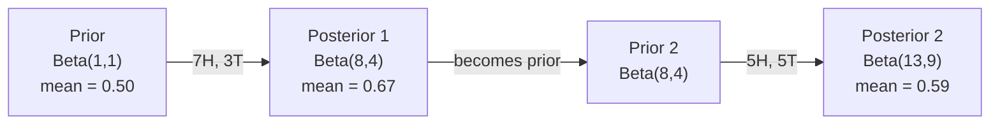

# Bayes teoremi

> Muhtemelenlik  Sorun senin beklediğin şeyle ilgili. Bayes teoremi  Sorun senin ne öğrendiğin şeyle ilgili.

**类型：**Yapım
**语言：**Python
**前置要求：**Eğitim 1 Fase, Ders 06
**时间：**~ 75 dakika

## Öğrenme hedefi

- Bayes teoremi uygulanır, ön olasılık ve kanıtlara göre, son olasılık hesaplanır.
- Züce bir yapım ile Laplace düzeltme ve log-uzay hesaplama
- MLE ile MAP tahminlerini karşılaştırın, MAP'ı nasıl L2 düzenlenmesine karşı koyacağınızı açıklayın
- Beta-Binomial konjugat öncüleri kullanmak A/B testleri için  sıralı Bayesian güncelleştirmeyi gerçekleştirmek

## 问题

Bir tıbbi testin %99 doğruluk oranı var. Test sonuçlarınız olumlu.

Çoğu insan 99% diyecektir. Gerçek cevap bu hastalığın nadir olmasına bağlıdır. Eğer her 10.000 kişiden sadece 1 kişi hastalanırsa, bir kez olumlu sonuç sadece hastalanma olasılığının yaklaşık %1 olduğunu gösterir. Diğer 99% olumlu sonuçlar sağlıklı insan tarafından meydana gelen yanlış haberlerdir.

Bu Bayes teorisi. Her spam filtre, her tıbbi teşhis, her ölçümsel belirsizlikten kaynaklanan bir ML modeli tamamen aynı düşünceleri kullanıyor.

Eğer bu noktayı anlamadığınızda bir ML sistemi oluşturursanız, model çıkışlarını yanlış anlayacaksınız, kötü eşiği ayarlayacaksınız ve aşırı güvenli tahminler yayınlayacaksınız.

## 概念

### Ortak olasılıktan Bayes'e.

6. derste şartsal olasılıkları biliyorsunuz:

```math
P(A \mid B) = \frac{P(A \text{ and } B)}{P(B)}
```

Görevi:

```math
P(B \mid A) = \frac{P(A \text{ and } B)}{P(A)}
```

İki ifade ortak bir molekül:$P(A \text{ and } B)$❖ onları yeniden düzenlemek:

```math
\begin{aligned}
P(A \text{ and } B) &= P(A \mid B) \cdot P(B) = P(B \mid A) \cdot P(A) \\[4pt]
&\text{因此：} \\[4pt]
P(A \mid B) &= \frac{P(B \mid A) \cdot P(A)}{P(B)}
\end{aligned}
```

İşte Bayes teoremi.

### Dört bölüm

| Part | Name | What it means |
|------|------|---------------|
| $P(A \mid B)$ | Posterior | 看到 evidence $B$ 之后，你对 $A$ 的更新后 belief |
| $P(B \mid A)$ | Likelihood | 如果 $A$ 为真，evidence $B$ 出现的概率有多大 |
| $P(A)$ | Prior | 在看到任何 evidence 之前，你对 $A$ 的 belief |
| $P(B)$ | Evidence | 在所有可能性下看到 $B$ 的总概率 |

Kanıtlar$P(B)$起到归化因子的作用── you can use the total probability law 展开它:

```math
P(B) = P(B \mid A) \cdot P(A) + P(B \mid \text{not } A) \cdot P(\text{not } A)
```

### 医学检测 örneği

Bir hastalık, her 10.000 insandan 1 kişiyi etkiliyor.

```math
\begin{aligned}
P(\text{sick}) &= 0.0001 \quad \text{（先验：疾病罕见）} \\
P(\text{positive} \mid \text{sick}) &= 0.99 \quad \text{（似然：检测能检出疾病）} \\
P(\text{positive} \mid \text{healthy}) &= 0.01 \quad \text{（假阳性率）} \\[6pt]
P(\text{positive}) &= P(\text{positive} \mid \text{sick}) \cdot P(\text{sick}) + P(\text{positive} \mid \text{healthy}) \cdot P(\text{healthy}) \\
&= 0.99 \cdot 0.0001 + 0.01 \cdot 0.9999 \\
&= 0.000099 + 0.009999 \\
&= 0.010098 \\[6pt]
P(\text{sick} \mid \text{positive}) &= P(\text{positive} \mid \text{sick}) \cdot P(\text{sick}) / P(\text{positive}) \\
&= 0.99 \cdot 0.0001 / 0.010098 \\
&= 0.0098 \\
&= 0.98\%
\end{aligned}
```

%1'e kadar değil. Önceki önemli kontrol. Bir durum nadir olduğunda, doğru testlerin çoğu bile yanlış pozitif sonuçlar verir.

### Spam Filtresi Örneği

"Lotteri" kelimesini içeren bir e-posta aldın mı?

```math
\begin{aligned}
P(\text{spam}) &= 0.3 \quad \text{（30\% 的邮件是垃圾邮件）} \\
P(\text{"lottery"} \mid \text{spam}) &= 0.05 \quad \text{（5\% 的垃圾邮件包含 "lottery"）} \\
P(\text{"lottery"} \mid \text{not spam}) &= 0.001 \quad \text{（0.1\% 的正常邮件包含 "lottery"）} \\[6pt]
P(\text{"lottery"}) &= 0.05 \cdot 0.3 + 0.001 \cdot 0.7 \\
&= 0.015 + 0.0007 \\
&= 0.0157 \\[6pt]
P(\text{spam} \mid \text{"lottery"}) &= 0.05 \cdot 0.3 / 0.0157 \\
&= 0.955 \\
&= 95.5\%
\end{aligned}
```

Bir kelime oranını %30'dan %95.5'e çıkarır. Gerçek spam filtreyi aynı anda yüzlerce kelime üzerinde uygulayacaktır.

### Naive Bayes:Bağımsızlık varsayımı

Naive Bayes, tüm özellikleri bir sınıfın koşullarında birbirinden bağımsız olarak varsayarak, bu düşünceyi çeşitli özelliklere yaydı:

```math
P(\text{class} \mid \text{feature}_1, \text{feature}_2, \ldots, \text{feature}_n) = \frac{P(\text{class}) \cdot P(\text{feature}_1 \mid \text{class}) \cdot P(\text{feature}_2 \mid \text{class}) \cdots P(\text{feature}_n \mid \text{class})}{P(\text{feature}_1, \text{feature}_2, \ldots, \text{feature}_n)}
```

"Sırılgan"ın bir kısmı bağımsızlık varsayımıdır. Yazılarda, kelimelerin ortaya çıkması bağımsız değildir. "Yeni" ve "York" ilişkili değildir. Ancak bu varsayım pratikte şaşırtıcı bir etki doğurur, çünkü sınıflandırma makinesi sadece sınıflara  sıralama gerektirir, iyi bir olasılık oluşturmak yerine  sıralama gerektirir.

Çünkü tüm sınıflara göre aynı, sadece moleküller karşılaştırarak atlayabilirsin.

```math
\text{score}(\text{class}) = P(\text{class}) \cdot \prod_i P(\text{feature}_i \mid \text{class})
```

Seçim puanı en yüksek sınıfı

### Maksimum olasılık tahminleri (MLE)

Nasıl eğitim verilerini alıyorsun?$P(\text{feature} \mid \text{class})$- Sayıları...

```math
P(\text{"free"} \mid \text{spam}) = \frac{\text{包含 "free" 的垃圾邮件数}}{\text{垃圾邮件总数}}
```

İşte MLE: Seçim için gözlem verisini en olası belirleme değerini seçin.

问题: Eğer bir kelime eğitim sırasında hiç spam'de görünmezse, MLE ona sıfır olasılıklar dağıtacak.

```math
P(\text{word} \mid \text{class}) = \frac{\text{count}(\text{word}, \text{class}) + 1}{\text{total\_words\_in\_class} + \text{vocabulary\_size}}
```

Her sayı 1'e ekle, ve olasılıkların hiç de sıfır olmayacağını garanti et.

### Maksimum a posteriori (MAP)

MLE 问的是: hangi parametreler en büyük $P(\text{data} \mid \text{parameters})$- Ne ?

MAP  soru şu: hangi parametreler en büyük $P(\text{parameters} \mid \text{data})$- Ne ?

Bayes teoremesine göre:

```math
P(\text{parameters} \mid \text{data}) \propto P(\text{data} \mid \text{parameters}) \cdot P(\text{parameters})
```

MAP, parametreler üzerinde bir öncüye katılır. Eğer parametrelerin daha küçük olması gerektiğini düşünüyorsanız, onu büyük değerli bir öncüye ödenmek için kodlayın. ML'deki L2 düzenlenmesiyle tamamen aynıdır.

| Estimation | Optimizes | ML equivalent |
|------------|-----------|---------------|
| MLE | $P(\text{data} \mid \text{params})$ | 未 regularize 的训练 |
| MAP | $P(\text{data} \mid \text{params}) \cdot P(\text{params})$ | L2 / L1 regularization |

### Bayesian vs. Frequentist:实践差异

Frequentistler parametreyi sabit ama bilinmeyen bir miktar olarak görüyorlar.

Bayesililer Parametreyi Değiştirmek için Değiştirir. Onlar soruyorlar:  Gördüğüm konulara dayanarak, bu parametrelere ne inanıyorum?

Construction ML system için, pratik farklılıkları aşağıdakiler:

| Aspect | Frequentist | Bayesian |
|--------|-------------|----------|
| Output | 点估计 | 值上的 distribution |
| Uncertainty | Confidence intervals（关于过程） | Credible intervals（关于 parameter） |
| Small data | 可能 overfit | Prior 起到 regularization 的作用 |
| Computation | 通常更快 | 通常需要 sampling（MCMC） |

Çoğu üretim seviyesinde ML sıklıklı bir yöntemdir. SGD 点估算) ⋅ Bayesian yöntemleri çok yararlı olacaktır.

### Bayesian düşüncesi neden ML için çok önemlidir ?

Bu tür bağlantılar daha derin:

**Priors 就是 regularization。**Yukarıdaki ağırlıklar Gaussian öncü L2 düzenlenmesi. L1'ün öncü yer L1'ün öncü yer. Her ek düzenlenme sırasında, sen de beklenen parametreler değerlerine karşı Bayesian bir ifade yaparsın.

**Posteriors 就是不确定性。**单个预测概率不能告诉你模型对该估计有多信心――Bayesian yöntemler size bir dağılım verecektir:我认为$P(\text{spam})$0.8 ile 0.95 arasında.

**Bayes updates 就是 online learning。**Bugünün sonrası yarınki öncülüğe dönüşecek. Modeliniz yeni verileri gördüğünde, sıfırdan yeniden eğitilmek yerine inançlarını yenileyecektir.

**Model comparison 是 Bayesian 的。**Bayesian bilgi kriterleri (BIC) ✓ sınırlı olasılıkla birlikte Bayes faktörleri Bayesian mantık kullanır.


```figure
bayes-update
```

## Yapın onu.
### 步骤 1: Bayes teoremi işlevi

```python
def bayes(prior, likelihood, false_positive_rate):
    evidence = likelihood * prior + false_positive_rate * (1 - prior)
    posterior = likelihood * prior / evidence
    return posterior

result = bayes(prior=0.0001, likelihood=0.99, false_positive_rate=0.01)
print(f"P(sick|positive) = {result:.4f}")
```

### 步骤 2: Naive Bayes sınıflandırıcısı

```python
import math
from collections import defaultdict

class NaiveBayes:
    def __init__(self, smoothing=1.0):
        self.smoothing = smoothing
        self.class_counts = defaultdict(int)
        self.word_counts = defaultdict(lambda: defaultdict(int))
        self.class_word_totals = defaultdict(int)
        self.vocab = set()

    def train(self, documents, labels):
        for doc, label in zip(documents, labels):
            self.class_counts[label] += 1
            words = doc.lower().split()
            for word in words:
                self.word_counts[label][word] += 1
                self.class_word_totals[label] += 1
                self.vocab.add(word)

    def predict(self, document):
        words = document.lower().split()
        total_docs = sum(self.class_counts.values())
        vocab_size = len(self.vocab)
        best_class = None
        best_score = float("-inf")
        for cls in self.class_counts:
            score = math.log(self.class_counts[cls] / total_docs)
            for word in words:
                count = self.word_counts[cls].get(word, 0)
                total = self.class_word_totals[cls]
                score += math.log((count + self.smoothing) / (total + self.smoothing * vocab_size))
            if score > best_score:
                best_score = score
                best_class = cls
        return best_class
```

Log olasılıkları, düşük akışın önlenmesini sağlar. Çok küçük olasılık çarpmaları, yüzen noktaya karşı çok küçük sayılarda oluşur.

### Adım 3: Spam Bilgi Üzerinde Eğitim

```python
train_docs = [
    "win free money now",
    "free lottery ticket winner",
    "claim your prize today free",
    "urgent offer free cash",
    "congratulations you won free",
    "meeting tomorrow at noon",
    "project update attached",
    "can we schedule a call",
    "quarterly report review",
    "lunch on thursday sounds good",
    "team standup notes attached",
    "please review the pull request",
]

train_labels = [
    "spam", "spam", "spam", "spam", "spam",
    "ham", "ham", "ham", "ham", "ham", "ham", "ham",
]

classifier = NaiveBayes()
classifier.train(train_docs, train_labels)

test_messages = [
    "free money waiting for you",
    "meeting rescheduled to friday",
    "you won a free prize",
    "please review the attached report",
]

for msg in test_messages:
    print(f"  '{msg}' -> {classifier.predict(msg)}")
```

### 4 adım: inceleme öğrenme olasılığı

```python
def show_top_words(classifier, cls, n=5):
    vocab_size = len(classifier.vocab)
    total = classifier.class_word_totals[cls]
    probs = {}
    for word in classifier.vocab:
        count = classifier.word_counts[cls].get(word, 0)
        probs[word] = (count + classifier.smoothing) / (total + classifier.smoothing * vocab_size)
    sorted_words = sorted(probs.items(), key=lambda x: x[1], reverse=True)
    for word, prob in sorted_words[:n]:
        print(f"    {word}: {prob:.4f}")

print("\nTop spam words:")
show_top_words(classifier, "spam")
print("\nTop ham words:")
show_top_words(classifier, "ham")
```

## Kullan
Scikit-learning  üretilebilir saf Bayes  gerçekleştirmek için sağladı:

```python
from sklearn.feature_extraction.text import CountVectorizer
from sklearn.naive_bayes import MultinomialNB
from sklearn.metrics import classification_report

vectorizer = CountVectorizer()
X_train = vectorizer.fit_transform(train_docs)
clf = MultinomialNB()
clf.fit(X_train, train_labels)

X_test = vectorizer.transform(test_messages)
predictions = clf.predict(X_test)
for msg, pred in zip(test_messages, predictions):
    print(f"  '{msg}' -> {pred}")
```

Aynı algoritma.CountVectorizer. Tokenizasyon ve kelimeforumu oluşturmayı işleyen.MultinomialNB.

## - Söyle.
Bu yapılandırılmış NaiveBayes sınıfı  tam bir boru hattını gösterdi: tokenizasyon  Laplace düzleştirme kullanımı  log- uzay tahminleri `code/bayes.py`Python standart kütüphanesi dışında herhangi bir bağımlılık gerektirmez.

### Birlikte Birlikte Birlikte Birlikte Birlikte Birlikte Birlikte Birlikte Birlikte Birlikte Birlikte Birlikte Birlikte Birlikte Birlikte Birlikte Birlikte Birlikte Birlikte Birlikte Birlikte Birlikte Birlikte Birlikte Birlikte Birlikte Birlikte Birlikte Birlikte Birlikte Birlikte Birlikte Birlikte Birlikte Birlikte Birlikte Birlikte Birlikte Birlikte Birlikte Birlikte Birlikte Birlikte Birlikte Birlikte Birlikte Birlikte Birlikte Birlikte Birlikte Birlikte Birlikte Birlikte Birlikte Birlikte Birlikte Birlikte Birlikte Birlikte Birlikte Birlikte Birlikte Birlikte Birlikte Birlikte Birlikte Birlikte Birlikte Birlikte Birlikte Birlikte Birlikte Birlikte Birlikte Birlikte Birlikte Birlikte Birlikte Birlikte Birlikte Birlikte Birlikte Birlikte Birlikte Birlikte Birlikte Birlikte Birlikte Birlikte Birlikte Birlikte Birlikte Birlikte Birlikte Birlikte Birlikte Birlikte Birlikte Birlikte Birlikte Birlikte Birlikte Birlikte Birlikte Birlikte Birlikte Birlikte Birlikte Birlikte Birlikte Birlikte Birlikte Birlikte Birlikte Birlikte Birlikte Birlikte Birlikte Birlikte Birlikte Birlikte Birlikte Birlikte Birlikte Birlikte Birlikte Birlikte Birlikte Birlikte Birlikte Birlikte Birlikte Birlikte Birlikte Birlikte Birlikte Birlikte Birlikte Birlikte Birlikte Birlikte Birlikte Birlikte Birlikte Birlikte Birlikte Birlikte Birlikte Birlikte Birlikte Birlikte Birlikte Birlikte Birlikte Birlikte Birlikte Birlikte Birlikte Birlikte Birlikte Birlikte Birlikte Birlikte Birlikte Birlikte Birlikte Birlikte Birlikte Birlikte Birlikte Birlikte Birlikte Birlikte Birlikte Birlikte Birlikte Birlikte Birlikte Birlikte Birlikte Birlikte Birlikte Birlikte Birlikte Birlikte Birlikte Birlikte Birlikte Birlikte Birlikte Birlikte Birlikte Birlikte Birlikte Birlikte Birlikte Birlikte Birlikte Birlikte Birlikte Birlikte Birlikte Birlikte Birlikte Birlikte Birlikte Birlikte Birlikte Birlikte Birlikte Birlikte Birlikte Birlikte Birlikte Birlikte Birlikte Birlikte Birlikte Birlikte Birlikte Birlikte Birlikte Birlikte Birlikte Birlikte Birlikte Birlikte Birlikte Birlikte Birlikte Birlikte Birlikte Birlikte Birlikte Birlikte Birlikte Birlikte Birlikte Birlikte Birlikte Birlikte Birlikte Birlikte Birlikte Birlikte Birlikte Birlikte Birlikte Birlikte Birlikte Birlikte Birlikte Birlikte Birlikte Birlikte

Eğer ön ve arka  aynı dağılım ailesine aittirse, bu ön "konjugat" olarak adlandırılır. Bu Bayesian güncelleme sırasında çok temiz 

| Likelihood | Conjugate Prior | Posterior | Example |
|-----------|----------------|-----------|---------|
| Bernoulli | $\text{Beta}(a, b)$ | $\text{Beta}(a + \text{successes}, b + \text{failures})$ | Coin flip bias estimation |
| Normal (known variance) | $\text{Normal}(\mu_0, \sigma_0)$ | Normal(weighted mean, smaller variance) | Sensor calibration |
| Poisson | $\text{Gamma}(a, b)$ | $\text{Gamma}(a + \text{sum of counts}, b + n)$ | Modeling arrival rates |
| Multinomial | $\text{Dirichlet}(\alpha)$ | $\text{Dirichlet}(\alpha + \text{counts})$ | Topic modeling, language models |

Bu neden önemlidir: Konjugat öncüleri yokken, Monte Carlo örneğine veya sonraki yaklaşımdaki değişim sonuçlarına ihtiyacınız var.

Beta dağılım, uygulamada en yaygın konjugat öncesi olanıdır.$\text{Beta}(a, b)$Bir olasılık parametreye inancınızı göstermek.$a/(a+b)$- Evet.$a+b$越大, dağıtım 越集中(越自信)

Beta öncesi özel durumları:
- $\text{Beta}(1, 1)$= uniform──you on parameter 没有意见──
- $\text{Beta}(10, 10)$= = = = = = = = = = = = = = = = = = = = = = = = = = = = = = = = = = = = = = = = = = = = = = = = = = = = = = = = = = = = = = = = = = = = = = = = = = = = = = = = = = = = = = = = = = = = = = = = = = = = = = = = = = = = = = = = = = = = = = = = = = = = = = = = = = = = = = = = = = = = = = = = = = = = = = = = = = = = = = = = = = = = = = = = = = = = = = = = = = = = = = = = = = = = = = = = = = = = = = = = = = = = = = = = = = = = = = = = = = = = = = = = = = = = = = = = = = = = = = = = = = = = = = = = = = = = = = = = = = = = = = = = = = = = = = = = = = = = = = = = = = = = = = = = = = = = = = = = = = = = = = = = = = = = = = = = = = = = = = = = = = = = = = = = = = = = = = = = = = = = = = = = = = = = = = = = = = = = = = = = = = = = = = = = = = = = = = = = = = = = = = = = = = = = = = = = = = = = = = = = = = = = = = = = = = = = = = = = = = = = = = = = = = = = = = = = = = = = = = = = = = = = = = = = = = = = = = = = = = = = = = = = = = = = = = = = = = = = = = = = = = = = = = = = = = = = = = = = = = = = = = = = = = = = = =
- $\text{Beta}(1, 10)$= 向 0 偏斜──你相信参数 很小──

更新规则极其简单:

```math
\begin{aligned}
\text{先验：} \quad & \text{Beta}(a, b) \\
\text{数据：} \quad & s \text{ 次成功}, f \text{ 次失败} \\
\text{后验：} \quad & \text{Beta}(a + s, b + f)
\end{aligned}
```

没有积分――没有样本――只有加法――

### Bayesian Değişiklikleri

Bayesian sonucu 天然是序列的──今日的后者会成为明天的前者──这是现实系统如何在不重新处理所有历史数据的情况下增量学习──

具体例: bir kârın adil olup olmadığını tahmin etmek

**Day 1：还没有数据。**
- Evet .$\text{Beta}(1, 1)$开始一个制服前──你没有意见──
- Önceki ortalama:0.5
- Önceki = [0, 1]

**Day 2：观察到 7 次正面，3 次反面。**
$\text{Posterior} = \text{Beta}(1 + 7, 1 + 3) = \text{Beta}(8, 4)$
- Arka ortalama:$8/12 = 0.667$
- Kanıtlar , çetin parayı doğru yönde yönlendirdiğini göstermektedir .

**Day 3：又观察到 5 次正面，5 次反面。**
Geçmişi bugünün önünü olarak kullanın.
$\text{Posterior} = \text{Beta}(8 + 5, 4 + 5) = \text{Beta}(13, 9)$
- Arka ortalama:$13/22 = 0.591$
- Yeni dengeler verileri , tahmin değerini 0.5 civarına geri döndü .



观测顺序 önemli değil.$\text{Beta}(1,1)$Bir kez seks yaparak 12 kez doğru ve 8 kez ters yüzlü bir güncelleme yaparsanız, bunu da alacaksınız.$\text{Beta}(13, 9)$ sonuç aynıdır.                                                                                                                                                                                                                                                            

Bu, üretim sınıfı ML  sisteminde çevrimiçi öğrenmenin temelidir.

### A/B Testlerle İletişim

A/B testleri aslında uydurma Bayesian sonuçlardır.

设定:你正在测试两种按颜色──A çeşitleri A 蓝色) 和 B çeşitleri B 绿色)──你想知道哪一个得到更多点击──

Bayesian A/B testi:

1. **Prior。**İki çeşit var.$\text{Beta}(1, 1)$Başlangıç. Önceki tercih yok.
2. **Data。**A: 1000 kez gösterim içinde 50 kez tıklayın.
3. **Posteriors。**
   - A:$\text{Beta}(1 + 50, 1 + 950) = \text{Beta}(51, 951)$❖ Ortalama = 0.051
   - B:$\text{Beta}(1 + 65, 1 + 935) = \text{Beta}(66, 936)$❖ Ortalama = 0,066
4. **Decision。**计算 $P(B > A)$B'nin gerçek dönüşüm oranı A'dan daha yüksek bir olasılıktır.

解析地计算 $P(B > A)$Çok zor ama Monte Carlo çok basit bir şey yaptı.

```
1. Draw 100,000 samples from Beta(51, 951)  -> samples_A
2. Draw 100,000 samples from Beta(66, 936)  -> samples_B
3. P(B > A) = fraction of samples where B > A
```

Eğer $P(B > A) > 0.95$Eğer 0.05 ve 0.95 arasında ise, verileri toplamaya devam edelim.$P(B > A) < 0.05$, A. Variansı yayınlanmaya başladı.

A/B testlerinin avantajları:
- Bir doğrudan olasılık elde edeceksiniz. %97 oranı daha iyi.
- 没有 p-value 混──没有 fail to reject the null hypothesis  这种回避表述──
- Her zaman sonuçları görebilirsin, ama yanlış pozitif oranları yükseltmeyeceksin.
- Önceki bilgiyi de dahil edebilirsiniz. Örneğin, önceki testler dönüşüm oranlarını genellikle %3-8 gösteriyor.

| Aspect | Frequentist A/B | Bayesian A/B |
|--------|----------------|--------------|
| Output | p-value | $P(B > A)$ |
| Interpretation | “如果 A=B，这些数据有多令人意外？” | “B 比 A 更好的可能性有多大？” |
| Early stopping | 会抬高 false positives | 任意时点都是安全的（前提是 prior 选择合理且 model specification 正确） |
| Prior knowledge | 不使用 | 编码为 Beta prior |
| Decision rule | $p < 0.05$ | $P(B > A) > \text{threshold}$ |

## 练习
1. **Multiple tests。**İki testte bir hasta iki kez olumlu sonuç aldı. İki kez test edilen hastaların sayısı yüzde 99 doğrudur.$P(\text{sick})$İlk testin ardından ikinci testin öncesini görüyor musun?

2. **Smoothing impact。**0.01、0.1、1.0 和 10.0 运行垃圾邮件分类器──Top kelime olasılığı 会如何变化?

3. **Add features。**扩展 NaiveBayes sınıfı, onu kelime sayımlarının dışında 之外, 也使用消息长度(短/长) 作为特征──从训练数据中估计 $P(\text{short} \mid \text{spam})$和 $P(\text{short} \mid \text{ham})$, ve onu tahmin puanına kattı.

4. **MAP by hand。**10 kere para atıyor, 7 kez başlıyoruz.$\text{Beta}(2,2)$Önceki 计算偏差的 MAP tahminı¬¬¬¬¬¬¬¬¬¬¬¬¬¬¬¬¬¬¬¬¬¬¬¬¬¬¬¬¬¬¬¬¬¬¬¬¬¬¬¬¬¬¬¬¬¬¬¬¬¬¬¬¬¬¬¬¬¬¬¬¬¬¬¬¬¬¬¬¬¬¬¬¬¬¬¬¬¬¬¬¬¬¬¬¬¬¬¬¬¬¬¬¬¬¬¬¬¬¬¬¬¬¬¬¬¬¬¬¬¬¬¬¬¬¬¬¬¬¬¬¬¬¬¬¬¬¬¬¬¬¬¬¬¬¬¬¬¬¬¬¬¬¬¬¬¬¬¬¬¬¬¬¬¬¬¬¬¬¬¬¬¬¬¬¬¬¬¬¬¬¬¬¬¬¬¬¬¬¬¬¬¬¬¬¬¬¬¬¬¬¬¬¬¬¬¬¬¬¬¬¬¬¬¬¬¬¬¬¬¬¬¬¬¬¬¬¬¬¬¬¬¬¬¬¬¬¬¬¬¬¬¬¬¬¬¬¬¬¬¬¬¬¬¬¬¬¬¬¬¬¬¬¬¬¬¬¬¬¬¬¬¬¬¬¬¬¬¬¬¬¬¬¬¬¬¬¬¬¬¬¬¬¬¬¬¬¬¬¬¬¬¬¬¬¬¬¬¬¬¬¬¬¬¬¬¬¬¬¬¬¬¬¬¬¬¬¬¬¬¬¬¬¬¬¬¬¬¬¬¬¬¬¬¬¬¬¬¬¬¬¬¬¬¬¬¬¬¬¬¬¬¬¬¬¬¬¬¬¬¬¬¬¬¬¬¬¬¬¬¬¬¬¬¬¬¬¬¬¬¬¬¬¬¬¬¬¬¬¬¬¬¬¬¬¬¬¬¬¬¬¬¬¬¬¬¬¬¬¬¬¬¬¬¬¬¬¬¬¬¬¬¬¬¬¬¬¬¬¬¬¬¬¬¬¬¬¬¬¬¬¬¬¬¬¬¬¬¬¬¬¬¬¬¬¬¬¬¬¬¬¬¬¬¬¬¬¬¬¬¬¬¬¬¬¬¬¬¬¬¬¬¬¬¬¬¬¬¬¬¬¬¬¬¬¬¬¬¬$7/10$) karşılaştırma yapılması

### 提示

**练习 1。**Bir kere kullanın.`bayes`İlk testten sonra bir kez daha ilk test olarak kullanılır.`sequential_bayes(prior, likelihood, false_positive_rate, 2)`Aynı sonucu vermeli, yaklaşık 0.5

**练习 2。**Her bir değer için bir tane oluştur .`NaiveBayes(smoothing=s)`Aynı veriyi kullanarak, farklı baskı yap.`top_words`◊smoothing = 0 时,垃圾邮件中未出现的词概率 = 0, bu nedenle sayısal olarak tanımlanmamıştır.

**练习 3。**统计垃圾邮件和正常邮件中各有多少条短消息,分别除以各类消息总数,并分分分别分别分别分别分别分别分别分别分别分别分别分别分别分别分别分别分别分别分别分别分别分别分别分别分别分别分别分别分别分别分别分别分别分别分别分别分别分别分别分别分别分别分别分别分别分别分别分别分别分别分别分别分别分别分别分别分别分别分别分别分别分分分分分分分分分分分分分分分分分分分分分分分分分分分分分分分分分分分分分分分分分分分分分分分分分分分分分分分分分分分分分分分分分分分分分分分分分分分分分分分分分分分分分分分分分分分分分分分分分分分分分分分分分分分分分分分分分分分分分分分分分分分分分分分分分分分分分分分分分分分分分分分分分分分分分分分分分分分分分分分分分分分分分分分分分分分分分分分分分分分分分分分分分分分分分分分分分分分分分分分分分分分分分分分分分分分分分分分分分分分分分分分分分分分分分分分分分分分分分分分分分分分分分分分分分分分分分分分分分分分分分分分分分分分分分分分分分分分分分分分分分分分分分分分`predict`Orta oranı oranı oranı oranı oranı oranı oranı oranı oranı oranı oranı oranı oranı oranı oranı oranı oranı oranı oranı oranı oranı oranı oranı oranı oranı oranı oranı oranı oranı oranı oranı oranı oranı oranı oranı oranı oranı oranı oranı oranı oranı oranı oranı oranı oranı oranı oranı oranı oranı oranı oranı oranı oranı oranı oranı oranı oranı oranı oranı oranı oranı oranı oranı oranı oranı oranı oranı oranı oranı oranı oranı oranı oranı oranı oranı oranı oranı oranı oranı oranı oranı oranı oranı oranı oranı oranı oranı 1 oranı oranı oranı oranı oranı oranı oranı oranı oranı oranı oranı oranı oranı oranı oranı oranı oranı oranı oranı oranı oranı oranı oranı oranı oranı oranı oranı oranı oranı oranı oranı oranı oranı oranı oranı oranı oranı oranı oranı oranı oranı oranı oranı oranı oranı oranı oranı oranı oranı oranı oranı oranı oranı oranı oranı oranı oranı oranı oranı oranı oranı oranı oranı oranı oranı oranı oranı oranı oranı %s oranı %s oranı %s oranı %s %s %s %s %s %s %s %s %s %s %s %s %s %s %s %s %s %s %s %s %s %s %s %s %s %s %s %s %s %s %s %s %s %s %s %s %s %s %s %s %s %s %s %s %s %s %s %s %s %s %s %s %s %s %s %s %s %s %s %s %s %s %s %s %s %s %s %s %s %s %s %s %s %s %s %s %s %s %s %s %s %s %s %s %s %s %s %s %s %s %s %s

**练习 4。**Kullanım$\text{Beta}(\alpha, \beta)$Önceki deneylerde,MAP  tahminleri$\frac{h + \alpha - 1}{n + \alpha + \beta - 2}$- Evet.$h = 7$- Evet.$n = 10$Sonuçlar MLE  0.7) ile öncesindeki  0.5) arasında olmalıdır.

## 关键术语
| Term | What people say | What it actually means |
|------|----------------|----------------------|
| Prior | “我的初始猜测” | 观测 evidence 之前的 $P(\text{hypothesis})$。在 ML 中：regularization 项。 |
| Likelihood | “数据拟合得有多好” | $P(\text{evidence} \mid \text{hypothesis})$。在特定 hypothesis 下，观测数据出现的概率有多大。 |
| Posterior | “我更新后的 belief” | $P(\text{hypothesis} \mid \text{evidence})$。Prior 乘以 likelihood，然后归一化。 |
| Evidence | “归一化常数” | 所有 hypotheses 下的 $P(\text{data})$。确保 posterior 求和为 1。 |
| Naive Bayes | “那个简单的文本分类器” | 一个假设 features 在给定 class 时相互独立的分类器。尽管该假设不成立，效果仍然很好。 |
| Laplace smoothing | “Add-one smoothing” | 给每个 feature 增加一个小计数，以防止未见数据产生零概率。 |
| MLE | “直接用频率” | 选择最大化 $P(\text{data} \mid \text{parameters})$ 的 parameters。没有 prior。在小数据上可能 overfit。 |
| MAP | “带 prior 的 MLE” | 选择最大化 $P(\text{data} \mid \text{parameters}) \cdot P(\text{parameters})$ 的 parameters。等价于 regularized MLE。 |
| Log-probability | “在 log space 中工作” | 使用 $\log(P)$ 而不是 $P$，避免许多小数相乘时发生 floating-point underflow。 |
| False positive | “错误警报” | 检测结果为阳性，但真实状态为阴性。它会推动 base rate fallacy。 |

## 延伸阅读
- [3Blue1Brown: Bayes' theorem](https://www.youtube.com/watch?v=HZGCoVF3YvM)- Medical test örnek kullanın görülebilir açıklama
- [Stanford CS229: Generative Learning Algorithms](https://cs229.stanford.edu/notes2022fall/cs229-notes2.pdf)- Naif Bayes ve onun ayrımcılık modelleriyle bağlantısı
- [Think Bayes](https://greenteapress.com/wp/think-bayes/)- 免费书籍,包含 Python 代码的贝耶斯统计
- [scikit-learn Naive Bayes](https://scikit-learn.org/stable/modules/naive_bayes.html)- Üretim sınıfı ve her türlü variantın ne zaman kullanılması
