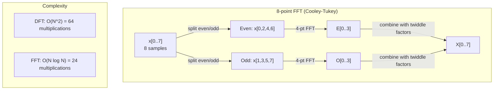
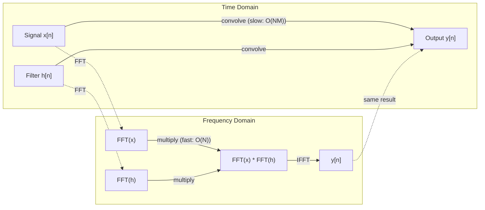

# Fourier Değişimi

> Her sinyal sinüs dalgalarının birleştirilmesi. Fourier dönüşümü size bazılarını söyleyecektir.

**Type:** Build
**Language:**Python
**Prerequisites:** Phase 1, Lessons 01-04, 19 (complex numbers)
**Time:** ~90 分钟

## Öğrenme hedefi
- DFT'yi gerçekleştirmek için,$O(N \log N)$Bu bir şey değil .
- Frekans katılıklarını anlamak: sinyalden amplitüde, faz ve güç spektrumunu çıkarmak
- 应用 convolution teoremi, FFT çarpımı yoluyla 执行 convolution
- Fourier frekansı parçalanmasını transformatör pozisyon kodlamaları ve CNN konvulsiyon katmanları ile bağlayın

## 问题
Bir ses ses ses kayıtı, zamanla değişen bir dizi basınç ölçüm değeri. Hissi değerleri, zamanla değişen bir dizi sayı değeri.

Ancak zaman alanında birçok desen görünmez. Bu ses sinyali saf ton mu yoksa akord mu? Bu payın haftalık döngüsü var mı? Bu resimlerin tekrarlanan dokuları mı var mı?

Fourier transformı, verileri zaman domeninden frekans domenine dönüştürür. Bir sinyal alır ve farklı frekanslarda sinüs dalgalarına ayrılır.

Bu ML için  çok önemlidir, çünkü frekans alanı düşüncesi 隨處可见── Konvolyasyonal sinir ağları  konvulsiyonu gerçekleştirir, konvulsiyon ise frekans alanında çoğaltmaktır── Transformer pozisyonal kodlamaları Frequency decomposition kullanmak için konum göstermek için konum kullanmak── Ses tanıma modeli (audio modeller, ses tanıma, müzik üretimi) spektrogramları, seslerin frekans temsillerini işlemek── Zaman dizisi modelleri, periyodik desenler aramak── Fourier dönüşümünü anlamak, bu sorunları işlemek için gerekli kelime birikmesini hazırlamak──

## 概念
### DFT tanımı

- Evet .$N$个 örnekler $x[0], x[1], \ldots, x[N-1]$,Diskret Fourier Transform 会生成 $N$个 frekans katılıkları $X[0], X[1], \ldots, X[N-1]$- ...

```math
X[k] = \sum_{n=0}^{N-1} x[n] \, e^{-2\pi i k n/N} \qquad \text{其中 } k = 0, 1, \ldots, N-1
```

Her biri .$X[k]$Bu karmaşık bir sayı. Büyüklüğü.$\lvert X[k] \rvert$       $k$Amplitude 成正比──未归化时,amplitude 为 $A$Ve ben de ben de ben de ben de ben de ben de ben de ben de ben de ben de ben de ben de ben de ben de ben de ben de ben de ben de ben de ben de ben de ben de ben de ben de ben de ben de ben de ben de ben de ben de ben de ben de ben de ben de ben de ben de ben de ben de ben de ben de ben de ben de ben de ben de ben de ben de ben de ben de ben de ben de ben de ben de ben de ben de ben de ben de ben de ben de ben de ben de ben de ben de ben de ben de ben de ben de ben de ben de ben de ben de ben de ben de ben de ben de ben de ben de ben de ben de ben de ben de ben de ben de ben de ben de ben de ben de ben de ben de ben de ben de ben de ben de ben de ben de ben de ben de ben de ben de ben de ben de ben de ben de ben de ben de ben de ben de ben de ben de ben de ben de$k$Üstün gerçek sinir dalgaları .$\lvert X[k] \rvert = AN/2$Bu yüzden de bunu yapmalıyız.$N/2$才能读出 amplitude── onun aşamasını $\angle X[k]$Bu frekansın fazını ödemeni gösterir.

关键洞见:$e^{-2\pi i k n/N}$- Bir tane frekanslı.$k$旋转的phasor──DFT 计算的是信号与 $N$个等间隔频 中每个的相关性──如果信号在频率中$k$Ünlü enerji içerir, ilişki çok büyük.

### Her bir dizi anlamı

**$X[0]$: DC component。**Bu, tüm örneklerin toplamı, ortalama 成比例¬ı ile birlikte, sinyalin sabitini ifade eder.

```math
X[0] = \sum_{n=0}^{N-1} x[n] \, e^0 = \text{全部 samples 之和}
```

**$X[k]$ for $1 \le k \le N/2$: positive frequencies。** $X[k]$Gösterme$N$个 örnekleri 中 $k$个周期 个周期 个周期 个周期 个周期 个周期 个周期 个周期 个周期 个周期 个周期 个周期 个周期 个周期 个周期 个周期 个周期 个周期 个周期 个周期 个周期 个周期 个周期 个周期 个周期 个周期 个周期 个周期 个周期 个周期 个周期 个周期 个周期 个周期 个周期 个周期 个周期 个周期 个周期 个周期 个周期 个周期 个周期 个周期 个周期 个周期 个周期 个周期 个周期 个周期 个周期 个周期 个周期 个周期 个周期 个周期 个周期 个周期 个周期 个周期 个周期 个周期 个周期 个周期 个周期 个周期 个周期 个周期 个周期 个周期 个周期 个周期 个周期 个周期 个周期 个周期 个周期$k$越大, frekans 越高(osillation 越快)

**$X[N/2]$: Nyquist frequency。**Bu .$N$个样本 能表示的最高频──超过这个频率,就会出现别名,也就是高频──伪装成低频──

**$X[k]$ for $N/2 < k < N$: negative frequencies。** Gerçek değerli sinyaller için,$X[N-k] = \overline{X[k]}$Negatif frekanslar pozitif frekansların aynasıdır.$N/2 + 1$个系数 中──

### Ters DFT

Ters DFT frekans katılıkları yeniden yapılandırma:

```math
x[n] = \frac{1}{N} \sum_{k=0}^{N-1} X[k] \, e^{2\pi i k n/N} \qquad \text{其中 } n = 0, 1, \ldots, N-1
```

Forward DFT'nin tek farkı: Eksponent arasında bir negatif değil, doğru olan bir simge vardır.$1/N$Normalleşme faktörü:

Ters DFT mükemmel bir yeniden yapılandırmadır. Hiçbir bilgiyi kaybetmez. Zaman domeninden frekans domenine, tekrar geri dönebilir ve herhangi bir hata yapmadan geri dönebilirsiniz.

### FFT: hızlı hale getirmek

Yukarıda tanımlanan DFT ise$O(N^2)$:对 $N$个输出系数 中的每个,都要对 $N$个 giriş örnekleri 求和──当 $N$= 1 milyon zaman, işte bu.$10^{12}$Sonraki operasyonlar:

Hızlı Fourier Değişimi (FFT) 会 $O(N \log N)$計算同樣的結果──当 $N$= 1 milyon zaman, bu yaklaşık olarak 20 milyon işlemdir, bir milyar değil. Bu da frekans analizini mümkün kılar.

Cooley-Tukey algoritması (((最常见的 FFT) bölün ve fethet kullanın:

1. Sinyal ızgaralı ve eşsiz indeksli örneklere bölünecek.
2. 递归计算每一半的DFT──
3. "Kızıl faktörler" kullanın.$e^{-2\pi i k/N}$合并两个半尺寸 DFTs──

```math
\begin{aligned}
X[k] &= E[k] + e^{-2\pi i k/N} \, O[k] && \text{其中 } k = 0, \ldots, N/2 - 1 \\
X[k + N/2] &= E[k] - e^{-2\pi i k/N} \, O[k] && \text{其中 } k = 0, \ldots, N/2 - 1 \\[6pt]
\text{其中 } E &= \text{偶数索引 samples 的 DFT} \\
O &= \text{奇数索引 samples 的 DFT}
\end{aligned}
```

Bu simetri, geri dönüşün her aşamasını gerçekleştirmek anlamına gelir.$O(N)$İş ve var.$\log_2(N)$層──总计:$O(N \log N)$- Evet.



Bu şekilde gerçekleştirilen radiks-2 FFT sinyal uzunluğu 2'nin en hızlı zamanıdır. Bir sorunun uzunluğu garip bir sayı olursa, normal hale geri döner.`dft`Bu yüzden hız için sinyaller genellikle son 2'nin ︎'üne kadar sıfır patlamalar.`numpy.fft`等库中的 FFT Mixed-radix algoritması kullanılarak herhangi bir uzunluğu işleyebilir, ancak uzunlukta sadece küçük elementleri içerir.

### Spektral analiz

**power spectrum**Evet .$\lvert X[k] \rvert^2$Yani her frekans katılamının karesi büyüklüğü... her frekansın üzerinde ne kadar enerji olduğunu gösterir.

**phase spectrum**Evet .$\angle X[k]$,也就是每个频率的相抵消――大多数分析任务,你关心的是功率谱,并会忽略相――

```math
\begin{aligned}
\text{频率 } k \text{ 处的 Power：} \quad P[k] &= |X[k]|^2 = \mathop{\mathrm{Re}}(X[k])^2 + \mathop{\mathrm{Im}}(X[k])^2 \\
\text{频率 } k \text{ 处的 Phase：} \quad \phi[k] &= \mathop{\mathrm{atan2}}(\mathop{\mathrm{Im}}(X[k]), \mathop{\mathrm{Re}}(X[k]))
\end{aligned}
```

### Frekans çözünürlüğü

DFT frekans çözünürlüğü  örneklere bağlı  数量 $N$ 和 örnekleme oranı $f_s$- Evet.

```math
\begin{aligned}
\text{bin } k \text{ 对应的频率：} \quad & f_k = k \cdot f_s / N \\
\text{频率分辨率：} \quad & \Delta f = f_s / N \\
\text{最高频率：} \quad & f_{\max} = f_s / 2 \quad \text{(Nyquist)}
\end{aligned}
```

İki çok yakın frekansı ayırmak için daha fazla örnek gerekmektedir. Yüksek frekansları yakalamak için daha yüksek örnekleme oranına ihtiyaç vardır.

### Konvulsiyon teoremi

Bu sinyal işleme sonucunda en önemli sonuçlardan biri ve CNN'lerle doğrudan bağlantılıdır.

**time domain 中的 convolution 等于 frequency domain 中的 pointwise multiplication。**

```math
\begin{aligned}
& x * h = \text{IFFT}(\text{FFT}(x) \cdot \text{FFT}(h)) \\[4pt]
& \text{其中 } * \text{ 表示 convolution，} \cdot \text{ 表示 element-wise multiplication}
\end{aligned}
```

Neden bu önemli:

- 两个长度为 $N$和 $M$直接 convolution 需要 $O(NM)$Operasyonlar
-  FFT'e dayalı konvulsiyon  ihtiyaç $O(N \log N)$:transform 两者、乘、transform back──
- Büyük çekirdekler için, FFT konvulsiyonı 会快得多──
- Bu büyük kabul alanları olan konvulsiyon katmanlarında olan bir şey.

Not:DFT  hesaplamak dairesel kıvrımdır(sinyal 会 etrafta sarılır)。 çizgi kıvrım için(önüklenmez), lütfen hesaplamak için önce iki sinyal sıfır pad 到长度 $N + M - 1$- Evet.



### Pencere

DFT 假设信号 是周期 的,也就是把 $N$个样本 视为一个无限重复信号的周期―― eğer sinyalin başlangıç noktası ve sonu aynı değere sahip değilse, sınırda bir kesintisizlik oluşur ve sahte yüksek frekanslı içeriğe sahip olarak ortaya çıkar── bu spektral sızıntı olarak adlandırılır──

Pencere Hesaba Katılması DFT Önceki sinyal 双端 taper到零, böylece sızıntıları azaltmak için.

常见 pencereler:

| Window | Shape | Main lobe width | Side lobe level | Use case |
|--------|-------|----------------|-----------------|----------|
| Rectangular | 平坦（无 window） | 最窄 | 最高 (-13 dB) | 当 signal 在 N 个 samples 中正好 periodic 时 |
| Hann | Raised cosine | 中等 | 低 (-31 dB) | 通用 spectral analysis |
| Hamming | Modified cosine | 中等 | 更低 (-42 dB) | Audio processing、speech analysis |
| Blackman | Triple cosine | 宽 | 非常低 (-58 dB) | 当 side lobe suppression 至关重要时 |

```math
\begin{aligned}
\text{Hann window：} \quad & w[n] = 0.5 \left(1 - \cos\frac{2\pi n}{N-1}\right) \\
\text{Hamming window：} \quad & w[n] = 0.54 - 0.46 \cos\frac{2\pi n}{N-1}
\end{aligned}
```

DFT'den önce, bir pencereyi sinyalle bir element-hikmetli çarpma yaparak uygulamak için pencereyi:`X = DFT(x * w)`- Evet.

### DFT özellikleri

| Property | Time Domain | Frequency Domain |
|----------|-------------|-----------------|
| Linearity | $ax + by$ | $aX + bY$ |
| Time shift | $x[n - k]$ | $X[f] e^{-2\pi i f k/N}$ |
| Frequency shift | $x[n] e^{2\pi i f_0 n/N}$ | $X[f - f_0]$ |
| Convolution | $x * h$ | $X \cdot H$ (pointwise) |
| Multiplication | $x \cdot h$ (pointwise) | $X * H$ (circular convolution, scaled by $1/N$) |
| Parseval's theorem | $\sum \lvert x[n] \rvert^2$ | $\frac{1}{N} \sum \lvert X[k] \rvert^2$ |
| Conjugate symmetry (real input) | $x[n]$ real | $X[k] = \overline{X[N-k]}$ |

Parseval teoremi, toplam enerjinin iki alan arasında aynı olduğunu gösterir.

### Konaklama kodlamaları ile bağlantı

原始 Transformer 使用 sinusoidal pozisyon kodlamaları:

```math
\begin{aligned}
PE(pos, 2i) &= \sin\left(pos / 10000^{2i/d_{\text{model}}}\right) \\
PE(pos, 2i+1) &= \cos\left(pos / 10000^{2i/d_{\text{model}}}\right)
\end{aligned}
```

Her boyuttan biri.$(2i, 2i+1)$Tüm frekans bantlarında bulunan her pozisyonun Fourier katılıklarına benzer bir örneği vardır.

Önemli özellikleri:

- **Uniqueness:**Her iki pozisyonda aynı kodlama olmayacak.
- **Bounded values:**Günah ve kötülük$[-1, 1]$İçinde.
- **Relative position:**konum$p+k$                                                                                                                                                                                                                                                                                                                                                                                                                                                                                                                             $p$处 kodlama ⇒ model ⇒ model ⇒ model ⇒ model ⇒ model ⇒ model ⇒ model ⇒ model ⇒ model ⇒ model ⇒ model ⇒ model ⇒ model ⇒ model ⇒ model ⇒ model ⇒ model ⇒ model ⇒ model ⇒ model ⇒ model ⇒ model ⇒ model ⇒ model ⇒ model ⇒ model ⇒ model ⇒ model ⇒ model ⇒ model ⇒ model ⇒ model ⇒ model ⇒ model ⇒ model ⇒ model ⇒ model ⇒ model ⇒ model ⇒ model ⇒ model ⇒ model ⇒ model ⇒ model ⇒ model ⇒ model ⇒ model ⇒ model ⇒ model ⇒ model ⇒ model ⇒ model ⇒ model ⇒ model ⇒ model ⇒ model ⇒ model ⇒ model ⇒ model ⇒ model ⇒ model ⇒ model ⇒ model ⇒ model ⇒ model ⇒ model ⇒ model ⇒ model ⇒ model ⇒ model ⇒ model ⇒ model ⇒ model ⇒ model ⇒ model ⇒ model ⇒ model ⇒ model ⇒ model ⇒ model ⇒ model ⇒ model ⇒ model ⇒ model ⇒ model ⇒ ⇒ ⇒ ⇒ ⇒ ⇒ ⇒ ⇒ ⇒     ⇒                                                                                                                                                                                                                                   

### CNN'lere bağlantı

Konvülsiyon katmanı 通過在信号或图上滑动一个学会过器 (kernel) ),将其应用到输入──数学上,这就是 convolution操作──

Konvulsiyon teoremine göre,
1. Giriş için FFT
2. Yükleme çekirdeği için FFT
3. Frekans alanında çarpın
4. IFFT'yi gerçekleştirmek için

标准 CNN 实现使用直接卷积 (直卷积) 对小型3x3核更快) 对大型核或全球卷积 (全球卷积) 对大型核或全球卷积 (全球卷积) 对FFT 基于的方法会显著更快──对FFT 基于的方法会显著更快──对FFT 基于FFT 的方法会显著更快──对FFT 基于FFT 的方法会显著更快──对FFT 基于FFT 的方法的方法会显著更快──对FFT 基于FFT 的方法的方法会显著更快──对FFT 基于FFT 的方法的方法会显著更快──对FFT 基于FFT 的重点的重点的重点是FFT 的重点的重点的重点的重点的重点的重点的重点是FFT 的重点的重点的重点的重点的重点的重点的重点是FFT 的重点的重点的重点的重点的重点的重点的重点的重点是FFT 的重点的重点的重点的重点的重点的重点的重点的重点的重点的重点是$O(N \log N)$Hayır.$O(N^2)$karmaşıklık, aşağıda rekabetçi doğruluk elde etmek.

### Spektrogramlar ve Kısa Zamanlı Fourier Değişimi

单次 FFT tüm sinyalin frekans içeriğini verecektir, ancak bu frekansların ne zaman ortaya çıktığını söyleyemez. ppppppppppppppppppppppppppppppppppppppppppppppppppppppppppppppppppppppppppppppppppppppppppppppppppppppppppppppppppppppppppppppppppppp

Kısa Zaman Fourier Değiştirme (STFT) ⇒ Sinyalın üst-üstünü kaplayan pencereler üzerinden FFT'yi hesaplamak için bu sorunu çözmek için. Sonuç: bir 2 boyutlu spektrogram, bunlardan bir eksesi zaman, diğer bir eksesi frekansdır.

```
STFT procedure:
1. Choose a window size (e.g., 1024 samples)
2. Choose a hop size (e.g., 256 samples -- 75% overlap)
3. For each window position:
   a. Extract the windowed segment
   b. Apply a Hann/Hamming window
   c. Compute FFT
   d. Store the magnitude spectrum as one column of the spectrogram
```

Spektrogramlar, ses ML modellerinin standart giriş temsilidir. Sessizleme tanıma modelleri.

### İsimsiz

Eğer sinyal 含高于 $f_s/2$(Nyquist frekansı) frekansları,  $f_s$Örnekleme, isimli kopyalar üretir. 100 Hz örneği ile 90 Hz sinyalini gösterir. 10 Hz sinyaline tamamen benzer.

```
Example:
  True signal: 90 Hz sine wave
  Sampling rate: 100 Hz
  Apparent frequency: 100 - 90 = 10 Hz

  The samples from the 90 Hz signal at 100 Hz sampling rate
  are identical to the samples from a 10 Hz signal.
  No amount of math can recover the original 90 Hz.
```

Bu nedenle analog-dijital dönüştürücüler, örnekleme sırasında anti-aliasing filtrelerini içerir.

### sıfır patlama çözünürlüğünü artırmaz

Bir yaygın yanlış anlaşma şu: FFT'de sinyal önüne sıfır patlama yapılır, frekans çözünürlüğünü artırır.

Gerçek frekans çözünürlüğü sadece gözlem süresine bağlıdır .$T = N / f_s$                                                                                                                                                                                                                                                              $\Delta f$İki frekansın en az ihtiyacın var.$T = 1 / \Delta f$秒的数据── ne kadar sıfır patlama yaparsan yap, bu temel sınırı değiştiremez.


```figure
fourier-synthesis
```

## Yapın onu.
### 步骤 1: DFT sıfırdan

$O(N^2)$DFT 直接来自定义──

```python
import math

class Complex:
    ...

def dft(x):
    N = len(x)
    result = []
    for k in range(N):
        total = Complex(0, 0)
        for n in range(N):
            angle = -2 * math.pi * k * n / N
            w = Complex(math.cos(angle), math.sin(angle))
            xn = x[n] if isinstance(x[n], Complex) else Complex(x[n])
            total = total + xn * w
        result.append(total)
    return result
```

### 步骤 2: Ters DFT

结构相同, exponent 为正,并除以 $N$- Evet.

```python
def idft(X):
    N = len(X)
    result = []
    for n in range(N):
        total = Complex(0, 0)
        for k in range(N):
            angle = 2 * math.pi * k * n / N
            w = Complex(math.cos(angle), math.sin(angle))
            total = total + X[k] * w
        result.append(Complex(total.real / N, total.imag / N))
    return result
```

### 步骤 3: FFT (Cooley-Tukey)

Tekrar FFT 要求长度为 2 的──拆分为 even 和 odd,递归, sonra ikili faktörler 合并──

```python
def fft(x):
    N = len(x)
    if N <= 1:
        return [x[0] if isinstance(x[0], Complex) else Complex(x[0])]
    if N % 2 != 0:
        return dft(x)

    even = fft([x[i] for i in range(0, N, 2)])
    odd = fft([x[i] for i in range(1, N, 2)])

    result = [Complex(0)] * N
    for k in range(N // 2):
        angle = -2 * math.pi * k / N
        twiddle = Complex(math.cos(angle), math.sin(angle))
        t = twiddle * odd[k]
        result[k] = even[k] + t
        result[k + N // 2] = even[k] - t
    return result
```

### 步骤 4: Spektral analiz yardımcıları

```python
def power_spectrum(X):
    return [xk.real ** 2 + xk.imag ** 2 for xk in X]

def convolve_fft(x, h):
    N = len(x) + len(h) - 1
    padded_N = 1
    while padded_N < N:
        padded_N *= 2

    x_padded = x + [0.0] * (padded_N - len(x))
    h_padded = h + [0.0] * (padded_N - len(h))

    X = fft(x_padded)
    H = fft(h_padded)

    Y = [xk * hk for xk, hk in zip(X, H)]

    y = idft(Y)
    return [y[n].real for n in range(N)]
```

## Kullan
Gerçek çalışmalarda, numpy'nin FFT'lerini kullanırken, yüksek derecede optimize edilmiş C kütüphaneleri tarafından desteklenir.

```python
import numpy as np

signal = np.sin(2 * np.pi * 5 * np.arange(256) / 256)
spectrum = np.fft.fft(signal)
freqs = np.fft.fftfreq(256, d=1/256)

power = np.abs(spectrum) ** 2

positive_freqs = freqs[:len(freqs)//2]
positive_power = power[:len(power)//2]
```

对于窗户和更高级的光谱分析:

```python
from scipy.signal import windows, stft

window = windows.hann(256)
windowed = signal * window
spectrum = np.fft.fft(windowed)
```

 Konvulsiyon için:

```python
from scipy.signal import fftconvolve

result = fftconvolve(signal, kernel, mode='full')
```

Spektrogramlar için:

```python
from scipy.signal import stft

frequencies, times, Zxx = stft(signal, fs=sample_rate, nperseg=256)
spectrogram = np.abs(Zxx) ** 2
```

Spektrogram Matrix'in şekli ise (n_frequencies, n_time_frames) ⋅ her bir satır bir zaman penceresidir ⋅ yukarıdaki güç spektrumu ⋅ bu da ses ML modelleri ⋅ giriş ⋅ tüketim ⋅ içeriği olarak ⋅

## - Söyle.
运行  İşlem`code/fourier.py`Ürün`outputs/prompt-spectral-analyzer.md`- Evet.

## 练习
1. **Pure tone identification。**1 ~ 50 Hz 之间) belirsiz bir frekans içeren bir sinyal oluşturun, 128 Hz örneklemesi ile 1 saniye. 128 Hz 128 Hz 128 Hz 128 Hz 128 Hz 128 Hz 128 Hz 128 Hz 128 Hz 128 Hz 128 Hz 128 Hz 128 Hz 128 Hz 128 Hz 128 Hz 128 Hz 128 Hz 128 Hz 128 Hz 128 Hz 128 Hz 128 Hz 128 Hz 128 Hz 128 Hz 128 Hz 128 Hz 128 Hz 128 Hz 128 Hz 128 Hz 128 Hz 128 Hz 128 Hz 128 Hz 128 Hz 12 Hz 12 Hz 12 Hz 12 Hz 12 Hz 12 Hz 12 Hz 12 Hz 12 Hz 12 Hz 12 Hz 12 Hz 12 Hz 12 Hz 12 Hz 12 Hz 12 Hz 12 Hz 12 Hz 12 Hz 12 Hz 12 Hz 12 Hz 12 Hz 12 Hz 12 12 12 12 12 12  12 12 12 12  12  12 12  12  12 12  12  12   12 12  12  12   12  12  12   12   12   12  12  12   12    12   12      12    12       

2. **FFT vs DFT verification。**Bir sinyal 64'e rastlantı olarak oluşur.$O(N^2){}$) ve FFT── tüm katılamları 1e-10 olarak içe uyumlandırıyor── 256、512、1024 ve 2048 sinyallerinin uzunluğunda iki işlevi oluşturur── DFT zamanı ile FFT zamanının oranını çizer──

3. **Convolution theorem proof by example。**创建信号 x = [1, 2, 3, 4, 0, 0, 0, 0] 和 filter h = [1, 1, 1, 0, 0, 0, 0, 0]──直接计算它们的圆形卷曲 (圆形卷曲) ─然后通过FFT 计算(转变、乘、逆转转转) ─验证结果匹配──现在通过适当的零执行线形卷曲──

4. **Windowing effects。**创建一个信号,它是10 Hz 和 12 Hz(非常接近) 两波的和──以128 Hz 采样 1秒──分别在无窗、汉窗 和汉明窗 下计算电源谱──哪个窗是最容易区分两峰?为什么?

5. **Positional encoding analysis。**为 d_model = 128 和 max_pos = 512 生成 sinusoidal pozisyon kodlamaları──对每一对位置$(p_1, p_2)$, hesaplamaları kodlamaları için nokta ürünü$\lvert p_1 - p_2 \rvert$Ve bu da bir şey değil.

### 提示

**练习 1。**Bir saniye içinde 128 kez, ben.$k$                                                                                                                                                                                                                                                                                                                                                                                                                                                                                                                             $k$Hz, bu nedenle, bütün sayı frekansı için, 1 ila 63 arasındaki en büyük değerin indeksi bu frekansdır.`generate_signal`和 `magnitude_spectrum` Gelen gürültüden sonra, kontrol zirvesi aynı kutuda olup olmadığını kontrol ederken diğer kutuların değeri artmıştır.

**练习 2。**2'nin 次长度 kullanın, çünkü `fft`Bu, bir bölüme sinyal gönderir.`max(abs(a - b))`◊ Zamanı büyük ölçüde tüketmek gerekir$N / \log_2 N$增长──

**练习 3。**Dört dönük bir kıvrım için, hesaplama.$n$= 0 、1 、2 时的$y[n] = \sum_k h[k] x[(n-k) \bmod 8]$,并比较 `convolve_direct`和 `convolve_fft`Önceki üç değer: Düzsel kıvrım uzunluğu 4 + 3 - 1 = 6'dır, bu nedenle önce uzunluğu 8'yi kontrol edin yeterlik olup olmadığını kontrol edin.

**练习 4。**Kullanım`hann_window`- Evet.`hamming_window`- Evet.`apply_window`和 `power_spectrum`, ve 9 ila 13 Hz arasında birkaç farklılık vardır. 10 Hz ve 12 Hz 1 saniyede tamamlanmıştır. Bu nedenle, pencereyi eklemeden en iyi görünümlü olabilir.

**练习 5。**Kullanım`positional_encoding(pos, 128)`計算每代码──比较位置 (0, 10) 的点 product 和位置 (100, 110) 的点 product: 两者的差必须在约1e-10 以内──然后固定一个 $p_1$, çizim nokta ürün 随 $\lvert p_1 - p_2 \rvert$变化的曲线──

## 关键术语
| Term | What it means |
|------|---------------|
| DFT (Discrete Fourier Transform) | 将 $N$ 个 time-domain samples 转换为 $N$ 个 frequency-domain coefficients。每个 coefficient 都是与该 frequency 上 complex sinusoid 的 correlation |
| FFT (Fast Fourier Transform) | 用于计算 DFT 的 $O(N \log N)$ algorithm。Cooley-Tukey algorithm 递归拆分 even/odd indices |
| Inverse DFT | 从 frequency coefficients 重建 time-domain signal。公式与 DFT 相同，但 exponent sign 相反，并带有 $1/N$ scaling |
| Frequency bin | DFT output 中的每个 index $k$ 表示 frequency $k f_s/N$ Hz。"bin" 是离散的 frequency slot |
| DC component | $X[0]$，zero-frequency coefficient。与 signal mean 成比例 |
| Nyquist frequency | $f_s/2$，在 sampling rate $f_s$ 下可表示的最大 frequency。高于它的 frequencies 会 alias |
| Power spectrum | $\lvert X[k] \rvert^2$，每个 frequency coefficient 的 squared magnitude。显示 energy 在 frequencies 上的分布 |
| Phase spectrum | $\angle X[k]$，每个 frequency component 的 phase offset。在 analysis 中通常会忽略 |
| Spectral leakage | 将 non-periodic signal 当作 periodic 处理导致的虚假 frequency content。可通过 windowing 减少 |
| Window function | 在 DFT 前应用的 tapering function（Hann、Hamming、Blackman），用于减少 spectral leakage |
| Twiddle factor | FFT butterfly computation 中用于合并 sub-DFTs 的 complex exponential $e^{-2\pi i k/N}$ |
| Convolution theorem | time domain 中的 convolution 等于 frequency domain 中的 pointwise multiplication。它是 signal processing 和 CNNs 的基础 |
| Circular convolution | signal 会 wrap around 的 convolution。这是 DFT 自然计算的内容 |
| Linear convolution | 没有 wraparound 的标准 convolution。通过在 DFT 前 zero-padding 实现 |
| Parseval's theorem | 总 energy 在 Fourier transform 中保持不变。$\sum \lvert x[n] \rvert^2 = \frac{1}{N} \sum \lvert X[k] \rvert^2$ |
| Aliasing | 当 sampling rate 不足时，高于 Nyquist 的 frequencies 表现为较低 frequencies |

## 延伸阅读
- [Cooley & Tukey: An Algorithm for the Machine Calculation of Complex Fourier Series (1965)](https://www.ams.org/journals/mcom/1965-19-090/S0025-5718-1965-0178586-1/)- 改变计算的原始 FFT 论文
- [3Blue1Brown: But what is the Fourier Transform?](https://www.youtube.com/watch?v=spUNpyF58BY)- Fourier dönüşümlerinin en iyi görünümlü girişleri
- [Lee-Thorp et al.: FNet: Mixing Tokens with Fourier Transforms (2021)](https://arxiv.org/abs/2105.03824)- Transformatörler arasında FFT  Yerine özdeyiş
- [Smith: The Scientist and Engineer's Guide to Digital Signal Processing](http://www.dspguide.com/)- 免费在线教材,深入覆盖 FFT、windowing 和光谱分析
- [Vaswani et al.: Attention Is All You Need (2017)](https://arxiv.org/abs/1706.03762)- Fourier frekansı parçalanması                                                                                                                                                                                                                                                                                                                                                                                                                                                                                                                      
- [Radford et al.: Whisper (2022)](https://arxiv.org/abs/2212.04356)- mel-spektrogramları kullanmak  giriş temsilciliği olarak konuşma tanıma
