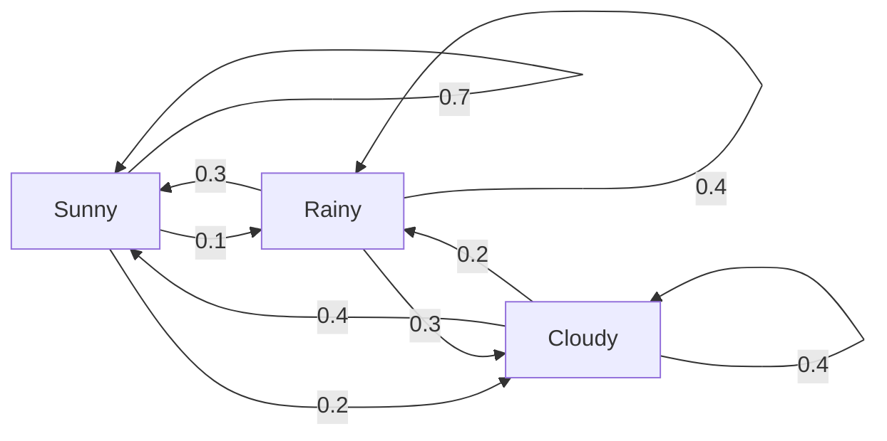
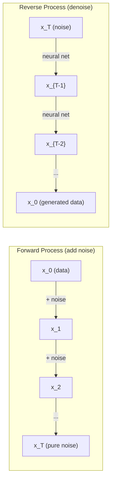

# Stochastic Prosesler

> 具有结构的随机性──随机走行、马科夫链和扩散模型 背后的数学──

**Type:** Learn
**Language:**Python
**Prerequisites:** Phase 1, Lessons 06-07（probability, Bayes）
**Time:** ~75 分钟

## Öğrenme hedefi
- 模拟 1D ve 2D rastgele yürüyüşler,并验证位移的 $\sqrt{n}$缩放规律
- 构建 Markov chain 模拟器,并通过自己的组合 计算其静止分布
- Metropolis-Hastings MCMC ve Langevin dinamiklerini hedef dağılım biçiminden kullanmak
- Önceden yayılma sürecini Brownian hareketi ile bağlayın, ters süreci nasıl oluşturulur açıklayın

## 问题
Birçok AI sistemi zamanla gelişen bir tesadüfenle ilgilidir. Statik tesadüfen değil, her adım önceden gerçekleşen bir şeye bağlı olarak yapılandırılmış bir sıralama tesadüfenle ilgilidir.

Dil modelleri bir kez bir simge üretir. Her bir simge önündeki bağlamdan bağlıdır. Model bir olasılık dağılımını çıkarır, sonra devam eder.

Diffusion modelleri 逐步向图像添加噪音,直到它变成纯静态噪音──然后它们反转这个过程,逐步谴责这个过程,逐步谴责这个过程,直到出现一张新图像──前进过程是一个马科夫链──反转过程是一个反向运行的学会的马科夫链──

Güçlendirme öğrenme ajanları, çevrede eylemler yaparlar. Her eylem bir tür olasılık ile yeni bir devlete yol açar.

MCMC örneklemesi Bayesian sonuçların bir sütunudur, Markov zinciri oluşturur, sabit dağılımı, yani geriye dönük bir şekilde kullanılır.

Hepsi dört temel düşünce üzerine kurulmuştur:
1. Rastgele yürüyüşler  最简单的 stochastic process
2. Markov zincirleri  带有过渡矩阵的结构化随机性
3. Langevin dinamikleri  带噪声的渐进下降
4. Metropolis-Hastings                                                                                                                                                                                                                                                            

## 概念
### - Rastgele Yürüyüşler

Yerden 0 開始── her adım,抛一枚公平硬币──正面:向右移动(+1)──反面:向左移动(-1)──

Geçmiş .$n$- Yerin ne?$n$个随机 $\pm 1$值的总和──期望位置是0(这个走路是无偏的)──但距离原点的期望距离按 $\sqrt{n}$增长──

Bu yolculuk adil, iki yönde de hareket yok ama zaman geçtikçe, başlangıç noktasından giderek uzaklaşıyor.$n$步后的标准偏差是 $\sqrt{n}$- Evet.

```
Step 0:  Position = 0
Step 1:  Position = +1 or -1
Step 2:  Position = +2, 0, or -2
...
Step 100: Expected distance from origin ~ 10 (sqrt(100))
Step 10000: Expected distance from origin ~ 100 (sqrt(10000))
```

**在 2D 中**, yürüyüşe eşiği gibi olasılıkla yukarı, aşağı, sola veya sağa hareket etmektedir.$\sqrt{n}$缩放规律──路径会描绘出类似的骨折的模式──

**为什么是 $\sqrt{n}$？**Her adımın bir adım gibi olasılığı +1 veya -1 olacaktır.$n$步后,位置 $S_n = X_1 + X_2 + \cdots + X_n$, her biri .$X_i$Şehir .$\pm 1$❖ Her adımın varyansiyası 1 ve her adım birbirinden bağımsızdır.$\mathop{\mathrm{Var}}(S_n) = n$❖ Standart sapma = $\sqrt{n}$❖ Merkez sınır teoremine göre,$S_n / \sqrt{n}$收到 standart normal dağılım

Bu tür .$\sqrt{n}$缩放在 ML 中随处可见──SGD 噪音按1/sqrt(batch_size) 缩放──Embedding 维度按 $\sqrt{d}$缩放──平方根 is an independent with addition and symbol──

**与 Brownian motion 的联系。**Bir adım boyutu al$1/\sqrt{n}$、 her saat$n$步's random walk──当 $n$Bu yürüyüş, Brownian hareketini alacak.$B(t)$ Bir sürekli zaman süreci, bunlardan $B(t)$服从平均值为 0 变量 为$t$Normal dağılım.

Brownian hareket, difüzyonun matematiksel temelidir. Bu, parçacıkların akışında hareketleri, fiyatların hareketlerini ve ayrıca, önemli bir şekilde, difüzyon modellerinde gürültü sürecini çizer.

**Gambler's ruin。**Bir rastgele yürüyüşcü konumdan.$k$開始,在 0 和 $N$处有吸收障壁──到达 $N$0'a ulaşma olasılığı nedir?$P(\text{到达 } N) = k/N$                                                                                                                                                                                                                                                              

### Markov Zincirleri

Markov zinciri, sabit olasılıklara göre devletler arasında dönüşümlü bir sistemdir.

```math
P(X_{t+1} = j \mid X_t = i, X_{t-1} = \ldots) = P(X_{t+1} = j \mid X_t = i)
```

Bu Markov özelliği. Yani bir geçiş matrisi ile yapabilirsin.$P$Tüm dinamikleri anlat:

```math
P[i][j] = \text{从状态 } i \text{ 转移到状态 } j \text{ 的概率}
```

$P$Her seferinde bir yere gitmen gerekiyor.

**示例 —— Weather：**

```
States: Sunny (0), Rainy (1), Cloudy (2)

P = [[0.7, 0.1, 0.2],    (if sunny: 70% sunny, 10% rainy, 20% cloudy)
     [0.3, 0.4, 0.3],    (if rainy: 30% sunny, 40% rainy, 30% cloudy)
     [0.4, 0.2, 0.4]]    (if cloudy: 40% sunny, 20% rainy, 40% cloudy)
```

Herhangi bir devletten 开始── geçişlerden sonra, devletlerin dağılımları sabit dağılımlara ulaşır.$\pi$, içinden $\pi P = \pi$Bu da bu.$P$∞'in öz değeri ∞'in sol öz vektörü ∞

 长期来看, whatever starts state is what,  长期来看,  长期来看, 长期来看, 长期来看, 长期来看, 长期来看, 长期来看, 长期来看, 长期来看, 长期来看, 长期来看, 长期来看, 长期来看, 长期来看, 长期来看, 长期来看, 长期来看, 长期来看, 长期来看, 长期来看, 长期来看, 长期来看, 长期来看, 长期来看, 长期来看, 长期来看, 长期来看, 长期的时间的时间的53%是阳阳的.



**计算 stationary distribution。**İki yöntem var:

1. **Power method**:                                                                                                                                                                                                                                                               $P$Yeterince tekrarladıktan sonra, bu da geçer.
2. **Eigenvalue method**:找到 $P$∞ ∞ ∞ ∞ ∞ ∞ ∞ ∞ ∞ ∞ ∞ ∞ ∞ ∞ ∞ ∞ ∞ ∞ ∞ ∞ ∞ ∞ ∞ ∞ ∞ ∞ ∞ ∞ ∞ ∞ ∞ ∞ ∞ ∞ ∞ ∞ ∞ ∞ ∞ ∞ ∞ ∞ ∞ ∞ ∞ ∞ ∞ ∞ ∞ ∞ ∞ ∞ ∞ ∞ ∞ ∞ ∞ ∞ ∞ ∞ ∞ ∞ ∞ ∞ ∞ ∞ ∞ ∞ ∞ ∞ ∞ ∞ ∞ ∞ ∞ ∞ ∞ ∞ ∞ ∞ ∞ ∞ ∞ ∞ ∞ ∞ ∞ ∞ ∞ ∞ ∞ ∞ ∞ ∞ ∞ ∞ ∞ ∞ ∞ ∞ ∞ ∞ ∞ ∞ ∞ ∞ ∞ ∞ ∞ ∞ ∞ ∞ ∞ ∞ ∞ ∞ ∞ ∞ ∞ ∞ ∞ ∞ ∞ ∞ ∞ ∞ ∞ ∞ ∞ ∞ ∞ ∞ ∞ ∞ ∞ ∞ ∞ ∞ ∞ ∞ ∞ ∞ ∞ ∞ ∞ ∞ ∞ ∞ ∞ ∞ ∞ ∞ ∞ ∞ ∞ ∞ ∞ ∞ ∞ ∞ ∞ ∞ ∞ ∞ ∞ ∞ ∞ ∞ ∞ ∞ ∞ ∞ ∞ ∞ ∞ ∞ ∞ ∞ ∞ ∞ ∞ ∞ ∞ ∞ ∞ ∞ ∞ ∞ ∞ ∞ ∞ ∞ ∞ ∞ ∞ ∞ ∞ ∞ ∞ ∞ ∞ ∞ ∞ ∞ ∞ ∞ ∞ ∞ ∞ ∞ ∞ ∞ ∞ ∞ ∞ ∞ ∞ ∞ ∞ ∞ ∞ ∞ ∞ ∞ ∞ ∞ ∞ ∞ ∞ ∞ ∞ ∞ ∞ ∞ ∞ ∞ ∞ ∞ ∞ ∞ ∞ ∞ ∞ ∞ ∞$P^T$∞'in öz değeri ∞'in öz vektörü ∞

两种方法都要求链 满足收条件――

**收敛条件。**Eğer bir Markov zinciri  aşağıdaki koşulları karşılarsa, tek sabit dağıtım alacaktır:
- **Irreducible**Her eyalet diğer eyaletlerden gelebilir.
- **Aperiodic**: zincir sabit döngü döngüsü ile gerçekleşmez

ML'de karşılaştığınız büyük zincirler bu iki şartı karşılıyor.

**Absorbing states。**Bir devletin içine girersen asla ayrılmayacaksın.$P[i][i] = 1$), bu durum 〜 absorbing 〜 absorbing 〜 Markov zincirleri 〜 absorbing 〜 terminal states  〜 〜 〜 〜 〜 〜 〜 〜 〜 〜 〜 〜 〜 〜 〜 〜 〜 〜 〜 〜 〜 〜 〜 〜 〜 〜 〜 〜 〜 〜 〜 〜 〜 〜 〜 〜 〜 〜 〜 〜 〜 〜 〜 〜 〜 〜 〜 〜 〜 〜 〜 〜 〜 〜 〜 〜 〜 〜 〜 〜 〜 〜 〜 〜 〜 〜 〜 〜 〜 〜 〜 〜 〜 〜 〜 〜 〜 〜 〜 〜 〜 〜 〜 〜 〜 〜 〜 〜 〜 〜 〜 〜 〜 〜 〜 〜 〜 〜 〜 〜 〜 〜 〜 〜 〜 〜 〜 〜 〜 〜 〜 〜 〜 〜 〜 〜 〜 〜 〜 〜 〜 〜 〜 〜 〜 〜 〜 〜 〜 〜 〜 〜 〜 〜 〜 〜 〜 〜 〜 〜 〜 〜 〜 〜 〜 〜 〜 〜 〜 〜 〜 〜 〜 〜 〜 〜 〜 〜 〜 〜 〜 〜 〜 〜 〜 〜 〜 〜 〜 〜 〜 〜 〜 〜 〜 〜 〜 〜 〜 〜 〜 〜 〜 〜 〜 〜 〜 〜 〜 〜 〜 〜 〜 〜 〜 〜 〜 〜 〜 〜 〜 〜 〜 〜 〜 〜 〜 〜 〜 〜 〜 〜 〜 〜 〜 〜 〜 〜 〜 〜 〜 〜 〜 〜 〜 〜 〜 〜 〜 〜 〜 〜 〜 〜 〜 〜 〜 〜 〜 〜 

**Mixing time。**需要多少步,chain 才会接近stationary distribution?形式化地说,就是总变距离与静止的距离降至某值以下的步数――快速混合 = 需要的步数少――逆向链,$P$模) kontrol karışım zamanı──gap 越大,mixing 越快──

### İletişim Dil Modelleri

Dil modeli 中的代币生成 近似是一个马科夫过程──给定当前文本,模型输出下一个代币 上的分布──温度 控制敏度:

```math
P(\text{token}_i) = \frac{\exp(\text{logit}_i / \text{temperature})}{\sum_j \exp(\text{logit}_j / \text{temperature})}
```

- Sıcaklık = 1.0: standart dağılım
- Sıcaklık < 1.0:更尖(更确定)
- Sıcaklık > 1.0:更平坦(更随机)
-               $\to 0$:argmax(cinsel açgözlülük)

Top-k örnekleme  kesin olarak en yüksek olasılıkla $k$个 token──Top-p(nukleus) örnekleme 截断到累积概率 超过 $p$集合──两者都会修改马科夫 geçiş olasılığı──

### Brownian Hareketi

Random walk'ın sürekli zaman sınırı── konum $B(t)$Üç nitelik vardır:
1. $B(0) = 0$
2. $B(t) - B(s)$服从平均值为 0 变量 为$t - s$Normal dağılım$t > s$)
3. 相互独立 不重叠区间上的 相互独立的增长

Brownian hareketi sürekli, ama kısıtlı değildir. Her ölçüde hareket eder.

Bu şekilde Brownian hareketine benzer bir şekilde hareket edebilirsiniz.

```math
B(t + dt) = B(t) + \sqrt{dt} \, z, \quad \text{其中 } z \sim \mathcal{N}(0, 1)
```

$\sqrt{dt}$缩放 çok önemlidir. Bu, rastgele yürüyüşler için kullanılan merkezi sınır teoreminden kaynaklanır.

### Langevin Dinamikleri

Gradient Descent 寻找函数的最小值──Langevin dinamikleri 寻找与 $\exp(-U(x)/T)$                                                                                                                                                                                                                                                                                                                                                                                                                                                                                                                             $U$Enerji fonksiyonu,$T$- Evet, sıcaklık.

```math
x_{t+1} = x_t - dt \, \nabla U(x_t) + \sqrt{2 T \, dt} \, z_t
```

Partikel üzerinde iki etki vardır:
1. **Gradient force**($-dt \cdot \nabla U$): 推向低能量(类似 Gradient Descent)
2. **Random force**($\sqrt{2T dt} \cdot z$):推向随机方向 (kızıltı)

         $T = 0$时,这就是纯渐进下降――高温下,它几乎是随机走行――在合适的温度下,粒子会探索能源景观,并在低能区域中停留更久――

**与 diffusion models 的联系。**Diffusion modelinin ileri süreci:

```math
x_t = \sqrt{\alpha_t} \, x_{t-1} + \sqrt{1 - \alpha_t} \cdot \text{noise}
```

Bu bir Markov zinciri, bilgiyi sesle karıştırmak için yeterli adımlar atmak.$x_T$Tam Gaussian gürültüsü.

 Şoktan veriye geri dönmek  Aynı zamanda bir Markov zinciri de vardır, ancak geçiş olasılığı Nöral Ağ tarafından öğrenilmiştir.



### MCMC: Markov Chain Monte Carlo

Bazen bir değerden bir değer elde etmeniz gerekir.$p(x)$Bayesian pozeriörler klasik örneklerdir.

**Metropolis-Hastings**构建一个静止分布 为 $p(x)$Markov zinciri:

1. Bir yerden.$x$Başlayın
2. Teklif dağıtımından$Q(x' \mid x)$提议一个新位置 $x'$
3. 计算 kabul oranı:$a = p(x') Q(x \mid x') / (p(x) Q(x' \mid x))$
4.                                                                                                                                                                                                                                                                                                                                                                                                                                                                                                                              $\min(1, a)$ Kabul et$x'$否则留在 $x$- Evet.
5. Tekrarlıyorum.

Eğer $Q$Simetrik bir şekilde.$Q(x' \mid x) = Q(x \mid x') = \mathcal{N}(x, \sigma^2){}$), oranı kolaylaştırılır$a = p(x') / p(x)$                                                                                                                                                                                                                                                              

Sıcaklık şartlarında, bu zincir garanti alınacak.$p(x)$ ama eğer önerme 太小(random walk) veya 太大(高拒绝),收可能很慢──调节 önerme 太小(random walk) veya 太大(高拒绝),收可能很慢──调节 önerme 太小(random walk) veya 太大(高拒绝),收可能很慢──调节 önerme 太小的艺术── MCMC 的艺术──

**为什么它有效。**Kabul oranı  Detaylı dengeni sağlamak:$x$- Hayır , git .$x'$                                                                                                                                                                                                                                                                                                                                                                                                                                                                                                                             $x'$- Hayır , git .$x$概率― Detaylı dengeler$p(x)$Bu zincirin sabit dağılımıdır. Bu nedenle yeterli adımlar atıldı.$p(x)$- Evet.

**实践注意事项：**
- **Burn-in**: 丢弃前 $N$个样本――链 需要时间从起点到到静止分布――
- **Thinning**: her bölümü$k$个样本保留一个, autocorrelationı azaltmak için.
- **Multiple chains**Çeşitli zincirler farklı noktalardan yürütülür. Eğer onlar aynı dağılımlara ulaşırsa, bu da kanıtlanmıştır.
- **Acceptance rate**: için$d$维 Gaussian önerileri, en iyi kabul oranı 大约是 23% (Roberts & Rosenthal, 2001) Too high means chain 几乎不移──Too low means it almost totally reject──

### AI'de Stochastic Prosesler

| Process | AI Application |
|---------|---------------|
| Random walk | RL 中的 exploration、Node2Vec embeddings |
| Markov chain | Text generation、MCMC sampling |
| Brownian motion | Diffusion models（forward process） |
| Langevin dynamics | Score-based generative models、SGLD |
| Markov decision process | Reinforcement learning |
| Metropolis-Hastings | Bayesian inference、posterior sampling |


```figure
random-walk-diffusion
```

## Yapın onu.
### 步骤 1: Random walk simülatörü

```python
import numpy as np

def random_walk_1d(n_steps, seed=None):
    rng = np.random.RandomState(seed)
    steps = rng.choice([-1, 1], size=n_steps)
    positions = np.concatenate([[0], np.cumsum(steps)])
    return positions


def random_walk_2d(n_steps, seed=None):
    rng = np.random.RandomState(seed)
    directions = rng.choice(4, size=n_steps)
    dx = np.zeros(n_steps)
    dy = np.zeros(n_steps)
    dx[directions == 0] = 1   # right
    dx[directions == 1] = -1  # left
    dy[directions == 2] = 1   # up
    dy[directions == 3] = -1  # down
    x = np.concatenate([[0], np.cumsum(dx)])
    y = np.concatenate([[0], np.cumsum(dy)])
    return x, y
```

1D yürüyüş  depolama toplu toplamı── her adım +1 veya -1── geçiyor $n$步后,位置就是总和──variance 随 随 $n$线性增长, bu nedenle standart sapma 按 $\sqrt{n}$增长──

### 步骤 2: Markov zinciri

```python
class MarkovChain:
    def __init__(self, transition_matrix, state_names=None):
        self.P = np.array(transition_matrix, dtype=float)
        self.n_states = len(self.P)
        self.state_names = state_names or [str(i) for i in range(self.n_states)]

    def step(self, current_state, rng=None):
        if rng is None:
            rng = np.random.RandomState()
        probs = self.P[current_state]
        return rng.choice(self.n_states, p=probs)

    def simulate(self, start_state, n_steps, seed=None):
        rng = np.random.RandomState(seed)
        states = [start_state]
        current = start_state
        for _ in range(n_steps):
            current = self.step(current, rng)
            states.append(current)
        return states

    def stationary_distribution(self):
        eigenvalues, eigenvectors = np.linalg.eig(self.P.T)
        idx = np.argmin(np.abs(eigenvalues - 1.0))
        stationary = np.real(eigenvectors[:, idx])
        stationary = stationary / stationary.sum()
        return np.abs(stationary)
```

sabit dağıtım $P$1'in sol öz vektörü.$P^T$Bu yüzden, bu da bir şey değil.

### 步骤 3: Langevin dinamikleri

```python
def langevin_dynamics(grad_U, x0, dt, temperature, n_steps, seed=None):
    rng = np.random.RandomState(seed)
    x = np.array(x0, dtype=float)
    trajectory = [x.copy()]
    for _ in range(n_steps):
        noise = rng.randn(*x.shape)
        x = x - dt * grad_U(x) + np.sqrt(2 * temperature * dt) * noise
        trajectory.append(x.copy())
    return np.array(trajectory)
```

Gradient General$x$推向低能──噪音 防止它陷入局部停滞──在平衡时,样本分布与$\exp(-U(x)/\text{temperature})$- Tamam.

### 4 adım: Metropolis-Hastings

```python
def metropolis_hastings(target_log_prob, proposal_std, x0, n_samples, seed=None):
    rng = np.random.RandomState(seed)
    x = np.array(x0, dtype=float)
    samples = [x.copy()]
    accepted = 0
    for _ in range(n_samples - 1):
        x_proposed = x + rng.randn(*x.shape) * proposal_std
        log_ratio = target_log_prob(x_proposed) - target_log_prob(x)
        if np.log(rng.rand()) < log_ratio:
            x = x_proposed
            accepted += 1
        samples.append(x.copy())
    acceptance_rate = accepted / (n_samples - 1)
    return np.array(samples), acceptance_rate
```

Bu algoritma yeni bir nokta önerir, daha yüksek olasılıkla olup olmadığını kontrol eder, sonra tekrar eder. İyi bir karışım elde etmek için, kabul oranı yaklaşık %23-50 arasında olmalıdır.

## Kullan
 Pratikte, bu algoritmaları gerçekleştirmek için olgun kütüphaneler kullanırsınız.

```python
import numpy as np

rng = np.random.RandomState(42)
walk = np.cumsum(rng.choice([-1, 1], size=10000))
print(f"Final position: {walk[-1]}")
print(f"Expected distance: {np.sqrt(10000):.1f}")
print(f"Actual distance: {abs(walk[-1])}")
```

### Değişiklik matrislerinin numpy kullanılarak

```python
import numpy as np

P = np.array([[0.7, 0.1, 0.2],
              [0.3, 0.4, 0.3],
              [0.4, 0.2, 0.4]])

distribution = np.array([1.0, 0.0, 0.0])
for _ in range(100):
    distribution = distribution @ P

print(f"Stationary distribution: {np.round(distribution, 4)}")
```

İlk dağıtımı tekrar tekrar artır $P$△ yeterince iterasyon geçtikten sonra, nerede başladığınızdan bağımsız olarak sabit dağılım elde eder.

### Gerçek çerçeve ile bağlantı

- **PyTorch diffusion：**Sarılan Yüz`diffusers`Orta `DDPMScheduler`实现了前和反马科夫链
- **NumPyro / PyMC：**MCMC(NUTS örneklemesini kullanarak, Metropolis-Hastings'in gelişimiyle Bayesian sonucu çıkarmak için
- **Gymnasium (RL)：**çevre adım işlevi  tanımlamak bir Markov karar süreci

### 验证 Markov zinciri yakınlığı

```python
import numpy as np

P = np.array([[0.9, 0.1], [0.3, 0.7]])

eigenvalues = np.linalg.eigvals(P)
spectral_gap = 1 - sorted(np.abs(eigenvalues))[-2]
print(f"Eigenvalues: {eigenvalues}")
print(f"Spectral gap: {spectral_gap:.4f}")
print(f"Approximate mixing time: {1/spectral_gap:.1f} steps")
```

Spektral Gap  tell you chain  forget its initial state speed──gap 0.2 ∼ 5 ̊ step ∼ mix ∼ gap ∼ 0.01 ∼ 100 ̊ step ∼ 运行长度模拟 之前必需检查这个点  mixing 很慢的链 会浪费计算──

## - Söyle.
本课产 出:
- `outputs/prompt-stochastic-process-advisor.md` Bir anket, belirli sorunları tanımlamada yardımcı olmak için hangi stohastik süreç çerçevesine uygun

## Bağlantılar

| Concept | Where it shows up |
|---------|------------------|
| Random walk | Node2Vec graph embeddings、RL 中的 exploration |
| Markov chain | LLMs 中的 Token generation、MCMC sampling |
| Brownian motion | DDPM 中的 forward diffusion process、SDE-based models |
| Langevin dynamics | Score-based generative models、stochastic gradient Langevin dynamics (SGLD) |
| Stationary distribution | MCMC convergence target、PageRank |
| Metropolis-Hastings | Bayesian posterior sampling、simulated annealing |
| Temperature | LLM sampling、RL 中的 Boltzmann exploration、simulated annealing |
| Mixing time | MCMC 的 convergence speed、spectral gap analysis |
| Absorbing state | End-of-sequence token、RL 中的 terminal states |
| Detailed balance | MCMC samplers 的 correctness guarantee |

Diffusion modelleri 值得特别关注──DDPM(Ho et al., 2020) bir ileri Markov zinciri tanımladı:

```math
q(x_t \mid x_{t-1}) = \mathcal{N}\left(x_t; \sqrt{1-\beta_t} \, x_{t-1}, \beta_t I\right)
```

İçlerinden $\beta_t$Bu bir gürültü programı.$T$步后,$x_T$Yakınlık$\mathcal{N}(0, I)$◊Düşüştürücü süreç bir uyarı sesi tarafından ◊Nüron Ağ ◊parametrasyon:

```math
p_\theta(x_{t-1} \mid x_t) = \mathcal{N}\left(x_{t-1}; \mu_\theta(x_t, t), \sigma_t^2 I\right)
```

Yürütme, öğrenilen her adımın Markov zincirinin bir parçasıdır. Markov zincirlerini anlamak, nasıl ve neden veri üretilebileceğini anlamak anlamına gelir.

SGLD(Stochastic Gradient Langevin Dynamics) Mini-batch Gradient Descent ile Langevin gürültüsü 结合起来──你不计算完整的 Gradient,而是使用 Stochastic estimate并添加校准的噪声──随着学习率的衰退,SGLD 会从优化 过渡到样本采集  你几乎免费得到近似的贝叶斯后样本──这是从神经网络 获得不确定性估计的最简单方式之一──

穿穿这些联系的关键洞见是:stochastic processes are not merely theoretical tools──它们是现代人工智能系统内部的计算机制──当你调节LLM的温度时,你调节一个马科夫链──当你训练扩散模型时,你学习反转一个类似布朗运动的过程──当你运行贝叶斯推理时,你构建一个接收到后的链──

## 练习
1. **模拟 1000 条 10000 步的 random walks。**図図の最終位置の分布──验证 平均 0 標準偏差 $\sqrt{10000} = 100$Gaussian'ın.

2. **使用 Markov chain 构建 text generator。**Bir küçük korpus üzerinde eğitim: her kelime için, bir sonraki kelime için geçişleri oluşturmak için.

3. **使用 Metropolis-Hastings 实现 simulated annealing。**Yüksek sıcaklıktan 开始 (resten her şeyi kabul eder), sonra yavaş yavaş降温 (sadece iyileşmeyi kabul eder) ⋅ kullanarak birçok yerel minimum olan işlevi en az değerleri bulur.

4. **比较不同 temperatures 下的 Langevin dynamics。**İki tane kuyu potansiyeli .$U(x) = (x^2 - 1)^2$时,样本 集在一个井中――高温 时,它们分布在两个井中――找到链 在井间混合的关键温度――

5. **实现 forward diffusion process。**Bir 1 boyutlu sinyalden (örneğin sinüs dalgası) başlamak için, 100 adım içinde yavaş yavaş gürültü eklemek için bir çizelge kullanın.

### 提示

**练习 1。**1000 farklı tohum için 调用 `random_walk_1d(10000, seed=i)`,并保留每次的最终位置──检查的意思是接近0吗;標準偏差是接近100;以及最终位置是否有约68% 落在-100至100之间──

**练习 2。**统计, her satırın bölünmesi ile satırın toplamı arasında, her satırın ve 1 olarak bir tekrarla bir tekrarla bir tekrarla bir tekrarla bir tekrarla bir tekrarla bir tekrarla bir tekrarla bir tekrarla bir tekrarla bir tekrarla bir tekrarla bir tekrarla bir tekrarla bir tekrarla bir tekrarla bir tekrarla bir tekrarla bir tekrarla bir tekrarla bir tekrarla bir tekrarla bir tekrarla bir tekrarla bir tekrarla bir tekrarla bir tekrarla bir tekrarla bir tekrarla bir tekrarla bir tekrarla bir tekrarla bir tekrarla bir tekrarla bir tekrarla bir tekrarla bir tekrarla bir tekrarla bir tekrarla bir tekrarla bir tekrarla bir tekrarla bir tekrarla bir tekrarla bir tekrarla bir tekrar tekrar tekrar tekrar tekrar tekrar tekrar tekrar tekrar tekrar tekrar tekrar tekrar tekrar tekrar tekrar tekrar tekrar tekrar tekrar tekrar tekrar tekrar tekrar tekrar tekrar tekrar tekrar tekrar tekrar tekrar tekrar tekrar tekrar tekrar tekrar tekrar tekrar tekrar tekrar tekrar tekrar tekrar tekrar tekrar tekrar tekrar tekrar tekrar tekrar tekrar tekrar tekrar tekrar tekrar tekrar tekrar tekrar tekrar tekrar tekrar tekrar tekrar tekrar tekrar tekrar tekrar tekrar tekrar tekrar tekrar tekrar tekrar tekrar tekrar tekrar tekrar tekrar tekrar tekrar tekrar tekrar tekrar tekrar tekrar tekrar tekrar tekrar tekrar tekrar tekrar tekrar tekrar tekrar tekrar tekrar tekrar tekrar tekrar tekrar tekrar tekrar tekrar tekrar tekrar tekrar tekrar tekrar tekrar tekrar tekrar tekrar tekrar tekrar tekrar tekrar tekrar tekrar tekrar tekrar tekrar tekrar tekrar tekrar tekrar tekrar tekrar tekrar tekrar tekrar tekrar tekrar tekrar tekrar tekrar tekrar tekrar tekrar tekrar tekrar tekrar tekrar tekrar tekrar tekrar tekrar tekrar tekrar tekrar tekrar tekrar tekrar tekrar tekrar tekrar tekrar tekrar tekrar tekrar tekrar tekrar tekrar tekrar tekrar tekrar tekrar tekrar tekrar tekrar tekrar tekrar tekrar tekrar tekrar tekrar tekrar tekrar tekrar tekrar tekrar tekrar tekrar tekrar tekrar tekrar tekrar tekrar tekrar tekrar tekrar tekrar tekrar tekrar tekrar tekrar tekrar tekrar tekrar tekrar tekrar tekrar tekrar tekrar tekrar tekrar tekrar tekrar tekrar tekrar tekrar tekrar tekrar tekrar tekrar tekrar tekrar tekrar tekrar tekrar tekrar tekrar tekrar tekrar tekrar tekrar tekrar tekrar tekrar tekrar tekrar tekrar tekrar tekrar tekrar tekrar tekrar tekrar tekrar tekrar tekrar tekrar tekrar tekrar tekrar tekrar tekrar tekrar tekrar tekrar tekrar tekrar tekrar tekrar tekrar tekrar tekrar tekrar tekrar tekrar tekrar tekrar tekrar tekrar tekrar tekrar tekrar tekrar tekrar tekrar tekrar tekrar tekrar tekrar tekrar tekrar tekrar tekrar tekrar tekrar tekrar tekrar tekrar tekrar tekrar tekrar tekrar tekrar tekrar tekrar tekrar tekrar tekrar tekrar tekrar tekrar tekrar tekrar tekrar tekrar tekrar tekrar tekrar tekrar tekrar tekrar tekrar tekrar tekrar tekrar tekrar tekrar tekrar tekrar tekrar tekrar tekrar tekrar tekrar tekrar tekrar tekrar tekrar tekrar tekrar tekrar tekrar tekrar tekrar tekrar tekrar tekrar tekrar tekrar tekrar tekrar tekrar tekrar tekrar tekrar tekrar tekrar tekrar tekrar tekrar tekrar tekrar tekrar tekrar`MarkovChain(transition_matrix, state_names)`,并调用 `simulate`◊ Check output içindeki her bir komşu kelimenin de korpus içinde olup olmadığını

**练习 3。**E$\exp(-\Delta / T)$Bu, daha düşük bir noktayı kabul etmenin ve her adımı atmanın ardından gerçekleşecek.$T$乘以一个因子,例如 0.99──在已知最小的函数上测试,并与细网格搜索的结果核对──

**练习 4。**Gradient $4x(x^2 - 1)$, ona vereceğim .`langevin_dynamics(grad_U, x0, dt, temperature, n_steps)`- Evet.$x = 0$处的障壁高度为1,因此在0.05~1 间的不同温度下,统计$x$符号 değişiminin sayısını bul, bu sayının hızla yükselen sıcaklıktan başlayarak oluştuğunu bul.

**练习 5。**调用 `diffusion_forward(signal, 100)`,并将所有 $(1 - \beta_t)$Bir adım daha atın.$\bar{\alpha}$ $\bar{\alpha}$                                                                                                                                                                                                                                                              `beta_end`▽先使用真实的噪音 测试 denoiser:此时 $(x_t - \sqrt{1 - \bar{\alpha}_t} \epsilon)/\sqrt{\bar{\alpha}_t}$必須精确還原原始信号──

## 关键术语
| Term | What people say | What it actually means |
|------|----------------|----------------------|
| Random walk | “抛硬币式移动” | 一个 position 在每一步按随机 increments 改变的过程 |
| Markov property | “无记忆性” | future 只依赖当前 state，而不依赖 history |
| Transition matrix | “概率表” | $P[i][j]$ = 从 state $i$ 移动到 state $j$ 的概率 |
| Stationary distribution | “长期平均” | 满足 $\pi P = \pi$ 的分布 $\pi$ —— chain 的 equilibrium |
| Brownian motion | “随机抖动” | random walk 的 continuous-time limit，$B(t) \sim \mathcal{N}(0, t)$ |
| Langevin dynamics | “带噪声的 Gradient Descent” | 结合 deterministic Gradient 与 random perturbation 的 update rule |
| MCMC | “向目标行走” | 构造一个 stationary distribution 为你想要的分布的 Markov chain |
| Metropolis-Hastings | “提议并接受/拒绝” | 使用 acceptance ratios 来确保收敛的 MCMC algorithm |
| Temperature | “随机性旋钮” | 控制 exploration 与 exploitation 之间权衡的参数 |
| Diffusion process | “噪声进，噪声出” | Forward：逐渐添加 noise。Reverse：逐渐移除 noise。生成 data。 |

## 延伸阅读
- **Ho, Jain, Abbeel (2020)** Difusion Probability Models'i reddetmek. Open diffusion model 革命的 DDPM 论文──清晰推导了前方和反马科夫链──
- **Song & Ermon (2019)**  Veri dağıtımının gradiyentlerini tahmin ederek jeneratif modellerleme. Langevin dinamiklerini kullanın  örnekleme yapın ◊ ◊ ◊ ◊ ◊ ◊ ◊ ◊ ◊ ◊ ◊ ◊ ◊ ◊ ◊ ◊ ◊ ◊ ◊ ◊ ◊ ◊ ◊ ◊ ◊ ◊ ◊ ◊ ◊ ◊ ◊ ◊ ◊ ◊ ◊ ◊ ◊ ◊ ◊ ◊ ◊ ◊ ◊ ◊ ◊ ◊ ◊ ◊ ◊ ◊ ◊ ◊ ◊ ◊ ◊ ◊ ◊ ◊ ◊ ◊ ◊ ◊ ◊ ◊ ◊ ◊ ◊ ◊ ◊ ◊ ◊ ◊ ◊ ◊ ◊ ◊ ◊ ◊ ◊ ◊ ◊ ◊ ◊ ◊ ◊ ◊ ◊ ◊ ◊ ◊ ◊ ◊ ◊ ◊ ◊ ◊ ◊ ◊ ◊ ◊ ◊ ◊ ◊ ◊ ◊ ◊ ◊ ◊ ◊ ◊ ◊ ◊ ◊ ◊ ◊     ◊                                                                                                                                                                                                                                                 
- **Roberts & Rosenthal (2004)**  Genel devlet uzay Markov zincirleri ve MCMC algoritmaları.    MCMC hakkında 何時以及为什么有效的理论──
- **Norris (1997)** Markov Chains. 标准教材──涵盖融合、静止分布 和打时间──
- **Welling & Teh (2011)** Stochastic Gradient Langevin Dinamikleri üzerinden Bayesian Öğrenimi. SGD ile Langevin dinamiklerini 结合,可扩展 Bayesian inference için kullanılır。
