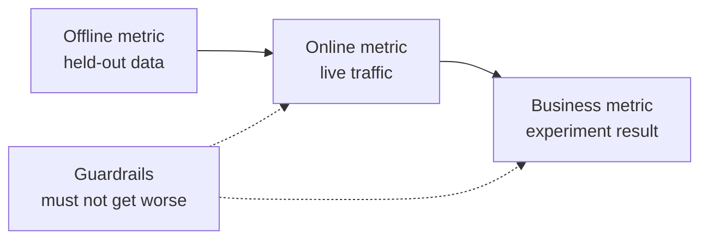

# 机器学习系统设计: problemden hazırlanmış model

> Model sadece sistemin bir parçasıdır. Model tasarımı neyi öngörüyor, kim neyi öngörüyor, ne kadar para ödüyor ve başarısızlıktan nasıl kurtuyoruz.

**Type:** Build
**Languages:** Python
**Prerequisites:** 阶段 2，第 09 课（模型评估）和第 13 课（ML 流水线）
**Time:** 约 110 分钟

## Öğrenme hedefi

- İşletme sorunlarını ML görevleri olarak tanımlamak, öngörülme içeriğini netleştirmek, öngörülme kararlarını kullanmak ve sorunların çözümlenmesi için kurallar yetersiz olması nedenleri
- 区分离线,线上,业务,护标,并将每个模型与简单基线和启动基线进行比较
- Akım tahminleri ve online tahminlerin günlük maliyeti, gecikmesi ve verilerin eskileşmesi
- 选择发布方式(影子、金丝雀、A/B 测试),并为每种故障模式选择安全默认行为
- 识别模型如何通过决策改变下一版本训练数据的反循环
- 编写 ML 设计文档,并按固定检查清单评分

## 问题

Bir abonelik şirketi, 流失预测模型──ı yapmasını istedi. Veri bilimcileri, gradient elevation classifier eğitimi aldılar.

原因与算法无关──誰決定分数应触发什么行动──分数每周只更新一次,但客户挽留团队每天打电话──标签来自取消订阅表,而该表还存储取消原因,因此某特征直接包含答案──也没人把模型与客户团原始规则比较:给连续两周不活跃客户打电话──

Bu başarısızlıklar eğitim başlamadan önce gömülmüştür. Bunlar tasarım başarısızlığıdır. Bir sayfa tasarım dosyası ise bir sonraki soru sormaya başlar.

## 核心概念

### İşletme hedefi ile ML görevleri

事業目標 ML 任務に等しくない.

1. 模型具体预测什么,预测对象是什么实体?
2. Hangi karar verme sistemi kullanılır, kim veya hangi sistem tarafından karar verilir?
3. Ne zaman tahmin yapılması gerekiyor, o anda hangi veriler kullanılabilir?
4. Karar verme kararlarının nasıl iyileşeceğini?

| 业务目标 | 预测 | 使用预测的决策 | ML 任务 |
|---|---|---|---|
| 减少流失 | 用户未来 30 天取消订阅的概率 | 每晚向风险最高的 5% 用户发送挽留优惠 | 二分类 |
| 减少欺诈损失 | 一笔支付属于欺诈的概率 | 在 100 ms 内批准、送审或阻止 | 二分类 |
| 保持货架有货 | 下周各门店每天的销售件数 | 各门店订货量 | 预测 |
| 展示相关商品 | （用户，商品）对的相关性分数 | 信息流中的商品顺序 | 排序 |

İkinci sırada en çok ayrıntılı bir tanımlama gerekmektedir. Bu günkü görevlerin kimlerin avantajı elde ettiğini belirlemek için, bu kullanıcıların gelecekte 30 gün içinde aboneliklerini kaldırıp kaldırmayacağını tahmin etmek gerekmektedir.

### 何时不应使用 ML

Google'ın Kötü bir yöntemle öğrenmek için kullanılması gereken bir araçtır.

- 简短规则可以实现目标,并能持续保持正确――规则运行、测试和解释的成本较低――
- 标签 yok, ne de gerçek bir toplama yöntemi yok.
-  Kimse tahminlere göre hareket etmez, bu yüzden tahmin daha doğru ve değişmez.
- 预测时可用数据不含所需信号──
- Bir hata da kabul edilemez, çıkışı kontrol edebilecek kimse yok.
- Közel kararlar getiren değere göre, sistemlerin inşa ve işletme maliyeti daha yüksektir.

Kurallar uzun ve kırılgan olduğunda, ML'ye yatırım yapmaya değer olmaya başlar. Aynı yönlendirmenin Kuralı 3. karmaşık başlangıç kuralları yerine ML'yi öncelik vermeyi önerir, çünkü öğrenilen model daha kolay yenilenir ve korunur.

### Üç katlı gösterge

Üç aşamalı bir ölçüde ML  sistemi, aynı zamanda bir sınırlama seti ayarlamak:

| 层面 | 何时能测量 | 流失预测示例 |
|---|---|---|
| 离线指标 | 上线前，在留出的历史数据上 | 优惠阈值处的 F1、风险最高 5% 中的精确率 |
| 在线指标 | 上线期间，在真实流量上 | 优惠接受率、已评分用户比例、分数分布 |
| 业务指标 | 上线数周后，通过实验 | 干预组与保留对照组的 30 天流失率 |
| 护栏指标 | 始终监测 | 每挽留一名用户的优惠成本、退订率、p99 延迟 |



Çeşitli seviyeler sık sık farklı sonuçlar verir. İnsani göstergeler tarihsel verileri değerlendirir, geçmişte sizin modeliniz yoktur.

选择与决策匹配离线指标――如果任务联系风险最高的5%用户,就测量这个5%中精确率――AUC, hiçbir zaman kullanmadığınız 值¬ları dahil olmak üzere tüm 值综合评估 için 值.

### 基线

孤立的指标没有意义―― eğer en iyi alternatif sadece 0.30, F1 达到 0.56 则很好; eğer bir kural 0.60 则很差──每个模型都应与三类基线比较:

- **简单基线。**始终预测多数类别,或始终预测训练集平均值──模型评估课使用过这种检查──
- **启发式基线。**Bölge bilgisi kurallarından veya eğitim verilerine uygun olan tek özelliklerden kaynaklanır.
- **现有系统。**Karar verme yöntemleri, elektronik tablo kullanan bir kişi bile olsa.

升级量 (R) = model puanı en güçlü güzergah puanı sayısını indirir. 升级量 (R) = model puanı en güçlü güzergah puanı sayısını indirir. 升级量 (R) = model puanı en güçlü güzergah puanı sayısını indirir. 升级量 (R) = model puanı sayısını indirir. 升级量 (R) = model puanı sayısını indirir. 升级量 (R) = model puanı sayısını indirir. 升级量 (R) = model puanı sayısını indirir. 升级要求 (R) = en az yükseltme gereksinimini belirler ve ek sistem maliyetlerini karşılayacaktır. 升级量 (R) = simple güzergah genellikle zayıf, başlayan güzergah sadece yenilenen güçlü güzergahlardır.

### Veriler ve etiket gereksinimleri

訓練前回答这些问题:

- **标签来源。**Hangi olayın belirlenmesi için kim sorumlu?
- **标签延迟。**预测后多久才知道真实结果? 预测后多久才知道真实结果? 预测后多久才知道真实结果? 预测后多久才知道真实结果? 预测后多久才知道真实结果? 预测后多久才知道真实结果? 预测后多久才知道真实结果? 预测后多久才知道真实结果? 预测后多久才知道真实结果? 预测后多久才知道真实结果? 预测后多几周出现欺诈?
- **标签质量。**Kim işaret ediyor, çıkış haksızlığı çok yüksek?
- **预测时的可用性。**Her bir özellik önceden belirlenirken var mıdır? Sonuçlar ortaya çıkmadan sonra yazılan özellikler, etiketlerin eğitim sırasında yayılmasıdır.
- **各类样本量。**Sadece iki yüz tane gerçek örnek var mı? Genellikle basit bir model kullanılır.
- **时间切分。**留出最近一段时间──時間序列课按时间划分数据也出于同原因──

### 延迟、吞吐量和成本预算

Üç sayılık kısım her türlü hizmet tasarımı:

- **延迟预算。**p99 延迟是100 请求中99 则低于耗时.
- **峰值吞吐量。**按最忙一分钟而非日均流量配置系统──峰值 QPS(per second request number) genellikle ortalama değerin birkaç katı──
- **成本预算。**Günde USD maliyetini veya 1000 defa tahmin edilen USD maliyetini kullanarak, karşılaştırma kolaylığı vardır.

Küçük bir kural, öncekileri bir araya getirir: İşleme sırasında talep sayısı, toplama miktarı katı gecikmeye eşit olur.

###  Bütçecilik ve çevrimiçilik

提供预测 iki temel yöntem vardır:

- **批量推理。**定時任務は各实体评分,分数を書き込み表またはキー値ストレージにします.
- **在线推理。**应用在请求到达时把特征发送给模型服务,等分数返回──

| 属性 | 批量 | 在线 |
|---|---|---|
| 新鲜度 | 距离上次运行的时间，加上运行耗时 | 使用当前请求的数据 |
| 请求延迟 | 一次键值读取，几毫秒 | 特征获取时间加模型耗时 |
| 成本驱动因素 | 实体数乘以每天运行次数 | 按峰值 QPS 配置的副本数 |
| 新实体 | 下一次运行前没有分数 | 第一次请求时即可评分 |
| 故障时 | 旧分数仍可读取 | 请求失败或超时 |

Bu ders araç paketi iki maliyetin de tahminini yapar. Bütçe maliyetinin fiziksel sayıyla ve günlük işlemlerin sayısının artışıyla birlikte olması. Zamanın daha kısa olmasına ve daha sık çalışmasına izin verir.

混合设计很常见: gece toplama görevleri, yeni kullanıcıları ve yeni verilere ihtiyaç duyulan istekleri online yollarla işleme, kullanıcıları değerlendirmek ve değerlendirmek için kullanılır.

### 部署模式

Yeni model 分阶段 kontakt kullanıcı:

1. **影子运行（Shadow）。**Yeni model gerçek akımın bir kopyasını alır. Sistem kayıtları tahmin eder, ancak kullanmaz.
2. **金丝雀发布（Canary）。**Yeni model, akışın küçük bir kısmına yöneliktir. Genellikle %1'ten %5'e kadar.
3. **A/B 测试。**随机分组的用户分别使用不同模型──统计检查测测业务指标,差异的清晰度, 流量和时间的足够的需要──

Her aşama birkaç dakika içinde tamamlanmalıdır. Deployed eski model versiyonunu korumak, yapılandırma ile değişim akışı.[影子与金丝雀发布课](../../../17-infrastructure-and-production/20-shadow-canary-progressive/docs/en.md)和 [A/B 测试课](../../../17-infrastructure-and-production/21-ab-testing-llm-features/docs/en.md)Bu üç farklı yöntemle konuşuyoruz.

### Çevre

Model kararları bir sonraki sürümün eğitim verilerine değişirken, bir karşı döngü ortaya çıkar.

- **干预隐藏标签。**流失模型发送优惠,挽留了部分用户──下个月,高风险用户看起来很忠诚,重新训练的模型便学到这些特征无法预测流失──
- **被阻止的行动没有结果。**Bu ödeme asla reddetme etiketi üretmez. Yeniden eğitilen modellerin gördüğü engellenmiş bölge sahtekarlık örnekleri azalır.
- **曝光限制反馈。**排序模型 sadece önde gelen ürünlerin sırasını gösterir, bu nedenle sadece bu ürünlerin tıklama elde edilmesi gerekir.

Düzeltme yönteminin ortak fikri, modelin etkilenmemiş bazı verileri korumakla birlikte bir grup kullanıcıyı sürekli müdahale etmeyi kabul etmemekle birlikte korumakla birlikte, az miktarda akım ve aksamlı dağıtım kararlarını vermekle birlikte, her örnek kayıt oranı ve kararları ile birlikte, daha sonraki eğitimlerin etkilenen verileri ve temiz verileri ayırt edebilmesiyle birlikte,

### Örgütler ve güvenlik

Sistemin her kısmı erken başarısız olur.

| 故障 | 没有预案时的结果 | 安全默认行为 |
|---|---|---|
| 模型服务超时 | 请求失败 | 使用启发式基线 |
| 夜间批任务失败 | 分数缺失或过旧 | 在固定期限内提供最近的正常分数，之后使用规则 |
| 特征缺失或越界 | 模型对坏输入评分 | 使用文档规定的默认值，并记录事件 |
| 新实体没有历史 | 没有分数 | 使用规则或总体均值 |
| 分数分布突然变化 | 大规模错误决策 | 暂停自动行动，并通知人工处理 |

İndekendeki bölümün başlangıçlı temel hattı da çoğu sorunların öntanımlı bir programdır, bu yüzden önce bunu gerçekleştirmek gerekir.

### 设计文档

设计文档在训练开始前集中记录上述决策――本课检查器为其 JSON 版本评分――其中 6 检查项目具有阻塞性,任一缺失都会使系统不安全或无用:

| 章节 | 回答的问题 | 阻塞条件 |
|---|---|---|
| 问题 | 预测什么，哪项决策使用它，为什么规则不够？ | 必须明确决策 |
| 指标 | 适用哪些离线、在线、业务和护栏指标？ | 必须明确业务指标 |
| 基线 | 适用哪些简单、启发式和现有系统基线？ | 必须有启发式或现有系统基线 |
| 数据 | 标签来自哪里、延迟多久，每个特征预测时是否可用？ | 不得泄露标签 |
| 预算与服务 | 有哪些延迟、峰值 QPS、成本和陈旧时间限制，哪种模式满足它们？ | 无 |
| 发布 | 使用哪些影子、金丝雀及 A/B 阶段，如何回滚？ | 必须有影子或金丝雀阶段，以及回滚 |
| 反馈循环 | 模型如何改变未来数据，如何保留干净数据？ | 无 |
| 故障模式 | 每种故障的默认行动是什么？ | 每种故障都必须有默认行为 |
| 监控 | 上线后观察什么？ | 无 |

```figure
mlprod-serving-cost
```

## 0 yapı

`code/main.py`仅使用标准库,包含三个工具:服务成本模型、基线比较器和设计文档检查器──

### 1. adım: çalışma yükü ve fiyatı açıklaması

工作负载保存流量与预算数字,成本模型保存价格── bunlar, tedarikçi fiyatları değil, pratik olarak kullanılan bütünüel sayımsal örneklerdir──

```python
@dataclass(frozen=True)
class Workload:
    name: str
    entities: int
    requests_per_day: int
    peak_qps: float
    max_staleness_hours: float
    latency_budget_ms: float


@dataclass(frozen=True)
class CostModel:
    batch_dollars_per_million: float = 0.40
    batch_job_hours: float = 1.0
    lookup_dollars_per_million: float = 0.25
    lookup_latency_ms: float = 4.0
    replica_dollars_per_hour: float = 0.50
    replica_qps: float = 200.0
    min_replicas: int = 2
    online_latency_ms: float = 35.0
```

### İkinci adım: Hesaplama toplama ve çevrimiçi hizmet maliyeti

Satış görevleri, eski zamanın sınırları içinde tamamlanmalıdır. İki seferin aralığı, görev süresinin sınırlarını azaltmaya eşittir.

```python
def batch_plan(workload: Workload, costs: CostModel) -> ServingPlan:
    refresh_hours = workload.max_staleness_hours - costs.batch_job_hours
    if refresh_hours <= 0:
        return ServingPlan(
            "batch", False, math.inf, costs.lookup_latency_ms, math.inf, 0.0,
            "staleness limit is shorter than one batch job",
        )
    runs_per_day = 24.0 / refresh_hours
    predictions = workload.entities * runs_per_day
    dollars = (
        predictions / 1e6 * costs.batch_dollars_per_million
        + workload.requests_per_day / 1e6 * costs.lookup_dollars_per_million
    )
    ...
```

Online servis ödemesi, kullanılabilirliği sağlamak için en az iki kopya tutarlı olarak kullanılabilir hale getirilmelidir:

```python
def online_plan(workload: Workload, costs: CostModel) -> ServingPlan:
    replicas = max(costs.min_replicas, math.ceil(workload.peak_qps / costs.replica_qps))
    dollars = replicas * costs.replica_dollars_per_hour * 24.0
    feasible = costs.online_latency_ms <= workload.latency_budget_ms
    ...
```

`choose_serving`选满足延迟和陈旧时间限制的方案,返回最便宜者.`None`...bütçeyi ayarlamanın gerektiğini söyle.

### Üçüncü adım: Model ile temel çizgiyi karşılaştır

Bu, en güçlü ve en zayıf olan temel hattın yükselmesini hesaplar.

```python
def compare_to_baselines(
    y_true: list,
    model_pred: list,
    baselines: dict[str, list],
    metric,
    metric_name: str,
    higher_is_better: bool = True,
    min_lift: float = 0.02,
) -> BaselineReport:
    if not baselines:
        raise ValueError("a model needs at least one baseline")
    scores = {name: metric(y_true, pred) for name, pred in baselines.items()}
    pick = max if higher_is_better else min
    best_name = pick(scores, key=scores.get)
    model_score = metric(y_true, model_pred)
    lift = model_score - scores[best_name] if higher_is_better else scores[best_name] - model_score
    return BaselineReport(metric_name, {"model": model_score, **scores}, best_name, lift, min_lift)
```

启发式基线是单特征规则──`fit_rule`Eğitim verilerinde bu özelliklerin her değerini  değer olarak değerlendirerek F1'in en iyi  değerini koruyun.

### 第4 步:为设计文档评分

Her kontrol işleminin anahtarı, ağırlığı, engelleme işaretleri, mesajları ve kontrol işlevi vardır.

```python
CheckItem("decision", 2, True, "name the action that uses each prediction", lambda d: _text(d, "problem.decision")),
CheckItem("baselines", 2, True, "add a heuristic or current-system baseline", check_baselines),
CheckItem("no_leakage", 2, True, "confirm every feature exists at prediction time",
          lambda d: get_path(d, "data.features_available_at_prediction_time") is True),
CheckItem("serving_fit", 1, False, "pick a serving mode that meets the staleness, latency, and cost budgets",
          check_serving_fit),
```

`check_serving_fit`复用成本模型,文档读取负载数字,并估算选定模式的成本──如果该模式不能满足陈旧时间上限、延迟预算或每日成本预算,检查就失败──声明采用批但只允许三分钟陈旧时间的文档无法通过──成本模型没有混合方案,因此声明混合的文档也将失败,直到你加入该方案在练习1中──

`review_design_doc`Bu konunun ağırlığı artırılacak, yeniden toplam ağırlığa ayrılacak. Sadece oran 0.85'e ulaşacak ve tüm engeller geçecek. Sonuçlar sadece incelemeye hazır olacak.

### 第5 步:运行

```bash
python3 code/main.py
```

```console
nightly churn scores
  ok batch        $0.91/day      4 ms  1.0 runs per day over 2,000,000 entities
  ok online      $24.00/day     35 ms  2 replicas sized for 40 peak QPS
  choose: batch

feed ranking, 2-hour freshness
  ok batch       $48.50/day      4 ms  24.0 runs per day over 5,000,000 entities
  ok online      $24.00/day     35 ms  2 replicas sized for 120 peak QPS
  choose: online

=== Model versus baselines (churn, metric F1) ===
  model                    0.564
  days_idle > 12.8688      0.500
  random at base rate      0.232
  majority class           0.000
  model beats the strongest baseline (days_idle > 12.8688) by +0.064
```

Çoğu tip temel hattının F1 0, çünkü tahmin edilmez. Dönüşüm kuralları gerçek rakiplerdir. Modeller ondan 0.064'e yüksektir. Bu nedenle model kullanmak için bir neden vardır.

设计文档评审会印欠缺六阻塞项的薄弱文档,以及得分1.00的完整文档──传入路径可评审您自己的文档:

```bash
python3 code/main.py my_design_doc.json
```

## kullanım

工具包各部都应团队在生产中使用的工具──

**基线。**scikit-learn basit bir temel çizgiyi bir tahminci olarak gerçekleştirir, böylece onlar aynı akış çizgisine modelle yerleştirebilir:

```python
from sklearn.dummy import DummyClassifier, DummyRegressor
from sklearn.metrics import f1_score

majority = DummyClassifier(strategy="most_frequent").fit(X_train, y_train)
base_rate = DummyClassifier(strategy="stratified", random_state=0).fit(X_train, y_train)
mean_value = DummyRegressor(strategy="mean").fit(X_train, y_reg_train)

print(f1_score(y_test, majority.predict(X_test)))
```

`most_frequent`                                                                                                                                                                                                                                                                                                                                                                                                                                                                                                                             `majority_baseline`- Evet .`stratified`                                                                                                                                                                                                                                                                                                                                                                                                                                                                                                                             `base_rate_baseline`✿ küçük öğrenmek ✿ hiçbir başlangıç kuralı yoktur, çünkü başlangıç kuralı senin özel alanından geliyor✿

**批量服务。**Apache Airflow、Dagster 等工作流调度器运行评分任务,任务将分数写入数仓表,或 Redis、DynamoDB 等键值存储──

**在线服务。**KServe、BentoML、NVIDIA Triton、TorchServe vb. model sunucuları modellerini HTTP veya gRPC 端点后封装 edecek.

**发布。**Argo Rollouts ve Kubernetes  Tool for Kin丝雀 Publishing分流──GrowthBook、Statsig ve diğer deney platformları kullanıcıları A/B 分组并计算统计量──

**设计评审。**Breck  et al. tarafından yayınlanan ML Test Score  içeren ML  sistemlerinin üretimi için gerekli 28 项 test ve izleme gereksinimleri。

## 交付成果

本课产 出 `outputs/skill-ml-design-review.md` Bu beceri bölümden bölümye değerlendirmek, öncelikli olarak engelleme eksikliklerini belirlemek, bu dersin büyüklüğünü ve çevrimiçi maliyet hesaplama ve inceleme hizmetlerini seçmek.

## 练习

1. Çı`choose_serving`添加混合方案:批量为已用户评分,在线为新用户评分――比较日费――
2. 修改流失数据,模型不再胜过规则──报告使提升消失的最小系数变动──
3. Çekşek Çekşek Ekle`budgets.max_dollars_per_1k_predictions`项,并编写缺少该项时会失败的测试──
4. Çekim için para ödemek için, JSON tasarım dosyası yazmak için, her engelleyişi düzeltmek için.
5. 模拟流失反循环: 模拟流失反循环: 模拟流失反循环: 模拟流失反循环: 模拟流失反循环: 模拟流失反循环: 模拟流失反循环: 模拟流失反循环: 模拟流失反循环: 模拟流失反循环: 模拟流失反循环: 模拟流失反循环: 模拟流失反循环: 模拟流失反循环: 模拟流失反循环: 模拟流失反循环: 模拟流失反

## 关键术语

| 术语 | 常见说法 | 实际含义 |
|------|----------------|----------------------|
| ML 任务 | “做一个流失模型” | 预测目标、实体、时间窗口，以及使用预测的决策 |
| 离线指标 | “模型分数” | 上线前在留出的历史数据上计算的指标 |
| 在线指标 | “实时数据” | 模型运行时在真实流量上测量的指标 |
| 业务指标 | “目标” | 决策必须改变、通过实验测量的公司业务结果 |
| 护栏指标 | “不要造成损害” | 新模型上线时不能变差的指标 |
| 基线 | “简单模型” | 模型必须以规定幅度超越的简单、启发式或现有系统预测器 |
| 批量推理 | “预先算好的分数” | 定时任务为每个实体评分并存储结果，供查询使用 |
| 在线推理 | “实时模型” | 每个请求到达时由模型评分 |
| 影子部署 | “暗发布” | 新模型对真实流量评分，但无人使用输出 |
| 金丝雀发布 | “逐步上线” | 新模型为逐渐扩大的小部分流量决策，同时备好回滚 |
| 反馈循环 | “模型训练自己” | 模型决策改变下一版本的训练数据 |

## 延伸阅读

- [Sculley et al., Hidden Technical Debt in Machine Learning Systems (NeurIPS 2015)](https://papers.nips.cc/paper/2015/hash/86df7dcfd896fcaf2674f757a2463eba-Abstract.html)Modelle çevresindeki sistem maliyetleri:
- [Google, Rules of Machine Learning](https://developers.google.com/machine-learning/guides/rules-of-ml)İlk model, gösterge ve eğitim ve hizmet uyumluluğunun pratik kuralları
- [Breck et al., The ML Test Score (IEEE Big Data 2017)](https://research.google/pubs/the-ml-test-score-a-rubric-for-ml-production-readiness-and-technical-debt-reduction/): Ölçmek için 28 test
- [Kohavi, Tang, and Xu, Trustworthy Online Controlled Experiments (Cambridge University Press, 2020)](https://experimentguide.com/)Nasıl çalışılır ve güvenilir sonuçlar çıkarılır?
- [Sato, Wider, and Windheuser, Continuous Delivery for Machine Learning (2019)](https://martinfowler.com/articles/cd4ml.html)Versiyon: Versiyonlaşmış ver­t, model ve deplo­ment
- [Google Cloud, MLOps: Continuous delivery and automation pipelines in machine learning](https://cloud.google.com/architecture/mlops-continuous-delivery-and-automation-pipelines-in-machine-learning)Eğitim ve hizmet otomasyonunun üç olgunluk seviyesi
