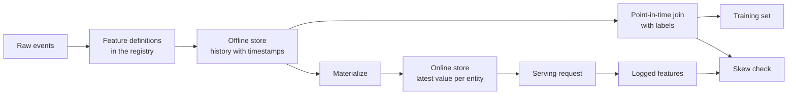

# Özellikleri depolama ve eğitim  servis farkı

> Bir özellik sadece tek bir tanımlama vardır, ancak iki okuma yolu vardır. Eğitim, her bir etiket zamanının tarihi değerini, çevrimiçi hizmet, en son değerleri okur.

**Type:** Build
**Languages:** Python
**Prerequisites:** Phase 2，第 08 课（特征工程）、第 13 课（机器学习流水线）、第 15 课（时间序列）和第 19 课（机器学习系统设计）
**Time:** ~100 分钟

## Öğrenme hedefi

- Açıklama: Çevrimiçi depolama, Çevrimiçi depolama, fiziksel olay süresi ve TTL'nin anlamı ve görevleri
- 实现时点正确的关联,并展示简单关联如何将未来值复制到训练数据中
- 列出训练服务偏差的四个原因:两条代码路径、特征陈旧、默认值不同和时间穿越
-  yapılandırma özellikleri kayıt defter, aynı zamanda eğitim yolları ve hizmet yolları kullanımı için aynı tanımlama
- Geçmiş günlerde yeni özellikleri doldurarak, her gün sonrası verileri okumadan
- Aynı varlık ve zaman için, servis günlüğündeki özellikleri ve eğitim yollarının ortaya çıkardığı özellikleri karşılaştırarak, farklılıkları tespit etmek

## 问题

Bir ekip kullanıcı kaybı modelini oluşturdu. Her etiket, kullanıcıların etiket gününden sonraki 30 gün içinde satın almadığını belirtti.`user_id`Etiketleri kullanıcı özellikleri ile ilişkilendirir ve temelini oluşturur.`days_since_last_purchase`訓練一条規則──離線准确率 0.948──

Gerçek akışta, bu model daha eski ve daha basit sürümlerden farklıdır. Özellik tablosu, her kullanıcı için en son değerleri kaydetmektedir. Bu değerler, etiket gününden birkaç hafta geç kalmıştır. Bir kullanıcı için son satın alma 115'inci gün, 175'inci gün için 60 gün önce yapılmıştır. Bu nedenle özellik kendiliğinden cevap içerir.

Bu iki eksikliğin nedeni aynı: eğitim ve çevrimiçi hizmetler aynı özellikleri aynı şekilde hesaplamak için iki farklı yöntem kullanıyor. Bu ders, karakter depolarının her bir bölümünü sıfırdan inşa edecek.

## 概念

### Aynı özellikten iki kişilik bir

訓練 ve online servis özellikleri için farklı talep biçimi:

| 属性 | 训练（离线） | 服务（在线） |
|---|---|---|
| 问题 | “一千万个（实体，时间）组合各自对应的值是什么？” | “这个实体现在的值是什么？” |
| 时间 | 过去的多个时点 | 当前 |
| 数据量 | 每个任务数百万行 | 每次请求一行 |
| 延迟 | 可以接受数分钟 | 几毫秒 |
| 存储 | 离线存储：在列式文件或数据仓库中保存带时间戳的完整历史 | 在线存储：在键值数据库中保存每个实体的最新值 |

Özellikler depolama aynı grup özelliklere göre tanımlanmıştır. Bu iki tür depolamacılığı doldurmak.



### 实体、时间  TTL ile

Her bir özellik dört terimle tanımlanabilir:

- **实体（Entity）。**Özellikler, örneğin,`user_id`Ya da`card_id`- Evet.
- **事件时间戳（Event timestamp）。**Bu değerin kurulması zamanı. 14'e kadar olan satın alma sayısı, olay zamanı 14'e kadar olan olay zamanı.
- **创建时间戳（Created timestamp）。**系统写入该行的时刻──今日执行的回填会写入事件时间早些、创建时间为当前时间的行──
- **TTL（time to live，生存时间）。**值允许达到最大年龄── TTL'nin değeri eksik olarak görülür, bu nedenle okuyucular özgün değerleri kullanır──

具有相同实体、数据源和 TTL 的一组特征,通常称为特征视图(特征视图) 

### 时点正确的关联

Bir dizi eğitim verisi, etiketle etiket zamanında var olan özellik değerlerini eşleştirmelidir.

1. Aynı varlığın özelliklerini bul.
2. Sadece olayın geç kalması için etiket zamanını belirlemek gerekir.
3. En son bir satır alın.
4. Eğer etiketleme zamanı olayın zamanını azaltırsa TTL'den fazla olursa, bu çizgiyi terk eder.

Aşağıda bir kullanıcı ̳16 ′ ′ etiketini ve haftalık oluşturulan özellikleri göster:

| 特征行日期 | `purchases_30d` | 时点关联 | 仅按 `user_id` 进行朴素关联 |
|---|---|---|---|
| 7 | 4 | | |
| 14 | 3 | 选中 | |
| 21 | 1 | 未来 | |
| 28 | 0 | 未来 | 选中 |

Etiket, kullanıcıların 17 ila 46 gün arasında herhangi bir ürün satın aldığını belirlemektedir. 28 gün boyunca yapılan işlemler, etiket gününden sonra satın alınmayan günleri hesaplıyor.

Zaman dizisi, aynı sebeple zaman dizisi olarak ayrılır.

### 訓練サービス偏差の原因

Google'ın  makine öğrenme kuralları                                                                                                                                                                                                                                                         

| 原因 | 发生的情况 | 演示中的例子 |
|---|---|---|
| 两条代码路径 | 训练与服务使用不同代码计算特征 | 服务窗口包含 `now - 30` 这一天，训练窗口却不包含 |
| 特征陈旧 | 服务读取的值与训练所用值的年龄不同 | 训练读取每周快照，而新服务计算实时的新值 |
| 默认值不同 | 两条路径对缺失值的填充方式不同 | 对“尚未购买”，训练使用 365，服务使用 -1 |
| 时间穿越 | 训练读取了标签时刻之后的值 | 朴素关联为每个标签读取最新快照 |

Aynı yönlendirme'nin 32'li maddesinin kuralları, eğitim akım ve hizmet akımları arasında mümkün olduğunca tekrar kullanma kodunu gerektiriyor.

### Özellikler kayıtlı

Registrar Sheet, özellik tanımlanmış bir katalogdır. Her bir yazı adı, varlık, veri kaynağı, değişim, pencereler, öntanımlı değerler, TTL, sorumlu, sürüm ve açıklama içerir.

两条规则可以保证其安全性:

- 两条路径都从注册表读取定义――任何服务都不能自维护变换逻辑的副本――
- 修改定义时创建新版本──旧版本继续保留,让旧模型仍能使用训练时的特征──

### Çıkış

Yeni bir özellik tarihi yoktur, ancak eğitim, her tarihi etiket zamanının değerini gerektirir. Geçmişteki her gün için bir satır yazmak için, geçmişteki her gün için bir tanımlama yerine getirmek için tekrar doldurulur.

Dönüşüm hesaplama maliyeti, fiziksel sayının ve tarih sayısının artışına bağlı olarak çarpma artışına neden olabilir. Bu gün gerçekleştirilen dönüşüm, daha erken olay zamanına yazılmasına rağmen, geç verileri veya daha sonra düzenlenmiş verileri okuyabilir.

### 检测偏差

Aynı yönlendirme'nin 29. maddesinde, hizmet sırasında kullanılan özellikleri kaydetmek ve eğitime kullanmak gerekmektedir.

为了定位原因,比较以下三组结果:

1. Online depo okuyucu sonuçları trenle ilişkili sonuçlar.
2. Gerçek zamanlı yeniden hesaplama sonuçları eğitimle ilişkili sonuçlarla ilişkili.
3. İkinci madde Kod yolunun gerçek zamanlı yeniden hesaplama sonuçlarıyla birlikte.

```figure
mlprod-pit-join
```

## 动手构建

`code/main.py`Orta kod sadece standart kutu kullanır. Zamanı bir kaç gün gösterir.

### 步骤 1: Özellik tanımı ve kayıt defteri

`FeatureDefinition`Önemli olan, bir veri biçimi, bir pencere ve bir kayda değerini oluşturmak.`compute`方法绝不会读取                                                                                                                                                                                                                                                                                                                                                                                                                                                                                                                        `as_of`Sonraki olaylar.

```python
@dataclass(frozen=True)
class FeatureDefinition:
    name: str
    entity: str
    aggregate: str
    window_days: int | None
    default: float
    version: int = 1
    owner: str = "growth-team"
    description: str = ""

    def compute(self, events: list[Event], as_of: int) -> float:
        visible = [e for e in events if e.day <= as_of]
        if self.window_days is not None:
            visible = [e for e in visible if e.day > as_of - self.window_days]
        if self.aggregate == "count":
            return float(len(visible))
        if self.aggregate == "sum":
            return round(sum(e.amount for e in visible), 2)
        if self.aggregate == "days_since_last":
            return float(as_of - max(e.day for e in visible)) if visible else self.default
        raise ValueError(f"unknown aggregate {self.aggregate!r}")
```

`FeatureRegistry.register`允许重复注册相同定义,但会拒绝名称和版本相同,内容却有不同的定义──`fill_defaults`İki yolun eksikliği aynı standart değer sağlar.

Modelle geçiyor`spend_30d@1`Bu tür bir alıntı sabit tanımlı.`compute`和 `fill_defaults`会解析引用,不含 `@`Yazı: Çıkışlar`@`Ama hiçbir versiyon yok.`ValueError`Bu nedenle, yazma hatası uyarı olmadan en son versiyona kadar okunacak değildir. Bu alıntı her depo satırının anahtarıdır.

### 步骤 2: İletişim depolarını doldurun

```python
def backfill(registry: FeatureRegistry, names: list[str], events: list[Event], days: list[int]) -> list[FeatureRow]:
    rows = []
    for entity, entity_events in sorted(group_events(events).items()):
        for day in days:
            rows.append(FeatureRow(entity, day, registry.compute(names, entity_events, day)))
    return rows
```

演示为 299 个用户在 25 个快照日回填三个特征,共生成 7475 行──

### 步骤 3: 时点关联

Önceki tarih boyunca her bir varlık için bir kez sıralanır.`bisect_right`找到标签日当天或之前的最后一行──TTL 检查会丢弃过旧行──

```python
def point_in_time_join(labels: list[LabelRow], rows: list[FeatureRow], ttl_days: int | None = None) -> list[JoinedRow]:
    by_entity: dict[str, list[FeatureRow]] = defaultdict(list)
    for row in rows:
        by_entity[row.entity].append(row)
    days_index = {}
    for entity, entity_rows in by_entity.items():
        entity_rows.sort(key=lambda r: r.day)
        days_index[entity] = [r.day for r in entity_rows]
    joined = []
    for label in labels:
        days = days_index.get(label.entity, [])
        pos = bisect.bisect_right(days, label.day) - 1
        match = by_entity[label.entity][pos] if pos >= 0 else None
        if match is not None and ttl_days is not None and label.day - match.day > ttl_days:
            match = None
        joined.append(JoinedRow(
            label.entity, label.day, label.label,
            match.day if match else None, match.values if match else None,
        ))
    return joined
```

### Adım 4: Yöntemli bağlantı kaynaklı sızıntıları ölçmek

`naive_latest_join`Sadece fiziksel olarak ilişkilendirilmiş olarak, bu nedenle her etiket için en son satırlara geri dönmek. Gösterim 100、120 ve 140'da etiketler oluşturmak ve her antrenman kitlesinde tek bir özellik kuralları oluşturmak.

```console
  naive join used a snapshot from after the label day for 100% of rows
  offline accuracy, naive join: 0.948 (rule: idle > 53 days)
  offline accuracy, PIT join:   0.893 (rule: idle > 19 days)
  accuracy on day 145, trained with naive join: 0.763
  accuracy on day 145, trained with PIT join:   0.876
```

朴素关联的离线表现更好:0.948对0.893――但在新数据上更差:0.763对0.876――漏漏的特征将适应出出的置天数值从19天推至53天――

### 5 adım: Çevrimiçi depolama ve maddileşme

On-line depolama, her bir kişi için bir satır tutar ve TTL'nin satırlarını aşmayı reddeder.`materialize`Sadece yazın güncelleşme zamanı görevinin yapılması için geç kalmasın.

```python
class OnlineStore:
    def __init__(self, ttl_days: int):
        self.ttl_days = ttl_days
        self._latest: dict[str, FeatureRow] = {}

    def write(self, row: FeatureRow) -> None:
        current = self._latest.get(row.entity)
        if current is None or row.day >= current.day:
            self._latest[row.entity] = row

    def read(self, entity: str, now: int) -> dict[str, float] | None:
        row = self._latest.get(entity)
        if row is None or row.day > now or now - row.day > self.ttl_days:
            return None
        return dict(row.values)
```

TTL 10 天時, 145 天の読み取りは140 天の行に戻る. Eğer yeni bir özelleştirme yoksa, 160 天の読み取りは20 天の歴史があるため, özelleştirilmiş değerlere geri döner.

### 步骤 6:偏差检查

`detect_skew`İki ile karşılaştırın.`(entity, day)`Anahtar görüntüsü. Her bir özelliğin eşleşmeyen oranını ve ortalama mutlak farkı rapor eder. %1'den fazla değer farklı olduğunda bu özelliği işaretler.`ValueError` Arama eksikliği farkı örtbas edebilir, ancak aramanın yapılmaması herhangi bir sorunu açıklayamaz.

```python
def detect_skew(
    training: dict[tuple[str, int], dict[str, float]],
    serving: dict[tuple[str, int], dict[str, float]],
    features: list[str],
    tolerance: float = 1e-6,
    max_mismatch_rate: float = 0.01,
) -> list[SkewReport]:
    if set(training) != set(serving):
        raise ValueError(f"{len(set(training) ^ set(serving))} keys are in only one view: log and compare the same requests")
    if not training:
        raise ValueError("no requests to compare")
    keys = sorted(training)
    reports = []
    for feature in features:
        diffs = [abs(training[k][feature] - serving[k][feature]) for k in keys]
        mismatches = sum(1 for d in diffs if d > tolerance)
        rate = mismatches / len(keys)
        mean_diff = sum(diffs) / len(keys)
        reports.append(SkewReport(feature, len(keys), rate, mean_diff, rate > max_mismatch_rate))
    return reports
```

Gösterme kayıtları Bölüm 141'den 150'e kadar, ve çalışma kavramı bölümünün tanıtıcı üç grup karşılaştırma.

```bash
python3 code/main.py
```

```console
=== Skew checks on 383 logged requests, days 141 to 150 ===
  online store read  vs  training join (one definition, same snapshots)
    ok   days_since_last_purchase   mismatch   0.0%  mean |diff|    0.00
    ok   purchases_30d              mismatch   0.0%  mean |diff|    0.00
    ok   spend_30d                  mismatch   0.0%  mean |diff|    0.00
  fresh compute      vs  training join (staleness only)
    SKEW days_since_last_purchase   mismatch  83.0%  mean |diff|    2.77
    SKEW purchases_30d              mismatch  30.5%  mean |diff|    0.38
    SKEW spend_30d                  mismatch  37.1%  mean |diff|   16.77
  second code path   vs  fresh compute (code differences only)
    SKEW days_since_last_purchase   mismatch   5.5%  mean |diff|   20.07
    SKEW purchases_30d              mismatch  12.5%  mean |diff|    0.13
    SKEW spend_30d                  mismatch  12.5%  mean |diff|    5.09
```

Bu üç çıkış blokunu tekrar okuyun:

- **同一定义、相同快照。**Online depolama ve eğitim bağlantısı aynı maddecilik çizgisine sahiptir, bu nedenle özet farkı sıfırdır.
- **陈旧性。**Çoğu istekte, gerçek zaman hesaplama değeri haftalık hızlı resimde farklıdır. Burada veriler daha yeni değil, çünkü model öğrenme en fazla altı gün önce değerlidir.
- **代码差异。**İkinci kod yolu, %12.5'lik bir pencerenin sayısına göre farklıdır, çünkü penceresinin bir gün daha fazla içerdiği için.`days_since_last_purchase`Üst fark oluşur, ama fark çok büyük: 1 ile 365 ⋅

## Kullanıcı araçlar

Bayramı açıktır. Bu bayramın her bir parçası, bu bayramın içinde karşılaşabileceği bir şey vardır:

| 从零实现 | Feast |
|---|---|
| `FeatureDefinition`、`FeatureRegistry` | 特征仓库中的 `Entity`、`FeatureView` 和 `Field`，通过 `feast apply` 注册 |
| `FeatureRow` 历史记录 | 离线存储，例如基于 Parquet 文件的 `FileSource` 或数据仓库表 |
| 带 TTL 的 `point_in_time_join` | `store.get_historical_features(entity_df=..., features=[...])` |
| `materialize` | `feast materialize-incremental <end time>` |
| `OnlineStore.read` | `store.get_online_features(features=[...], entity_rows=[...])` |
| 创建时间戳检查 | 数据源上的 `created_timestamp_column` 和 `filter_by_created_timestamp=True` |

定义如下──这些代码遵循节日快速入门指南,运行本课不需要它们──

```python
from datetime import timedelta

from feast import Entity, FeatureView, Field, FileSource
from feast.types import Float32, Int64

user = Entity(name="user", join_keys=["user_id"])

user_activity_source = FileSource(
    name="user_activity_source",
    path="data/user_activity.parquet",
    timestamp_field="event_timestamp",
    created_timestamp_column="created",
)

user_activity = FeatureView(
    name="user_activity",
    entities=[user],
    ttl=timedelta(days=10),
    schema=[
        Field(name="purchases_30d", dtype=Int64),
        Field(name="spend_30d", dtype=Float32),
        Field(name="days_since_last_purchase", dtype=Int64),
    ],
    source=user_activity_source,
)
```

Daha sonra, eğitim ve çevrimiçi hizmet okumak aynı özellik:

```python
from feast import FeatureStore

store = FeatureStore(repo_path=".")

training_df = store.get_historical_features(
    entity_df=labels_df,
    features=["user_activity:purchases_30d", "user_activity:days_since_last_purchase"],
    filter_by_created_timestamp=True,
).to_df()

online = store.get_online_features(
    features=["user_activity:purchases_30d", "user_activity:days_since_last_purchase"],
    entity_rows=[{"user_id": 42}],
).to_dict()
```

`labels_df`Her etiket için bir satır kaydet, içerir.`user_id`- Evet.`event_timestamp`Ürünler ve değerler, bir araya gelerek, bir araya gelerek, bir araya gelerek, bir araya gelerek, bir araya gelerek, bir araya gelerek, bir araya gelerek, bir araya gelerek, bir araya gelerek, bir araya gelerek, bir araya gelerek, bir araya gelerek, bir araya gelerek, bir araya gelerek, bir araya gelerek, bir araya gelerek, bir araya gelerek, bir araya gelerek, bir araya gelerek, bir araya gelerek, bir araya gelerek, bir araya gelerek, bir araya gelerek, bir araya gelerek, bir araya gelerek, bir araya gelerek, bir araya gelerek, bir araya gelerek, bir araya gelerek, bir araya gelerek, bir araya gelerek, bir araya gelerek, bir araya gelerek, bir araya gelerek, bir araya gelerek, bir araya gelerek, bir araya gelerek, bir araya gelerek, bir araya gelerek, bir araya gelerek, bir araya gelerek, bir araya gelerek, bir araya gelerek, bir araya gelerek, bir araya geleceğe, bir araya geleceğe, bir araya geleceğe, bir araya geleceğe, bir araya geleceğe, bir araya geleceğe, bir araya geleceğe, bir araya geleceğe, bir araya geleceğe, bir araya geleceğe, bir araya geleceğe, bir araya gelecek, bir araya gelecek, bir araya gelecek, bir araya gelecek, bir araya gelecek, bir araya, bir araya gelecek, bir araya gelecek, bir araya, bir araya gelecek, bir araya, bir araya gelecek, bir araya gelecek, bir araya, bir araya, bir araya, bir araya gelecek, bir araya, bir araya, bir araya, bir araya, bir araya, bir araya, bir araya, bir araya, bir araya, bir araya, bir araya, bir araya, bir araya, bir araya, bir araya, bir araya, bir araya, bir araya, bir araya, bir araya, bir araya, bir araya, bir araya, bir araya, bir araya, bir araya, bir araya, bir araya, bir araya, bir araya, bir araya, bir araya, bir araya, bir araya, bir araya, bir araya, bir araya, bir araya, bir araya, bir araya, bir araya, bir araya, bir araya, bir araya, bir araya, bir araya, bir araya, bir araya`point_in_time_join`Orta TTL 检查一致──同一页还介绍了 `filter_by_created_timestamp=True`Bu seçenek, eğitim verilerindeki değerlerin yeniden doldurulmasını önleyebilir. Tüm çevrimdışı depolama alanları bu seçeneği desteklemiyor.

Tekton、Hopsworks 和 büyük bulut makinesi öğrenme platformundaki özellik depolama, aynı çevrimiçi depolama gibi farklılıkları da kullanmaktadır.

## 交付成果

本课产 出 `outputs/skill-feature-skew-audit.md` Bu beceri denetleme özellikleri                                                                                                                                                                                                                                                          

## 练习

1. 将快照间隔从 7 天改为 1 天――再运行陈旧性比较,并解释结果――
2. TTL'yi 3 gün için ayarlayın.
3. Çı`FeatureRow`添加创建日期──让关联忽略标签日后写入的行──
4. - Ben de .`spend_7d`Kayıt için`spend_30d`Bu yazının 2 versiyonu, kayıtlı kayıtlardan iki versiyonu basılmıştır.
5. 修复 `legacy_serving_features`, üçüncü grup fark kontrolü geçene kadar.

## 关键术语

| 术语 | 常见说法 | 实际含义 |
|------|----------------|----------------------|
| 特征存储 | “存特征的数据库” | 根据同一组定义计算特征，并同时提供给训练与在线服务的系统 |
| 离线存储 | “训练数据” | 带事件时间戳的完整特征历史，由训练任务和回填任务读取 |
| 在线存储 | “特征缓存” | 每个实体的最新值，供服务路径以毫秒级延迟读取 |
| 实体 | “ID” | 特征所描述对象的键，例如用户或银行卡 |
| 事件时间戳 | “何时发生” | 特征值成立的时刻 |
| 时点关联 | “截至某时刻的关联” | 为每个标签匹配标签时刻当天或之前的最新特征行 |
| TTL | “有效期” | 特征值在被读取方视为缺失之前允许达到的最大年龄 |
| 物化 | “同步到线上” | 将最新特征值从离线存储复制到在线存储的任务 |
| 回填 | “计算历史” | 在过去的日期执行特征定义，以生成其历史记录 |
| 训练—服务偏差 | “离线时明明有效” | 训练与在线服务中的特征或行为差异 |

## 延伸阅读

- [Feast：时点关联](https://docs.feast.dev/getting-started/concepts/point-in-time-joins)TTTL 语义与创建时间过
- [Feast 文档](https://docs.feast.dev/): Özellikler: görüntüleri, çevrimiçi depolama, çevrimiçi depolama ve fizyolojikleştirme
- [Google：《机器学习规则》](https://developers.google.com/machine-learning/guides/rules-of-ml)Bölüm 29'dan 37'e kadar: Hizmet Ayrılıkları Kuralı
- [Breck 等：《机器学习的数据验证》（SysML 2019）](https://research.google/pubs/data-validation-for-machine-learning/)Google'ın veri doğrulama, eğitim hizmetleri arasında farkı dahil
- [TensorFlow Data Validation 指南](https://www.tensorflow.org/tfx/guide/tfdv)Moder check ≠偏差 check ̇漂移检 ̇̇̇̇̇̇̇̇̇̇̇̇̇̇̇̇̇̇̇̇̇̇̇̇̇̇̇̇̇̇̇̇̇̇̇̇̇̇̇̇̇̇̇̇̇̇̇̇̇̇̇̇̇̇̇̇̇̇̇̇̇̇̇̇̇̇̇̇̇̇̇̇̇̇̇̇̇̇̇̇̇̇̇̇̇̇̇̇̇̇̇̇̇̇̇̇̇̇̇̇̇̇̇̇̇̇̇̇̇̇̇̇̇̇̇̇̇̇̇̇̇̇̇̇̇̇̇̇̇̇̇̇̇̇̇̇̇̇̇̇̇̇̇̇̇̇̇̇̇̇̇̇̇̇̇̇̇̇̇̇̇̇̇̇̇̇̇̇̇̇̇̇̇̇̇̇̇̇̇̇̇̇̇̇̇̇̇̇̇̇̇̇̇̇̇̇̇̇̇̇̇̇̇̇̇̇̇̇̇̇̇̇̇̇̇̇̇̇̇̇̇̇̇̇̇̇̇̇̇̇̇̇̇̇̇̇̇̇̇̇̇̇̇̇̇̇̇̇̇̇̇̇̇̇̇̇̇̇̇̇̇̇̇̇̇̇̇̇̇̇̇̇̇̇̇̇̇̇̇̇̇̇̇̇̇̇̇̇̇̇̇̇̇̇̇̇̇̇̇̇̇̇̇̇̇̇̇̇̇̇̇̇̇̇̇̇̇̇̇̇̇̇̇̇̇̇̇̇̇̇̇̇̇̇̇̇̇̇̇̇̇̇̇̇̇̇̇̇̇̇̇̇̇̇̇̇̇̇̇̇̇̇̇̇̇̇̇̇̇̇̇̇̇̇̇̇̇̇̇̇̇̇̇̇̇̇̇̇̇̇̇̇̇̇̇̇̇̇̇̇̇̇̇̇̇̇̇̇̇̇̇̇̇̇̇̇̇̇̇̇̇̇̇̇̇̇̇̇̇̇̇̇̇̇̇̇̇̇̇̇̇̇̇̇̇̇̇̇̇̇̇̇̇̇̇̇̇̇̇̇̇̇̇̇̇̇̇̇̇̇̇̇̇̇̇̇̇̇̇̇̇̇̇̇̇̇̇̇̇̇̇̇̇̇̇̇
- [Sculley 等：《机器学习系统中隐藏的技术债》（NeurIPS 2015）](https://papers.nips.cc/paper/2015/hash/86df7dcfd896fcaf2674f757a2463eba-Abstract.html)Modelle çevresindeki veriler akım su hattı teknik borçlara bağlıdır
