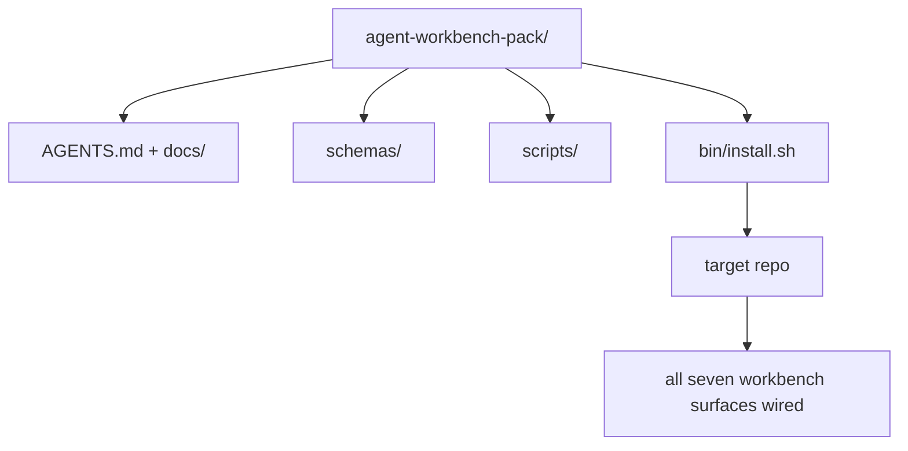

# Capstone:交付一个可复用代理工作板包

> Bu mini-track, her repo paketine yerleştirilebilir.`cp -r`Sonra ertesi sabah da bir ajanı çalıştıralım. Bu, dersimizin gerçek bir ürünü.

**类型：**Yapım
**语言：**Python (stdlib)
**前置要求：**14 · 31 · 14 · 41 aşamaları
**时间：**~ 75 dakika

## Öğrenme hedefi

- Yedi işleme masası yüzeyini doğrudan yerleştirilebilir bir katalog olarak toplayın.
- Fixed schema、script 和 template, let new repo  get a known available baseline──
- 添加一个安装脚本,用等方式放置这个包──
- Hangi içerik paket içinde kalır, hangi içerik dışarıda kalır, karar vererek, her birinin kendi görüşünü belirler.
- ☐ bir kez temsilci tarafından ☐ yardımıyla tamamlanan depo değişikliğini göstermek ve değerlendirmeci tarafından geri kazanılabilecek kanıtlar sunmak

## 问题

Bir çalışma tabanı Google Dokümanında var, sohbet tarihi ve üç sadece bulanık olarak hatırlanan senaryoda, bir çalışma tabanı her ay yeniden inşa edilir. Çözüm bir versiyon paketine sahiptir: bir repo veya bir katalog, içinde yüzey, şema, senaryo ve bir bir bir emir vardır.

Bu ders bitince, disket üzerinde teslimat yapacaksın.`outputs/agent-workbench-pack/`Ve bir de onu istediğin repoya koyabilirsin.`bin/install.sh`- Evet.

## 概念



### Paket düzenlemesi

```
outputs/agent-workbench-pack/
├── AGENTS.md
├── docs/
│   ├── agent-rules.md
│   ├── reliability-policy.md
│   ├── handoff-protocol.md
│   └── reviewer-rubric.md
├── schemas/
│   ├── agent_state.schema.json
│   ├── task_board.schema.json
│   └── scope_contract.schema.json
├── scripts/
│   ├── init_agent.py
│   ├── run_with_feedback.py
│   ├── verify_agent.py
│   └── generate_handoff.py
├── bin/
│   └── install.sh
└── README.md
```

### Ne bırakıyorsun, ne bırakıyorsun?

留下:

- Yüzey şeması... Bunlar kontrat.
- Yukarıdaki dört senaryo...
- Dört bölüm. Bunlar kural ve kural.

Dışarıda:

- 项目特定任务──任务属于目标 repo的董事会,不属于包──
- 供应商 SDK 调用──这个包与框架无关──
- Bu paket, takımın yanında değil, yanında yerleştirilmiştir.

### Kurulucu

Bir kısaca.`bin/install.sh`(Yada `bin/install.py`):

1. Hiç .`--force`时, 拒绝覆盖安装到已有包上.
2. Bu paketleri hedef repo'ya geri yükleyeceğim.
3. Eğer varsa`.github/workflows/`,                                                                                                                                                                                                                                                               
4. 打印后续步骤:填写板、设置接受命令、运行 init脚本──

### 版本管理

Bu paket bir taneyle beraber.`VERSION`文件──需要迁移的 schema bump 和脚本 变更会出现重大突破──仅 doc 的变更会出现突破补丁──目标 repo 的 `agent_state.json`Başlangıçta kayıtlı olan paket versiyonuna karşı.


```figure
wb-pack-install
```

## Yapın onu.

`code/main.py`Bu dersin yanında bir paket toplayacağım.`outputs/agent-workbench-pack/`Bu mini-track'i, ön planda bulunan schema ve script'i ve yazmış olduğunuz dokümanı bir parça olarak kullanıyorum.

- Yapma .

```
python3 code/main.py
```

Bu yazı, kopyalanıp sabitlenmiş yüzeyde, README'ye yazıp, paket ağacını basıp sıfırdan çıkıyor.

## Gerçek üretim modüsü

Bir paket sadece çatalın geçebilmesi ve iyi olmayan akıntılı bir şekilde değerlidir.

**`VERSION` 是 contract，不是 marketing。**Büyük bir çarpma  devlet göçü gerekir。 Küçük çarpma  tekrar çalıştırmak gerekir kontrolcü。 Yapıştırma çarpması sadece kullanılır。 Kurulucu Her zaman yüklemek için `.workbench-version`写入目标 repo; eğer hedeflerin kilitlenmesi ve paketlenmesi `VERSION`İttifak`lint_pack.py`Bu yüzden teslimatını reddetti.`npm`- Evet.`Cargo`和 `pyproject.toml`10 yıl boyunca bu kuralları değiştirmek için bir ajanın elinde.

**跨工具分发的单一来源。**Nx           `nx ai-setup`, tek bir yapılandırma    `AGENTS.md`- Evet.`CLAUDE.md`- Evet.`.cursor/rules/`- Evet.`.github/copilot-instructions.md`Bu paket de bunu yapmalı; kurutma 输出 symlink(`ln -s AGENTS.md CLAUDE.md`Bu paket, başarısızlık modudur.

**`uninstall.sh` 会在存在非平凡 state 时拒绝执行。**Bu paket kaldırılamıyor .`agent_state.json`- Evet.`task_board.json`Ya da`outputs/`❖ Uinstaller 会削除 schema、script、doc 和 `AGENTS.md`(带 `--keep-agents-md`Seçmeyi reddet), ve eğer devlet dosyası herhangi bir gönderilmemiş değişiklik varsa,就拒绝继续──State 属于用户;pack 并不拥有它──

**Skill-as-publishable。SkillKit-style 分发。**Bu paket SkillKit yeteneği olarak 交付:`skillkit install agent-workbench-pack`Bu, bir tek kaynaktan 32 AI ajanına kadar yerleştirilmiştir.

## Kullan

Paket üç yerde teslimat:

- **作为一个你放进 repo 的目录。** `cp -r outputs/agent-workbench-pack /path/to/repo`- Evet.
- **作为一个公开 template repo。**Kork ve özelleştir,并用 `VERSION`- Kontrol et.
- **作为一个 SkillKit skill。**Bir emir ver, bir emir ver.

Paket bir tarif. Her kurulum bir servis.

## - Söyle.

`outputs/skill-workbench-pack.md`Programlar için bir paket oluşturulur: kurallar, ekip tarihinin daha netleşmesi, küresel kapsam, repo ile uyumlu bir boyut, rubrik boyut, bir alanın belirli bir yöntemi genişletmesi.

## 练习

1. Bu konuda bir seçim yapabilmek için hangi beşinci belgeye yükseltilmesi gerektiğini belirleyin.
2. Python'da yeniden yazma yükleyici,并添加 `--dry-run`Bayrak, ergonomi ile bash karşılaştırıldığında.
3. Bir ekle.`bin/uninstall.sh`...güvenli bir paket taşımak ve devlet dosyasına girmek için.
4. Bir ekle.`lint_pack.py`, paketleme        `VERSION`时失败──把它插入包──自备备用的CI──
5. 手工作業台 移動到本包のランブに書き込み― hangi işlemler zamanını en aza indirmek için yapılabilir?

## 职业实践: prov once deposu değişimi

打包演示证明组装程序能够运行并生成文件──它不能证明您的代理能完成新任务──生成的检查能够验证该任务,或已部署的系统能正常工作──请区分这些结论──

Sahip olduğunuz veya değiştirilmesine izin verdiğiniz depolarda, gerçek bir küçük görev seçin. Bir programlama ajanı kullanın.

Bu yüzden, bu testin diğer bir parçası olarak, bir iş saatini beklemek için, aşağıdaki bağlantıların kendi testiyle kopyalanmasını sağlayabilirsiniz.`learning-artifacts/`Kayıtta, depodaki mevcut modelleri ve paketleri referans olarak saklayın.

### 1. 明确任务并选择自主程度

43 Sınıfın görev çerçevesini ve 44 Sınıfın kanıt planını kullanmak. Başlangıç sürümünü kaydetmek. Görebilir hedefler, amaçsızlar, değişikliğe izin vermek yolları, ve kabul kanıtları kullanmak. Bu davranışın kullanıcı veya operatörlerine gerçekten ihtiyaçları olduğunu belirlemek.

 İş modelini seçin: adım adım yönlendirme  kontrol noktasının gerçekleştirilmesi, veya sınır açıklı kendiliğinden gerçekleştirilmesi  belirsizlik  potansiyel sonuçlar ve geri dönüşü neden desteklediğini açıklayın  Küçük bir yerel yeniden yapı, ziyaret kontrolünün değişmesine daha az kontrol noktası gerektirebilir 

 Gerçek bir zaman harcama bütçesi belirlemek; eğer bir ajan ilgili bir işlev sağlıyorsa, aynı zamanda bir belirleme veya maliyet sınırlaması belirlemek gerekir.

### 2.                                                                                                                                                                                                                                                                                                                                                                                                                                                                                                                              

查找相关实现、调用方、测试和本地指令──记录每一个来源为什么应进入上下文,以及哪些现有证据能够推翻过去的笔记──不要默认加载整个仓库──

Her tür genişleme için belirlenmiş seçimler yapın: beceri; beceriler; tekrar kullanılabilecek bir süreç sağlamak; MCP araçları; erişim yeteneği; 子; hook; kesinlik kontrolü gerçekleştirmek;插件; plugin; paketleme;

记录一个被你拒绝的新项目会带来上下文或维护成本――重新审核一个过往的记忆或命令; eğer kanıtlar iptal veya değiştirmeyi desteklerse, kendi başına yönetilen öğrenme ortamında gerçekleştirilmiştir―― yeniden çalıştırılan etkilenen bir kontrol, kaldırılmasının kaybedilmediğini doğrulayarak gerekli bir bağlamı oluşturur――

### 3. 记录基线并实现

Edit edite önce, çalıştırma ile ilgili en çok mevcut kontrol, gerekli davranışların mevcut durumunu göstermek.

让代理在任务约定内实现变更. 让代理在任务约定内实现变更. 让代理在任务约定内实现变更. 让代理在任务约定内实现变更. 让代理在任务约定内实现变更. 让代理在任务约定内实现变更. 让代理在任务约定内实现变更. 让代理在任务约定内实现变更. 保留干预日志,说明每次纠正的原因,说明权限变更或计划调整的原因. 让代理在任务约定内实现变更. 让代理在任务约定内实现变更. 让代理在任务约定内实现变更. 让代理在任务约定内实现变更. 让代理在任务约定内实现变更. 保留干预日志,说明每次纠正的原因,说明权限变更或计划调整的原因. 委派可选;如果确实有用,在增加另一个执行者之前,首先应用第45 课责任归属与集成约定.

### 4. 质疑证据

选择能够观察变更界面的验证方式―― UI için, yeniden yapılandırmak ve ilgili görgü açısından genişlik altında gerçek hizmet sunma kullanıcı süreçlerini incelemek―― API için, kontrol istekleri ve sıralama sonrası yanıtları için―― CLI için, çalıştırma yapılandırma sonrası emirleri için, kontrol çıkış kodu ve çıkışını kontrol etmek―― seçilen görevlerin gerekli kontrollerini, sınırlarını açıklamak――

Görev belirlediği bağımsız olarak beklenen sonuçları yazın, ajanın gerçekleştirdiği karşı önerilerden kaçınının. Bir kerelik kopyasında, örneğin, değersiz veya atılmak için gerekli bir yanıt sonucu olarak belirli bir hata sonucu getirin. Aynı kabul kontrolünü yürütün: bu hataya göre başarısız olmalıdır.

Eğer kontrol eski bir şekilde geçerse, önce bir ifade veya gözlem biçimini güçlendirsin, tekrar ona inan. Doğru bir şekilde gerçekleşmesini sağlayıp tekrar çalıştırılmasını sağlasan, iki kez gerçekleştirilen kanıtları korusun.

İlk hedef ve değişikliklere izin verilme yollarına bakmak, testlerin değişimleri dahil olmak üzere sonuç farkları, sonuç farkları. Lütfen eş veya bağımsız değerlendirme toplantısı, değişikliklerin gerçekleşmemesi önemi altında en zayıf kanıtları sorgulayarak, sonuçta karar vermek sizin sorumluluğunuzdadır.

### 5. 演练运行与恢复

Bir kez yerel ortamda veya önceden yayınlanan ortamda yürütülen değişen teslimatlar.`local`- Evet.`staging`Ya da`live`,并注明确的版本或交付物标识──本地演练只支持本地结论;本地演练不要求部署到生产环境──

 görev ile ilgili bir başarısızlık sinyali seçin,  değer belirleyin,  gözlem penceresi ve sorumluluk kişiyi belirleyin.                                                                                                                                                                                                                                               

演练回滚到已知可用交付物,并检查前行为是否恢复──适用时,应考虑持久化数据:仅替换二进制文件不一定能撤销数据变更──记录任何未经验证的恢复步骤──

### 6. 改进下一次执行并交接

Sonuçları, gerçek zaman tüketimi, elde edilebilir miktar verileri ve yapay müdahaleler dahil olmak üzere temel çizgilerle karşılaştırmak. Bir görev sadece görev içinde ne olduğunu açıklayabilir, bir ajanın genel olarak daha hızlı veya daha güvenilir olduğunu kanıtlayamaz.

46'ıncı dersine göre, bir kez gerçekleştiği düzeltme test olarak dönüştürülecek, ∞ daha küçük yetki sınırları, ∞ otomatik süreç veya daha net örnekler. ∞ yeniden çalıştırılmak etkilenen kontroller. ∞ geçici giriş hata değişikliklerini kaldırmak, ∞ bir sonraki toplantı için son bölümü belirlemek, ∞ değişim dosyaları, ∞ çözülmemiş risk ve sonraki adım eylemleri.

### 工评审标准

Soruyor muhakemeci, kanıt dosyalarını kontrol et, ve en zayıf kabul kontrollerini tekrar yaptır.`demonstrated`(Sunuç gösterilmiştir)`needs revision`(edilmeli) veya `unverified`(未验证) Bu görüşlerin yerini hiçbir şey alamaz.

| 维度 | 评审者应质疑的证据 |
|---|---|
| 任务与自主程度 | 初始行为、边界明确的目标、合理的权限与预算，以及可执行的停止规则 |
| 上下文与环境 | 相关来源、合理的工具访问权限，以及经过重新核查的退役决定 |
| 验证 | 变更前后的实际行为，以及相同检查能够拒绝的、刻意引入的错误结果 |
| 评审与运行 | 已检查的差异、独立质疑、标明环境的运行观测，以及演练过的恢复流程 |
| 迭代与交接 | 一项经过验证的改进、如实说明的局限、干净的最终状态，以及可复现的下一步行动 |

Başvuru işi tamamlanmadan önce, çözün.`needs revision`Sorunlar: elde edilemeyen kanıtlar saklanmalıdır.`unverified`Bu çalışma kitlesinin, bir sınır açıklı görevdeki mühendislik kararlılığını göstermesi, işe alınma veya görevlendirilme koşullarına sahip olma konusunda bir garanti değildir.

## 交付物

Geri dönüştürülebilir paketleri ve tamamladığın şeyleri sakla.[career-agent-evidence.md](https://github.com/rohitg00/ai-engineering-from-scratch/blob/main/phases/14-agent-engineering/42-agent-workbench-capstone/outputs/career-agent-evidence.md)Bu modül görev çerçevesini, yürütme planını, yürütme sertifikasını, değerlendirmeyi, geri kazanma çalışmalarını ve bağlantılarını değerlendirilebilir bir örnek çalışması olarak birleştirir.

## 关键术语

| 术语 | 人们常说 | 它实际含义 |
|------|----------------|------------------------|
| Workbench pack | “starter kit” | 一个带版本的目录，携带全部七个 surface |
| Installer | “Setup script” | 以幂等方式放置 pack 的 `bin/install.sh` |
| Pack version | “VERSION” | schema/script 变更使用 major bump，仅 doc 变更使用 patch |
| Drop-in pack | “cp -r and go” | Pack 在第一天无需按 repo 定制即可工作 |
| Forkable template | “GitHub template” | GitHub 的 “Use this template” 可以从中 clone 的公开 repo |

## 延伸阅读

- 14 · 31 ~ 14 · 41  Bu paket 打包的每一面
- [SkillKit](https://github.com/rohitg00/skillkit)Bu yeteneği 32 AI ajanında yerleştir .
- [Nx Blog, Teach Your AI Agent How to Work in a Monorepo](https://nx.dev/blog/nx-ai-agent-skills) 跨六种工具的单一来源发电机
- [agents.md — the open spec](https://agents.md/)Paketin yönlendiricisi  İçeriğini gerçekleştirmek zorundadır
- [HKUDS/OpenHarness](https://github.com/HKUDS/OpenHarness) paket eşdeğerliğinin referans gerçekleşmesi
- [Augment Code, A good AGENTS.md is a model upgrade](https://www.augmentcode.com/blog/how-to-write-good-agents-dot-md-files) paket dokı 
- [Anthropic, Effective harnesses for long-running agents](https://www.anthropic.com/engineering/effective-harnesses-for-long-running-agents)
- [Anthropic, Harness design for long-running application development](https://www.anthropic.com/engineering/harness-design-long-running-apps)
- Fase 14 · 30  消费 消费 消费 消费 消费 消费 消费 消费 消费 消费 消费 消费 消费 消费 消费 消费 消费 消费 消费 消费 消费 消费 消费 消费 消费 消费 消费 消费 消费 消费 消费 消费 消费 消费 消费 消费 消费 消费 消费 消费 消费 消费 消费 消费 消费 消费 消费 消费 消费 消费 消费 消费 消费 消费 消费 消费 消费 消费 消费 消费 消费 消费 消费 消费 消费 消费 消费 消费 消费 消费 消费 消费 消费 消费 消费 消费 消费 消费 消费 消费 消费 消费 消费 消费 消费 消费 消 消 消 消 消 消 消 消 消 消 消 消 消 消 消 消 消 消 消 消 消 消 消 消 消 消 消 消 消 消 消 消 消 消 消 消 消 消 消 消 消 消 消 消 消 消 消 消 消 消 消 消 消 消 消 消 消 消 消 消 消 消 消 消 消 消 消 消 消 消 消 消 消 消 消 消 消 消 消 消 消 消 消 消 消 消 消 消 消 消 消 消 消 消 消 消 消 消 消 消 消 消 消 消 消 消 消 消 消 消 消 消 消 消 消 消 消 消 消 消 消 消 
- Fase 14 · 41  Bu paket önce/sonra referans değerinin geliştirilmesi gerekiyor
