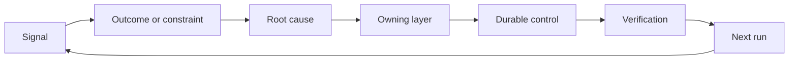

# Konuşturma ve geri dönüş mekanizması için bir dönüm

> Kod yayınlaması, mevcut yapı döngüsünü sona erdirir ve aynı zamanda uzun süreli öğrenme döngüsünü açar.

**Type:** Learn + Build
**Languages:** Python (stdlib)
**Prerequisites:** Phase 14 lessons 46 and 53
**Time:** ~75 minutes

## Öğrenme hedefi

- Yapılan hataları, değerlendirme verilerini, kullanıcı davranışlarını ve yanlışlarını sorumlu bir eylem olarak dönüştürmek.
- Bu nedenle, bu programın kullanımı için gerekli olan araçların kullanımı için gerekli olan araçların kullanımı için gerekli olan araçların kullanımı için gerekli olan araçların kullanımı için gerekli olan araçların kullanımı için gerekli olan araçların kullanımı için gerekli olan araçların kullanımı için gerekli olan araçların kullanımı için gerekli olan araçların kullanımı için gerekli olan araçların kullanımı için gerekli olan araçların kullanımı için gerekli olan araçların kullanılması için gerekli olan araçların kullanılması için gerekli olan araçların kullanılması için gerekli olan araçların kullanılması için gerekli olan araçların kullanılması için gerekli olan araçların kullanılması için gerekli olan araçların kullanılması için gerekli olan araçların kullanılması için gerekli olan araçların kullanılması için gerekli olan araçların kullanılması için gerekli olan araçların kullanılması için gerekli olan araçların kullanılması için gerekli olan araçların kullanılması için gerekli olan araçların kullanılması için gerekli olan araçların kullanılması için gerekli olan araçların kullanılması için gerekli olan araçların kullanılması için gerekli olan araçların kullanılması için gerekli olan araçların kullanılması gereklidir.
- Devam ve tekrar oluşma risklerine göre öncelik sıralanması
- Bu nedenle, her bir sistem kontrol mekanizması, emeklilik koşullarını belirlemiştir.
- 沟通交付决策, kanıtlar, 权衡取舍及明确负责的决策者──

## Bu da bir altyapıdır.

Bir ekip, çok sayıda sistem bağlantısı takip (sıra) ̊ değerlendirme kayıtları ̊ destek iş tekli ve eksiklik günlüğü ̊ toplayabilir, ancak tamamen herhangi bir biliş dersleri almıyor.**晋级通道（Promotion）**Bu, bir kişinin, bir kişinin, bir kişinin, bir kişinin, bir kişinin, bir kişinin, bir kişinin, bir kişinin, bir kişinin, bir kişinin, bir kişinin, bir kişinin, bir kişinin, bir kişinin, bir kişinin, bir kişinin, bir kişinin, bir kişinin, bir kişinin, bir kişinin, bir kişinin, bir kişinin, bir kişinin, bir kişinin, bir kişinin, bir kişinin, bir kişinin, bir kişinin, bir kişinin, bir kişinin, bir kişinin, bir kişinin, bir kişinin, bir kişinin, bir kişinin, bir kişinin, bir kişinin, bir kişinin, bir kişinin, bir kişinin, bir kişinin, bir kişinin, bir kişinin, bir kişinin, bir kişinin veya bir diğerinin, bir diğerinin, bir diğerinin, bir diğerinin, bir diğerinin, bir diğerinin, bir diğerinin, bir diğerinin, bir diğerinin, bir diğerinin, bir diğerinin, bir diğerinin, bir diğerinin, bir diğerinin, bir diğerinin, bir diğerinin, bir diğerinin, bir diğerinin, bir diğerinin, bir diğerinin, bir diğerinin, bir diğerinin, bir diğerinin, bir diğerinin, bir diğerinin, bir diğerinin, bir diğerinin, bir diğerinin, bir diğerinin, bir diğerinin, bir diğerinin, bir diğerinin, bir diğerinin, bir diğerinin, bir diğerinin, bir diğerinin, bir diğerinin, bir diğerine karşı karşı karşı karşı karşı karşı karşı karşı karşı karşı karşı karşı karşı karşı karşı karşı karşı karşı karşı karşı karşı karşı karşı karşı karşı karşı karşı karşı karşı karşı karşı karşı karşı karşı karşı karşı karşı karşı karşı karşı karşı karşı karşı karşı karşı karşı karşı karşı karşı karşı karşı karşı karşı karşı karşı karşı karşı karşı karşı karşı karşı karşı karşı karşı karşı karşı karşı karşı karşı karşı karşı karşı karşı karşı karşı karşı karşı karşı karşı karşı karşı karşı karşı karşı karşı karşı karşı karşı karşı karşı karşı karşı karşı karşı karşı karşı karşı karşı karşı karşı karşı karşı karşı karşı karşı karşı karşı karşı karşı karşı karşı karşı karşı karşı karşı karşı karşı karşı karşı karşı karşı karşı karşı karşı karşı karşı karşı karşı karşı karşı karşı karşı karşı karşı karşı karşı karşı karşı karşı karşı karşı karşı karşı karşı karşı karşı karşı karşı karşı karşı karşı karşı karşı karşı karşı karşı karşı karşı karşı karşı karşı karşı karşı karşı karşı karşı karşı karşı karşı karşı karşı karşı karşı karşı karşı karşı karşı karşı karşı karşı karşı karşı karşı karşı karşı karşı karşı karşı karşı karşı karşı karşı karşı karşı karşı karşı karşı karşı karşı karşı karşı karşı karşı karşı karşı karşı karşı karşı karşı karşı karşı karşı karşı karşı karşı karşı karşı karşı karşı karşı karşı karşı

Çekilme (Ratchet)

1. 观测到具体实测信号;
2. Bu durumun, beklenen ürün sonuçları, koşulları veya ön önlenme varsayımlarıyla bağlantılı olması;
3.                                                                                                                                                                                                                                                               
4. 实施受控的持久化改进;
5. 验证该故障复发的概率已切实降低;
6. 定期复审该控制机制是否应继续保留──

## 精准路由至应责任 seviyesine kadar

| 信号类型 | 归属目的地 |
|---|---|
| 误报、功能倒退、错误输出结果 | 评测集（Evaluation）或自动化测试 |
| 上下文缺失、重复劳动、过时事实 | 上下文数据源或检索路由策略 |
| 不安全操作或越权漏洞 | 安全策略（Policy）或权限硬边界 |
| 超时、重试风暴、依赖服务不可用 | 运行时控制（Runtime Control） |
| 新的产品需求或尚未决断的权衡取舍 | 经过规范成型（Shaped）的待办项 |

Bu nedenle, otomatik test veya sertlik yetkisi tamamen hataları gerçekleştiremeyecek kadar yüksek olduğunda, Prompte'de bir daha bir bölüm eklemeyi unutmayın.



## 责任归属本身就是控制机制的一部分

Her bir dönümsel eylemin içinde:

- 唯一的人类责任人 (Büyük kişi);
-                                                                                                                                                                                                                                                               
- 拟修改的目标系统组件 (Artifact)
- Dönüşümün gerçekçi bir şekilde gerçekleşmesini kanıtlamak;
- 复审或自动失效窗户;
- 明确的退役条件 (Retirement Condition)

Bir insan tarafından tanınmamış bir  iyileştirme programı,  dolu                                                                                                                                                                                                                                                      

## 果断退役过时的控制机制

Bu kuralların sürekli bir şekilde bir araya gelmesi ve kontrol edilmesi için, bu kuralların birbirine karşı çıkması ve maliyetleri yüksek olması mümkündür.

- Sistem yapı veya iş akışı temel değişimlere yol açtı;
- Alt kattaki değişmezlik mekanizması üst kattaki metin talimatlarını tamamen değiştirmiştir.
- Önceki zaman penceresinde, önlenilen hatalar bir daha ortaya çıkmadı;
- Kontrol kuralları normal işletme gelişimini engelledi ve zarar önleme avantajlarını aşmıştı.

Bu yüzden de, bu durumun gerçekleştiğini göstermek için, bu durumun tamamen ortadan kaldırılması gerekir.

## 打通 ürün yapılandırma ve kodlama ajanının karşı karşı bağlama

Aynı çelişkili mekanizma aynı anda ürün işletmesi ve akıllı vücut geliştirme iki rota hizmet edebilmektedir:

- 产品业务实证驱动预期产出框架、假设图谱、最小切片或量度计划的发展;
- Kodlama Ajansı'nın çalışması, otomatikleştirme testinin yapılması, yüklenmesi, işletim alanının optimize edilmesi, otomatik yazılım veya iletişim mekanizması;
- 线上真故障既能促成产品功能边界调整,也能促成代理工作台的加固──

Bu nedenle görev çerçevesinin, kodlama öncesi ilan edilme aşamasında değil, her sistem tarafından kabul edilen değişimlerin ortasında geçmesinin nedeni de budur.

## 动手实现

Bu deney, gerçek test sinyallerini sınıflandırmak, öncelikli sıralama ve çıkışlar yaparak, sorumluluk yüklenme ile ilgili bir dizi eylem oluşturmak için yapılmıştır.`outputs/feedback-backlog.json`- Evet.

```bash
python3 code/main.py
python3 -m unittest discover code/tests -v
```

尝试添加一个运行时超时信号,验证它将被正确路由至运行时控制层,而不是泛化混入通用需求待遇列表――

## 实践实验: Başarısızlıktan sonra karar vermeye sorumlu

Mesleki öğrenme yolunuzdan, işleme koleksiyonu projelerinden, bir çalışma akışını seçin.[职业交付模板](https://github.com/rohitg00/ai-engineering-from-scratch/blob/main/phases/14-agent-engineering/54-build-the-feedback-ratchet/outputs/career-delivery-evidence.md)İçeride.

Python deneyleri örnekler üretir, eylemler yapılır. kullanıcıyı gözlemlemez, etkiyi ölçmez ve işgücü kazanma gücünü kanıtlamaz.

### 1. - Ne oldu ?

记录用户,任务,当前工作流,以及你希望改进的结果――链接到经过同意的观察记录、已脱敏的支持记录,或可复制的任务轨迹――区分你直接观察的事实,他人报告的情况以及你的推断――

 bir başarısızlık bul: başarısızlık hipotezi, kullanılamaz sonuçlar, beklenmedik maliyetler veya gecikmiş bağlantılar.  Anlamanızı değiştiren kanıtları açıklayın.

Kullanıcı ile temas edemezseniz, eşinizle açık bir işaretleme simülasyonu yapın veya açık bir durum üzerine simülasyon yapın.

### 2. Yetki sınırları içinde ilerleme

Bilinmeyen projeler listesi, en düşük maliyetleri seçmek, en büyük bilinmeyen projeler hareketlerini etkilemeyi bekleyen ve çözmeyi bekleyen projeler listesi, hangi projeler, hangi projeler, hangi projeler, hangi projeler, hangi projeler, hangi projeler, hangi projeler, hangi projeler, hangi projeler, hangi projeler, hangi projeler, hangi projeler, hangi projeler, hangi projeler, hangi projeler, hangi projeler, hangi projeler, hangi projeler, hangi projeler, hangi projeler, hangi projeler, hangi projeler, hangi projeler, hangi projeler, hangi projeler, hangi projeler, hangi projeler, hangi projeler, hangi projeler, hangi projeler, hangi projeler, hangi projeler, projeler, projeler, projeler, projeler, projeler, projeler, projeler, projeler, projeler, projeler, projeler, projeler, projeler, projeler, projeler, projeler, projeler, projeler, projeler, projeler, projeler, projeler, projeler, projeler, projeler, projeler, projeler, projeler, projeler, projeler, projeler, projeler, projeler, projeler, projeler, projeler, projeler, projeler, projeler, projeler, projeler, projeler, projeler, projeler, projeler, projeler, projeler, projeler, projeler, projeler, projeler, projeler, projeler, projeler, projeler, projeler, projeler, projeler, projeler, projeler, projeler, projeler, projeler, projeler, projeler, projeler, projeler, projeler, projeler, projeler, projeler, projeler, projeler, projeler, projeler, projeler, projeler,

Örneğin, müşteri verilerini kullanma iznini beklerken, öncelikle hassas olmayan çevrimiçi devreye hazırlanabilirsiniz. Etkin ilerleme yetkili işlerin tamamlanması anlamına gelir ve kararların engellenmesi gerektiğini açıkça belirtir; erişim veya onay hakkınızı genişletmez.

### 3. Önerileri karşılaştırmak ve karar verme sorumluluğu

Bu konuda detaylı bir bilgi edinmek için, kısa bir karar özetlemesi makalesi yazmak gerekir.

- Kullanıcı sorunu ve değişim planının kanıtları;
- En az iki seçenek vardır; makul olarak uygulanabilir olduğunda, daha düşük maliyetli işçi veya geliştirilme gereksiz olan bir program dahil edilmelidir.
- 質量、交互設計、工作量、運行費用 ve risk boyutları;
- Önerileriniz, kalıcı belirsizlikler ve karar verme gereksinimleri;
-  karar verme sorumluluğu olan  etkilenen çıkarcıların ve karar verme süresi 

Lütfen bir kişiyi temsil eden bir ortak, bu konulardan birisini sorgulayarak, bu konulardan birisini değerlendirerek, bu konularda nasıl bir değişiklik yapıldığını veya neden önerilerini değiştirmediğini açıklayın.

### 4.                                                                                                                                                                                                                                                                                                                                                                                                                                                                                                                              

Sorulara cevap verilmesi gerektiği gibi, çalışmaların orijinal biçimini, çalışmaları, çalışmaları seçmek, çalışmaları, çalışmaları, çalışmaları, çalışmaları, çalışmaları, çalışmaları, çalışmaları, çalışmaları, çalışmaları, çalışmaları, çalışmaları, çalışmaları, çalışmaları, çalışmaları, çalışmaları, çalışmaları, çalışmaları, çalışmaları, çalışmaları, çalışmaları, çalışmaları, çalışmaları, çalışmaları, çalışmaları, çalışmaları, çalışmaları, çalışmaları, çalışmaları, çalışmaları, çalışmaları, çalışmaları, çalışmaları, çalışmaları, çalışmaları, çalışmaları, çalışmaları, çalışmaları, çalışmaları, çalışmaları, çalışmaları, çalışmaları, çalışmaları ve çalışmaları seçin.

Kullanıcının başlangıcından görev tamamlanmasına kadar, tüm iletişim sürecini araştırmak, hata çıkışı veya veri eksikliği durumuna girmek, kullanıcıların başarısızlığı tespit edip düzeltme ve yardım almadan geri kazanma durumunu gözlemlemek.

Yapay denetim ve düzeltme sürecini tüm iş sürecine dahil etmek.

### 5. Sonuçları ekonomik ile karşılaştır

Aynı gösterge tanımını kullanmak, görev genelini oluşturmak, toplama yöntemlerini ve karşılaştırılabilir gözlem pencerelerini kullanmak, örnek sayısı, dışlama noktaları ve kanıt bağlantısını sayı değerinin yanında yerleştirmek, bu koşulların değişmesi durumunda, karşılaştırmanın neden kısıtlı olduğunu açıklamak,

 Kullanıcı sonuçları  Bir kalite veya güvenlik  göstergesi ve genel yapay inceleme çalışmaları  Sonuçlar hedefe ulaşmasa da gerçek kayıtlar  Küçük örnekler veya simülasyon örnekleri sadece sınırlı bir öğrenme sonucu destekler, işgücü etkisini kanıtlayamazlar 

 her başarıyla tamamlanan görev maliyetinin tahmin edilmesi, model devreleme, yeniden deneme, destek hizmetleri ve yapay denetimlerin hesaplanması,  insan gücü tek fiyatlı varsayımları, gerçek kullanım miktarını değerlendirmeye ayırmak,  bu maliyetin yapay alternatif programlarla veya proje arkasındaki değerli varsayımlarla karşılaştırılması,

- Evet.[LLM FinOps 课程](https://aiengineeringfromscratch.com/lesson?path=phases/17-infrastructure-and-production/27-finops-llms), daha fazla öğrenme maliyeti, birim ekonomisi ile ilişkili olarak değişim modelinin sadece olası tepkilerden biri; iş akımının kapsamını azaltmak veya yapay adımları korumak, daha iyi bir ürün karar vermemize yardımcı olabilir.

### 6. 完成闭环

Önceden bildirilen standartlara göre, önerilen devam, düzen veya durdurulmasıdır. Eğer kanıtlar henüz kesinleşmemişse, kayıp gözlemleri ve aşağıdaki sınırı açık testleri belirtilirse, sorumluluk sahibi karar vericilerin tepkileri kaydedilmelidir.

選択一項 交付プロセス自身の改善: daha net bir görev çerçeve、 daha erken kullanıcı giderleri、 daha iyi değerlendirmeler 清单、 daha küçük ajan 交付单元, veya daha özel değerlendirmeler vakaları──指定責任者および复审日期──

Reviews, decide to retain, modify or withdraw this improvement. Record selection's evidence. Eğer yeni bir liste çalışma miktarını arttırırsa ama hedef başarısızlığını önlemese, bu düzenleme kalıcı olarak kalmamalıdır.

## 交付物

- Ben de .[career-delivery-evidence.md](https://github.com/rohitg00/ai-engineering-from-scratch/blob/main/phases/14-agent-engineering/54-build-the-feedback-ratchet/outputs/career-delivery-evidence.md)☐ ☐ ☐ ☐ ☐ ☐ ☐ ☐ ☐ ☐ ☐ ☐ ☐ ☐ ☐ ☐ ☐ ☐ ☐ ☐ ☐ ☐ ☐ ☐ ☐ ☐ ☐ ☐ ☐ ☐ ☐ ☐ ☐ ☐ ☐ ☐ ☐ ☐ ☐ ☐ ☐ ☐ ☐ ☐ ☐ ☐ ☐ ☐ ☐ ☐ ☐ ☐ ☐ ☐ ☐ ☐ ☐ ☐ ☐ ☐ ☐ ☐ ☐ ☐ ☐ ☐ ☐ ☐ ☐ ☐ ☐ ☐ ☐ ☐ ☐ ☐ ☐ ☐ ☐ ☐ ☐ ☐ ☐ ☐ ☐ ☐ ☐ ☐ ☐ ☐ ☐ ☐ ☐ ☐ ☐ ☐ ☐ ☐ ☐ ☐ ☐ ☐ ☐ ☐ ☐ ☐ ☐ ☐ ☐ ☐ ☐ ☐ ☐ ☐ ☐ ☐ ☐ ☐ ☐ ☐ ☐ ☐ ☐ ☐ ☐ ☐ ☐ ☐ ☐ ☐ ☐ ☐ ☐ ☐ ☐ ☐ ☐ ☐ ☐ ☐ ☐ ☐ ☐ ☐ ☐ ☐ ☐ ☐ ☐ ☐ ☐ ☐ ☐ ☐ ☐ ☐ ☐ ☐ ☐ ☐ ☐                                                                                                                                                                                            

## 验证

Eşinizle birlikte aşağıdaki yapay kabul standartlarını kullanın.**met**(doğrudur)**needs work**(evlenme ihtiyacı) veya **not observed**(yetime kadar gözlemlenmemiş),并提供证据链接或具体缺失的观测──填好了字段,并不能证明判断合理──

| 检查项 | 满足标准的证据 |
|---|---|
| 工作流有事实依据 | 可追溯的观测支持问题定义；他人报告、推断和模拟均有标记。 |
| 遵守授权边界 | 下一项可逆工作明确，任何受限操作都等待真正的决策责任人授权。 |
| 权衡沟通清晰 | 记录可信的替代方案、利益相关方的异议、建议，以及明确的决策请求。 |
| 交互经过测试 | 走查覆盖成功、失败、恢复，以及人工审核工作量。 |
| 结果经过比较 | 基线与后续度量的定义一致；样本、护栏指标、成本和比较局限清晰可见。 |
| 对挫折承担责任 | 证据改变了继续、调整或停止的决策，并导向一项有明确责任人的后续行动。 |
| 流程得到改进 | 一项工作流改进具备责任人、复审日期，以及基于证据的保留、修改或退役决定。 |

Her simülasyon aşamasında bile, gözlemlenmemiş gerçek kullanıcı davranışları hâlâ kanıt eksikliği vardır.

## 课后练习

1. Yakın dönemde bir hata ve bir kullanıcı gerçek şikayetleri ile birlikte, ayrılığı olarak belirli bir sorunlu hareket olarak dönüştürülür.
2. Bu, bir daha tekrar oluşmasını engelleyebilecek en alt düzey sistem düzeyleri olarak belirlenmektedir.
3. Deneyim çıkışı eylemleri tamamlamak için gerçekleştirilebilir otomatik test talimatı veya gözlem göstergesi
4. Bu, bir güvenlik stratejisi kuralının belirgin bir şekilde geri çekilme şartlarını oluşturmasıdır.
5. Sistem tarafından kabul edilen bir düzeltme eğiticiyi, geriye doğru takip etmeyi ve bir sonraki görev çerçevesine dahil etmeyi.

## 延伸阅读

- [Basili, Caldiera, and Rombach, The Goal Question Metric Approach](https://www.cs.toronto.edu/~sme/CSC444F/handouts/GQM-paper.pdf), hedef yönlendirilmiş ölçüm mekanizması yoluyla organizasyon düzeyinde sürekli algılama yükünü nasıl gerçekleştirmek için araştırılmaktadır.
- [Fagerholm et al., Building Blocks for Continuous Experimentation](https://doi.org/10.1145/2601248.2601276), analiz, gerçek kanıtlara dayanarak ürünlerle sürekli olarak bağlantılı olan teknik ve organizasyon kapsamını oluşturur.
- [Nuseibeh and Easterbrook, Requirements Engineering: A Roadmap](https://www.cs.toronto.edu/~sme/papers/2000/ICSE2000.pdf), açıklama ihtiyaçları tüm sistem yaşam döngüsü hareketlerinin gelişimi için bir mühendislik bakış açısı olarak görülecek.

## 交付物沉

Kalmak`outputs/feedback-backlog.json` Yol yolu örneği olarak,并保留你完成的职业交付证证,记录自己的决策──两者共同为产品判断力与交付──产品判断与交付──学习路径结尾,并为下一个预期产出框架提供依据──
