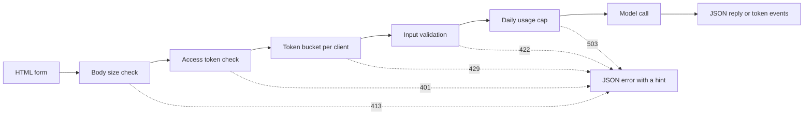

# 模型演示界面: işleviyle paylaşılabilir uygulama

> Model gösterisi bir kısım vardır: input、model调用和输出── önce her bölüm için kısıtlamalar belirlenir.

**Type:** Build
**Languages:** Python
**Prerequisites:** Phase 11 · 13（构建生产级 LLM 应用）、Phase 17 · 08（推理指标）、Phase 17 · 19（AI 网关）
**Time:** ~90 分钟

## Öğrenme hedefi

- 写出演示的输入、模型调用和输出约定,并为每部分设定限制──
- Bir HTTP uygulaması oluşturmak için standart kutu kullanın, bir HTML sayfası, bir JSON uç noktası ve bir sunucu gönderme olay uç noktası bulunur.
- 低到高验证输入,并返回 成本 低到高验证输入,并返回能够告诉用户下一步操作的 JSON 错误――
- Her müşteri sipariş çuvalı kullanmak, günlük kullanım miktarının sınırları ve seçilebilir ziyaret siparişleri, açık gösterileri korumak.
- 编写不保留输入文本和客户端地址的请求日志──
- Standart Kütüphane gösterisini iki çerçeve sürümüne karşılaştırarak gösterinin ürün sinyalleri olarak yükseltilmesi gerektiğini belirtti.

## 问题

Senin modelin defterde çalışmaya başladı. Şimdi, bir değerlendirici 10 giriş denemek istiyor, bir müşteri de bir kez telefonda sonuçları görmek istiyor.

Notbook 单元格 no input limit, ne de progress display;;;;;;;;;;;;;;;;;;;;;;;;;;;;;;;;;;;;;;;;;;;;;;;;;;;;;;;;;;;;;;;;;;;;;;;;;;;;;;;;;;;;;;;;;;;;;;;;;;;;;;;;;;;;;;;;;;;;;;;;;;;;;;;;;;;;;;;;;;;;;;;;;;;;;;;;;;;;;;;;;;;;;;;;;;;;;;;;;;;;;;;;;;;;;;;;;;;;;;;;;;;;;;;;;;;;;;;;;;;;;;;;;;;;;;;;;;;;;;;;;;;;;;;;;;;;;;;;;;;;;;;;;;;;;;;;;;;;;;;;;;;;;;;;;;;;;;;;;;;;;;;;;;;;;;;;;;;;;;;;;;;;;;;;;;;;;;;;;;;;;;;;;;;;;;;;;;;;;;;;;;;;;;;;;;;;;;;;;;;;;;;;;;;;;;;;;;;;;;;;;;;;;;;;;;;;;;;;;;;;;;;;;;;;;;;;;;;;;;;;;;;;;;;;;;;;;;;;;;;;;;;;;;;;;;;;;;;;;;;;;;;;;;;;;;;;;;;;;

- Utente, 40.000 karakterli bir dosya yapıştırıyor.
- Bir yazı bir dakikada 500 talep gönderir. Her talep bir ödeme modeli düzenlenmesini başlatır.
- 页面八秒没有显示任何内容,因此用户再次点击了四次按──
- server日志, müşteri hesabı numarası içeren her giriş için bir giriş tutmaktadır。

演示界面使用少量代码就能防止这些故障──本课先使用Python 标准库构建一个演示,让你看清每个部分;再使用两个流行框架构建相同演示,比较各自的默认行为──

## 概念

### Gösterim bir anlaşma.

Her gösterinin üç bölümü vardır. Giriş kullanıcı gönderebileceği içeriğidir; model düzenleme giriş dönüştürülür çıkış olarak; çıkış kullanıcı gördüğü içeriğidir, hataları da içerir.

Bu sayfayı yazmadan önce yazın:

| 部分 | 需要回答的问题 | 本课的答案 |
|------|--------------------|-----------------------|
| 输入 | 什么类型、多大、允许哪些字符？ | 长度为 1 到 500 个字符的字符串，不含控制字符 |
| 模型调用 | 一次调用需要多久、成本多少？ | 一个不到一毫秒即可运行完毕、没有调用费用的玩具关键词模型 |
| 输出 | 成功和失败时，用户分别看到什么？ | 标签、分数和回复，或带有操作提示的 JSON 错误 |

Notbook  hiçbir kısıtlama belirlemedi.



 Kontrollerin düşük ve yüksek maliyetlere göre yapılması ️ İfadeli talepler ilk geçmeyen kontrollerin durdurulmasıdır, bu nedenle neredeyse servis kaynağını tüketmez.

### Yapılan çalışmaların sonucunda

浏览器可以在发送任何内容之前检查输入──文本区域上的 `maxlength`和 `required`属性,无需网络调用就能向用户提供反────────────────────────────────────────────────────────────────────────────────────────────────────────────────────────────────────────────────────────────────────────────────────────────────────────────────────────────────────────────────────────────────────────────────────────────────────────────────────────────────────────────────────────────────────────────────────────────────────────────────────────────────────────────────────────────────────────────────────────────────────────────────────────────────────────────────────────────────────────────────────────────────────────────────────────────────────────────────────────────────────────────────────────────────────────────────────────────────────────────────────────────────────────────────────────────────────────────────────────────────────────────────────────────────────────────────────────────────────────────────────────────────────────────────────────────────────────────────────────────────────────────────────────────

Hizmetçi kontrolü maliyetleri göre düşük seviye yüksek seviyeye:

1. 读取 `Content-Length`Başlıklı istekler:
2. 解析 JSON 请求体──拒绝不是 JSON 对象的请求体──
3. 检查字段──拒绝空文本、超长文本和控制字符──
4. Sadece tüm kontrol istekleri ile bir model kullanmak için kullanılır.

| 未通过的检查 | HTTP 状态 | 错误代码 |
|--------------|-------------|------------|
| 没有 `Content-Length` 请求头 | 411 Length Required（需要长度） | `length_required` |
| `Content-Length` 不是数字 | 400 Bad Request（错误请求） | `bad_length` |
| 请求体超过 4,096 字节 | 413 Content Too Large（内容过大） | `body_too_large` |
| 尚未收到 `Content-Length` 指定的字节数，请求体就停止传输 | 408 Request Timeout（请求超时） | `request_timeout` |
| 内容类型不是 JSON | 415 Unsupported Media Type（不支持的媒体类型） | `unsupported_media_type` |
| 请求体不是 JSON 对象 | 400 Bad Request（错误请求） | `bad_json` |
| 文本缺失、为空、过长或含有控制字符 | 422 Unprocessable Content（无法处理的内容） | `missing_text`、`empty_text`、`text_too_long`、`control_characters` |

RFC 9110  bunları tanımladı 

Örnekler de giriş tasarımının bir parçasıdır. Örnekler kullanıcılara uygun girişlerin nasıl olduğunu gösterir. Ayrıca, değerlendiriciyi test yapabilmek için bir kez tıklatmak gerekir.

### 让用户知道模型正在工作

Modelle调用可能需要几秒钟. Eğer bu değişiklik yoksa, kullanıcı modelin yavaşladığını ve sayfa bozukladığını ayırt edemez.

Bu dersin sayfası dört farklı yönüyle oluşur:

- Lütfen, işlemi sırasında yasaklanın.
- Zamanı gösterdi, her 100 millimetr saniye bir kez yenilenir.
- İlk simge geldiğinde, ilk simge göster 时间
- Lütfen bitirin, gösterim tüm tüketim zaman.

Öğrenmek[推理指标](../../08-inference-metrics-goodput/)时,首代币 时间(TTFT) ise sunucu göstergesi.

### Etrafı yollama, çıkış ve çıkış şekli

语言模型个别代币 生成回复── eğer sunucu son bir deyişle 才发送, kullanıcı tüm üretim sürecini beklemesi gerekir── eğer sunucu her bir deyişle 就绪时即发发送, kullanıcı ilk deyişle 才发送, kullanıcı okuyabilir──

Server-Send Events, SSE) bu davranışın standart biçimi olarak gerçekleştirilmektedir.`text/event-stream`                                                                                                                                                                                                                                                              `event:`和 `data:`行组成,并以一个空行结束──WHATWG HTML 标准 tarafından tanımlanmıştır.

```text
event: token
data: {"index":0,"text":"Label:"}

event: token
data: {"index":1,"text":" positive."}

event: done
data: {"label":"positive","score":1.0,"tokens":11}
```

浏览器提供用于 SSE 的 `EventSource`接口, ama sadece gönderir GET İstekler. Get İstekler URL'e girer ve yerleştirecek. Web  sunucu ve temsilci ise URL'i ziyaret günlüğüne yazacaktır.`fetch()`和 `response.body.getReader()`读取响应,并自行解析事件格式──

流式响应存在单次 JSON 回复 没有问题: 服务器在第一个代币前就发送了状态码200――如果模型随后失败,服务器无法再改变状态码――因此,服务器将在流中发送一个`error`事件, ページからこの事件が誤りとして表示される.

Yapımında[生产级 LLM 应用](../../../11-llm-engineering/13-production-app/)时, framework for you via SSE 发送代币──本课手写同协议,让你能够看到服务器发送的每一行──

###  Yazıcıların bu eylemlere göre yanlış bilgi edinebilmesi

误信息 has two tasks: User'a ne olduğunu anlatmak, ve user'e ne yapması gerektiğini anlatmak.

Bu gösterideki her hata aynı JSON  yapı kullanıyor:

```json
{
  "error": {
    "code": "text_too_long",
    "message": "The text has 812 characters. The limit is 500.",
    "hint": "Shorten the text to 500 characters or fewer.",
    "request_id": "a8f3c2b435e3"
  }
}
```

- `code`Bu, bir kullanıcı için bir çözüm.
- `message`陈述事实,并附上用户需求的数值──
- `hint`                                                                                                                                                                                                                                                              
- `request_id`Bir kullanıcı raporunu bir日志 kayıtına bağlayın.

RFC 9457 HTTP API'nin standart hata biçimini tanımladı, problem detayları olarak adlandırılır.

### Güvenli paylaşım açık gösterim

Açık bağlantı, istek gönderme gücünü değiştirir.

| 风险 | 本演示中的控制措施 | 面向更多受众的控制措施 |
|------|----------------------|-------------------------------|
| 单个客户端发送过多请求 | 每客户端一个令牌桶，配合 429 和 `Retry-After` | 登录后按用户限流 |
| 陌生人发现链接 | `Authorization` 请求头中的可选访问令牌 | 通过身份提供方实现单点登录 |
| 总成本无限增长 | 每日用量上限，配合 503 和 `Retry-After` | 模型提供方的支出限制和告警 |
| 输入非常大或异常 | 请求体大小限制、文本长度限制、控制字符检查 | 输入与输出的内容审核 |
| 日志保留私人输入 | 只记录输入长度和客户端的带密钥哈希 | 日志保留期限与访问控制 |

Bu, bir paketle ilgili olarak, bir paketle ilgili olarak, bir paketle ilgili olarak, bir paketle ilgili olarak, bir paketle ilgili olarak, bir paketle ilgili olarak, bir paketle ilgili olarak, bir paketle ilgili olarak, bir paketle ilgili olarak, bir paketle ilgili olarak, bir paketle ilgili olarak, bir paketle ilgili olarak, bir paketle ilgili olarak, bir paketle ilgili olarak, bir paketle ilgili olarak, bir paketle ilgili olarak, bir paketle ilgili olarak, bir paketle ilgili olarak, bir paketle ilgili olarak, bir paketle ilgili olarak, bir paketle ilgili olarak, bir paketle ilgili olarak, bir paketle ilgili olarak, bir paketle ilgili olarak, bir paketle ilgili olarak, bir paketle ilgili olarak, bir paketle ilgili olarak, bir paketle ilgili olarak, bir paketle ilgili olarak, bir paketle ilgili olarak, bir paketle ilgili olarak, bir paketle ilgili olarak, bir paketle ilgili olarak, bir paketle ilgili olarak, bir paketle ilgili olarak, bir paketle ilgili olarak, bir paketle ilgili olarak, bir paketle ilgili olarak, bir paketle ilgili olarak, bir paketle ilgili olarak, bir paketle ilgili olarak, bir paketle ilgili olarak, bir paketle ilgili olarak, bir paketle ilgili olarak, bir paketle ilgili olarak, bir paketle ilgili olarak, bir paketle ilgili olarak, bir paketle ilgili olarak, bir miktar olarak, bir miktar olarak, bir miktar olarak, bir miktar olarak, bir miktar olarak, bir miktar olarak, bir miktar olarak, bir miktar olarak, bir miktar olarak, bir miktar olarak, bir miktar olarak, bir miktar olarak, bir miktar olarak, bir miktar olarak, bir miktar olarak, bir miktar olarak, bir miktar olarak, bir miktar olarak, bir miktar olarak, bir miktar olarak, bir miktar olarak, bir miktar olarak, bir miktar olarak, bir miktar olarak, bir miktar olarak, bir miktar olarak, bir miktar olarak, bir miktar olarak, bir miktar olarak, bir miktar olarak, bir miktar olarak, bir miktar olarak, bir miktar olarak, bir miktar olarak, bir miktar olarak, bir miktar olarak, bir miktar olarak, bir miktar olarak, bir miktar olarak, bir miktar olarak, bir miktar olarak, bir miktar olarak, bir miktar olarak, bir miktar olarak, bir miktar olarak, bir miktar olarak, bir miktar olarak, bir miktar olarak, bir miktar olarak, bir miktar olarak, bir miktar olarak, bir miktar olarak, bir miktar olarak, bir miktar olarak, bir miktar olarak,

```text
tokens = min(capacity, tokens + refill_rate * seconds_since_last_request)
accept the request if tokens >= 1, then subtract 1
```

桶为空时,服务器返回 `429 Too Many Requests`RFC 6585  define 了状态码 429,并允许服务器附带 `Retry-After`响应头──本演示始终添加该响应头,给出距离下一个令牌可用还需等待的数秒──页面读取响应头,并此期间禁用按──

演示 Client Point IP Addressı bir kutu anahtarı olarak kullanmak. Bu durumda, tüm kullanıcılar bir kutu paylaşacaklar. Bu nedenle, kendi temsilci ayarlarının başlıklarından Client Point Address'i okuyun.

 在学习[AI 网关](../../19-ai-gateways/)时,网关按租户执行限流――演示也需要同样的控制,只是规模较小――限流控制单个客户端,但没有控制总量――百个客户端即使都未超越各自限制,仍可能尽尽尽预算――使用量上限统计一天内所有模型调调,并在达到固定次后拒绝新调――

Güncellik ve giriş de dikkatli bir şekilde işlenmelidir.`http.server`İşleyici, istemci IP adresini ve istekini standart hatalara yazıyor. Eğer giriş URL'de yer alırsa, giriş de日志ye girer. Bu gösterim bu日志yi değiştirir. Her istek sadece bir kayıt yazıyor, içerir. Router, durum kodu, hata kodu, gecikme ve giriş uzunluğu.

告诉用户您保留的信息──演示页面说明, sunucu metin uzunluğunu korur, ancak metin kendisini asla korur değil──

### 演示何时成为产品

演示由一进程提供服务,面向已知的人群和短时会话──以下信号表明,演示已经成为产品:

- Takımın dışında herkes haftada bir kullanıyor.
- Birisi kullanılabilir hedefler veya raporlar önerdi.
- Kullanıcılar kayıt gerektiriyor, kaydetmek veya tarih izlemek için.
- Haftalık model maliyeti bütçenin bir parçası haline geldi.
- 输入包含受合同或法律约束的数据──

| 属性 | 演示 | 产品 |
|----------|------|---------|
| 用户 | 已知人群，短时会话 | 未知人群，每日使用 |
| 状态 | 无 | 账户、历史、已保存的结果 |
| 可用性 | 尽力而为，单进程 | 书面目标、副本、值班责任人 |
| 成本控制 | 一个每日用量上限 | 每用户配额和计费 |
| 可观测性 | 每请求一条日志 | 链路跟踪、指标和告警 |

Bu sinyalleri gördüğünde, gösterimlerin üretim seviyesine aktarılması gerekir LLM uygulama programındaki üretim teknolojisi. Bu teknoloji gerçek kimlik doğrulama, yedek model, bağlantı takip ve kullanıcı maliyetinin takip edilmesini arttırmıştır.

```figure
demo-token-bucket
```

## 动手构建

Sadece bir dosya var.`code/main.py`Standartlar dışında herhangi bir bağımlılık gerekmez.

```bash
python3 code/main.py
```

Kendi kontrolüyle kontrol verifiyatör 令牌桶 流格式, ayrıca gerçek bir HTTP 往返通信── boş bir limanda sunucu başlatır, üç istek gönderir, sunucu durdurur ve sonra çıkardı.

```bash
python3 code/main.py --serve
```

Browserde açın`http://127.0.0.1:8000`❖ Ctrl+C 停止服务器✔

### 第1 步:模型调用

Model bir oyuncak anahtar kelime hesaplayıcıdır, metni doğru, negatif veya orta olarak işaretleyecektir.

```python
def classify(text):
    words = WORD_RE.findall(text.lower())
    positive = sum(1 for word in words if word in POSITIVE)
    negative = sum(1 for word in words if word in NEGATIVE)
    score = (positive - negative) / max(1, positive + negative)
    if score > 0:
        label = "positive"
    elif score < 0:
        label = "negative"
    else:
        label = "neutral"
    return {"label": label, "score": round(score, 3), "positive_cues": positive,
            "negative_cues": negative, "words": len(words)}


def generate(text):
    result = classify(text)
    reply = (
        f"Label: {result['label']}. Positive cues: {result['positive_cues']}. "
        f"Negative cues: {result['negative_cues']}. Words read: {result['words']}."
    )
    parts = reply.split(" ")
    yield parts[0]
    for part in parts[1:]:
        yield " " + part
```

Gerçek model olarak değiştirmek için, sadece değiştirmek gerekir.`generate`△ ⇒ ⇒ ⇒ ⇒ ⇒ ⇒ ⇒ ⇒ ⇒ ⇒ ⇒ ⇒ ⇒ ⇒ ⇒ ⇒ ⇒ ⇒ ⇒ ⇒ ⇒ ⇒ ⇒ ⇒ ⇒ ⇒ ⇒ ⇒ ⇒ ⇒ ⇒ ⇒ ⇒ ⇒ ⇒ ⇒ ⇒ ⇒ ⇒ ⇒ ⇒ ⇒ ⇒ ⇒ ⇒ ⇒ ⇒ ⇒ ⇒ ⇒ ⇒ ⇒ ⇒ ⇒ ⇒ ⇒ ⇒ ⇒ ⇒ ⇒ ⇒ ⇒ ⇒ ⇒ ⇒ ⇒ ⇒ ⇒ ⇒ ⇒ ⇒ ⇒ ⇒ ⇒ ⇒ ⇒ ⇒ ⇒ ⇒ ⇒ ⇒ ⇒ ⇒ ⇒ ⇒ ⇒ ⇒ ⇒ ⇒ ⇒ ⇒ ⇒ ⇒ ⇒ ⇒ ⇒ ⇒ ⇒ ⇒ ⇒ ⇒ ⇒ ⇒ ⇒ ⇒ ⇒ ⇒ ⇒ ⇒ ⇒ ⇒ ⇒ ⇒ ⇒ ⇒ ⇒ ⇒ ⇒ ⇒ ⇒ ⇒ ⇒ ⇒ ⇒ ⇒ ⇒ ⇒ ⇒ ⇒ ⇒ ⇒ ⇒ ⇒ ⇒ ⇒ ⇒ ⇒ ⇒ ⇒ ⇒ ⇒ ⇒     ⇒ ⇒    ⇒ ⇒      ⇒                                                                                                                                                                                                          

### İkinci adım: Kanıtlama ve hata tepkisi

Bir sıra dışı sınıf tüm hataları taşıyor. Bu HTTP durum kodu, sabit hata kodu, mesaj, işlem önerisi ve seçilebilir cevap başlığı içerir.

```python
class DemoError(Exception):
    def __init__(self, status, code, message, hint, headers=None):
        super().__init__(message)
        self.status = status
        self.code = code
        self.message = message
        self.hint = hint
        self.headers = dict(headers or {})


def validate_text(payload, max_chars=MAX_CHARS):
    if "text" not in payload:
        raise DemoError(422, "missing_text", 'The field "text" is missing.', 'Add a "text" field with your input.')
    text = payload["text"]
    if not isinstance(text, str):
        raise DemoError(422, "text_not_string", 'The field "text" is not a string.', "Send the input as a string.")
    text = text.strip()
    if not text:
        raise DemoError(422, "empty_text", "The text is empty.", "Type a sentence or pick an example.")
    if len(text) > max_chars:
        raise DemoError(422, "text_too_long", f"The text has {len(text)} characters. The limit is {max_chars}.",
                        f"Shorten the text to {max_chars} characters or fewer.")
    if CONTROL_RE.search(text):
        raise DemoError(422, "control_characters", "The text contains control characters.",
                        "Remove the hidden characters, then send the text again.")
    return text
```

验证器 öncelikle baş尾空白を削除します. Sadece boşluğunu içeren metinler boş olarak değerlendirilir.`check_body_size`和 `parse_json_body`411、413、415 ve 400 情形 için aynı model kullanmak`error_body`- Ne olursa olsun .`DemoError`转换为概念部分展示的 JSON 结构──

### Üçüncü adım:

```python
class TokenBucket:
    def __init__(self, capacity, refill_per_second, now):
        if capacity < 1:
            raise ValueError("capacity must be at least 1")
        if refill_per_second <= 0:
            raise ValueError("refill_per_second must be positive")
        self.capacity = float(capacity)
        self.refill_per_second = float(refill_per_second)
        self.tokens = float(capacity)
        self.updated = now

    def take(self, now, cost=1.0):
        elapsed = max(0.0, now - self.updated)
        self.tokens = min(self.capacity, self.tokens + elapsed * self.refill_per_second)
        self.updated = now
        if self.tokens >= cost:
            self.tokens -= cost
            return 0.0
        return (cost - self.tokens) / self.refill_per_second
```

`take`                                                                                                                                                                                                                                                                                                                                                                                                                                                                                                                             `Retry-After`- Evet.

`RateLimiter`- Evet .`OrderedDict`İçinde her müşteri için bir kutu saklanmaktadır.`ThreadingHTTPServer`Özgür bir dilekçe içinde her dilekçeyi işleme, bu nedenle bu sözlüğü korumak için kilitleme kullanılır.`max_clients`时,限流器 will remove the longest unissued requested client. 时,限流器 will remove the longest unissued requested client. 时,限流器 will remove the longest unissued requested client. 时,限流器 will remove the longest unissued requested client. 时,限流器 will remove the longest unissued requested client. 时,限流器 will remove the longest unissued requested client. 时,限流器 will remove the longest unissued requested client. 时, the longest unissued client. 时, the longest unissued client. 时, will get a full bucket. 时, 时, 时, 时, 时, 时, 时, 时, 时, 时, 时, 时, 时, 时, 时, 时, 时, 时, 时, 时, 时, 时, 时, 时, 时, 时, 时, 时, 时, 时, 时, 时, 时, 时, 时, 时, 时, 时, 时, 时, 时, 时, 时, 时, 时, 时, 时, 时, 时, 时, 时, 时, 时, 时, 时, 时, 时, 时, 时, 时, 时, 时, 时, 时, 时, 时, 时, 时, 时, 时, 时, 时, 时, 时, 时, 时 时 时 时  时                    时                                                                                               `max_clients`Settle beklediğinizden daha yüksek aktif müşteri sayısı。

限流器 kabul bir `clock`参数──测试传入 `FakeClock`Bu yüzden gerçek bir bekleme gereksinimsizdir. Zamanı ileriye doğru 10 saniye ilerletmek için.`UsageCap`Aynı saatlik modülü kullanarak günlük toplam işlem: 86.400 saniyelik sabit pencerenin istatistikası ile, kullanıldığı zaman sonraki pencereden uzaklıkta geri dönmek için bekleme saniye sayısı gerekir.

### 第4 步: olay akışı

```python
def sse_event(event, data):
    payload = json.dumps(data, separators=(",", ":"), ensure_ascii=False)
    return f"event: {event}\ndata: {payload}\n\n".encode("utf-8")


def stream_events(text, generate_fn=generate, delay=0.0, sleep=time.sleep):
    count = 0
    try:
        for token in generate_fn(text):
            yield sse_event("token", {"index": count, "text": token})
            count += 1
            if delay:
                sleep(delay)
    except Exception:
        yield sse_event("error", MODEL_ERROR)
        return
    result = classify(text)
    yield sse_event("done", {"label": result["label"], "score": result["score"], "tokens": count})
```

`json.dumps`Bir yazı yazmış olacağım.`\n`Bu iki karakter. Bu nedenle, her olayda sadece bir dizi veri vardır, bunların içinden orijinal değişken karakterleri yoktur.

生成器捕获模型故障,并发送 `error`- Olaylar, çünkü sunucu durumunu gönderdi.`delay`和 `sleep`参数, tarayıcı gösterisinde akış hızını yavaşlatabilir ve testin hızlı devam etmesini sağlar.

### 第5 步: request processor

`DemoHandler`继承自 `BaseHTTPRequestHandler`◊POST 处理器按概念部分所述的顺序执行检查:

```python
def do_POST(self):
    app = self.server.app
    request_id = uuid.uuid4().hex[:12]
    client_id = self.client_address[0]
    started = time.perf_counter()
    route = self.path if self.path in self.routes else "other"
    status, code, chars = 200, None, 0
    try:
        declared = self.headers.get("Content-Length")
        try:
            if route == "other":
                raise DemoError(404, "not_found", "This endpoint does not exist.",
                                "Send requests to /api/predict or /api/stream.")
            size = check_body_size(declared, app.config.max_body_bytes)
        except DemoError:
            self.drain(int(declared) if declared and declared.isdigit() else 0)
            raise
        try:
            body = self.rfile.read(size)
        except TimeoutError:
            self.close_connection = True
            raise DemoError(408, "request_timeout", "The request body did not arrive in time.",
                            "Send the request again with the full body.") from None
        app.admit(client_id, self.headers.get("Authorization"))
        text = app.read_text(self.headers.get("Content-Type"), body)
        chars = len(text)
        app.charge()
        if route == "/api/predict":
            self.send_json(200, predict(text), request_id)
        else:
            code = self.send_stream(text, request_id)
    except DemoError as err:
        status, code = err.status, err.code
        self.send_error_json(err, request_id)
    except TimeoutError:
        status, code = 408, "request_timeout"
        self.close_connection = True
    except Exception:
        status, code = 500, "internal_error"
        self.send_error_json(DemoError(500, "internal_error", "The server failed on this request.",
                                       "Try again. Quote the request id if you report the problem."), request_id)
    finally:
        latency_ms = (time.perf_counter() - started) * 1000
        app.log.record(request_id, route, client_id, status, chars, latency_ms, code)
```

`admit`检查访问令牌和令牌桶──`charge`检查每日上限,最后执行,因此只有有效请求才会计入上限──每个请求都会在 `finally`Bu blokta bir günlüğüne yazılmış, reddedilen talepleri de dahil olmak üzere kayıtlar saklanmıştır.`route`, kesinlikle orijinal bir yol değildir, çünkü yollar kullanıcı metnini içeren sorgu satırı ile birlikte olabilir.

Dört detay kolayca göz ardı edilmeyen bir hata önleyebilir:

- 处理器类上 `timeout = 10`Bu, 100 字节 gönderilmesini belirten bir kullanıcı olarak 10 字节 gönderilmesini belirten bir kullanıcı olarak kalıcı olarak bir sunucu hattını kullanır. İşleyici gönderir ve talep ID'nin 408 JSON hatasını yapar. Bağlantıyı kapatır.
- `log_message`直接返回,不输出内容── This will remove containing client-end address and requested default日志── Bu, istemeden gelen kullanıcı adresini ve istediklerini oluşturacak bir giriş yapmadan önce yapılan işlemleri ortadan kaldıracak.
- `drain`RFC 1122 belirtti ki, anahane kapanırken hala okunmamış veriler bulunur, TCP yeniden gönderir; bu nedenle, müşteri 413 回复
- `send_stream`捕获 `BrokenPipeError`Not closed generator──user shut tags page, model stop, bu talebinde de artık maliyet artmaz──

`BaseHTTPRequestHandler`HTTP/1.0 kullanımı öntanımlı olarak yapılır. Bu nedenle, sunucu bağlantının kapanması anında, HTTP/1.1 sunucusu tarafından aynı amaç için bir blok nakliye kodu ile gönderilen cevapların sona ermesini ifade eder.

### Bölüm 6: Sayfa

`render_page`返回一个HTML文档,其中内嵌样式和脚本──页面不载任何外部脚本、字体或图片──脚本按以下方式读取流:

```javascript
const reader = response.body.getReader();
const decoder = new TextDecoder();
let buffer = "";
while (true) {
  const chunk = await reader.read();
  if (chunk.done) { break; }
  buffer += decoder.decode(chunk.value, { stream: true });
  let cut = buffer.indexOf("\n\n");
  while (cut >= 0) {
    const frame = parseFrame(buffer.slice(0, cut));
    buffer = buffer.slice(cut + 2);
    cut = buffer.indexOf("\n\n");
    if (frame.event === "token") { output.textContent += frame.data.text; }
  }
}
```

网络数据块可能在事件中结束.`buffer`- Hayır, hayır.

页面使用 `textContent`写入模型输出,绝不使用 `innerHTML` Model Output is incredible text. ♦ Sayfaların HTML olarak tekrar tekrar tekrar tekrar tekrar tekrar tekrar tekrar tekrar tekrar tekrar tekrar tekrar tekrar tekrar tekrar tekrar tekrar tekrar tekrar tekrar tekrar tekrar tekrar tekrar tekrar tekrar tekrar tekrar tekrar tekrar tekrar tekrar tekrar tekrar tekrar tekrar tekrar tekrar tekrar tekrar tekrar tekrar tekrar tekrar tekrar tekrar tekrar tekrar tekrar tekrar tekrar tekrar tekrar tekrar tekrar tekrar tekrar tekrar tekrar tekrar tekrar tekrar tekrar tekrar tekrar tekrar tekrar tekrar tekrar tekrar tekrar tekrar tekrar tekrar tekrar tekrar tekrar tekrar tekrar tekrar tekrar tekrar tekrar tekrar tekrar tekrar tekrar tekrar tekrar tekrar tekrar tekrar tekrar tekrar tekrar tekrar tekrar tekrar tekrar tekrar tekrar tekrar tekrar tekrar tekrar tekrar tekrar tekrar tekrar tekrar tekrar tekrar tekrar tekrar tekrar tekrar tekrar tekrar tekrar tekrar tekrar tekrar tekrar tekrar tekrar tekrar tekrar tekrar tekrar tekrar tekrar tekrar tekrar tekrar tekrar tekrar tekrar tekrar tekrar tekrar tekrar tekrar tekrar tekrar tekrar tekrar tekrar tekrar tekrar tekrar tekrar tekrar tekrar tekrar tekrar tekrar tekrar tekrar tekrar tekrar tekrar tekrar tekrar tekrar tekrar tekrar tekrar tekrar tekrar tekrar tekrar tekrar tekrar tekrar tekrar tekrar tekrar tekrar tekrar tekrar tekrar tekrar tekrar tekrar tekrar tekrar tekrar tekrar tekrar tekrar tekrar tekrar tekrar tekrar tekrar tekrar tekrar tekrar tekrar tekrar tekrar tekrar tekrar tekrar tekrar tekrar tekrar tekrar tekrar tekrar tekrar tekrar tekrar tekrar tekrar tekrar tekrar tekrar tekrar tekrar tekrar tekrar tekrar tekrar tekrar tekrar tekrar tekrar tekrar tekrar tekrar tekrar tekrar tekrar tekrar tekrar tekrar tekrar tekrar tekrar tekrar tekrar tekrar tekrar tekrar tekrar tekrar tekrar tekrar tekrar tekrar tekrar tekrar tekrar tekrar tekrar tekrar tekrar tekrar tekrar tekrar tekrar tekrar tekrar tekrar tekrar tekrar tekrar tekrar tekrar tekrar tekrar tekrar tekrar tekrar tekrar tekrar tekrar tekrar tekrar tekrar tekrar tekrar tekrar tekrar tekrar tekrar tekrar tekrar tekrar tekrar tekrar tekrar tekrar tekrar tekrar tekrar tekrar tekrar tekrar tekrar tekrar tekrar tekrar tekrar tekrar tekrar tekrar tekrar tekrar tekrar tekrar tekrar tekrar tekrar tekrar tekrar tekrar tekrar tekrar tekrar tekrar tekrar tekrar tekrar tekrar tekrar tekrar tekrar tekrar tekrar tekrar tekrar tekrar tekrar tekrar tekrar tekrar tekrar tekrar tekrar tekrar tekrar tekrar tekrar tekrar tekrar tekrar tekrar tekrar tekrar tekrar tekrar tekrar tekrar tekrar tekrar tekrar tekrar tekrar tekrar tekrar tekrar tekrar tekrar tekrar tekrar tekrar tekrar tekrar tekrar tekrar tekrar tekrar tekrar tekrar tekrar tekrar tekrar tekrar tekrar tekrar tekrar tekrar tekrar tekrar tekrar tekrar tekrar tekrar tekrar tekrar tekrar tekrar tekrar tekrar tekrar tekrar tekrar tekrar tekrar tekrar tekrar tekrar tekrar tekrar tekrar tekrar tekrar tekrar tekrar tekrar tekrar tekrar tekrar tekrar tekrar tekrar tekrar tekrar tekrar tekrar tekrar tekrar tekrar tekrar tekrar tekrar tekrar tekrar tekrar tekrar tekrar tekrar tekrar tekrar tekrar tekrar tekrar tekrar tekrar tekrar tekrar tekrar tekrar tekrar tekrar tekrar tekrar tekrar tekrar tekrar tekrar tekrar tekrar tekrar tekrar tekrar tekrar tekrar tekrar tekrar tekrar tekrar tekrar tekrar tekrar tekrar tekrar tekrar tekrar tekrar tekrar tekrar tekrar tekrar tekrar tekrar tekrar tekrar tekrar tekrar tekrar tekrar tekrar tekrar tekrar tekrar tekrar tekrar tekrar tekrar tekrar`onerror`属性元素, 属性就可能在用户浏览器中执行代码──

服务器 da gönderiyor `default-src 'none'``Content-Security-Policy`响应头── bu strateji sadece bir içe gömülü yazı ve bir içe gömülü şablonı izin verir ve SHA-256 哈希 onları tanımlamak için geçerlidir.

```python
def csp_hash(source):
    digest = hashlib.sha256(source.encode("utf-8")).digest()
    return "'sha256-" + base64.b64encode(digest).decode("ascii") + "'"
```

### 7. Adım: Yapma, yapma.

Server'i başlatın ve sonra ikinci terminalden kullanın `curl`❖ Başlangıçta çalışan sunucu sürekli yedi talebi gönderir.

```bash
for i in 1 2 3 4 5 6 7; do
  curl -s -o /dev/null -w '%{http_code} ' -X POST http://127.0.0.1:8000/api/predict \
    -H 'Content-Type: application/json' -d '{"text": "ok"}'
done
```

```text
200 200 200 200 200 429 429
```

Bekle 10 saniye sonra boş bir yazı gönder.

```bash
curl -s -X POST http://127.0.0.1:8000/api/predict \
  -H 'Content-Type: application/json' -d '{"text": ""}'
```

```json
{"error": {"code": "empty_text", "message": "The text is empty.", "hint": "Type a sentence or pick an example.", "request_id": "e3e3599feaea"}}
```

Kullanım kapatım çıkım kapatım`curl -N`观察事件流:

```bash
curl -N -X POST http://127.0.0.1:8000/api/stream \
  -H 'Content-Type: application/json' -d '{"text": "The screen is bright."}'
```

Eğer bir arama emri istese, sunucu başlatmadan önce ayarlayın.`DEMO_ACCESS_TOKEN`△ Sayfa sonra bir 令牌 输入框 gösterir.

```bash
export DEMO_ACCESS_TOKEN="$(python3 -c 'import secrets; print(secrets.token_urlsafe(24))')"
echo "$DEMO_ACCESS_TOKEN"
python3 code/main.py --serve
```

运行测试:

```bash
python3 -m unittest discover -s code/tests -v
```

HTTP 测试在端口 0 上启动服务器,由操作系统选择空端口──`tearDown`停止服务器,并检查它的线程是否已结束──

## 使用框架

Gradio 和 Streamlit Bu iki Python çerçevesinin daha az kod oluşturmak için aynı tür gösterimleri kullanması mümkündür. Aşağıdaki iki örnek de`main.py`导入约定,因此验证器和模型保持不变――运行 `main.py`Ya da test, herhangi bir çerçeveyi kurmak zorunda değilsin.

### Bir fonksiyon organizasyonu

Gradio 为一个Python 函数包装 Web界面──输入和输出组件描述约定,生成器函数发送部分输出──

```python
import os

import gradio as gr

from main import EXAMPLES, MAX_CHARS, DemoError, classify, generate, validate_text


def label_text(text):
    try:
        clean = validate_text({"text": text})
    except DemoError as err:
        raise gr.Error(f"{err.message} {err.hint}")
    label = classify(clean)["label"]
    reply = ""
    for token in generate(clean):
        reply += token
        yield reply, label


demo = gr.Interface(
    fn=label_text,
    inputs=gr.Textbox(label="Text to label", lines=5, max_length=MAX_CHARS),
    outputs=[gr.Textbox(label="Reply"), gr.Textbox(label="Label")],
    examples=list(EXAMPLES),
    flagging_mode="never",
)

if __name__ == "__main__":
    demo.queue(max_size=20).launch(auth=("demo", os.environ["DEMO_PASSWORD"]))
```

Her seferinde .`yield`Tüm çıkış değerini değiştirir. Bu nedenle, bu işlev her adımdan sonuna kadar tüm tekrarları ortaya çıkarır.

Bu yüzden, bu konuda bir şey yapmamalıyız.`flagging_mode` Değişken Mode gösterir  kullanıcı                                                                                                                                                                                                                                                                                                                                         `"never"`Bu da bir yerden çıkarılacak.

`queue(max_size=20)`限制等待中的请求数──默认并发限制是每个事件只运行一个调用──在提高限制之前,慢模型一次只服务一个用户── Gradio, uygulamanın başlatılmasında API 端点 oluşturur,脚本无需通过页面就能调用演示──你的限流也必须覆盖这些端点──

### Her giriş yeniden çalıştırılır.

Kullanıcı her değişiklik kontrolünde,Streamlit tüm yazı başından sonuna kadar yeniden çalıştırır.

```python
import streamlit as st

from main import EXAMPLES, MAX_CHARS, DemoError, classify, generate, validate_text

st.title("Toy sentiment demo")
st.caption("Do not paste private data.")

example = st.selectbox("Start from an example", ["", *EXAMPLES])
with st.form("demo"):
    text = st.text_area("Text to label", value=example, max_chars=MAX_CHARS)
    submitted = st.form_submit_button("Run model")

if submitted:
    try:
        clean = validate_text({"text": text})
    except DemoError as err:
        st.error(f"{err.message} {err.hint}")
    else:
        st.write_stream(generate(clean))
        st.write(f"Label: {classify(clean)['label']}")
```

`st.write_stream`Doğrudan kabul eden jeneratör, her veri blokuna ulaştığında yazın. Lütfen kullanın.`@st.cache_resource`Bu süslemeci tüm toplantılara bir model örneğini paylaşsın.

### Programların belirlenmiş davranışları

| 需求 | 标准库（本课） | Gradio | Streamlit |
|------|--------------------------------|--------|-----------|
| 表单、示例、结果区域 | 自己编写 HTML | `Interface` 根据组件和 `examples` 构建 | 使用 `st.text_area`、`st.selectbox` 等控件 |
| 输入长度限制 | 页面上的 `maxlength` 加服务器检查 | `Textbox` 上的 `max_length` | `st.text_area` 上的 `max_chars` |
| 部分输出 | 自己编写 SSE 和流读取器 | 使用生成器函数，每次 `yield` 替换输出 | `st.write_stream` 配合数据块生成器 |
| 进度显示 | 自己编写计时器 | 输出区域的进度显示，由 `show_progress` 设置 | `st.write_stream` 在每个数据块到达时显示它 |
| 面向用户的错误 | 带有 `code`、`message`、`hint`、`request_id` 的 JSON | `raise gr.Error(...)` 显示消息 | `st.error(...)` 显示消息 |
| 并发 | 每请求一个线程，无上限 | 队列，默认每个事件只运行一个调用 | 每次交互都会为该会话重新运行脚本 |
| 公开链接 | 自己运行服务器和管理域名 | `launch(share=True)` 提供一周后过期的链接 | 自己将应用部署到服务器 |
| 登录 | Bearer 令牌检查 | `launch(auth=...)` 使用用户名和密码 | `st.login()` 配合 OpenID Connect 提供方 |
| 限流与成本上限 | 令牌桶和每日上限 | 自己编写代码，通过请求获取客户端地址 | 自己编写代码 |
| 工具写入磁盘的输入信息 | 日志中只有输入长度 | 被标记的样本写入 CSV 文件，除非设置 `flagging_mode="never"` | 由自己的代码决定 |

Çerçeve sayfa açısından tasarruf en fazla iş yapar: tablo, örnekler, gelişmeler gösterir ve bölüm çıkışlar. Bunlar açık bağlantı risk açısından tasarruf daha az iş yapar. Üç versiyonun içinde, sınırlı akış, maliyet sınırları ve günlük gizlilik sizin sorumluluğunuzdur. Standart kutu versiyonu bu bölümleri gösterir, çerçeve kullanırken neyi kontrol etmeniz gerektiğini size gösterir.

## - Söyle.

本课产 出 `outputs/skill-demo-interface-checklist.md` Model gösteriminin açıklamaları veya kodları sunar, yanlışları ve açık bağlantıların kontrol tedbirlerini değerlendirir ve onaylanmış veya onaylanmamış sonuçlar verir.

## 练习

1. - Ben de .`BUCKET_CAPACITY`设置为 2,将 `REFILL_PER_SECOND`设置为1──预测七请求循环的输出,再实际运行并比较──
2. Arama içinde ekle`language`Sadece kabul et.`"en"`◊ Diğer herhangi bir değer geri getirmek için 422  hata,并添加两个测试――
3. 找出一个玩具模型会错分类的句子,例如"Ekrân iyi değil".──将其作为第四个例子,并在页面上添加说明,解释模型的局限性──
4. Makineye göre, gösterimlerin geriye doğru yönlendirilecek.`trust_proxy`Seçenekler, sadece temsilci adresinden okunur.`X-Forwarded-For`❖ ❖ ❖ ❖ ❖ ❖ ❖ ❖ ❖ ❖ ❖ ❖ ❖ ❖ ❖ ❖ ❖ ❖ ❖ ❖ ❖ ❖ ❖ ❖ ❖ ❖ ❖ ❖ ❖ ❖ ❖ ❖ ❖ ❖ ❖ ❖ ❖ ❖ ❖ ❖ ❖ ❖ ❖ ❖ ❖ ❖ ❖ ❖ ❖ ❖ ❖ ❖ ❖ ❖ ❖ ❖ ❖ ❖ ❖ ❖ ❖ ❖ ❖ ❖ ❖ ❖ ❖ ❖ ❖ ❖ ❖ ❖ ❖ ❖ ❖ ❖ ❖ ❖ ❖ ❖ ❖ ❖ ❖ ❖ ❖ ❖ ❖ ❖ ❖ ❖ ❖ ❖ ❖ ❖ ❖ ❖ ❖ ❖ ❖ ❖ ❖ ❖ ❖ ❖ ❖ ❖ ❖ ❖ ❖ ❖ ❖ ❖ ❖ ❖ ❖ ❖ ❖ ❖ ❖ ❖ ❖ ❖ ❖ ❖ ❖ ❖ ❖ ❖ ❖ ❖ ❖ ❖ ❖ ❖ ❖ ❖ ❖ ❖ ❖ ❖ ❖ ❖ ❖ ❖ ❖ ❖ ❖ ❖ ❖ ❖ ❖ ❖ ❖ ❖ ❖ ❖ ❖ ❖ ❖ ❖ ❖ ❖ ❖ ❖ ❖ ❖ ❖ ❖ ❖ ❖ ❖ ❖ ❖ ❖ ❖ ❖ ❖     ❖ ❖                                                                                                                                                    
5. - Ben de .`generate`流式返回トークン için model API'nin kullanımı için değiştirilmiştir. 保存验证器、限制和事件形式不变── 时间与服务器日志中的延迟──

## 关键术语

| 术语 | 人们常说 | 实际含义 |
|------|-----------------|------------------------|
| 演示约定 | “UI” | 输入限制、模型调用，以及包含错误在内的输出结构 |
| 令牌桶 | “限流器” | 每客户端一个计数器，按固定速率补充，最多达到容量上限；每个请求消耗一个令牌 |
| Retry-After | “稍后再试” | 响应头，指定客户端多久之后，或在哪个日期之后，可以再次尝试 |
| 服务器发送事件 | “流式传输” | 由 `event:` 和 `data:` 行组成的 `text/event-stream` 响应，每个事件后有一个空行 |
| 首 token 时间 | “延迟” | 从发出请求到第一个 token 显示在用户屏幕上的时间 |
| 用量上限 | “预算” | 一个时间窗口内所有客户端合计的模型调用次数上限 |
| 带密钥哈希 | “匿名 ID” | 使用秘密盐值对客户端地址计算 HMAC（基于哈希的消息认证码）；它只是化名，任何持有盐值的人都能检验某个已知地址 |
| 内容安全策略 | “CSP” | 响应头，告诉浏览器页面允许使用哪些脚本、样式和连接 |

## 延伸阅读

- [Python `http.server` 文档](https://docs.python.org/3/library/http.server.html): server class 默认 HTTP/1.0 默认日志, ve bu modül üretim ortamı için uygulanmamış uyarılar
- [WHATWG HTML 标准：服务器发送事件](https://html.spec.whatwg.org/multipage/server-sent-events.html)Şirketin başkanı:`EventSource`- Evet.
- [MDN：使用服务器发送事件](https://developer.mozilla.org/en-US/docs/Web/API/Server-sent_events/Using_server-sent_events)Event Format ve Browser API'nin örnekleri:
- [MDN：使用可读流](https://developer.mozilla.org/en-US/docs/Web/API/Streams_API/Using_readable_streams)Nasıl bir parça okuyabilirsiniz?`fetch()`响应体──
- [MDN：使用 Fetch API](https://developer.mozilla.org/en-US/docs/Web/API/Fetch_API/Using_Fetch):带 JSON 请求体的请求及响应处理──
- [MDN：429 Too Many Requests](https://developer.mozilla.org/en-US/docs/Web/HTTP/Reference/Status/429)和 [MDN：Retry-After](https://developer.mozilla.org/en-US/docs/Web/HTTP/Reference/Headers/Retry-After): sınırlı akış durumu kod ve onun tepkisi
- [MDN：内容安全策略](https://developer.mozilla.org/en-US/docs/Web/HTTP/Guides/CSP):内嵌脚本的哈希和 `default-src`- Emret.
- [RFC 6585](https://www.rfc-editor.org/rfc/rfc6585.html): Yeni HTTP  durum kodu, 429 ∞ dahil
- [RFC 9110](https://www.rfc-editor.org/rfc/rfc9110.html):HTTP 语义, 413、415 和 422── dahil
- [RFC 9457](https://www.rfc-editor.org/rfc/rfc9457.html): problem details,即 HTTP API'nin standart JSON 错误格式──
- [RFC 1122](https://www.rfc-editor.org/rfc/rfc1122.html)Bu durum, kapalı kalmış olan, henüz okunmamış verilerin bağlantısı sırasında meydana gelen TCP yeniden ayarlamalarını içerir.
- [Gradio：分享应用](https://gradio.app/guides/sharing-your-app): paylaşım bağlantısı, kimlik doğrulama, API sayfa ve sınır akışı
- [Gradio：流式输出](https://gradio.app/guides/streaming-outputs): 通过生成器函数提供部分输出──
- [Gradio：Interface](https://gradio.app/docs/gradio/interface)- ...`examples`- Evet.`flagging_mode`和 `concurrency_limit`- Evet.
- [Gradio：使用标记功能](https://gradio.app/guides/using-flagging): 标记样本在磁盘上的存储位置中.
- [Streamlit：基本概念](https://docs.streamlit.io/get-started/fundamentals/main-concepts): yeniden çalıştırılan veri akımı
- [Streamlit：st.write_stream](https://docs.streamlit.io/develop/api-reference/write-magic/st.write_stream)和 [Streamlit：缓存](https://docs.streamlit.io/develop/concepts/architecture/caching): bölüm çıkış, ve sadece bir kez yüklenmiş model
- [Streamlit：st.login](https://docs.streamlit.io/develop/api-reference/user/st.login)OpenID Connect üzerinden  提供方登录──
