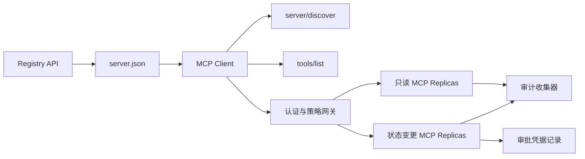

# 综合实战项目 13:带 Registry and Governance's Statsless MCP Server

> Üretim seviyesindeki MCP, basit bir sunucu süreci değildir. Bu, tüm bir anlaşma zinciri: yayımlanabilir veri; gerçek zamanlı hizmet bulunması; durumsuz talepler; zarf; kimlik tanımı ve yetki; ayrıntılı ölçüm stratejisi kararları; denetim sertifikaları ve dağıtım sertifikaları.

**Type:** Capstone
**Languages:** Python 与 TypeScript 参考模型；支持任何生产级编程语言
**Prerequisites:** Phase 11, Phase 13, Phase 14, Phase 17 与 Phase 18
**必修 MCP 进阶课：** [Lesson 28: Tool Contracts](../../../13-tools-and-protocols/28-mcp-tool-contracts-and-content/docs/en.md)- Evet .[Lesson 29: 可靠性与流控](../../../13-tools-and-protocols/29-mcp-reliability-cancellation-and-flow-control/docs/en.md)- Evet .[Lesson 30: Registry 供应链](../../../13-tools-and-protocols/30-mcp-registry-supply-chain-and-drift/docs/en.md), 及 [Lesson 31: 一致性工程](../../../13-tools-and-protocols/31-mcp-conformance-versioning-and-operations/docs/en.md)
**目标协议规范：**MCP `2026-07-28`
**Time:** ~25 小时

## Öğrenme hedefi

- 实现合规的无状态 MCP 请求与结果 封筒──
- Registry 静态元数据 ile çalışma zamanındaki gerçek zamanlı anlaşma arasında ciddi bir ayrım bulunmaktadır.
- Kesinlik düzenlemesi ve kaydetme algılama araçları bulma sistemi oluşturmak.
- Her bir araç için 调用强制执行签发者 (Yedici) 收藏者 (Kitap) 作用域 (Közellik) 及审批策略 (Dikamet) 及审批策略)
- 部署无 Session 亲和性绑定的流向 HTTP 集群──
- İnternet hattında, yetkililik, strateji, kayıt ve denetim sınırlarında tam bir inşaat kanıtı sunmak.

## MCP ön ön ön ön ü ü ü ü ü ü ü ü ü ü ü ü ü ü ü ü ü ü ü ü ü ü ü ü ü ü ü ü ü ü ü ü ü ü ü ü ü ü ü ü ü ü ü ü ü ü ü ü ü ü ü ü ü ü ü ü ü ü ü ü ü ü ü ü ü ü ü ü ü ü ü ü ü ü ü ü ü ü ü ü ü ü ü ü ü ü ü ü ü ü ü ü ü ü ü ü ü ü ü ü ü ü ü ü ü ü ü ü ü ü ü ü ü ü ü ü ü ü ü ü ü ü ü ü ü ü ü ü ü ü ü ü ü ü ü ü ü ü ü ü ü ü ü ü ü ü ü ü ü ü ü ü ü ü ü ü ü ü ü ü ü ü ü ü ü ü ü ü ü ü ü ü ü ü ü ü ü ü ü ü ü ü ü ü ü ü ü ü ü ü ü ü ü ü ü ü ü ü ü ü ü ü ü ü ü ü ü ü ü ü ü ü ü ü ü ü ü ü ü ü ü ü ü ü ü ü ü ü ü ü ü ü ü ü ü ü ü ü ü ü ü ü ü ü ü ü ü ü ü ü ü ü ü ü ü ü ü ü ü ü ü ü ü ü ü ü ü ü ü ü ü ü ü ü ü ü ü ü ü ü ü ü ü ü ü ü ü ü ü ü ü ü ü ü ü ü ü ü ü ü ü ü ü ü ü ü ü ü ü ü ü ü ü ü ü ü ü ü ü ü ü ü ü ü ü ü ü ü ü ü ü ü ü ü ü ü ü ü ü ü ü ü ü ü ü ü ü ü ü ü ü ü ü ü ü ü ü ü ü ü ü ü ü ü ü ü ü ü ü ü ü ü ü ü ü ü ü ü ü ü ü ü ü ü ü ü ü ü ü ü ü ü ü ü ü ü ü ü ü ü ü ü ü ü ü ü ü ü ü ü ü ü ü ü ü ü ü ü ü ü ü ü ü ü ü ü ü ü ü ü ü ü ü ü ü ü ü ü ü ü ü ü ü ü ü ü ü ü ü ü ü ü ü ü ü ü ü ü ü ü ü ü ü ü ü ü ü ü ü ü ü ü ü ü ü ü ü ü ü ü ü ü ü ü ü ü ü ü ü ü ü ü ü ü ü ü ü ü ü ü ü ü ü ü

Bu projeyi üretim için hazır hale getirmeden önce, 13 aşama ilişkili dört aşama aşamaları tamamlanmalıdır:

1. [Lesson 28](../../../13-tools-and-protocols/28-mcp-tool-contracts-and-content/docs/en.md): defines this Server  must expose of Tool、Schema、 structured content、分页、 autofill、 route及 error分类契约──
2. [Lesson 29](../../../13-tools-and-protocols/29-mcp-reliability-cancellation-and-flow-control/docs/en.md)Bu nedenle, bu durumun bir diğer yönü de, bir diğer yönü de, bir diğer yönü de, bir diğer yönü de olabilir.
3. [Lesson 30](../../../13-tools-and-protocols/30-mcp-registry-supply-chain-and-drift/docs/en.md): definizione nomenclature attribution 、 origine 、 、 、 、 、 、 、 、 、 、 、 、 、 、 、 、 、 、 、 、 、 、 、 、 、 、 、 、 、 、 、 、 、 、 、 、 、 、 、 、 、 、 、 、 、 、 、 、 、 、 、 、 、 、 、 、 、 、 、 、 、 、 、 、 、 、 、 、 、 、 、 、 、 、 、 、 、 、 、 、 、 、 、 、 、 、 、 、 、 、 、 、 、 、 、 、 、 、 、 、 、 、 、 、 、 、 、 、 、 、 、 、 、 、 、 、 、 、 、 、 、 、 、 、 、 、 、 、 、 、 、 、 、 、 、 、 、 、 、 、 、 、 、 、 、 、 、 、 、 、 、 、 、 、 、 、 、 、 、 、 、 、 、 、 、 、 、 、 、 、 、 、 、 、 、 、 、 、 、 、 、 、 、 、 、 、 、 、 、 、 、 、 、 、 、 、 、 、 、 、 、 、 、 、 、 、 、 、 、 、 、 、 、 、   、 、    、 、     、                                                   
4. [Lesson 31](../../../13-tools-and-protocols/31-mcp-conformance-versioning-and-operations/docs/en.md)Altın standartları tanımlamak ve geri dönüşüm kayıtları kullanımı durumları, sıkı versiyon zamanları, SDK  davranış farklılıkları, temsilci ağ sertifikaları, hassas veri açıktırma, sağlık giriş ve yayın engellemeleri.

Bu proje, bu üretim sınıfı unsurlarını sıkı bir şekilde birleştirmekle sorumludur ve tek bir basit çalıştırma yoluyla bir SDK testi ile yapılması mümkün değildir.

## 问题背景

企业内部平台需要一套只读数据工具和少量具有状态变更能力的写操作工具――开发者必须能够发现该服务器、了解如何连接、检查其实时运行能力,并且只能调用其被明确授权访问的操作――

Gerçek zorluk bir Python işlevi yazmak değil, aşağıdaki altı gerçek kaynağın yükseklik birliği içinde kalmasını sağlamak:

1. `server.json`声明 Server 在何处安装或通过什么网络端点访问;
2. `server/discover` mevcut işleyişin gerçek zamanlı süreçlerini destekleme yeteneğini açıkladı;
3. Her talep, kabul edilen protokol versiyonunu ve Müşteri'nin yetenek açıklamasını açıkça belirtir.
4. 授权系统 will调用方与法定发发发商、资源指示器(Ressource Indicator) ve Kapsam 绑定;
5. 策略引擎 bağımsız karar vermesi için belirli işlem ve giriş parametrelerinin yürütülmeye hazır olup olmadığı;
6. 审计日志 审计日志 审计日志 审计日志 审计日志 审计日志 审计日志 审计日志 审计日志 审计日志 审计日志 审计日志 审计日志 审计日志 审计日志 审计日志 审计日志 审计日志 审计日志 审计日志 审计日志 审计日志 审计日志 审计日志 审计日志 审计日志 审计日志 审计日志 审计日志 审计日志 审计日志 审计日志 审计日志 审计日志 审计日志 审计日志 审计日志 审计日志 审计日志 审计日志 审计日志 审计日志 审计日志 审计日志 审计日志 审计日记 审计日记 审计日记 审计日记 审计日记 审计日记 审计日记 审计日

 herhangi bir bağlantı hareket ederken, platformda bağlantı bozuklukları gösterilmesine neden olabilir. Server  hata yolu ile uyumsuz bir müşteri  diğer kaynaklar için gönderilen Token'leri yanlış kullanılabilir veya onaylanmamış durumlarda yüksek riskli zararlı işlemler gerçekleştirilmelidir.

## 两层发现机制 (İki keşif katmanı)

Registry 静态索引与实时的 MCP Server  tamamen farklı boyutlu bir soruya cevap veriyor:

| 发现层次 | 交互契约 | 回答的核心问题 |
|---|---|---|
| 发布层 (Publication) | `server.json` 与 Registry API | 该 Server 是什么？其代码包或远程网络端点在哪里？如何进行配置？ |
| 运行时 (Runtime) | `server/discover` | 该运行进程当前实际支持哪些协议版本、能力特性、扩展及 Server 身份？ |

官方 Registry 采用带版本控制的 `server.json`Şema。 bir uzaklık条目 Açıklayabilirsiniz Akışlanabilir HTTP 地址:

```json
{
  "$schema": "https://static.modelcontextprotocol.io/schemas/2025-12-11/server.schema.json",
  "name": "com.example/internal-readonly",
  "title": "Internal Read-Only Tools",
  "description": "Read-only incident and data lookup tools.",
  "version": "1.0.0",
  "remotes": [
    {
      "type": "streamable-http",
      "url": "https://mcp.internal.example.com/readonly"
    }
  ]
}
```

Registry Schema 版本与 MCP 协议版本完全独立,不要混为一谈―― her dosya kendi anlaşmasına göre ciddi bir deneme yapmalıdır.

具備合规 Schema 不代表拥有命名空间所有权──对 `example.com`完成验证的发布者使用反向 DNS 命名空间 `com.example/*`Ya da bir isim.

Sunucu  gerçekleştirilmelidir `server/discover`Müşteri, işletme yöntemini başlatmadan önce kullanmaya başlayabilir:

```json
{
  "resultType": "complete",
  "supportedVersions": ["2026-07-28"],
  "capabilities": {
    "tools": {
      "listChanged": false
    }
  },
  "_meta": {
    "io.modelcontextprotocol/serverInfo": {
      "name": "com.example/internal-readonly",
      "version": "1.0.0"
    }
  },
  "ttlMs": 3600000,
  "cacheScope": "public"
}
```

## 无状态 MCP 核心(Stateless MCP Core)

MCP `2026-07-28`Anlaşmayı tamamen kaldırdım.`initialize`El ele`Mcp-Session-Id`                                                                                                                                                                                                                                                              `params._meta`İçinde:

```json
{
  "io.modelcontextprotocol/protocolVersion": "2026-07-28",
  "io.modelcontextprotocol/clientCapabilities": {},
  "io.modelcontextprotocol/clientInfo": {
    "name": "internal-platform-client",
    "version": "1.0.0"
  }
}
```

负载均衡器 负载均衡器 负载均衡器 负载均衡器 负载均衡器 负载均衡器 负载均衡器 负载均衡器 负载均衡器 负载均衡器 负载均衡器 负载均衡器 负载均衡器 负载均衡器 负载均衡器 负载均衡器 负载均衡器 负载均衡器 负载均衡器 负载均衡器 负载均衡器 负载均衡器 负载均衡器 负载均衡器 负载均衡器 负载均衡器 负载均衡器 负载均衡器 负载均衡器 负载均衡器 负载均衡器 负载均衡器 负载均衡器 负载均衡器 负载均衡器 负载均衡器 负载均衡器 负载均衡器 负载均衡器 负载均衡器 负载均衡器 负载均衡器 负载均衡器 负载均衡器 负负载均衡器 负载均衡器 负载均衡器 负载负载负载负载负载负载负载负载负载负载负载负载负载负载负载负载负载负载负载负载负载负载负载负载负载负载负载负载负载负载负载负载负载负载负载负载负载负载负载负载负载负载负载负载负载负载负载负荷 负载负载负载负载负载负负负负负负负负负负负负负负负负负负负负负负负负负负负负负负负负负负负负负负负负负负负负负负负负负负负负负负负负负负负负负负负负负负负负负负负负负负负负负负负负负负负负负负负负负负负负负负负负负负负负负负负负负负负负负负负负负负负负负负负负负负负负负负负负负负负负负负负负负负负负负负负负负负负负负负负负负负负负负负负负负负负负负负

常规成功结果返回 `resultType: "complete"`, ve Server 应在 `_meta.io.modelcontextprotocol/serverInfo`中标明身份──协议版本非法返回 Geçersiz Params 错误码 `-32602`; için yasal ama desteklenmeyen versiyon, geri gönder `-32022`Veriler arasında doğru bir şekilde belirtildi .`supported`ile`requested`- Evet.

### Çekilme hizmetleri

`tools/list`必須保证确定性排序, sonuçları şunları içerir:

- `ttlMs`:Faç towards Client's freshness缓存提示;
- `cacheScope`- ...`public`(Public共享) veya `private`(上下文私有);
-  Strengly stable tool sequencing, aynı listenin modelin sonunun en büyük tekrar kullanımı için Quick Cache'ni sağlayan;
- `resultType: "complete"`Server Bilgisi ile...

 belirli kullanıcıların haklarını kontrol etmek için, genellikle dışarı çıkmak `cacheScope: "private"`, kullanıcı özel araçların görünürlüğünü kamu paylaşılan depolarda bulunamayacaktır.

## Akışlanabilir HTTP 传输

面向网络的服务器 暴露单一的 POST 端点──每个 JSON-RPC 请求或通知均为独立的 POST──

                                                                                                                                                                                                                                                                                                                                                                                                                                                                                                                             `subscriptions/listen`建立长连接流──

Lütfen görüntüleri belirleyin HTTP Lütfen başlık:

- `MCP-Protocol-Version`: talep edilen veri ile uyumlu;
- `Mcp-Method`: JSON-RPC 方法名一致;
- `Mcp-Name`: 调用 `tools/call`Ürün adı;
- `Accept: application/json, text/event-stream`- Evet.

Başlık ve istek uyumsuz olduğunda hemen geri dön .`-32020`错误码――校验 `Origin`防防DNS重绑定,并将请求作用域 SSE 流的被动断开视为请求取消──



```figure
cf-mcp-gate
```

## 认证与策略决策

传输层元数据绝对不等于权限凭证.

1. 动态发现受保护资源元数据;
2. Kaynak seçimi ve yetkili sunucu;
3. 优先使用 客户ID Metadata Dokümanları (CIMD) 注册 客户端;
4. On empowerment flow中发送 Kaynak göstergesi;
5. 验证返回的                                                                                                                                                                                                                                                                                                                                                                                                                                                                                                                        `iss`Kayıtların yetkili sunucu birliği;
6. 按 隔离存储 凭据 客户,绝不跨 复用 发行人 发行人 隔离存储 凭据 ,绝不跨 发行人 复用;
7. MCP Server 侧验证 Token'ın发发发商、受众、过期时间与 Scope;
8. Özel araçların isimlerini ve gerçek parametrelerini uygulamak için ikinci strateji kararları alınmaktadır.

### İnsanlık onayı, sihirli bir kapsam değil, kanıt kayıtlarıdır.

状态变更调调用需要一个结构化的人工审批凭证 (BİR) ),与操作者、工具名、规范化参数哈希值 (Hazı) 、目标环境、过期时间及单次/多次使用策略深度绑定──单独一条聊天消息绝不能充当审批凭证──

Python'un modelinde sıralama anahtarının düzenlenmesi JSON 計算哈希,并将该 Digest与 Token Subject、工具名、服务器 URL 和过期时间签名绑定──改哪怕一个参数段,该审批记录均不能重放──审批记录是独立证证证,而不是直接进入Token 里乱塞的 Scope──

## 动手构建步骤

1. **建模发布元数据**:编写并验证 `server.json`, emin olmak için isim alanı DNS 规范的反向符合.
2. **实现实时服务发现**: İşlemlerin herhangi bir işleme önceliği`server/discover`- Evet.
3. **实现无状态 Envelope**: Her istek için versiyon ve kapasiteli veriler, tüm alt katmanları kaldırma Sessiyon  durumu。
4. **构建工具集**: sadece okuma ve durum değişim araçları, kapalı JSON Şema ve doğru ipuçları hazırlamak
5. **支持缓存感知的工具列表**:输出确定性排序的工具列表,并配置 `ttlMs`ile`cacheScope`- Evet.
6. **接入认证与策略网关**: Okul sınavı Token, ve yüksek risk araçları调用前强校验防重放的审批凭证。
7. **分离静态 Registry 与运行时校验**: karşı karşı`server.json`Gerçek zamanla.`server/discover`,及时上报漂移──
8. **接入脱敏审计日志**: complete record on downline,并对敏感参数执行哈希或脱敏落盘──
9. **验证水平扩展**Bu durumda, iki durumsuz replik yüklenmiş ve yüklemeden sonra yüklenmiş.
10. **真实网络验证**Gerçek ağ tarafından JSON vücutları ile doğru ve ters yönlü farklı kullanım örneklerini test etmek için:

## İhtiyacım var.

Gönderilen kod aşağıdaki beş sınıfın iş kanıtı ile birlikte olmalıdır:

| 证据类别 | 最低验证标准 | 来源课程 |
|---|---|---|
| 网络线路 (Wire) | 正反向用例中脱敏的原始 HTTP 头与 JSON-RPC 体，覆盖类型错误、头不匹配、不支持版本等 | [Lesson 31](../../../13-tools-and-protocols/31-mcp-conformance-versioning-and-operations/docs/en.md) |
| 代理网络 (Proxy) | 直连与经过代理转发的报文对比，证明协议错误未被粗暴折叠为 500 且流式传输未被缓冲 | [Lessons 29](../../../13-tools-and-protocols/29-mcp-reliability-cancellation-and-flow-control/docs/en.md) 与 [31](../../../13-tools-and-protocols/31-mcp-conformance-versioning-and-operations/docs/en.md) |
| 准入管理 (Admission) | 已验证的发布者命名空间、不可变 Registry 记录哈希、实时 `server/discover` 观察凭证与准入账本事件 | [Lesson 30](../../../13-tools-and-protocols/30-mcp-registry-supply-chain-and-drift/docs/en.md) |
| 重试与取消 (Retry) | 取消与完成的竞态测试、显式超时、安全只读重试、写操作幂等键、重连刷新机制 | [Lesson 29](../../../13-tools-and-protocols/29-mcp-reliability-cancellation-and-flow-control/docs/en.md) |
| 发布回滚 (Rollback) | 明确的先前版本哈希、描述符锁定、健康检查窗口、路由平滑切换结果与决策证据 | [Lessons 30](../../../13-tools-and-protocols/30-mcp-registry-supply-chain-and-drift/docs/en.md) 与 [31](../../../13-tools-and-protocols/31-mcp-conformance-versioning-and-operations/docs/en.md) |

## 本地参考模型运行

Python modeli, dış ağ paketini açılmadan, isimlendirme alanı denemesi, gerçek zamanlı bulma, kesinlik listesi, talep edilen veri denemesi, token tanımlama hakkı, hash'e dayalı onay belgesi ve denetim sürecini tamamladı:

```bash
cd phases/19-capstone-projects/13-mcp-server-with-registry
python3 code/main.py
python3 -m unittest discover -s code/tests -v
```

TypeScript  proje, dış MCP SDK'nin kullanımı olmadan, orijinal stdio  açığa çıkma durumu JSON-RPC  bağlantısı ve yasadışı parametrelere geri dönüş yoluyla gösterildi`isError: true`- ...

```bash
cd phases/19-capstone-projects/13-mcp-server-with-registry/code/ts
npm install
npm run typecheck
npm test
npm run demo
```

## 线路协议报文范例

```http
POST /mcp HTTP/1.1
Host: mcp.internal.example.com
Content-Type: application/json
Accept: application/json, text/event-stream
MCP-Protocol-Version: 2026-07-28
Mcp-Method: tools/call
Mcp-Name: postgres.readonly
Authorization: Bearer REDACTED

{
  "jsonrpc": "2.0",
  "id": 42,
  "method": "tools/call",
  "params": {
    "name": "postgres.readonly",
    "arguments": {"sql": "SELECT 1"},
    "_meta": {
      "io.modelcontextprotocol/protocolVersion": "2026-07-28",
      "io.modelcontextprotocol/clientCapabilities": {},
      "io.modelcontextprotocol/clientInfo": {
        "name": "internal-platform-client",
        "version": "1.0.0"
      }
    }
  }
}
```

## 核心专业术语

| 术语 | 行业俗称 | 规范真实定义 |
|---|---|---|
| 无状态 MCP (Stateless MCP) | “到处都没有状态” | 协议层不存在 Session；跨调用状态属于显式传递且由业务服务端持久化管理 |
| `server.json` | “工具清单清单” | Registry 静态元数据，用于定义发布命名、代码打包、配置项与传输端点 |
| `server/discover` | “传统握手” | 强制实现的常规业务 RPC，用于获取实时支持的版本与能力，而非建立会话 |
| 缓存作用域 (Cache scope) | “能不能缓存？” | 标识可缓存结果是否可以被跨上下文公共复用（`public`）或仅限当前上下文（`private`） |
| 策略决策 (Policy decision) | “Token 允许就能调” | 针对调用者主体、工具、操作目标、参数载荷及外部上下文的细粒度二次判定 |
| 审批凭证 (Approval record) | “人工在群里点了同意” | 绑定至具体操作者、确切参数哈希与过期时间的强防篡改凭据证据 |
| 显式句柄 (Explicit handle) | “Session ID” | 业务层具名状态的普通应用标识符，绝非底层传输连接会话 |

## 延伸阅读

- [MCP 2026-07-28 核心变更](https://modelcontextprotocol.io/specification/2026-07-28/changelog)
- [Streamable HTTP 传输规范](https://modelcontextprotocol.io/specification/2026-07-28/basic/transports/streamable-http)
- [MCP 服务发现](https://modelcontextprotocol.io/specification/2026-07-28/server/discover)
- [MCP 鉴权与授权规范](https://modelcontextprotocol.io/specification/2026-07-28/basic/authorization)
- [官方 Registry server.json 要求](https://github.com/modelcontextprotocol/registry/blob/main/docs/reference/server-json/official-registry-requirements.md)
