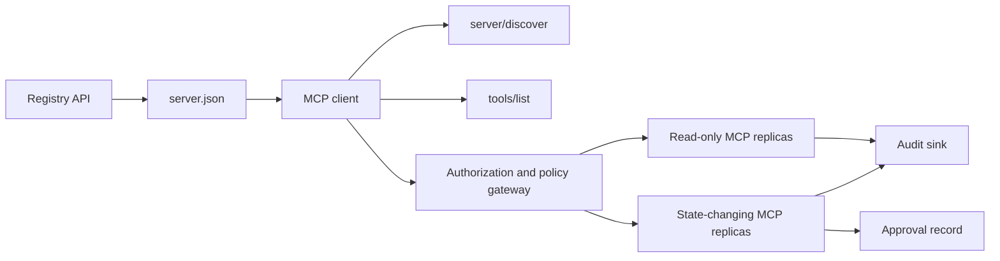

# 综合实战项目 13:带 Registry and Governance's Statsless MCP Server

> Üretim seviyesindeki MCP, basit bir sunucu süreci değildir. Bu, tüm bir anlaşma zinciri: yayımlanabilir veri; gerçek zamanlı hizmet bulunması; durumsuz talepler; zarf; kimlik tanımı ve yetki; ayrıntılı ölçüm stratejisi kararları; denetim sertifikaları ve dağıtım sertifikaları.

**Type:** Capstone
**Languages:** Python 与 TypeScript 参考模型；支持任何生产级编程语言
**Prerequisites:** Phase 11, Phase 13, Phase 14, Phase 17 与 Phase 18
**必修 MCP 进阶课：** [Lesson 28: Tool Contracts](../../../13-tools-and-protocols/28-mcp-tool-contracts-and-content/docs/en.md)- Evet .[Lesson 29: 可靠性与流控](../../../13-tools-and-protocols/29-mcp-reliability-cancellation-and-flow-control/docs/en.md)- Evet .[Lesson 30: Registry 供应链](../../../13-tools-and-protocols/30-mcp-registry-supply-chain-and-drift/docs/en.md), 及 [Lesson 31: 一致性工程](../../../13-tools-and-protocols/31-mcp-conformance-versioning-and-operations/docs/en.md)
**目标协议规范：**MCP `2026-07-28`
**Time:** ~25 小时

## Öğrenme hedefi

- 实现合规的无状态 MCP 请求与结果 封筒──
- Registry 静态元数据 ile çalışma zamanındaki gerçek zamanlı anlaşma arasında ciddi bir ayrım bulunmaktadır.
- Kesinlik düzenlemesi ve kaydetme algılama araçları bulma sistemi oluşturmak.
- Her bir araç için 调用强制执行签发者 (Yedici) 收藏者 (Kitap) 作用域 (Közellik) 及审批策略 (Dikamet) 及审批策略)
- 部署无 Session 亲和性绑定的流向 HTTP 集群──
- İnternet hattında, yetkililik, strateji, kayıt ve denetim sınırlarında tam bir inşaat kanıtı sunmak.

## MCP ön ön ön ön ü ü ü ü ü ü ü ü ü ü ü ü ü ü ü ü ü ü ü ü ü ü ü ü ü ü ü ü ü ü ü ü ü ü ü ü ü ü ü ü ü ü ü ü ü ü ü ü ü ü ü ü ü ü ü ü ü ü ü ü ü ü ü ü ü ü ü ü ü ü ü ü ü ü ü ü ü ü ü ü ü ü ü ü ü ü ü ü ü ü ü ü ü ü ü ü ü ü ü ü ü ü ü ü ü ü ü ü ü ü ü ü ü ü ü ü ü ü ü ü ü ü ü ü ü ü ü ü ü ü ü ü ü ü ü ü ü ü ü ü ü ü ü ü ü ü ü ü ü ü ü ü ü ü ü ü ü ü ü ü ü ü ü ü ü ü ü ü ü ü ü ü ü ü ü ü ü ü ü ü ü ü ü ü ü ü ü ü ü ü ü ü ü ü ü ü ü ü ü ü ü ü ü ü ü ü ü ü ü ü ü ü ü ü ü ü ü ü ü ü ü ü ü ü ü ü ü ü ü ü ü ü ü ü ü ü ü ü ü ü ü ü ü ü ü ü ü ü ü ü ü ü ü ü ü ü ü ü ü ü ü ü ü ü ü ü ü ü ü ü ü ü ü ü ü ü ü ü ü ü ü ü ü ü ü ü ü ü ü ü ü ü ü ü ü ü ü ü ü ü ü ü ü ü ü ü ü ü ü ü ü ü ü ü ü ü ü ü ü ü ü ü ü ü ü ü ü ü ü ü ü ü ü ü ü ü ü ü ü ü ü ü ü ü ü ü ü ü ü ü ü ü ü ü ü ü ü ü ü ü ü ü ü ü ü ü ü ü ü ü ü ü ü ü ü ü ü ü ü ü ü ü ü ü ü ü ü ü ü ü ü ü ü ü ü ü ü ü ü ü ü ü ü ü ü ü ü ü ü ü ü ü ü ü ü ü ü ü ü ü ü ü ü ü ü ü ü ü ü ü ü ü ü ü ü ü ü ü ü ü ü ü ü ü ü ü ü ü ü ü ü ü ü ü ü ü ü ü ü ü ü ü ü ü ü ü ü ü ü ü ü ü ü ü ü ü ü ü ü ü ü ü ü ü ü ü ü ü ü ü ü ü ü ü ü ü ü ü ü ü ü ü ü ü

Bu projeyi üretim için hazır hale getirmeden önce, 13 aşama ilişkili dört aşama aşamaları tamamlanmalıdır:

1. [Lesson 28](../../../13-tools-and-protocols/28-mcp-tool-contracts-and-content/docs/en.md): defines this Server  must expose of Tool、Schema、 structured content、分页、 autofill、 route及 error分类契约──
2. [Lesson 29](../../../13-tools-and-protocols/29-mcp-reliability-cancellation-and-flow-control/docs/en.md)Bu nedenle, bu durumun bir diğer yönü de, bir diğer yönü de, bir diğer yönü de, bir diğer yönü de olabilir.
3. [Lesson 30](../../../13-tools-and-protocols/30-mcp-registry-supply-chain-and-drift/docs/en.md): definizione nomenclature attribution 、 origine 、 、 、 、 、 、 、 、 、 、 、 、 、 、 、 、 、 、 、 、 、 、 、 、 、 、 、 、 、 、 、 、 、 、 、 、 、 、 、 、 、 、 、 、 、 、 、 、 、 、 、 、 、 、 、 、 、 、 、 、 、 、 、 、 、 、 、 、 、 、 、 、 、 、 、 、 、 、 、 、 、 、 、 、 、 、 、 、 、 、 、 、 、 、 、 、 、 、 、 、 、 、 、 、 、 、 、 、 、 、 、 、 、 、 、 、 、 、 、 、 、 、 、 、 、 、 、 、 、 、 、 、 、 、 、 、 、 、 、 、 、 、 、 、 、 、 、 、 、 、 、 、 、 、 、 、 、 、 、 、 、 、 、 、 、 、 、 、 、 、 、 、 、 、 、 、 、 、 、 、 、 、 、 、 、 、 、 、 、 、 、 、 、 、 、 、 、 、 、 、 、 、 、 、 、 、 、 、 、 、 、 、 、 、   、 、    、 、     、                                                   
4. [Lesson 31](../../../13-tools-and-protocols/31-mcp-conformance-versioning-and-operations/docs/en.md)Altın standartları tanımlamak ve geri dönüşüm kayıtları kullanımı durumları, sıkı versiyon zamanları, SDK  davranış farklılıkları, temsilci ağ sertifikaları, hassas veri açıktırma, sağlık giriş ve yayın engellemeleri.

Bu proje, bu üretim sınıfı unsurlarını sıkı bir şekilde birleştirmekle sorumludur ve tek bir basit çalıştırma yoluyla bir SDK testi ile yapılması mümkün değildir.

## 问题背景

企业内部平台需要一套只读数据工具和少量具有状态变更能力的写操作工具――开发者必须能够发现该服务器、了解如何连接、检查其实时运行能力,并且只能调用其被明确授权访问的操作――

Gerçek sıkıntı aslında bir işlevi kaydetmek değil, aşağıdaki altı gerçek kaynağın yükseklik birliği içinde kalmasını sağlamak için:

1. `server.json`声明 Server 在何处安装或通过什么网络端点访问;
2. `server/discover` mevcut işleyişin gerçek zamanlı süreçlerini destekleme yeteneğini açıkladı;
3. Her talep, kabul edilen protokol versiyonunu ve Müşteri'nin yetenek açıklamasını açıkça belirtir.
4. 授权系统 will调用方与法定发发发商、资源指示器(Ressource Indicator) ve Kapsam 绑定;
5. 策略引擎 bağımsız karar vermek için belirli bir işlemin gerçekleştirilmeye hazır olup olmadığı;
6. 审计日志 审计日志 审计日志 审计日志 审计日志 审计日志 审计日志 审计日志 审计日志 审计日志 审计日志 审计日志 审计日志 审计日志 审计日志 审计日志 审计日志 审计日志 审计日志 审计日志 审计日志 审计日志 审计日志 审计日志 审计日志 审计日志 审计日志 审计日志 审计日志 审计日志 审计日志 审计日志 审计日志 审计日志 审计日志 审计日志 审计日志 审计日志 审计日志 审计日志 审计日志 审计日志 审计日志 审计日志 审计日志 审计日记 审计日记 审计日记 审计日记 审计日记 审计日记 审计日记 审计日

 herhangi bir bağlantı kaydırılmasına neden olan bir platformda bağlantı bozuklukları, yanlış yollarla uyumsuzlukları, diğer kaynaklar için gönderilen Token'lerin yanlış kullanımı veya beklenmedik bir değerlendirme durumunda zararlı işlemlerin ortaya çıkması ortaya çıkabilir.

## 两层发现机制 (İki keşif katmanı)

Registry 静态索引与实时的 MCP Server  tamamen farklı boyutlu bir soruya cevap veriyor:

| 发现层次 | 交互契约 | 回答的核心问题 |
|---|---|---|
| 发布层 (Publication) | `server.json` 与 Registry API | 该 Server 是什么？其代码包或远程网络端点在哪里？如何进行配置？ |
| 运行时 (Runtime) | `server/discover` | 该运行进程当前实际支持哪些协议版本、能力特性、扩展及 Server 身份？ |

官方 Registry 采用带版本控制的 `server.json`Şema。 bir uzaklık条目 Açıklayabilirsiniz Akışlanabilir HTTP 地址:

```json
{
  "$schema": "https://static.modelcontextprotocol.io/schemas/2025-12-11/server.schema.json",
  "name": "com.example/internal-readonly",
  "title": "Internal Read-Only Tools",
  "description": "Read-only incident and data lookup tools.",
  "version": "1.0.0",
  "remotes": [
    {
      "type": "streamable-http",
      "url": "https://mcp.internal.example.com/readonly"
    }
  ]
}
```

Registry Schema  versiyon ile MCP 协议 versiyonu tamamen bağımsızdır, iki tarafı birleştirmek için bir gün yazılmasın.

具備合规 Schema 不代表拥有命名空间所有权──对 `example.com`完成验证的发布者使用反向 DNS 命名空间 `com.example/*`Ya da onun adı adı boşluğu. Bu mülkiyetin kanıtlanmasına Register'ın onay süreci sorumludur.

标准库模型中的 `validate_registry_document`函数刻意只是一个部分的远程配置校验器──它检查官方必填的 函数刻意只是一个部分的远程配置校验器──它检查官方必填的 函数刻意只是一个部分的远程配置校验器──它检查官方必填的 函数刻意只是一个部分的远程配置校验器的一个部分的远程配置校验器──它检查官方必填的 函数刻意只是一个部分的远程配置校验器的一个部分的远程配置校验器的一个部分.`name`- Evet.`description`ile`version`字段,可选的 `title`, yayınlanan isim ve uzunluk kısıtlamaları, belirli sürümlerin biçimi ve her birinin biçimi`streamable-http`Ya da`sse`远程端点的 HTTP(S) URL biçimi。Bu genel projenin gerçek zamanlı olarak uzaktan uç noktasına yapılan araştırmalar nedeniyle, ekstra gereksinim de var `remotes`列表非空──`validate_publisher_namespace`单独对照已验证的发行人域名检查名称, ve `validate_runtime_alignment`则将发布名称与版本同实时的 则将发布名称与版本同实时的 则将发布名称与版本同实时的 则将发布名称与版本同实时的 则将发布名称与版本同实时的 则将发布名称与版本同实时的 则将将发布名称与版本与版本同实时的 则将发布名称与版本与版本与实时的 则将将发布名称与版本与版本与实时的 则将将发布名称与版本与版本与版本与实时的 则将发布名称与版本与版本与版本与版本与实时的`serverInfo`比較──官方 Schema 官方 JSON Schema 官方 JSON Schema 官方 JSON Schema 官方 JSON Schema 官方 JSON 官方 JSON 官方 JSON 官方 JSON 官方 JSON 官方 JSON 官方 JSON 官方 JSON 官方 JSON 官方 JSON 官方 JSON 官方 JSON 官方 JSON 官方 JSON 官方 JSON 官方 JSON 官方 JSON 官方 JSON 官方 JSON 官方 JSON 官方 JSON 官方 JSON 官方 JSON 官方 JSON 官方 JSON 官方 JSON 官方 JSON 官方 JSON 官方 JSON 官方 JSON 官方 JSON 官方 JSON 官方 JSON 官方 JSON 官方 JSON 官方 JSON 官方 JSON 官方 JSON 官方 JSON 官方 JSON 官方 JSON 官方 JSON 官方 JSON 官方 JSON 官方 JSON 官方 JSON 官方 JSON 官方 官方 官方 官方 官方 官方 官方 官方 官方 官方 官方 官方 官方 官方 官方 官方 官方 官方 官方 官方 官方 官方 官方 官方 官方 官方 官方 官方 官方 官方 官方 官方 官方 官方 官方 官方 官方 官方 官方 官方 官方 官方 官方 官方 官方 官方 官方 官方 官方 官方 官方 官方 官方 官方 官方 官方 官方 官方 官方 官方 官方 官方 官方 官方 官方 官方 官方 官方 官方 官方 官方 官方 官方 官方 官方 官方 官方 官方 官方 官方 官方 官方 官方 官方 官方 官方 官方 官方 官方 官方 官方 官方 官方 官方 官方 官方 官方 官方 官方 官方 官方 官方 官方 官方 官方 官方 官方 官方 官方 官方 官方 官方 官方 官方 官方 官方 官方 官方 官方 官方 官方 官方 官方 官方 官方 官方 官方 官方 官方 官方 官方 官方 官方 官方 官方 官方 官方 官方 官方 官方 官方 官方 官方 官方 官方 官方`mcp-publisher`Tüm dosyaları inceleme; bu bağımlı olmayan alt bölümü tam bir Şema olarak görme.

Sunucu  gerçekleştirilmelidir `server/discover`Müşteri, bu kapsamlı projenin başlatılmasından önce aktif olarak kullanabilir. Müşteri, bu kapsamlı projenin çözülmesinden sonra bunu yapabilir ve mevcut protokolün değiştirilmiş sürümü ve gerçek zamanlı yetenek kümesini elde edebilir:

```json
{
  "resultType": "complete",
  "supportedVersions": ["2026-07-28"],
  "capabilities": {
    "tools": {
      "listChanged": false
    }
  },
  "_meta": {
    "io.modelcontextprotocol/serverInfo": {
      "name": "com.example/internal-readonly",
      "version": "1.0.0"
    }
  },
  "ttlMs": 3600000,
  "cacheScope": "public"
}
```

Özel kayıtlar ek mülkiyet, inceleme veya yaşam döngüsü verilerini indekse edebilir, ancak bu verileri asla MCP 线路字段 veya 线路字段 olarak oluşturamaz.`server.json`根字段──組織策略应与已發布记录并列存放──当确实需要公开的自定义元数据时,使用登录的 `_meta.io.modelcontextprotocol.registry/publisher-provided`扩展,并保持在其 4 KB 上限之内──

## 无状态 MCP 核心(Stateless MCP Core)

MCP `2026-07-28`Anlaşmayı tamamen kaldırdı.`initialize`- Ne ?`notifications/initialized`Elini tut, aynı zamanda hareket et.`Mcp-Session-Id`- Evet.

Her istek var.`params._meta`İçinde:

```json
{
  "io.modelcontextprotocol/protocolVersion": "2026-07-28",
  "io.modelcontextprotocol/clientCapabilities": {},
  "io.modelcontextprotocol/clientInfo": {
    "name": "internal-platform-client",
    "version": "1.0.0"
  }
}
```

Versiyon ve yetenek, bağlantı seviyesinin değil, talep seviyesinin gerçeklerilerdir.

常规成功结果返回 `resultType: "complete"`, ve Server                                                                                                                                                                                                                                                                                                                                                                                                                                                                                                                           `_meta.io.modelcontextprotocol/serverInfo`中标明身份──协议版本缺失或不是字符串时返回 Geçersiz Params 错误码 `-32602`- ...`-32022`Sadece şifre sağlanan ancak desteklenmeyen bir sürüm için kullanılır, verileri doğru olmalıdır.`{"supported": ["2026-07-28"], "requested": "..."}`- Evet.

### Çekilme hizmetleri

ııııııııııııııııııııııııııııııııııııııııııııııııııııııııııııııııııııııııııııııııııııııııııııııııııııııııııııııııııııııııııııııııııııııııııııııııııııııııııııııııııııııııııııııııııııııııııııııııııııııııııııııııııııııııııııııııııııııııııııııııııııııııııııııııııııııııııııııııııııııııııııııııııııııııııııııııııııııııııııııııııııııııııııııııııııııııııııııııııııııııııııııııııııııııııııııııııııııııııııııııııııııııııııııııııııııııııııııııııııııııııııııııııııııııııııııııııııııııııııııııııııııııııııııııııııııııııııı`tools/list`必須是確定性的──其結果包含:

- `ttlMs`:Faç towards Client's freshness缓存提示;
- `cacheScope`- ...`public`(Public共享) veya `private`(上下文私有);
-  Strengly stable tool sequencing, aynı listeyi modelin sonunda tekrar kullanılabilir hale getirir.
- `resultType: "complete"`Server Bilgisi ile...

 belirli kullanıcıların haklarını kontrol etmek için, genellikle dışarı çıkmak `cacheScope: "private"`, kullanıcı özel araçların görünürlüğünü kamu paylaşılan depolarda bulunamayacaktır.

## Akışlanabilir HTTP 传输

面向网络的服务器 暴露单一的 POST 端点──每个 JSON-RPC 请求或通知均为独立的 POST──

                                                                                                                                                                                                                                                                                                                                                                                                                                                                                                                             `subscriptions/listen`建立长连接流,承载选择订阅的变更通知──当前传输中不存在独立的 GET 流、Session DELETE、Session 请求头或 `Last-Event-ID`Çıkartmak.

Her talep içerir:

- `MCP-Protocol-Version`: talep edilen veri ile uyumlu;
- `Mcp-Method`: JSON-RPC 方法名一致;
- `Mcp-Name`: kullanılır`tools/call`- Evet.`resources/read`ile`prompts/get`- ...
- `Accept: application/json, text/event-stream`- Evet.

usage规定的 `-32020`错误拒绝不一致的镜像请求头──校验 `Origin`,will local develop Server  tied to return ring address,认证远程客户端,并将已关闭的请求作用域 SSE 响应视为取消──



```figure
cf-mcp-gate
```

## 认证与策略决策

传输层元数据绝对不等于权限凭证―― her konuşma için sıkı bir şekilde belirlenme hakkı gerekir――

对于远程 Server:

1. 动态发现受保护资源元数据;
2. Kaynak seçimi ve yetkili sunucu;
3. 优先使用 客户端ID Metadata Dokümanları (CIMD) 注册 客户端将动态 客户端注册 动态 客户端注册) 视为兼容性支持;
4. On empowerment flow中发送 Kaynak göstergesi;
5. 验证返回的                                                                                                                                                                                                                                                                                                                                                                                                                                                                                                                        `iss`Kayıtların yetkili sunucu birliği;
6. 按 隔离存储 凭据 客户,绝不跨 复用 发行人 发行人 隔离存储 凭据 ,绝不跨 发行人 复用;
7. MCP Server 侧验证 Token'ın发发发商、受众、过期时间与 Scope;
8. Özel araçların isimlerini ve gerçek parametrelerini uygulamak için ikinci strateji kararları alınmaktadır.

`readOnlyHint`ile`destructiveHint`Ürünlerin mevcut riskleri karşılamasına yardımcı olmak için kullanılan araçlar, güvenilir bir yetki ve kontrol aracı değildir.

### İnsanlık onayı, sihirli bir kapsam değil, kanıt kayıtlarıdır.

状态变更调调用需要一个结构化的人工审批凭证 (BİR) ),与操作者、工具名、规范化参数哈希值 (Hazı) 、目标环境、过期时间及单次/多次使用策略深度绑定──单独一条聊天消息绝不能充当审批凭证──

Python modeli sıralama anahtarının düzenlenmesine yönelik JSON 计算哈希,并将该 Digest与 Token Subject、工具名、服务器URL 和过期时间绑定──改哪怕一个参数段,该审批记录也将在处理器运行之前重放失败──审批记录是独立证证证证,而不是添加到Access Token 中的 Scope──

Bu, yüksek riskli araçları tek tek değerlendirilebilir bağımsız yüzeyde yerleştirmek için geçerlidir.

## 动手构建

### 1. 建模发布元数据

创建 `server.json`Ve tamamlanmış Şema 校验── 发行者已认证的命名空间内使用稳定的名称,并包含版本、描述、适用时的官方 `repository`Ya da`packages`KEYS, yalnızca açıklamaların çevre değişkenliği olarak girilen, asla yazı değerine giremez.

### 2. 实现实时服务发现

Herhangi bir iş RPC  önce gerçekleştirmek `server/discover`◊ Publication Supported Protocol Version、 क्षमता集、 Server Kişiliği ile Genişle,并添加一个使用 `-32022`Edited by:

### 3. 实现无状态信封 (Bükükleyici)

Her istek , müşterinin kapasitesine bağlı olarak bir protokol sürümünü taşımalıdır . Her sonuç geri gönderilmelidir .`resultType`Sessiyon tanımlayıcıları, bağlantı kapasitesi, sesyon tanımlayıcıları,

### 4. 构建工具表面

İki sadece okuyucu araç ve bir durum değişim aracı ile başlayın. Her bir araç için sınırlı JSON Şema, kesin bir açıklama, kesinlik sonuçları yapı ve gerçek bir açıklama sunulur.

### 5. 添加缓存感知的列表

Eğitim, geri dönüş araçları,并附 `ttlMs`ile`cacheScope`❖ ❖ ❖ ❖ ❖ ❖ ❖ ❖ ❖ ❖ ❖ ❖ ❖ ❖ ❖ ❖ ❖ ❖ ❖ ❖ ❖ ❖ ❖ ❖ ❖ ❖ ❖ ❖ ❖ ❖ ❖ ❖ ❖ ❖ ❖ ❖ ❖ ❖ ❖ ❖ ❖ ❖ ❖ ❖ ❖ ❖ ❖ ❖ ❖ ❖ ❖ ❖ ❖ ❖ ❖ ❖ ❖ ❖ ❖ ❖ ❖ ❖ ❖ ❖ ❖ ❖ ❖ ❖ ❖ ❖ ❖ ❖ ❖ ❖ ❖ ❖ ❖ ❖ ❖ ❖ ❖ ❖ ❖ ❖ ❖ ❖ ❖ ❖ ❖ ❖ ❖ ❖ ❖ ❖ ❖ ❖ ❖ ❖ ❖ ❖ ❖ ❖ ❖ ❖ ❖ ❖ ❖ ❖ ❖ ❖ ❖ ❖ ❖ ❖ ❖ ❖ ❖ ❖ ❖ ❖ ❖ ❖ ❖ ❖ ❖ ❖ ❖ ❖ ❖ ❖ ❖ ❖ ❖ ❖ ❖ ❖ ❖ ❖ ❖ ❖ ❖ ❖ ❖ ❖ ❖ ❖ ❖ ❖ ❖ ❖ ❖ ❖ ❖ ❖ ❖ ❖ ❖ ❖ ❖ ❖ ❖ ❖ ❖ ❖ ❖ ❖ ❖ ❖ ❖ ❖ ❖ ❖ ❖ ❖ ❖ ❖ ❖ ❖ ❖ ❖ ❖ ❖ ❖ ❖ ❖ ❖ ❖ ❖ ❖ ❖ ❖ ❖ ❖ ❖ ❖ ❖ ❖  ❖ ❖ ❖   ❖ ❖    ❖ ❖                                                                                                

### 6. 添加认证与策略

校验发发发商、受众、过期时间与范围── her bir araç için uygulama stratejisi kararlarını kullanır, ve onayı kesin yüksek riskli işlemlere bağlar.

### 7. Kayıt ve çalışma zamanından ayrılmış

Önceki dersler`server.json`Kayıt, tekrar kullan `server/discover`探测远程端点──当已发布的远程端点、身份、版本或必需能力与实时进程不一致时,上报漂移──

### 8. 添加审计证据

记录操作者、发发发商、资源、工具、策略决策、请求标识符、追踪上下文、延迟与结果──持久化前对敏感参数与结果进行脱敏或计算摘要──审计接收端必须位于模型可见上下文之外──

### 9. 验证水平扩展

yüklemeden sonra iki durumsuz kopyasını yerleştirerek, en az 100 并发请求 gönderin, doğruluğun亲和性'ye bağlı olmadığını kanıtlayın. Eğer bir araç durumdan geçiş yapması gerekiyorsa, açıkça şeffaf olmayan bir cümle oluşturur ve paylaşımlı kalıcılık sisteminde depona edilir.

### 10. 跨越真实线路

针对真实服务器 二进制运行一致性检查――捕获请求头与JSON请求体,不仅仅是SDK对象――覆盖错误版本、请求头不匹配、缺少 Scope、受众错误、参数形、Handler 失败、取消与缓存过期等用例──

## İhtiyacım var.

Gönderilenler aşağıdaki beş tür delil içermelidir, yoksa tamamlanmamıştır:

| 证据类别 | 最低验证标准 | 来源课程 |
|---|---|---|
| 网络线路 (Wire) | 正向与反向用例的脱敏原始请求头与 JSON-RPC 请求体，覆盖元数据类型错误、请求头不匹配、不受支持的版本、缺失或未知的 `resultType`、通知无响应以及响应 ID 匹配 | [Lesson 31](../../../13-tools-and-protocols/31-mcp-conformance-versioning-and-operations/docs/en.md) |
| 代理网络 (Proxy) | 同一稳定用例分别直连与经过已部署的中间层运行，记录入口、源站与出口的状态码及响应体摘要；证明协议错误未被折叠为通用 500 响应，且流式传输未被缓冲 | [Lessons 29](../../../13-tools-and-protocols/29-mcp-reliability-cancellation-and-flow-control/docs/en.md) 与 [31](../../../13-tools-and-protocols/31-mcp-conformance-versioning-and-operations/docs/en.md) |
| 准入管理 (Admission) | 已验证的发布者命名空间、不可变的 Registry 记录摘要、产物或远程端点来源证明、实时 `server/discover` 身份与能力观测、描述符锁定、当前 Registry 状态以及准入账本事件 | [Lesson 30](../../../13-tools-and-protocols/30-mcp-registry-supply-chain-and-drift/docs/en.md) |
| 重试与取消 (Retry) | 取消与完成的竞态、显式超时、安全的只读重试、写操作幂等键、重连后重新拉取，以及证明请求取消不会悄然变成持久任务取消 | [Lesson 29](../../../13-tools-and-protocols/29-mcp-reliability-cancellation-and-flow-control/docs/en.md) |
| 发布回滚 (Rollback) | 确切的先前版本、准入与产物摘要、描述符锁定、当前生效的 Registry 状态、当前健康窗口、路由恢复结果以及脱敏的决策证据 | [Lessons 30](../../../13-tools-and-protocols/30-mcp-registry-supply-chain-and-drift/docs/en.md) 与 [31](../../../13-tools-and-protocols/31-mcp-conformance-versioning-and-operations/docs/en.md) |

随版一并保存脱敏证据包的摘要──只要缺少任意一类,就暂缓发布──不要从进程内分发器推断代理行为,不要从注册表中存在该条目推断准入,不要从新的 JSON-RPC ID 推断重试安全,也不要从上一次部署推断回滚就绪──

## 本地参考模型运行

Python modeli herhangi bir ağ kitlesini açılmadığı durumlarda, Registry 元データ、反向 DNS 發布者命名空间校验、发布与运行时身份核查、实时发现、确定性工具列表、逐请求元数据、可信签发者/受众/过期时间/Scope 检查、绑定操作的审批、一个有档说明的部分 Registry 校验器、策略以及审计:

```bash
cd phases/19-capstone-projects/13-mcp-server-with-registry
python3 code/main.py
python3 -m unittest discover -s code/tests -v
```

TypeScript 项目在不借助 MCP SDK durumunda, stdio 暴露无状态 JSON-RPC 结构──其`tools/call`路径执行与 `tools/list`Bilinen araçların yasadışı parametre ile aktarıldığı zaman, geri gönderilmelidir.`isError: true`Bu, bir uygulama için kullanılır.

```bash
cd phases/19-capstone-projects/13-mcp-server-with-registry/code/ts
npm install
npm run typecheck
npm test
npm run demo
```

Bu modeller, HTTP istek başlığı, OAuth 交换、Registry 发布、OPA 集成、 load balance or采集端接收──'ı kanıtlayamıyor.

## 线路协议报文范例

```http
POST /mcp HTTP/1.1
Host: mcp.internal.example.com
Content-Type: application/json
Accept: application/json, text/event-stream
MCP-Protocol-Version: 2026-07-28
Mcp-Method: tools/call
Mcp-Name: postgres.readonly
Authorization: Bearer REDACTED

{
  "jsonrpc": "2.0",
  "id": 42,
  "method": "tools/call",
  "params": {
    "name": "postgres.readonly",
    "arguments": {"sql": "SELECT 1"},
    "_meta": {
      "io.modelcontextprotocol/protocolVersion": "2026-07-28",
      "io.modelcontextprotocol/clientCapabilities": {},
      "io.modelcontextprotocol/clientInfo": {
        "name": "internal-platform-client",
        "version": "1.0.0"
      }
    }
  }
}
```

## 交付物

交付一个包含以下内容的代码仓库:

- 通过 Schema 校验的 `server.json`- ...
- Sadece oku ve durum değişimleri iki sınıf Server  yüzeyi;
- `server/discover`Kesinlikle.`tools/list`, ve stratejileri kontrol altına almak.`tools/call`- ...
- 带有两个可互换副本的流向 HTTP 部署;
- 认证与审批集成;
- Kayıt  yayıncı veya özel Kayıt API  adaptasyoncu;
- Strategy definition and binding operation'ın onay kaydı;
- 脱敏的审计输出与追踪传播;
- 线路与代理故障证;
- 准入、重试、健康与回滚证, ayrıca duyarlılıktan kurtuluş testi paketinin özetleri

| 权重 | 评分标准 | 证据 |
|---:|---|---|
| 25 | 协议正确性 | 无状态请求元数据、服务发现、结果、请求头与反向用例 |
| 20 | 授权 | 签发者、受众、过期时间、Scope 与绑定操作的审批用例 |
| 15 | Registry 完整性 | 合法的 `server.json`、发布记录、实时发现探测与漂移报告 |
| 15 | 策略与安全 | 允许、拒绝、畸形、过期审批与敏感数据用例 |
| 15 | 扩展性与可靠性 | 两个副本、无亲和性依赖、取消、超时与恢复 |
| 10 | 可审计性 | 接收端脱敏审计与追踪证据 |

## 练习与思考

1. Düzgün sürede sunucu değişmezken, yayınlanan uzaklık URL'lerini değiştirin, kayıt kayıt raporunun doğru hareket etmesini sağlayın.
2. İki kez aynı giriş gönderme.`tools/list`, kanıtlama araçları sırası 字节级稳定;`ttlMs`过期并刷新──
3. 发送一个合法请求体,但 `MCP-Protocol-Version`Lütfen başı başı başı başı başı başı başı başı başı başı başı başı başı başı başı başı başı başı başı başı başı başı başı başı başı başı başı başı başı başı başı başı başı başı başı başı başı başı başı başı başı başı başı başı başı başı başı başı başı başı başı başı başı başı başı başı başı başı başı başı başı başı başı başı başı başı başı başı başı başı başı başı başı başı başı başı başı başı başı başı başı başı başı başı başı başı başı başı başı başı başı başı başı başı başı başı başı başı başı başı başı başı başı başı başı başı başı başı başı başı başı başı başı başı başı başı başı başı başı başı başı başı başı başı başı başı başı başı başı başı başı başı başı başı başı başı başı başı başı başı başı başı başı başı başı başı başı başı başı başı başı başı başı başı başı başı başı başı başı başı başı başı başı başı başı başı başı başı başı başı başı başı başı başı başı başı başı başı başı başı başı başı başı başı başı başı başı başı başı başı başı başı başı başı başı başı başı başı başı başı başı başı başı başı başı başı başı başı başı başı başı başı başı başı başı başı başı başı başı başı başı başı başı başı başı başı başı başı başı başı başı başı başı başı başı başı başı başı başı başı başı başı başı başı başı başı başı başı başı başı başı başı başı başı baş`-32020`, ve strateji veya araç kullanmıyor.
4. Sadece okuyucu sunucu bir token gönderir ve durumu değiştiren sunucuya gösterir.
5. Bir onayın bir kurallaştırma parametresi özetine bağlanmasını, bir bölümünü değiştirmesini, onayın yeniden yüklenemeyeceğini kanıtlamasını sağlar.
6. İş akışı sürekli olarak devam etmesi gereken yerlerde, gizli süreçlerin kaydı ile değiştirilen açık ortaklık sözcükleri ile değişim yollarını farklı kopyalar arasında değiştirmek gerekir.
7. Bir istek etki alanını kesin SSE  bağlantı, yeni JSON-RPC istek kimliği kullanmak 重试,验证没有任何使用 `Last-Event-ID`恢复路径──

## 核心专业术语

| 术语 | 行业俗称 | 规范真实定义 |
|---|---|---|
| 无状态 MCP (Stateless MCP) | “到处都没有状态” | 协议层不存在 Session；跨调用状态是显式的，并由 Server 管理 |
| `server.json` | “工具清单” | Registry 静态元数据，用于定义发布命名、代码打包、配置项与传输端点 |
| `server/discover` | “传统握手” | 强制实现的常规 RPC，用于获取实时版本与能力，而非 Session 初始化器 |
| 缓存作用域 (Cache scope) | “能不能缓存？” | 标识可缓存结果是否可以被跨上下文公共复用（`public`）或仅限当前上下文（`private`） |
| 策略决策 (Policy decision) | “Token 允许就能调” | 针对调用者主体、工具、操作目标、参数载荷及外部上下文的细粒度二次判定 |
| 审批凭证 (Approval record) | “有人点了同意” | 在过期策略下绑定到一个操作者与一项重大操作的证据 |
| 显式句柄 (Explicit handle) | “Session ID” | 用于命名由 Server 管理之状态的普通应用数据，而非协议连接状态 |

## 延伸阅读

- [MCP 2026-07-28 核心变更](https://modelcontextprotocol.io/specification/2026-07-28/changelog)
- [Streamable HTTP 传输规范](https://modelcontextprotocol.io/specification/2026-07-28/basic/transports/streamable-http)
- [MCP 服务发现](https://modelcontextprotocol.io/specification/2026-07-28/server/discover)
- [MCP 鉴权与授权规范](https://modelcontextprotocol.io/specification/2026-07-28/basic/authorization)
- [官方 Registry server.json 要求](https://github.com/modelcontextprotocol/registry/blob/main/docs/reference/server-json/official-registry-requirements.md)
- [官方 Registry OpenAPI 契约](https://registry.modelcontextprotocol.io/openapi.yaml)
