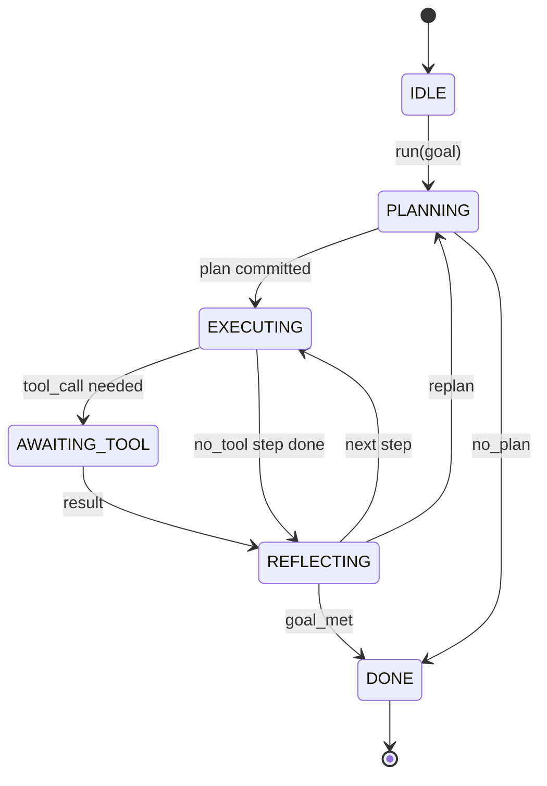

# Ajan Harness Loop Sözleşmesi

> Harness İşte ajanı, model ise birlikte işlemci.

**Type:** Build
**Languages:** Python
**Prerequisites:** Phase 13 lessons 01-07, Phase 14 lesson 01
**Time:** ~90 minutes

## Öğrenme Hedefleri


```figure
cf-loop-contract
```
- Bir ajan harnes döngüsünü belirgin geçişlerle belirgin bir durum makinesi olarak belirler.
- 10 yaşam döngüsü hakları konuları gerçekleştirmek için, operatörler politika, telemetri ve koruma çerçeveleri içine alabilir.
- İki çekme noktasını tanımlayın, bu konumlarda kontrolü tekrar çağıran kişiye vererek yeni giriş yaparak geri kazanın.
- 强制执行 per session budgets ((turns、tool calls、wall-clock),同时在超限时不泄漏部分状态──
- 发发含十一种事件类型的类型类型类型类型类型类型类型类型类型类型类型类型类型类型类型类型类型类型类型类型类型类型类型类型类型类型类型类型类型类型类型类型类型类型类型类型类型类型类型类型类型类型类型类型类型类型类型类型类型类型类型类型类型类型类型类型类型类型类型类型类型类型类型类型类型类型类型类型类型类型类型类型类型类型类型类型类型类型类型类型类型类型类型类型类型类型类型类型类型类型类型类型类型类型类型类型类型类型类型类型类型类型类型类型类型类型类型类型类型类型类型类型类型类型类型类型类型类型类型类型类型类型类型类型类型类型类型类型类型类型类型类型类型类型类型类型类型类型类型类型类型类型类型类型类型类型类型类型类型类型类型类型类型类型类型类型类型类型类型类型类型类型类型类型类型类型类型类型类型类型类型类型类型类型类型类型类型类型类型类型类型类型类型类型类型类型类型类型类型类型类型类型类型类型类型类型类型类型类型类型类型类型类型类型类型类型类型类型类型类型类型类型类型类型类型类型类型类型类型类型类型类型类型类型类型类型类型类型类型类型类型类型类型类型类型类型类型类型类型类型类型类型类型类型类型类型类型类型类型类型

## 框架

Bir insan olmayan kodlama ajanı çalıştırır. Bu bir sohbet döngüsü değil. Bu bir devlet makinesi, operatör düğümlerini kapatabilir, kenarlarını da denetebilir. Bir kere sözleşmeyi yazdıktan sonra, modelleri, araçları veya politikaları değiştirdiğinde yeniden yapılandırılmayacak, kayıt çağrısı haline gelecek.

Bu ders kurulduğunda bu sözleşme var. Bu sözleşmenin adı altı devlet, 10 hok konu, iki çekim noktası, 10 olay türü ve bütçe zarfı.

## devletler

Bir döngü var. Beş tane aktif.



`IDLE`Bu, yasal giriş noktası.`DONE`Bu, yasal olarak yapılan tek ihracat.`AWAITING_TOOL`Tek bir çekim noktası oluşur. Diğer tüm geçişler içindir.

Bu durum makinesi kesinliktir. Aynı olay logunu, harness'i yeniden aynı durumuna girer. Bu durum, seansları tekrar oynatmanıza izin verir.

## Hak konuları

Hooks is operator 接入ループ的接口──harness 会触发十个话题──每个话题可接受任意数的订阅者──订阅者 按注册 顺序触发──一个订阅者可以突变的有效载荷、升起来中止 当前轮时,或返回一个哨兵来跳过下一步──

```text
before_plan         after_plan
before_tool_call    after_tool_call
before_step         after_step
on_error
on_pause
on_budget_exceeded
on_complete
```

Bu şekil, Claude Code'u, Courseor'u ve OpenCode'u 2025 yılının ortalarına kadar kullanıma götüren bir model olarak göstermiştir.`rm -rf`Çekil    `before_tool_call`△ Gönder OpenTelemetry span                                                                                                                                                                                                                                                                                                                                                                                                                                                                                                                     `after_step`                                                                                                                                                                                                                                                              `on_pause`- Evet.

## Çekme noktaları

İlk kez kontrolü kaybettiğimde.`AWAITING_TOOL`Bir de bir de bir de bir de bir de bir de bir de bir de bir de bir de bir de bir de bir de bir de bir de bir de bir de bir de bir de bir de bir de bir de bir de bir de bir de bir de bir de bir de bir de bir de bir de bir de bir de bir de bir de bir de bir de bir de bir de bir de bir de bir de bir de bir de bir de bir de bir de bir de bir de bir de bir de bir de bir de bir de bir de bir de bir de bir de bir de bir de bir de bir de bir de bir de bir de bir de bir de bir de bir de bir de bir de bir de bir de bir de bir de bir de bir de bir de bir de bir de bir de bir de bir de bir de bir de bir de bir de bir de bir de bir de bir de bir de bir de bir de bir de bir de bir de bir de bir de bir de bir de bir de bir de bir de bir de bir de bir de bir de bir de bir de bir de bir de bir de bir de bir de bir de bir de bir de bir de bir de bir de bir de bir de bir de bir de bir de bir de bir de bir de bir de bir de bir de bir de bir de bir de bir de bir de bir de bir de bir de bir de bir de bir de bir de bir de bir de bir de bir de bir de bir de bir de bir de bir de bir de bir de bir de bir de bir de bir de bir de bir de bir de bir de bir de bir de bir de bir de bir de bir de bir de bir de bir de bir de bir de bir de bir de bir de bir de bir de bir de bir de bir de bir de bir de bir de bir de bir de bir de bir de bir de bir de bir de bir de bir de bir de bir de bir de bir de bir de bir de bir de bir de bir de bir de bir de bir de bir de bir de bir de bir de bir de bir de bir de bir de bir de bir de bir de bir de bir de bir de bir de bir de bir de bir de bir de bir de bir de bir de bir de bir de bir de bir de bir de bir de bir de bir de bir de bir de bir de bir de bir de bir de bir de bir de bir de bir de bir de bir de bir de bir de bir de bir de bir de bir de bir de`on_pause`...Büjet bitince, bir tane tane tane tane tane tane tane tane tane tane tane tane tane tane tane tane tane tane tane tane tane tane tane tane tane tane tane tane tane tane tane tane tane tane tane tane tane tane tane tane tane tane tane tane tane tane tane tane tane tane tane tane tane tane tane tane tane tane tane tane tane tane tane tane tane tane tane tane tane tane tane tane tane tane tane tane tane tane tane tane tane tane tane tane tane tane tane tane tane tane tane tane tane tane tane tane tane tane tane tane tane tane tane tane tane tane tane tane tane tane tane tane tane tane tane tane tane tane tane tane tane tane tane tane tane tane tane tane tane tane tane tane tane tane tane tane tane tane tane tane tane tane tane tane tane tane tane tane tane tane tane tane tane tane tane tane tane tane tane tane tane tane tane tane tane tane tane tane tane tane tane tane tane tane tane tane tane tane tane tane tane tane tane tane tane tane tane tane tane tane tane tane tane tane tane tane tane tane tane tane tane tane tane tane tane tane tane tane tane tane tane tane tane tane tane tane tane tane tane tane tane tane tane tane tane tane tane tane tane tane tane tane tane tane tane tane tane tane tane tane tane tane tane tane tane tane tane tane tane tane tane tane tane tane tane tane tane tane tane tane tane tane tane tane tane tane tane tane tane tane tane tane tane tane tane tane tane tane tane tane tane tane tane tane tane tane tane tane tane tane tane tane tane tane tane tane tane tane tane tane tane tane tane tane tane tane tane tane tane tane tane tane tane tane tane tane tane tane tane tane tane tane tane tane tane tane tane tane tane tane tane tane tane tane tane tane tane tane tane tane tane tane tane tane tane tane tane tane tane tane tane tane tane tane tane tane tane tane tane tane tane tane tane tane tane tane tane tane tane tane tane tane tane tane tane tane tane tane tane tane tane tane tane tane tane tane tane tane tane tane tane tane tane tane tane tane tane tane tane tane tane tane tane tane tane tane tane tane tane tane tane tane tane tane tane tane tane tane tane tane tane tane tane tane tane tane tane tane tane tane tane tane tane tane tane tane tane tane tane tane tane tane tane tane tane tane tane tane tane tane tane tane tane tane tane tane tane tane tane tane tane tane tane tane tane tane tane tane tane tane tane tane tane tane tane tane tane tane tane tane tane tane tane tane tane tane tane tane tane tane tane tane tane tane tane tane tane tane tane tane tane tane

Çekme noktası istisna değil. Bir dönüştür. Arayan, harman durumunu kontrol eder. Harmanı alın.`resume(payload)`◊harness 会从停止的位置继续──これはPython jeneratörünün şekliyle aynı──pull point 上の輸送由你選択──在TUI 中它是鍵盤──通過MCP 时它是`tools/call`# # Sıradan # # İş seçimi #

## olay akışı

Loop 会在合同中的特定位置将事件添加到打字流. Bu akış yalnızca eklenir, aboneler herhangi bir şekilde oynatabilir.

- `session.start` 调用 `run(goal)`Bir kez çıkmak
- `plan.draft` planlamacı 返回草案プラン 时发出
- `plan.commit` taslak aktîf plan için gönderildi 后发发
- `step.start` Her yürütme adımı 开始时发出
- `step.end` Her yürütme adımı 終了時发出
- `tool.call` 需要 tool 的步骤将控制权交给调用者 发发出
- `tool.result` Kullanım araç sonucu 恢复时发出
- `tool.error` Fayda hatası 恢复时,或 hook abort call 时发出
- `budget.warn`  Bütçe sınırına ulaşmak 时发出
- `session.pause` loop 因 pause (Budget veya hak) 让出发发发发
- `session.complete` döngüye ulaşmak `DONE`Bir kez çıkmak

Evrenler, gözlemsel bir durumdur. Kayıtlı gemi. Onları birbirlerine göre göre göre göre göre göre.

## bütçe zarfı

Bir seans 携带三个限制──turn count、tool call count、wall-clock seconds──每个轮会让转加一──每个工具调会让工具调用加一──每个状态过渡都会检查墙-clock──一旦达到任意限,循环会触发`on_budget_exceeded`, gönderme`budget.warn`Sonra bir sonraki çekim noktasında                                                                                                                                                                                                                                                                                                                                                                                                                                                                                                                      `IDLE`,并附带预算ın ötesinde sebeplerle¬¬¬¬¬¬¬¬¬¬¬¬¬¬¬¬¬¬¬¬¬¬¬¬¬¬¬¬¬¬¬¬¬¬¬¬¬¬¬¬¬¬¬¬¬¬¬¬¬¬¬¬¬¬¬¬¬¬¬¬¬¬¬¬¬¬¬¬¬¬¬¬¬¬¬¬¬¬¬¬¬¬¬¬¬¬¬¬¬¬¬¬¬¬¬¬¬¬¬¬¬¬¬¬¬¬¬¬¬¬¬¬¬¬¬¬¬¬¬¬¬¬¬¬¬¬¬¬¬¬¬¬¬¬¬¬¬¬¬¬¬¬¬¬¬¬¬¬¬¬¬¬¬¬¬¬¬¬¬¬¬¬¬¬¬¬¬¬¬¬¬¬¬¬¬¬¬¬¬¬¬¬¬¬¬¬¬¬¬¬¬¬¬¬¬¬¬¬¬¬¬¬¬¬¬¬¬¬¬¬¬¬¬¬¬¬¬¬¬¬¬¬¬¬¬¬¬¬¬¬¬¬¬¬¬¬¬¬¬¬¬¬¬¬¬¬¬¬¬¬¬¬¬¬¬¬¬¬¬¬¬¬¬¬¬¬¬¬¬¬¬¬¬¬¬¬¬¬¬¬¬¬¬¬¬¬¬¬¬¬¬¬¬¬¬¬¬¬¬¬¬¬¬¬¬¬¬¬¬¬¬¬¬¬¬¬¬¬¬¬¬¬¬¬¬¬¬¬¬¬¬¬¬¬¬¬¬¬¬¬¬¬¬¬¬¬¬¬¬¬¬¬¬¬¬¬¬¬¬¬¬¬¬¬¬¬¬¬¬¬¬¬¬¬¬¬¬¬¬¬¬¬¬¬¬¬¬¬¬¬¬¬¬¬¬¬¬¬¬¬¬¬¬¬¬¬¬¬¬¬¬¬¬¬¬¬¬¬¬¬¬¬¬¬¬¬¬¬¬¬¬¬¬¬¬¬¬¬¬¬¬¬¬¬¬¬¬¬¬¬¬¬¬¬¬¬¬¬¬¬¬¬¬¬¬¬¬¬¬¬¬¬¬¬¬¬¬¬¬¬¬¬¬¬¬¬¬¬¬¬¬¬¬¬¬¬¬¬¬

Bütçe, öldürme anahtarı değil. Bir çıkış.

## 本课不做什么

Modelleyi kullanmaz. Gerçek araçları kaydetmez. Nakliyeyi gerçekleştirmez. Bunlar bir sonraki dört ders.

`main.py`Orta belirleyici planlayıcı bir yerine geçer. Bu, sabit kodlanmış üç adımlı bir plana geri döner. Bunlardan iki adım da bir araç sonucu gerektirir.

## Nasıl okuyabilirim?

`HarnessLoop`Bu bir durumdur. Hakları açıyor.`Budget`Sınırlara uymak.`Event`Evet, yukarıdaki akışın tiplenmiş zarfı.`HookRegistry`- Bu bir masa.`_transition`Bu sadece bir devleti değiştiren bir fonksiyon, bu yüzden devleti makinesi değişkenleri bir yerde yoğunlaşır.

Üsttan aşağıya kadar oku`main.py`Sonra oku.`code/tests/test_loop.py`❖ testler ❖ her geçişleri sabitleyip ❖ her kanca ateşleme sırası

## 继续深入

Üretim ortamında inşaat harnesinin en zor kısmı devlet makinesi değil, kontratın zorunlu şekilde gerçekleştirilmesini sağlamak. Bu kontrat, planlayıcının sıcak yüklenmesini kabul etmesi gerekir.`before_tool_call`Bu dersdeki testler bu başarısızlık modlarını kapsayacak.

Aşağıdaki dersler, araçlar listesini ekleyecek. Yeniden, JSON-RPC taşımacılığı olacaktır. Yeniden, göndericidir.
