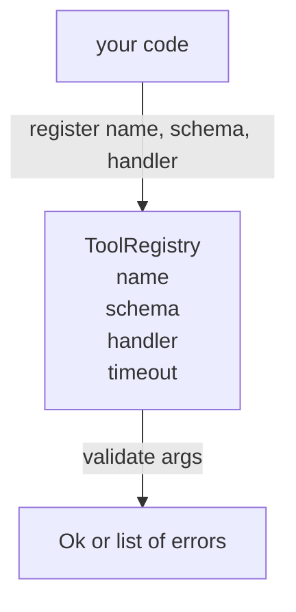

# 带 Schema Validation Tool Registry

> Agent 无法验证的工具,就是 agent 无法调用的工具――先构建注册表和方案检查器,再构建工具――

**Type:** Build
**Languages:** Python
**Prerequisites:** Phase 13 lessons 01-07, Phase 14 lesson 01
**Time:** ~90 minutes

## Öğrenme Hedefleri


```figure
cf-registry-validate
```
- Bir tür kayıt var, haritalama aracı adı → schema → handler, bırak dispatcher sadece bir kez sormak gerekir, sonra ise
- 实现 JSON Schema 2020-12 的一个子集,覆盖百分之九十的工具调用 实际使用的关键字──
- 返回精确的、形如 json-pointer 的错路,模型一次回归内自我修改, json-pointer 的错路, json-pointer 的错路, json-pointer 的错路, json-pointer 的错路, json-pointer 的错路, json-pointer 的错路, json-pointer 的错路, json-pointer 的错路, json-pointer 的错路, json-pointer 的错路, json-pointer 的错路, json-pointer 的错路, json-pointer 的错路, json-pointer 的错路, json-pointer 的错路, json-pointer 的错路, json-pointer 返回的错路, json-pointer 的错路, json-pointer 返回回回回回回回回回回回回回回回回回回回回回回回回回回回回回回回回回回回回回回回回回回回回回回回回回回回回回回回回回回回回回回回回回回回回回回回回回回回回回回回回回回回回回回回回回回回回回回回回回回回回回回回回回回回回回回回回回回回回回回回回回回回回回回回回回回回回回回回回回回回回回回回回回回回回回回回回回回回回回回回回回回回回回回回回回回回回回回回回回回回回回回回回回回回回回回回回回回回回回回回回回回回回回回回回回回回回回回回回回回回回回回回回回回回回回回回回回回回回回回回回回回回回回回回回回回回回回回回回回回回回回回回回回回回回回回回回回回回回回回回回回回回回回回回回回回回回回回回回回回回回回回回回回回回回回回回
- Açık bir baskısı olmadığı durumlarda tekrar kayıt reddedilmesidir, çünkü sessizlik kapsamlılığı üretim araçları kataloglarının 漂移的原因
- 保持 validator 纯净(无I/O、无时间、无全球), böylece tekrarlama log 上重新运行。

## Neden kayıt öncelik versin ?

2026 yılında kodlama ajanı  sahip kayıtlı araçlar, model  can put into single context window                                                                                                                                                                                                                                                   

Biz kaçınmalıyız ki hatalar, şema olmayan yöneticiler, ya da onaysız yöneticiler yayınlanmasın.

## Araç kayıtları 长什么样

```text
ToolRecord
  name        : str          (unique, lowercase alphanumeric and underscore segments separated by dots, e.g., snake_case.segment.case)
  description : str          (one line, shown to the model)
  schema      : dict         (JSON Schema 2020-12 subset)
  handler     : Callable     (async or sync, returns Any)
  idempotent  : bool         (dispatcher uses this for retry decisions)
  timeout_ms  : int          (override per-tool dispatcher default)
```

Şema onaylayıcıdır 唯一触碰的字段──Handleler ona karşı net değildir──我们故意把二者分开──Schema是数据──Handleers are code──它们混在一起,会诱导你把验证逻辑放入处理器,而这正是我们要阻止的 bug──

## JSON Şema 2020-12 子集

完整的2020-12 spec 是一篇论文──我们需要八个关键字──

```text
type           string / number / integer / boolean / object / array / null
properties     map of property name -> schema
required       list of property names
enum           list of allowed primitive values
minLength      integer, applies to strings
maxLength      integer, applies to strings
pattern        ECMA-262-compatible regex, applies to strings
items          schema applied to every array element
```

Bu, API'yi kapsayacak bir araçtır. Gerçek ihtiyaçların içeriği. Biz anahtar kelimeleri eklemiyoruz.

## Json işaretçisi 错误路径

validation 失败时,validator 返回一个错误列表―― her hata içerideki json-pointer yoluyla birlikte 输入 内部 json-pointer path──pointer ise özellik isimleri ve dizi indeksleri tarafından oluşturulan bir dizi.

```text
{"a": {"b": [1, 2, "x"]}}
                    ^
                    /a/b/2
```

model 读取 error paths 的能力强于读取句子的能力──如果 schema 要求 `args.user.email`, ve model                                                                                                                                                                                                                                                                                                                                                                                                                                                                                                                           `/user/email`, 并带有 `expected_type: string`❖ model 会在下一次调用中修正它,不需要一轮自然语言说明──

## Registr & override

`register(name, schema, handler, **opts)`默认拒绝重复注册──调用方必须传进 `override=True`才能替换── bu işletim seviyesindeki sağlık alışkanlığı── kod kutuunun iki bölümü aynı araç adı ile kayıtlıdır, üretim sırasında bir hafta boyunca bulduğu bir hata──

Kayıt 暴露三个读取方法──`get(name)`返回记录 或抛出异常──`validate(name, args)`Birini geri çevir .`Ok`Ya da bir grup hata.`names()`按注册顺序返回 araç isimleri。

## Valider nedir, değil mi?

Şema ağacının bir kez tekrarlamasıdır.`"42"`Sessiz bir şekilde kesilmez.

Bu güvenlik sınırları değil. Geçmişte kötü niyet yöneticisi hâlâ davranışta bulunmayabilir.

## Şekil



## Nasıl okuyabilirim?

`code/main.py`- Defini etti .`ToolRegistry`- Evet.`ToolRecord`- Evet.`ValidationError`, ve sekiz validator fonksiyonu---validator based `schema["type"]`Gönderiyor mu?`enum`处理) ◊ her tür onaylayıcı ◊ regreso空列表, ◊ regreso `ValidationError`列表──top-level walker 会拼接 errors, ve向下递归时前置路段──

`code/tests/test_registry.py`覆盖登录、过渡、验证成功、带路径的验证失败,以及该子集中的每个关键字──

## 继续深入

Bu bölümün sonunda, istediğiniz iki ekleme: yerel tanımlar blokları için.`$ref`Bu, bir diğer önemli konudur.`additionalProperties: false`                                                                                                                                                                                                                                                              

Aşağıdaki ders: (İki yirmi iki) JSON-RPC taşıma stüdyolarını inşa edecek, bu kayıtları model müşteriye açığa vuracak.
