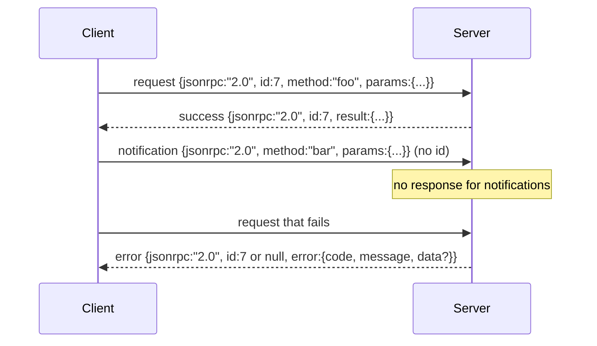

# Newline-Delimited Stdio'nun JSON-RPC 2.0 tabanlı

> Modelle kliyenle araç sunucusu arasındaki nakliye stüdyodan JSON-RPC'ye dayalıdır. Bir kere yazın, her katman çerçevesini anlamanıza yardımcı olur.

**Type:** Build
**Languages:** Python
**Prerequisites:** Phase 13 lessons 01-07, Phase 14 lesson 01
**Time:** ~90 minutes

## Öğrenme Hedefleri


```figure
cf-jsonrpc-frames
```
- Uses Through stdin 和 stdout 上的 newline-delimited JSON framing of JSON-RPC 2.0 通信。
- 映射五个标准错误码(-32700, -32600, -32601, -32602, -32603),并以正确语义暴露它们──
- 区分请求、响应、通知 和批量,未发明新封筒钥匙──
- Her zaman bir analiz hatası ile, diğerleri de bu hale gelmez.
- Bu yüzden, bu programın kendiliğinden bitmesi için bir demo oluşturmak için, bir çocuk süreci oluşturmak için kullanın.

## Neden JSON-RPC hala dil olarak kullanılmaktadır ?

2026 yılında, bir kodlama ajanı tek bir oturumda 12 araç sunucusuna 通信。 her sunucu bağımsız bir süreçtir veya uzaktan son nokta。 tel biçimi 2013 yılından beri aynıdır。 JSON-RPC 2.0 iki sayfa spesifikasyonudur。 alternatif bir çözüm nedeniyle hayatta kalabilir.

本课构建 stdio variant──Newline-delimited JSON── her istek bir satır──her cevap bir satır──transport sınırı`\n`- Evet.

## tel şekli

4 adet zarf şekli vardır──2 adet müşteri tarafından gönderilmektedir──2 adet sunucu tarafından gönderilmektedir──



bildirim yok`id` sunucu cevap vermiyor. Eğer sunucu bildirime cevap verirse, müşteri bir arama sitesine bağlanmanın bir yolu yoktur.

Batch ise istekler veya bildirimlerin JSON dizisi──server 返回一个响应列,顺序任意,每个非通知条对应一个响应──如果批中每个条目都是通知,服务器不发发任何内容──

## 五个 hata kodları

```text
-32700  Parse error      JSON could not be parsed
-32600  Invalid Request  Envelope shape is wrong
-32601  Method not found
-32602  Invalid params
-32603  Internal error
```

-32000 ile -32099 arasındaki kodlar sunucu tanımlı hatalara saklanın. Diğer tüm kodlar uygulama tanımlıdır.`data.exception`中放入 istisna sınıf adı。

Parse hatası var.`id`Evet .`null`, çünkü talebi henüz yeterli ölçüde analiz edilmedi.

## Yeni çizgi çerçeveleme ve BytesIO demo

Transport ̇̇̇̇̇̇̇̇̇̇̇̇̇̇̇̇̇̇̇̇̇̇̇̇̇̇̇̇̇̇̇̇̇̇̇̇̇̇̇̇̇̇̇̇̇̇̇̇̇̇̇̇̇̇̇̇̇̇̇̇̇̇̇̇̇̇̇̇̇̇̇̇̇̇̇̇̇̇̇̇̇̇̇̇̇̇̇̇̇̇̇̇̇̇̇̇̇̇̇̇̇̇̇̇̇̇̇̇̇̇̇̇̇̇̇̇̇̇̇̇̇̇̇̇̇̇̇̇̇̇̇̇̇̇̇̇̇̇̇̇̇̇̇̇̇̇̇̇̇̇̇̇̇̇̇̇̇̇̇̇̇̇̇̇̇̇̇̇̇̇̇̇̇̇̇̇̇̇̇̇̇̇̇̇̇̇̇̇̇̇̇̇̇̇̇̇̇̇̇̇̇̇̇̇̇̇̇̇̇̇̇̇̇̇̇̇̇̇̇̇̇̇̇̇̇̇̇̇̇̇̇̇̇̇̇̇̇̇̇̇̇̇̇̇̇̇̇̇̇̇̇̇̇̇̇̇̇̇̇̇̇̇̇̇̇̇̇̇̇̇̇̇̇̇̇̇̇̇̇̇̇̇̇̇̇̇̇̇̇̇̇̇̇̇̇̇̇̇̇̇̇̇̇̇̇̇̇̇̇̇̇̇̇̇̇̇̇̇̇̇̇̇̇̇̇̇̇̇̇̇̇̇̇̇̇̇̇̇̇̇̇̇̇̇̇̇̇̇̇̇̇̇̇̇̇̇̇̇̇̇̇̇̇̇̇̇̇̇̇̇̇̇̇̇̇̇̇̇̇̇̇̇̇̇̇̇̇̇̇̇̇̇̇̇̇̇̇̇̇̇̇̇̇̇̇̇̇̇̇̇̇̇̇̇̇̇̇̇̇̇̇̇̇̇̇̇̇̇̇̇̇̇̇̇̇̇̇̇̇̇̇̇̇̇̇̇̇̇̇̇̇̇̇̇̇̇̇̇̇̇̇̇̇̇̇̇̇̇̇̇̇̇̇̇̇̇̇̇̇̇̇̇̇̇̇̇̇̇̇̇̇̇̇̇̇̇̇̇̇̇̇̇̇̇̇̇̇̇`\n`Eğer bir yol analiz edemezse, transport bir paket yazıyor.`id: null`Bu yüzden, bu da bir sorun değil.

Bu ders içinde, biz bir çift.`io.BytesIO`包装成 stdin 和 stdout──server 读取请求直到 EOF,为每个请求 写入回复,然后返回──client 再读回回回复──没有过程 spawn──没有时间out──transport 行为与真实子进程管 完全相同,因为 Python 的`io`Arabirim  aynı şekilde `.readline()`和 `.write()`Sözleşme

## Metod Gönderi

Transport ne tür yöntemler olduğunu bilmiyor.`handler(method, params)`❖Handeller 返回結果 或抛出异常──三例外类 暴露特定コード──

```text
MethodNotFound -> -32601
InvalidParams  -> -32602
Anything else  -> -32603 with exception name in data
```

Transport  asla araç kayıtlarını görmeyecektir                                                                                                                                                                                                                                                                                                                                                                                                                                                                                                                     

##  davranış                                                                                                                                                                                                                                                                                                                                                                                                                                                                                                                            

```text
client writes              server reads             server writes
---------------            -----------              -------------
{...valid request...}      parses ok                {...response, id matches...}
{...broken json...         parse fails              {id:null, error: -32700}
{...valid request...}      parses ok                {...response, id matches...}
{...missing method...}     invalid envelope         {id:X, error: -32600}
```

Bir satır kırık JSON ne olacak durdurma döngüsü.`method`Alanı, Çeviri, Çeviri, Çeviri, Çeviri, Çeviri, Çeviri, Çeviri, Çeviri, Çeviri, Çeviri, Çeviri, Çeviri, Çeviri, Çeviri, Çeviri, Çeviri, Çeviri, Çeviri, Çeviri, Çeviri, Çeviri, Çeviri, Çeviri, Çeviri, Çeviri, Çeviri, Çeviri, Çeviri, Çeviri, Çeviri, Çeviri, Çeviri, Çeviri, Çeviri, Çeviri, Çeviri, Çeviri, Çeviri, Çeviri, Çeviri, Çeviri, Çeviri, Çeviri, Çeviri, Çeviri, Çeviri, Çeviri, Çeviri, Çeviri, Çeviri, Çeviri, Çeviri, Çeviri, Çeviri, Çeviri, Çeviri, Çeviri, Çeviri, Çeviri, Çeviri, Çeviri, Çeviri, Çeviri, Çeviri, Çeviri, Çeviri, Çev, Çev, Çev, Çev, Çev, Çev, Çev, Çev, Çev, Çev, Çev, Çev, Çev, Çev, Çev, Çev, Çev, Çev, Çev, Çev, Çev, Çev, Çev, Çev, Çev, Çev Çev Çev Çev Çev Çev Çev Çev Çev Çev Çev Çev Çev Çekekekekekekekekekekekekekekekekekekekekekekekekekekekekekekekekekekekekekekekekekekekekekekekekekekekekekekekekekekekekekekekekekekekekekekekekekekekekekekekekekekekekekekekekekekekekekekekekekekekekekekekekekekekekekekekekekekekekekekekekekekekekekekekekekekekekekekekekekekekekek

## İletişimler 和非对称 akışlar

bildirim  ateş ve unutma  harness  Uyarıları kullan  Gelişme olaylarını  iptal sinyallerini  log hatları  bildirim  uzun süren araç  status güncellemelerini akışlandırabilir, 

Bu ders bir çıkış bildirim yardımcı gerçekleştirmek için,`write_notification` sunucu  istek sırasında  kullanılarak  ilerlemeyi gönderir  demo  bu kalıpı gösterir: bir istek  gelir, işçi  iki ilerleme bildirimi gönderir, sonra son cevabı yazar 

## Nasıl okuyabilirim?

`code/main.py`- Defini etti .`StdioTransport`、parse yardımcı`parse_request`)、三个 yazı yardımcıları(`write_response`- Evet.`write_error`- Evet.`write_notification`), ve gönderme döngüsü `serve`◊ hata kod sabitleri   modül kapsamında ◊

`code/tests/test_transport.py`覆盖五个错误码、通知(不写响应)、批量(排列入,排列出, 跳过通知)、破解 JSON(解析错误 后继续),以及处理器 在调用中途写入通知的不对称流――

## 继续深入

Bu nakliye 足以支后续课程──生产运输 会添加三件事──一个能在转发后继续存在的相关性 id 字段(你的`id`Bu zaten var, ama ağ içinde bir dış iz kimliği gerekir.`$/cancelRequest`Uçuş çağrısı için bir bilgi, bir içerik türü müzakere el sıkışması, aynı soket aynı anda JSON-RPC ve Akışlanabilir HTTP diyebilir.
