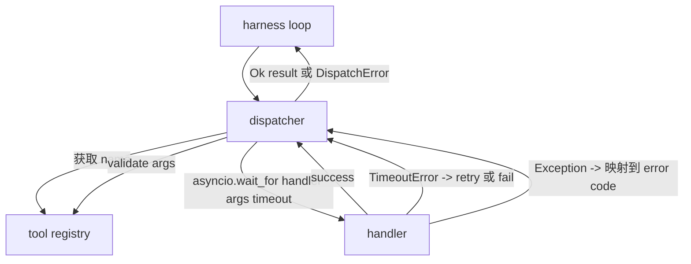
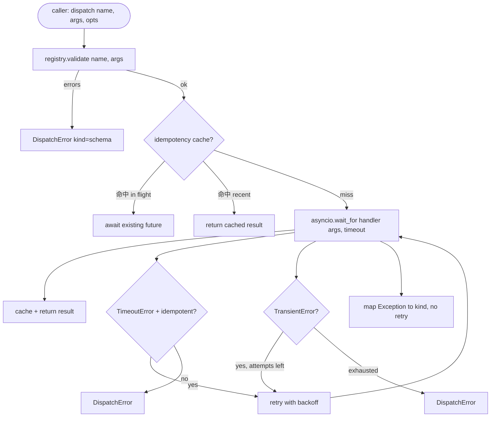

# Fonksiyon Arama Çözücü

> Dispatcher, her sözleşmeyi satın alma alanında bir plan oluşturur.

**Type:** Build
**Languages:** Python
**Prerequisites:** Phase 13 lessons 01-07, Phase 14 lesson 01
**Time:** ~90 minutes

## Öğrenme Hedefleri
- Kullanın her çağrı için zamanlama  paketleme aracı kullanıcısı, bunun yerine bir döngü ırmak 
- 应用带 jitter 和最大尝试次数的指数式反弹复试――
- Idempotency anahtarı ile yeniden denemeyi tekrar tekrar denemeyi yavaşlatmak için, 竞争的重复试 不会运行两次──
- Bu işlemci istisnaları ve ulaşım hataları  Harness döngüsüne  zaten anlaşılan tek hata zarfı 
- Aynı anda sınırlı bir şekilde paralel gönderim yaparak, dört araç çağrısı yapmaktan kaçın.


```figure
cf-dispatch-retry
```

## - Dispatcher'ın oturduğu yer

位于 harness loop(lection twenty) 和 tool registry(lection twenty-one)之间──transport(lection twenty-two)向 loop 输入──loop 把 tool call 交给 dispatcher──dispatcher 调用 registry,运行 handler,并返回 result 或 JSON-RPC 形状的错包──



Depolatör, tek bildiği zamanları, geri çekilmeleri ve boşlukları.

## Zamanlamalar

Her aletin bir süreliğine ait bir kayıt var.`timeout_ms`❖ Harness 传入 per call override 时,dispatcher 会用它覆盖默认值──我们使用 `asyncio.wait_for`Zamanı bitince, işçi görevleri iptal edilecek, gönderen geri dönecek.`DispatchError(kind="timeout")`- Evet.

Dürüst olmayan araçlar için, zaman kaybı 默认 olarak geri dönüşü olmayan bir hata değildir.`db.write`Belki gönderilmiştir, belki de gönderilmemiştir.`idempotent`Bayraklı. İdepotent araçlar.

## Eksponansiyel geri çekilme ile tekrar deneyler

Geri Deneme Politika, en son üç deneme.

```text
attempt 1  -> delay 0
attempt 2  -> delay 0.1s * (1 + random[0..0.5])
attempt 3  -> delay 0.4s * (1 + random[0..0.5])
```

Sadece .`timeout`和 `transient`Hatalar tekrar denenecek.`schema`hata`not_found`Ya da`internal`hata tekrar denemez. Şema hataları kesinliktir.

Yeniden deneme döngüsü, kullanımı  verilen bütçeyi takip edecek. Eğer arayanın bütçesi  Geri kalan araçlar ııfır çağırırsa, gönderen ilk denemede hızla başarısız olur, geri döner.`kind="budget_exceeded"`- Evet.

## İdempotency anahtarı dedupe

İlk kez 4 saat 9 saniye sonra çıkıyor. İlk kez 5 saniye sonra tekrar başlatılıyor.`payments.charge`İki kez ödeme yaptın.

İletici  kabul可选的 `idempotency_key`Eğer bir çağrı geldiğinde aynı anahtarla uçağımızda ise, gönderen gelecekte uçağı bekler ve sonuçlarını geri alır.

Anahtar, arayanın sorumluluğu. Planlayıcıdan yararlanmak.`f"{step_id}:{tool_name}:{hash(args)}"`❖ dispatcher key'i ortaya çıkarmaz çünkü sadece argümanlardan  çıkış anahtarı  iki farklı arama yaptırır.

## Hata zarfı

失败的发送 返回单一形――

```text
DispatchError
  kind        : "timeout" | "transient" | "schema" | "not_found" | "internal" | "budget_exceeded"
  message     : str
  attempts    : int
  jsonrpc_code: int   （-32601、-32602、-32603 之一）
```

Harness döngüsü`kind`映射到下一个状态──`schema`和 `not_found` Giriş`on_error`- Hayır, tekrar başlatmak için değil.`timeout`和 `transient` Giriş`on_error`,可能重複,也可能不重複,取決於試圖──`budget_exceeded`触发 `on_budget_exceeded`- Evet.

## Fan out'a karşı karşılaşma sınırı

`gather(*calls)`Bu arada tüm sistemleri yürütmek için kullanılır.

Dispatcher 用 semaphore 包装 `gather`△默认 concurrence limit is 八── her çağrı  dispatching  önce semaphore edinmek ve tamamlanmak için  release `gather`形形的输出, fakat gerçek programlama 界的──

## Tek bir çağrı için akış



## Şifreyi nasıl okuyabilirsiniz

`code/main.py`- Defini etti .`Dispatcher`- Evet.`DispatchError`和 `TransientError`◊ dispatcher 在构造时接收登录──async`dispatch(name, args, ...)`Bu tek giriş noktası.`_run_with_retries`İç kullanım`asyncio.wait_for`İndirim  uygulama¬¬¬¬¬¬¬¬¬¬¬¬¬¬¬¬¬¬¬¬¬¬¬¬¬¬¬`gather_bounded(calls)`运行多个发送――

`code/tests/test_dispatcher.py`覆盖 timeout 触发、transient 上的重试、方案错 上不重试、idempotency dedupe(iki kez aynı anahtarla eşzamanlı çağrılar 折叠为一次处理器调用), yanı sıra eşzamanlılık sınırlaması(semaphore 生效) 

Test kullan `asyncio.sleep(0)`Ve belirleyici olarak.`Counter`Bu yüzden duvar saatine bağlı değil, saniyede tamamlanır.

## Daha ileri gitmeye çalışıyorum .

Birincisi, her geçiş sırasında yapılandırılmış kaydı yaptırmak için bir döngü olay akışı  zaten bu kapasiteyi sağladı, ancak dispatcher de yayınlamak zorunda `dispatch.attempt`和 `dispatch.retry`Evrenler: 2. Çevre kesicileri: Bir pencerede gerçekleşir N 次 başarısızlıktan sonra, araç  soğutma süresine girdi, gönderiler 会立即返回 `kind="circuit_open"`...sadece test handler değil. ...bu iki şey de sözleşmeyi değiştirmeden, bu dispatcher'a eklenebilir.

Ders 24. İletişimciyi plan ve yürütme ajanına bağla, dört bölümün birlikte hareket etmesini görmene izin ver.
