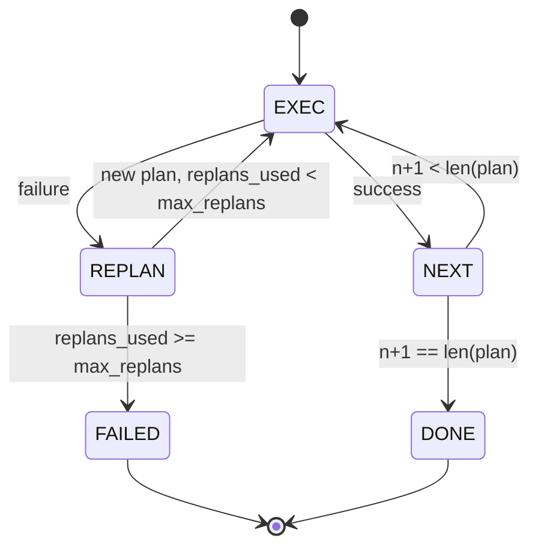

# Planlama ve İcra Kontrol Akışı

> 无法承受失败的计划是脚本――能重复的脚本――才是代理――先构建重新规划者――

**Type:** Build
**Languages:** Python
**Prerequisites:** Phase 13 lessons 01-07, Phase 14 lesson 01
**Time:** ~90 minutes

## Öğrenme Hedefleri


```figure
cg-plan-replan
```
- Planı, işlevsel olarak belirtilen adımların sırası olarak gösterir.
- 顺序执行 steps,并将失败 受控地 handoff 回规划者──
- Şu anki kursordan  yeniden planlamaya başlayın ve bağlamda önceki hata ile, bir sonraki planı daha fazla bilgi için yapın.
- Her inceleme planı farklı bir şekilde yayımlıyor, let down游 tracer veya UI 能展示 planı neden değiştirmek için.
- 强制执行两个预算:硬性阶梯上限和硬性复制上限──

## Planlama ve yürütme, düşünce zinciri değil

Düşünce zinciri ajanı, simgeler yayınlar,并让循环 猜测工具 call 在哪里结束──计划-and-execute agent önce yapılandırılmış bir plan yayınlar, sonra kesin olarak her adımı gerçekleştirir──planı kullanır, içten bir bakış açısıyla veriyi kullanır──execution is harness 通过发送器 运行这些数据──

两个部分──一个规划者 产生计划──一个执行者 运行计划──真正意在的是执行者 遇到失败 时发生什么──三个选项:

```text
1. Abort         （返回 failed，暴露 error）
2. Skip          （将 step 标记为 failed，继续剩余部分）
3. Replan        （把 error 交给 planner，从 cursor 获取新 plan）
```

Replanı                                                                                                                                                                                                                                                              

## Adım şekli

```text
Step
  id              : int           （在一个 plan revision 内单调递增）
  tool_name       : str
  args            : dict
  expected_outcome: str           （planner 声明的 success condition）
  result          : Any | None
  error           : str | None
```

`expected_outcome`Bu, bir düzenleyici ile bir adımdan bir kez yayımlayan kısa cümlelerle birlikte kullanılır.

## Planlayıcı'nın şekli

```python
def planner(goal: str, history: list[Step], last_error: str | None) -> list[Step]:
    ...
```

Saf bir işlev.`goal`Bu kullanıcı hedefi.`history`Yapılmış adımlar (rüzgârlar ve hatalar)`last_error`İlk çağrısında hiç, ardından her çağrısında son başarısızlık mesajı var.

Planlayıcı Bilmiyor, İcracı Bilmiyor, Tekrar Deneme Bilmiyor, Zamanlama Bilmiyor, Sadece Plan Oluşturur.

## İcracı

Başarısızlık, başarısızlık, ölümcül başarısızlık, başarısızlık, başarısızlık, başarısızlık, başarısızlık, başarısızlık, başarısızlık, başarısızlık, başarısızlık, başarısızlık, başarısızlık, başarısızlık, başarısızlık, başarısızlık, başarısızlık, başarısızlık, başarısızlık, başarısızlık, başarısızlık, başarısızlık, başarısızlık, başarısızlık, başarısızlık, başarısızlık, başarısızlık, başarısızlık, başarısızlık, başarısızlık, başarısızlık, başarısızlık, başarısızlık, başarısızlık, başarısızlık, başarısızlık, başarısızlık, başarısızlık, başarısızlık, başarısızlık, başarısızlık, başarısızlık, başarısızlık, başarısızlık, başarısızlık, başarısızlık, başarısızlık, başarısızlık, başarısızlık, başarısızlık, başarısızlık, başarısızlık, başarısızlık, başarısızlık, başarısızlık, başarısızlık, başarısızlık, başarısızlık, başarısızlık, başarısızlık, başarısızlık, başarısızlık, başarısızlık, başarısızlık, başarısızlık, başarısızlık, başarısızlık, başarısızlık, başarısızlık, başarısızlık, başarısızlık, başarısızlık, başarısızlık, başarısızlık, başarısızlık, başarısızlık, başarısızlık, başarısızlık, başarısızlık, başarısızlık, başarısızlık, başarısızlık, başarısızlık, başarısızlık, başarısızlık, başarısızlık, başarısızlık`FAILED`Oturum sonucu:



## Revision 时的计划 diff

Planlamacı başarısızlıktan sonra yeni planı geri döndüğünde, uygulayıcı üç bölüm içeren bir bölüm yayınlayacaktır.`plan.diff`olayı

```text
removed: 旧 plan 中存在但新 plan 中不存在的 step ids 列表
added  : 新 plan 中存在但旧 plan 中不存在的 step ids 列表
revised: tool_name 或 args 已改变的 step ids 列表
```

Tracer veya UI'yi kaldırılan adımların çarpışması ve eklenenlerin vurgulaması olarak görebilirsiniz.

## 两个硬性预算

`max_steps` limiti tüm seansın içinde toplam adımlar uygulanması, replans içerir. 默认是十二──一线性的五步计划, eğer replans 两次并且每次增加三个步骤,达到十六次执行,从而超过预算──执行者会拒绝该计划,并返回 FAILED──

`max_replans`限制第一次计划 后规划师 被调用次数――默认是五――这是更重要的限制――一个连续五次回复同一个破碎的计划的规划师,否则会一直循环,直到步骤预算 抓获它――限制重规划会让失败更快发生,原因也更清楚――

## 本课中的 belirleyici planlamacı

Bu ders model kullanmıyor. Ders bir belirleyici planlamacı sunar.`last_error`Seçim planı.

```text
last_error is None    -> emit 一个 four-step plan
last_error matches X  -> emit 一个绕过 X 的 three-step plan
last_error matches Y  -> emit 一个优雅放弃的 two-step plan
otherwise             -> return []（表示没有内容可 replan）
```

Bu yeterli test uygulayıcı, her geçiş yolunda üst davranış: başarı, yeniden planlama, yeniden planlama, yeniden planlama ve bütçe aşaması.

## Sonuç Şekili

```text
SessionResult
  status      : "completed" | "failed"
  reason      : str     ("goal_met" | "step_budget" | "replan_budget" | "no_plan")
  history     : list[Step]
  revisions   : list[PlanDiff]
  events      : list[Event]
```

Ders yirmi İçeriden Harness Çapı doğrudan okuyabilirsiniz. Ders yirmi üç İçeriden Dispatcher  her adımını gerçekleştirmek. Ders yirmi bir İçeriden Kayıt her adımın argümanlarını doğrulayın. Ders yirmi iki İçeriden ulaşım. JSON-RPC üzerinden tüm akışın ışıklanacağını model müşteriye göstermek.

## Şifreyi nasıl okuyabilirsiniz

`code/main.py`- Defini etti .`PlanExecuteAgent`- Evet.`Step`- Evet.`PlanDiff`- Evet.`SessionResult`Ve belirleyici planlamacı, uygulayıcı, tek kişi.`run(goal)`Metod, geri dön.`SessionResult`◊ plan farklılık                                                                                                                                                                                                                                                                                                                                                                                                                                                                                                                         `(tool_name, args)`Tüpler 计算。

`code/tests/test_agent.py`覆盖线性成功、一次中期计划失败 后重计划、返回 `failed:replan_budget`Planı yeniden düzenlemek için bütçeyi aşamaklı olarak düzenlemek ve plan farklılıkları biçimi oluşturmak için düzenleme yapılması.

## Daha ileri gitmeye çalışıyorum .

连接到真实模型 后,你需要两个扩展──第一,部分计划缓存:当一个计划的六个步骤 中前三个成功、后失败时,你不想重新运行前三个──执行者 已保留历史;planner 只需要读取它──第二,并行分支:当前执行者是严格序列的──发行独立分支(`gather_step`Hayır.`next_step`) 'in planlayıcısı, dispatcher ile aynı anda iki araç çağrısı yapabilir.

Bu iki şey de gerçek karmaşıklığı artıracaktır. Bu iki şey de, sabitlenmiş bir şekilde daha kolay eklenecektir.
