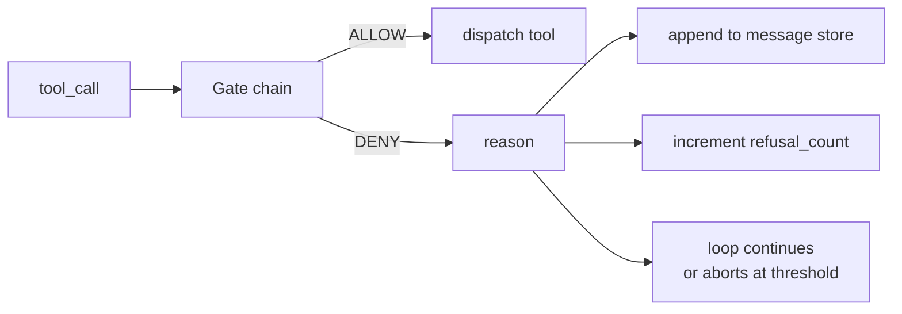
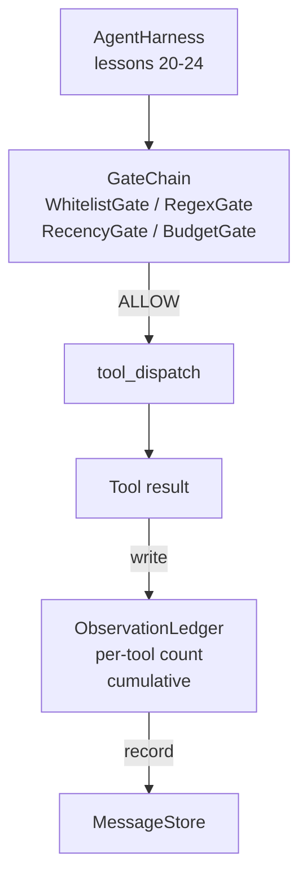

# Kapstone 第 25 课: Verifikasyon Kapıları ve Gözlem Bütçesi

> 没有验证层的代理利用,只是披露外套的愿望. 本课会构建确定性门链,用于决定是否允许一次工具调用 触发、代理可以看到多少输出,以及当代理 已读取太多内容时循环 何时必须停止──这个链由小型、名有门加上观察账号组成; ledger 会追踪已经显示给模型的每个代币──

**Type:** Build
**Languages:** Python (stdlib)
**Prerequisites:** Phase 19 · 20-24（Track A1：agent loop、tool registry、message store、prompt builder、model router），Phase 14 · 33（instructions as constraints），Phase 14 · 36（scope contracts），Phase 14 · 38（verification gates）
**Time:** ~90 minutes

## Öğrenme Hedefleri

-  yapı `evaluate(call)`- Nasıl ?`VerificationGate`Protokol.
- Bu, bir kısım kısımlı bir zincir oluşturmak için kullanılır.
- 按工具和转 建索引的 `ObservationLedger` Her gözlemde takip edilmesi
- Toplam gözlem bütçesi dışarı çıkınca, bir araç çağrısı reddedilmelidir.
-                                                                                                                                                                                                                                                                                                                                                                                                                                                                                                                              `GateDecision`Kayıt,供下游 gözlemlenme 摄取──

## 问题

Ajan kullanırken 模型自由调调工具 时, gerçek kullanımın ilk saatinde üç tür hata ortaya çıkar.

İlk sınıf sınırsız gözlemlerdir. Bir 20 bin satır repo için 50 bin token çıkışını bir sonraki döngüye atarlar. Model her bin satırda sadece bir uyum görüyorlar.

İkinci sınıf, eski yeniliktir. Uzun süredir çalışmakta olan görevler 50 kez araç çağrısı toplanır. Model üçüncü döngünün ilk okuyucu dosyasını gerçek zamanlı durumunu yeniden okuyacaktır.

Üçüncü sınıf: ayrıcalıklı bir sürüşme.`web_search`Başlayın, sonra nasıl yürüyeceğini bilmiyoruz.`shell`Model bir araç adı oluşturdu, böylece 默认宽松──等有人读取痕迹时,/tmp 里已经放了一个垃圾文件,并且一次已经打到了私有API──

Verifikasyon kapısı, harness'in içinde 不 的组件的负责人.`(call, history, ledger)`Bu nedenle, bu işlemin gerçekleşmesi için, bu işlemin gerçekleşmesi için, bu işlemin gerçekleşmesi için, bu işlemin gerçekleşmesi için, bu işlemin gerçekleşmesi için, bu işlemin gerçekleşmesi için, bu işlemin gerçekleşmesi için, bu işlemin gerçekleşmesi için, bu işlemin gerçekleşmesi için, bu işlemin gerçekleşmesi için, bu işlemin gerçekleşmesi için, bu işlemin gerçekleşmesi için, bu işlemin gerçekleşmesi için, bu işlemin gerçekleşmesi için, bu işlemin gerçekleşmesi için, bu işlemin gerçekleşmesi için, bu işlemin gerçekleşmesi için, bu işlemin gerçekleşmesi için, bu işlemin gerçekleşmesi için, bu işlemin gerçekleşmesi için, bu işlemin gerçekleşmesi için, bu işlemin gerçekleşmesi için, bu işlemin gerçekleşmesi için, bu işlemin gerçekleşmesi için, bu işlemin gerçekleşmesi için, bu işlemin gerçekleşmesi için, bu işlemin gerçekleşmesi için, bu işlemin gerçekleşmesi için, bu işlemin gerçekleşmesi için, bu işlemin gerçekleşmesi için, bu işlemin gerçekleşmesi için, bu işlemin gerçekleşmesi için, bu işlemin gerçekleşmesi için, bu işlemin gerçekleşmesi için, bu işlemin gerçekleşmesi için, bu işlemin gerçekleşmesi için, gerekmektedir.

## 概念



Kapı herhangi bir şeyle dolu .`evaluate(call, ctx) -> GateDecision`方法的对象──chain 是一个有序列表──evaluation 在第一次拒绝时短路──序列很重要:便宜的结构性门 会先于昂贵的代币计数门 运行──

本课提供四门:

- `WhitelistGate`                                                                                                                                                                                                                                                              
- `RegexGate`◊ Araç argümanları 会与 regex 匹配──适合拒绝包含 `rm -rf`Şel aramaları veya iç IP HTTP aramaları için kullanılabilir.
- `RecencyGate`◊ model sadece son N 轮 gözlemlerini görebilir. ◊ daha eski gözlemler gizlenecektir. ◊ bu kapı sonuçlarını reddedecek ve bir gözleme penceresinin çağrısını genişletecektir.
- `BudgetGate`◊ Model tüm seans boyunca toplam okudukları tokenlerin bir üst sınır vardır.

Gözlem defteri 负责记账。 Her seferinde başarılı bir araç çağrı 都会写入一行: araç adı、 dönüş、 gönderilen token、 kumulatif。 ledger 回答两个问题:模型总共看到了多少,以及它看到了工具 X 的多少──预算 kapısı 读取第一──每工具预算 kapısı 读取第一──是你的练习内容,它会读取第二──


```figure
cg-gate-chain
```

## Yapılandırma



Harness 会询链──链 要么点头,要么拒绝── eğer bu nokta başarsa, araç, işlem, ledger 会计数, sonuç mesaj mağazasına eklenir── eğer bu reddederse, model sistem mesajı şeklinde reddedilecek, sonra döngü yeniden deneme veya durdurulmaya karar verir──

## Ne yapacaksın?

实现一个 `main.py`- Testler.

1. `Observation`和 `ToolCall`veri sınıfları  define wire shapes。
2. `ObservationLedger`Kayıt`(turn, tool, tokens)`Satırlar,并回答 `cumulative()`和 `per_tool(name)`- Evet.
3. `GateDecision`- Hayır .`(allow, reason, gate_name)`- Evet.
4. `VerificationGate`Bu protokol. Her kapı gerçekleştirildi.`evaluate(call, ctx)`- Evet.
5. `GateChain`Bir sıralama listesi var. Her kapıyı kullanır, ilk kapıyı geri gönderir. Eğer tüm kapılar geçerse, geri gönderilmesine izin verir.
6. Demo 运行一个很小的合成代理循环──三轮──第三轮触发预算门,循环 会报告一次干净的拒绝,并带有非零拒绝计数──

- Çok kaba kullanmak istiyorum .`len(text) // 4`Heuristik. Bu dersın odak noktası, tokenizer değil kapı tesisatçısı.

## Neden zincir  sırası önemli

Bir kere inkar etmek, bir kere izin vermek daha kolay.`WhitelistGate`运行  İşlem$O(1)$- Evet.`RegexGate`运行  İşlem$O(\text{pattern} \cdot \text{argv})$- Evet.`RecencyGate`读取 mesaj mağazası'nın bir küçük parçası──`BudgetGate`读取整个账本──你需要按成本升序排列它们,这样被拒绝的电话就能在执行昂贵的工作前短路──

Bu araç kontrat içindedir. Regex kapısı. Diğer: Bu argüman kontrat içindedir. Sonraki İçeri: Harness  hâlâ ilgileniyor, ama çağrı yapıda yasal.

## Nasıl A'nın kalan kısmıyla birleşti ?

Önceki ders size bir döngü, araç kayıt, mesaj depo, hızlı oluşturucu ve model yönlendiricisi olarak sunulmuştur. Bu ders, model ve araçlar arasındaki katmanları ekliyor. Bu ders, kapı zincirini geri döndüğünde sandbox, izin veren kişi tarafından kullanılır.

## 运行方式

```bash
cd phases/19-capstone-projects/25-verification-gates-observation-budget
python3 code/main.py
python3 -m pytest code/tests/ -v
```

demo 会打印逐轮追踪, her bir kapı kararını içerir,并以零退出──tests 覆盖 ledger、每个独立门、链短路,以及端到端合成循环──
