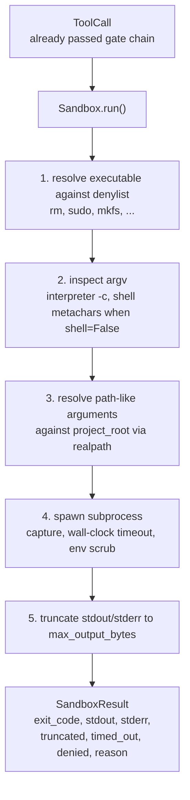
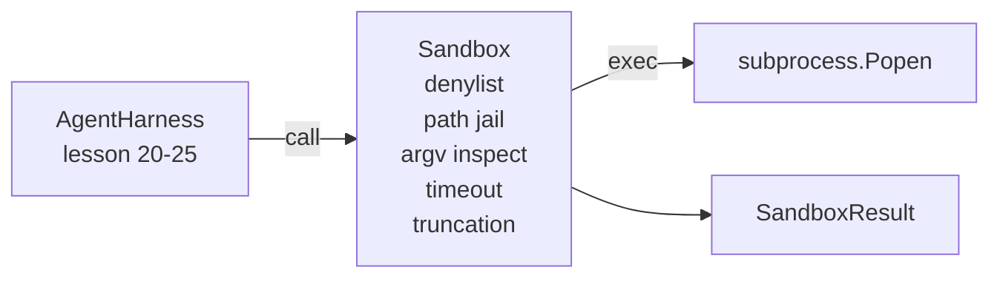

# Capstone 第 26 课:带 Denylist &amp; apos; le Path Jail ' ın Kum Kutusu Koşucu

> Verifikasyon kapısı bir kere araç çağrısı yapmayı karar verir. Sandbox, çalışmasında ne olacağını belirler. Bu ders, tehlikeli çalıştırılabilir işlemleri reddedecek, tehlikeli argv şekilleri reddedecek, her dosya yolunu projenin köküne sınırlayacaktır, aşırı çıkışları keser ve duvar saatinin zamanlaması sırasında kaçak süreçleri öldürür.

**Type:** Build
**Languages:** Python (stdlib)
**Prerequisites:** Phase 19 · 25（verification gates and observation budget），Phase 14 · 33（instructions as constraints），Phase 14 · 38（verification gates）
**Time:** ~90 minutes

## Öğrenme Hedefleri

- Bir paket oluşturun.`subprocess.run``Sandbox`Sınıf, zaman çıkışı, yakalama ve kesim.
- 按名称通过 denylist、按结构通过 argv inspector 拒绝命令──
-                                                                                                                                                                                                                                                                                                                                                                                                                                                                                                                              
- Shell modunda 关闭时拒绝 shell meta karakteri。
- 返回结构化  Yapılandırılmış`SandboxResult`, için aşağı游 gözlemlebilirlik 和 eval harness 摄取──

## 问题

能够 shell out 能够 shell out 能够 shell out 能够在一个转内安装后门、外泄密钥、损坏开发人员笔记本电脑,并产生云账单――最低的防护成本是不给它 shell――成本第二低的是一个会对精确的图案列表说不的沙盒――

Ajan izleri 中反复出现三类失败──

Birinci sınıfı tehlikeli uygulanabilir bir model.`sudo`- Evet.`chmod -R 777`- Evet.`rm -rf`- Evet.`mkfs`- Evet.`dd`────────────────────────────────────────────────────────────────────────────────────────────────────────────────────────────────────────────────────────────────────────────────────────────────────────────────────────────────────────────────────────────────────────────────────────────────────────────────────────────────────────────────────────────────────────────────────────────────────────────────────────────────────────────────────────────────────────────────────────────────────────────────────────────────────────────────────────────────────────────────────────────────────────────────────────────────────────────────────────────────────────────────────────────────────────────────────────────────────────────────────────────────────────────────────────────────────────────────────────────────────────────────────────────────────────────────────────────────────────────────────────────────────────────────────────────────────────────────────────────────────────────────────────────────────────────────────────

İkinci sınıfı argv hileler. Bir suçlu, bir şell modelini kullanamayacağını söyler.`python3 -c "import os; os.system('rm -rf /')"`- Evet.`bash -c '...'`- Evet.`node -e '...'`- Evet.`perl -e '...'`Sandbox, bilmem gerek, benzer bir şey var.`-c`Bayrak yorumcu çalışması aslında birkaç adımlık bir çığlık çağrısı.

Üçüncü sınıf: Yol kaçışı.`./src/main.py`Ama okudum.`../../etc/passwd`◊ Sandbox 会通过 `os.path.realpath`解析每个路径论点,并断言其前,从而将它们限制在监狱内──

Bu kum kutusu işletim sistemi anlamında güvenlik sınırları değildir. Kod işlemeyi yapan bir saldırganın kaçması mümkün. Bu kum kutusu geliştirme zamanının koruma korumasıdır.

## 概念



Sandbox'da dört reddetme eksesi vardır: isim,argv,yol, yapı. Her eksesi çağrının saf işlevi, bu zaman da bir alt işlem yok.

`SandboxResult`çıkış kodları 使用慣例值:0 表示成功,非零表示失敗,另外有三哨码:否定 (-100)、timed_out (-101) 和 truncated( çıkış kodu 是真实值,同时设置旗)。下游课程会读取这个结构化结果,而不是解析 stderr。


```figure
cg-path-jail
```

## Yapılandırma



Denylist is executable basenames 的 frozenset──aliases(`/bin/rm`- Evet.`/usr/bin/rm`)都会解析到相同的基名──argv inspektor 了解解释器形:任何 argv[0] 是解释器 且后续任一 arg 以 `-c`Ya da`-e`Başlangıçta argv şehri reddedildi. Çağrıda açık bir talep yok.`;`- Evet.`|`- Evet.`&`- Evet.`>`- Evet.`<`Çekil,`$()`) reddedilmeye yol açacak.

Hapishanenin yolu en ufak bir parçası.`project_root`                                                                                                                                                                                                                                                              `/`Ya da mevcut belgelerle uyumlu olarak) her şey geçerli olacak.`os.path.realpath`归一化,然后与项目根的真路比较──如果解析后的目标不在根下,则拒绝──Symlink kaçış girişimleri(project root 中指向外部的 symlink) gerçek yolu 阻止 olarak kontrol edilir, değil, 检查字面路径──

## Ne yapacaksın?

实现是 `main.py`Bir test daha var.

1. `SandboxResult`veri sınıfı:out_code、stdout、stderr、truncated、timed_out、denied、reason、duration_ms。
2. `SandboxConfig`veri sınıfı:project_root、max_output_bytes、timeout_seconds、denylist、interpreter_block。
3. `Sandbox`sınıf:`run(argv, *, shell=False, cwd=None)`Geri dön .`SandboxResult`- Evet.
4. 内部 reddetme yardımcıları:`_check_executable_denylist`- Evet.`_check_argv_interpreter`- Evet.`_check_shell_metachars`- Evet.`_check_path_jail`- Evet.
5. Çıktı kesim,带清晰的 `truncated`Bayrak ve yakalanan akımın ortasındaki işaret çizgisi.
6. 底部デモ:一系列合法与反抗的通话―― her çağrı sonucu gösterir──

kum kutu 默认使用 `subprocess.run`Ve`shell=False`- Evet.`capture_output=True`❖ Duvar saatinin geçici süresi `timeout`tartışmalar;`TimeoutExpired`Sandbox, bir sandbox sonucu oluşturur.

## Neden bu gerçek kum kutusu değil ?

Bu ders sandbox kullanmaz isim boşlukları, gruplar, sekomp, gVisor, Firecracker veya herhangi bir çekirdek seviyesinde izolasyon.

 Production agents, you need to overlay on it: in unprivileged Docker container 中运行、在microVM 中运行、滴滴能力、将项目 root 挂载为读写而已 并将划划 dir 挂载为读写而已、对内存 和 CPU 设置清除限制、将环境 理理为已知安全的白名列──第 29 课会做其中一部分──操作系统隔离 不在本课范围内──

## 运行方式

```bash
cd phases/19-capstone-projects/26-sandbox-runner-denylist
python3 code/main.py
python3 -m pytest code/tests/ -v
```

Demo bir geçici dizin oluşturur, bir temiz dosya içine koyar, sonra bir grup arama yapar.`denied=True`Ve nedenlerin SandboxResult──Timeouts 会返回 `timed_out=True`❖ Çökme 会设置 `truncated=True`△ demo 会打印结果的 JSON tablo,并以零退出──

## Nasıl A'nın kalan kısmıyla birleşti ?

Bölüm 25  ders  ders çıkış zinciri  26  ders geçit izin  sonra çalıştırılan uygulayıcı  27  ders                                                                                                                                                                                                                                                                                                                                                                                                                                                                                                `Sandbox.run`调用发出一个 `gen_ai.tool.execution`29. Sınıfın sonundan sona kadar gösterim, gerçek bir kodlama ajanı bu iki katı ile bağlayacaktır.
