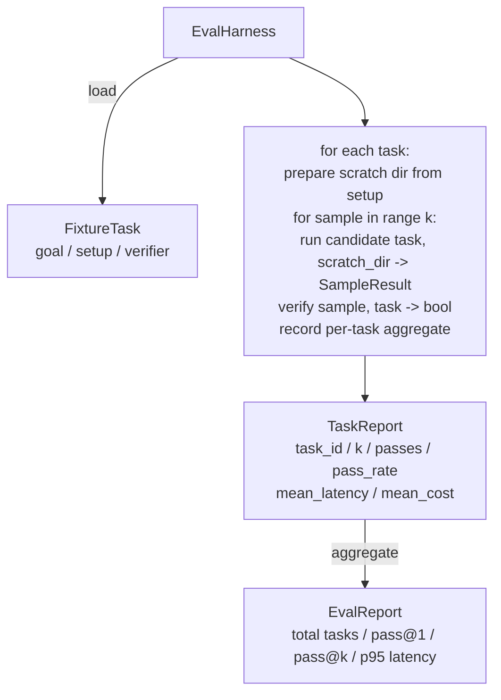

# Kaştağı Ders 27: 带 Fixture Tasks of Eval Harness

> Bir kodlama ajanının seviyesi, görev paketlerini ölçmek için kullandığınızdan bağlıdır. Bu ders bir değerlendirme harnesini oluşturacak: sabit bir görev alıyor.

**Type:** Build
**Languages:** Python (stdlib)
**Prerequisites:** Phase 19 · 25 (verification gates), Phase 19 · 26 (sandbox runner), Phase 14 · 30 (eval-driven agent development), Phase 14 · 19 (SWE-bench and GAIA benchmarks)
**Time:** ~90 minutes

## Öğrenme Hedefleri

- Bu konumu belirlemek için, bir hedef oluşturmak ve bir verifikatörün üçü oluşturmak gerekir.
- Her görev için bir kaç örnek çalıştırılır 打分,并计算 pass@1 和 pass@k。
- Gecikme ve maliyetleri %95 ölçümleri ile birleştirmek için.
- Bu, bir diğer devirin en son olarak kullanılacağı bir işlevi oluşturur.
- 输出结构化 JSON rapor, için regresyon takip metni 摄取──

## Sorun

Bu yüzden, bu bir başarı değil.

İlk sınıfı deneysiz bir geçiş. Ajan, bir kez fark ettiğini söylüyor, bir kez de paketleri yeşil olarak işaret ediyor, üç hafta sonra gerileme testi. Aynı bir hata ortaya çıkıyor. Ajanın düşüncesi mantıklı görünüyor, ama aslında hiçbir şey de tamir edilmemiştir.

İkinci sınıf ise, keşfedilmemiş gerileme. İlk şablonun bir kez değiştirilmesi, ajanın görünen görevlerde %4 oranında yükselmesine izin verir, sakin görevlerde %14 oranında düşmesine izin verir.

Üçüncü sınıf ise, 100 görevden sonra, sadece 95 görevden sonra, çünkü 5 takımı yeniden adlandırıldı.

Harness, bu başarısızlıkları gerçeklere dönüştürme sürecidir. Her zaman tekrarlanabilir bir sırada çalışır ve bir doğrulama aracı kullanır.

## Anlaşım

```mermaid
flowchart LR
  F1[fixtures/task_001/<br/>task.json + expected/] --> Harness
  F2[fixtures/task_002/<br/>...] --> Harness
  Harness[Harness<br/>for each task:<br/>setup / run agent k samples /<br/>verify each sample /<br/>record latency, cost]
  Harness --> Report[EvalReport<br/>pass@1 / pass@k<br/>mean ms / p95 ms<br/>mean cost]
```

`FixtureTask`Küçük bir JSON dosyası, seçilebilir bir dosya eklenir.`expected/`目录──JSON 声明 `id`- Evet.`goal`(Agent'in uyarısını yap)`setup`块((((((((((((((((((((((((((((((((((((((((((((((((((((((((((((((((((((((((((((((((((((((((((((((((((((((((((((((((((((((((((((((((((((((((((((((((((((((((((((((((((((((((((((((((((((((((((((((((((((((((((((((((((((((((((((((((((((((((((((((((((((((((((((((((((((((((((((((((((((((((((((((((((((((((((((((((((((((((((((((((((((((((((((((((((((((((((((((((((((((((((((((((((((((((((((((((((((((((((((((((((((((((((((((((((((((((((((((((((((((((((((((((((((((((((((((((((((((((((((((((((((((((((((((((((((((((((((`verifier`块──verifier 块指定 harness'in verifier registry içindeki bir işlevi,并提供其参数──

Üç çeşit doğrulayıcı 形态覆盖大多数有用任务──

Birincisi:`file_equals`◊ ajan  çalıştırıldıktan sonra, belirlenen dosya beklenen içeriğe göre göre görecektir.

İkinci tür:`regex_match`                                                                                                                                                                                                                                                              

Üçüncü:`shell_exit_zero`◊ harness 运行一个 shell命令(通过课26的沙盒),只有当命令以零 退出时才让任务通过──这能捕捉测试必须通过的任务──

Harness her görevi yürütmek için`k`İkinci. Geçit.`1 - (1 - p)^k`, içinden p is experience pass rate;harness ayrıca raw counts rapor eder, facilitate you find variance;; latency is each sample's wall-clock;; Cost is agent 自行報告的任何内容;;token count、USD,或两者);harness 会跨样品 求和,并呈现逐任务和聚合数字──

## Mimarlık



adayın adı:`Callable[[FixtureTask, str], SampleResult]`✿ ✿ ✿ ✿ ✿ ✿ ✿ ✿ ✿ ✿ ✿ ✿ ✿ ✿ ✿ ✿ ✿ ✿ ✿ ✿ ✿ ✿ ✿ ✿ ✿ ✿ ✿ ✿ ✿ ✿ ✿ ✿ ✿ ✿ ✿ ✿ ✿ ✿ ✿ ✿ ✿ ✿ ✿ ✿ ✿ ✿ ✿ ✿ ✿ ✿ ✿ ✿ ✿ ✿ ✿ ✿ ✿ ✿ ✿ ✿ ✿ ✿ ✿ ✿ ✿ ✿ ✿ ✿ ✿ ✿ ✿ ✿ ✿ ✿ ✿ ✿ ✿ ✿ ✿ ✿ ✿ ✿ ✿ ✿ ✿ ✿ ✿ ✿ ✿ ✿ ✿ ✿ ✿ ✿ ✿ ✿ ✿ ✿ ✿`tempfile.mkdtemp()`创建草图目录,并把其路径作为普通字符串传入──harness 不关心候选人 如何工作──候选人 可以是确定性的补丁申请者(对harness自我测试 很有用)、真实LLM代理、fuzzer──契约是 SampleResult──

## Ne yapacaksın?

`main.py`提供:

1. `FixtureTask`veri sınıfı
2. `SampleResult`veri sınıfı:başarı_kendini rapor eden、alanlık_ms、maliyet_birimleri、editler。
3. 带 `to_dict()``TaskReport`- Evet.`EvalReport`Verim sınıfları。
4. Verifiyeci adı 映射到函数 的`VerifierRegistry`△内置 verifiers:file_equals、regex_match、shell_exit_zero。
5. `EvalHarness`sınıfı── bir adayla 运行一个任务目录──返回EvalReport──
6. Bağlı halde`tasks/`Ortacı beş görev:
   - `fizzbuzz`Orta bir tek
   - `factorial`Orta eksiklik
   - hata mesajı 中的字体错误
   - 空 fonksiyon vücut
   - Bağlı listeler geçişleri 中的
7. Bir kesinlik referans adayı`apply_known_fixes`),harness kullanmak için kullanılır.
8. Demo 打印 EvalReport JSON ve sıfır 退出。

Yapıştırma görevleri 以 `tasks/`İçinde JSON dosya biçimi, paketlenmiş, birlikte`tasks/<id>/buggy/`和 `tasks/<id>/expected/`Çekilmez bir çöp, bir başvuruya teslim edilir ve beklenen doğrulama görevi yerine getirir.

## Neden pas@k kullanıyorsun, sadece pas@1 değil?

Gerçek LLM ajanları ise her zaman geçerli olur.

Pass@k 会和 pass@1 Bir rapor, çünkü pass@k 会掩盖真失败: Eğer model iki kez sadece bir kez doğru cevap alırsa, senin yararlı bir ajanın yok.

## Nasıl A'nın kalan kısmıyla birleşti ?

Ders 25 ışığa çıkıyor ışığa çıkıyor ışığa çıkıyor ışığa çıkıyor ışığa çıkıyor ışığa çıkıyor ışığa çıkıyor ışığa çıkıyor ışığa çıkıyor ışığa çıkıyor ışığa çıkıyor ışığa çıkıyor ışığa çıkıyor ışığa çıkıyor ışığa çıkıyor ışığa çıkıyor ışığa çıkıyor ışığa çıkıyor ışığa çıkıyor ışığa çıkıyor ışığa çıkıyor ışığa çıkıyor ışığa çıkıyor ışığa çıkıyor ışığa çıkıyor ışığa çıkıyor ışığa çıkıyor ışığa çıkıyor ışığa çıkıyor ışığa çıkıyor ışığa çıkıyor ışığa çıkıyor ışığa çıkıyor ışığa çıkıyor ışığa çıkıyor ışığa çıkıyor ışığa çıkıyor ı ışığa çıkıyor ı ışşşşşşşşşşşşşşşşşşşşşşşşşşşşşşşşşşşşşşşşşşşşşşşşşşşşşşşşşşşşşşşşşşşşşşşşşşşşşşşşşşşşşşşşşşşşşşşşşşşşşşşşşşşşşşşşşşşşşşşşşşşşşşşşşşşşşşşşşşşşşşşşşşşşşşşşşşşşşşşşşşşşşşşşşşşşşşşşşşşşşşşşşşşşşşşşşşşşşşşşşşşşşşşşşşşşşşşşşşşşşşşşşşşşşşşşşşşşşşşşşşşşşşşşşşşşşşşşşşşşşşşşşşşşşşşşşşşşşşşşşşşşşşşşşşşşşşşşşşşşşşşşşşşşşşşş`shell_exit_zero`verifier 使用 sandbox。Desin 28 会把每次 harness run 包进 OTel trace。Desin 29 针对其中一个捆绑固定 运行端到端演示,并断言参考候选人的pass@1 = 1.0。

## 运行方式

```bash
cd phases/19-capstone-projects/27-eval-harness-fixture-tasks
python3 code/main.py
python3 -m pytest code/tests/ -v
```

demo 以 JSON 打印 EvalReport,包括pass@1、pass@5、mean latency 和逐任务 breakdown──exit code 为零──teses 覆盖 verifier functions、pass@k math、fixture loading,以及 harness 针对捆绑引用候选人的端到端 行为──

```figure
pass-at-k
```
