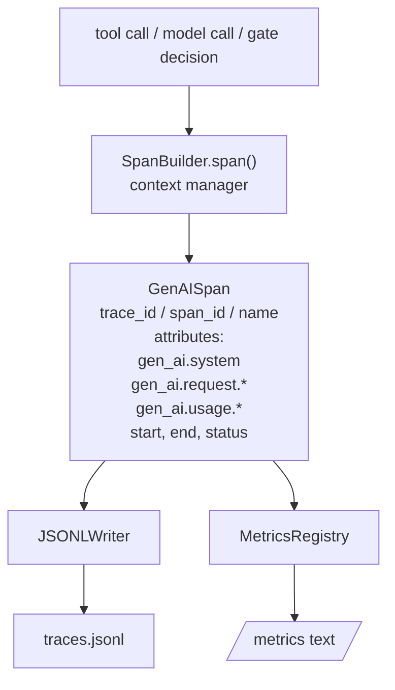
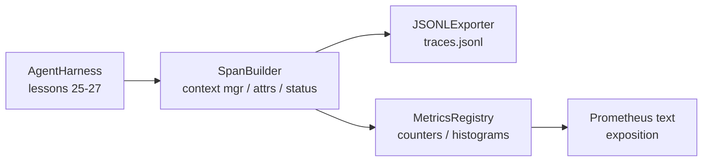

# Capstone Ders 28: OTel GenAI Spans & Prometheus Metrikleri kullanmak  gözlemliliği gerçekleştirmek

> 无可观察的代理harness 是一个会花钱的黑盒──本课会手写一个跨度构建器,发发出符合OpenTelemetry GenAI semantic conventions 的记录,把它们写在JSON-Lines文件,每行一个跨度,并以Prometheus文格式 暴露计和 histograms──整个实现都是Stdlib Python,并且可离线运行──

**Type:** Build
**Languages:** Python (stdlib)
**Prerequisites:** Phase 19 · 25 (verification gates), Phase 19 · 26 (sandbox), Phase 19 · 27 (eval harness), Phase 13 · 20 (OpenTelemetry GenAI), Phase 14 · 23 (OTel GenAI conventions)
**Time:** ~90 minutes

## Öğrenme Hedefleri

- OpenTelemetry GenAI semantik sözleşmelerine uygun bir yapılandırma 形态的跨度数据类──
- 实现一个JSONL出口,每行写入一个自包含跨度──
- 构建带标签 和 Prometheus metin biçimi açıklanabilirlik hesaplayıcıları ve histogramlar。
- Uzd span context manager 包装任意调用,记录时间、status 和例外──
- Deney emisyonu geçiyor`json.loads`Dönüş,并匹配 仕様形──

## Sorun

生产中的编码代理 每一轮都会产出三类文物:一次模型调用一次工具执行以及一个验证门决定──没有结构化远程测量,这些都没有用──

İlk sınıf başarısızlık modeli, kayıp izleridir. Sorun çıktı, ancak tek kayıt 500 kez yapılan bir sohbet logudur.

İkinci sınıf başarısızlık modeli ise, aşılmaz bir iztiraklılıktir. Harness, spans yazmış, ancak kendi ad hoc alan isimlerini kullanmıştır. Grafana, Honeycomb, Jaeger veya yerel CLI'ler tüm araçları boşa harcadı.

Üçüncü sınıf başarısızlık modeli, toplanmamış metriklerdir. Bir kez çok yavaş bir araç çağrısı izleyebilirsiniz, ancak cevap veremezsiniz.

OpenTelemetry GenAI semantik sözleşmeleri bunun için var. Bunlar, her türlü LLM çerçevesinin uzayış emitenleri için bir grup standart özelliği tanımlıyor.

## Anlaşım



Harness 中 中の各操作 都会生成一个 span──span 具有痕跡 id(全代理调用)、span id(この操作)、名前(例えば`gen_ai.chat`- Evet.`gen_ai.tool.execution`GenAI'nin konvansiyonlarının özelliklerini takip et­mek, başlangıç ve son zamanını ve durumunu takip et­mek.

GenAI'nin konvensiyonları  standartlaştırdı bu özellik anahtarları:`gen_ai.system`(Haya tedarikçi, örneğin `anthropic`- Evet.`openai`)`gen_ai.request.model`(model kimliği)`gen_ai.request.max_tokens`- Evet.`gen_ai.usage.input_tokens`- Evet.`gen_ai.usage.output_tokens`- Evet.`gen_ai.response.model`- Evet.`gen_ai.response.id`- Evet.`gen_ai.operation.name`, ve araç özel anahtarlar `gen_ai.tool.name`和 `gen_ai.tool.call.id`- Evet.

EXPORTER 写 JSONL。每行一个 JSON对象──这是下游工具 可以流、grep 和进口的最简单格式──真实OTel eksporteur 会使用OTLP gRPC;本课的JSONL eksporteur 是离线等价,并且在每个工作站上都以零退出──

Metrikler ve izler yok. Her araç çağrısı bir hesaplayıcıyı artırır.`tools_called_total{tool="read_file"}`◊histogram 记录观察到的延迟:`tool_latency_ms{tool="read_file"}`△ △ △ △ △ △ △ △ △ △ △ △ △ △ △ △ △ △ △ △ △ △ △ △ △ △ △ △ △ △ △ △ △ △ △ △ △ △ △ △ △ △ △ △ △ △ △ △ △ △ △ △ △ △ △ △ △ △ △ △ △ △ △ △ △ △ △ △ △ △ △ △ △ △ △ △ △ △ △ △ △ △ △ △ △ △ △ △ △ △ △ △ △ △ △ △ △ △ △ △ △ △ △ △ △ △ △ △ △ △ △ △ △ △ △ △ △ △ △ △ △ △ △ △ △ △ △ △ △ △ △ △ △ △ △ △ △ △ △ △ △ △ △ △ △ △ △ △ △ △ △ △ △ △ △ △ △ △ △ △ △ △ △ △ △ △ △ △ △ △ △ △ △ △ △ △ △ △ △ △ △ △ △ △ △ △ △ △ △ △ △ △ △ △ △ △ △ △ △ △ △ △ △ △ △ △ △ △ △ △ △ △ △ △ △ △ △ △                                                                          

```figure
trace-spans
```

## Mimarlık



- Spası yapıcı, küçük bir sınıf.`span(name, attrs)`Metode, bir bağlam yöneticisine geri dönmek. İçeri girdiğinde kayıt başlangıcı zamanı, çıkışında kayıt bitirme zamanı, istisna atıldığında, bu istisna eklenirse, bitmiş süreyi etişkiciye göndermek.

Metrik kayıtları iki diptedir.`{(name, frozen_labels): int}`❖Histogramlar çiğ örnekleri listede tutarak, Prometheus histogram kovaları olarak gösterilmektedir.

## Ne yapacaksın?

`main.py`提供:

1. `GenAISpan`veri sınıfı:trace_id、span_id、parent_span_id、name、attribut、start_unix_nano、end_unix_nano、status、status_message、events。
2. 带 `span(name, attrs, parent=None)`bağlam yöneticisi `SpanBuilder`Sınıfı
3. 带 `export(span)``JSONLExporter`Sınıf, ek yazım bir satır.
4. `Counter`和 `Histogram`sınıflar ve `MetricsRegistry`- Evet.
5. 生成 metin biçimi çıkışı `prometheus_exposition(registry)`- Evet.
6. 发发发期并更新的指标 `wrap_tool_call(name)`Dekorasyoncı.
7. Demo: sintet一次完整代理调用 (),写入 traces.jsonl,打印 Prometheus exposition,并以零 退出。

Trace id 16 byte  değeri   32 个 hex 字符), span id 8 byte  değeri  16 个 hex 字符),都截取自随机的 `uuid4`Hex. ∞ ∞ ∞ ∞ ∞ ∞ ∞ ∞ ∞ ∞ ∞ ∞ ∞ ∞ ∞ ∞ ∞ ∞ ∞ ∞ ∞ ∞ ∞ ∞ ∞ ∞ ∞ ∞ ∞ ∞ ∞ ∞ ∞ ∞ ∞ ∞ ∞ ∞ ∞ ∞ ∞ ∞ ∞ ∞ ∞ ∞ ∞ ∞ ∞ ∞ ∞ ∞ ∞ ∞ ∞ ∞ ∞ ∞ ∞ ∞ ∞ ∞ ∞ ∞ ∞ ∞ ∞ ∞ ∞ ∞ ∞ ∞ ∞ ∞ ∞ ∞ ∞ ∞ ∞ ∞ ∞ ∞ ∞ ∞ ∞ ∞ ∞ ∞ ∞ ∞ ∞ ∞ ∞ ∞ ∞ ∞ ∞ ∞ ∞ ∞ ∞ ∞ ∞ ∞ ∞ ∞ ∞ ∞ ∞ ∞ ∞ ∞ ∞ ∞ ∞ ∞ ∞ ∞ ∞ ∞ ∞ ∞ ∞ ∞ ∞ ∞ ∞ ∞ ∞ ∞ ∞ ∞ ∞ ∞ ∞ ∞ ∞ ∞ ∞ ∞ ∞ ∞ ∞ ∞ ∞ ∞ ∞ ∞ ∞ ∞ ∞ ∞ ∞ ∞ ∞ ∞ ∞ ∞ ∞ ∞ ∞ ∞ ∞ ∞ ∞ ∞ ∞ ∞ ∞ ∞ ∞ ∞ ∞ ∞ ∞ ∞ ∞ ∞ ∞ ∞ ∞ ∞ ∞ ∞ ∞ ∞ ∞ ∞ ∞ ∞ ∞ ∞ ∞ ∞ ∞ ∞ ∞ ∞ ∞ ∞ ∞ ∞ ∞ ∞ ∞ ∞ ∞ ∞ ∞ ∞ ∞ ∞ ∞ ∞ ∞ ∞ ∞ ∞ ∞ ∞ ∞ ∞ ∞ ∞ ∞ ∞ ∞ ∞ ∞ ∞ ∞ ∞ ∞ ∞ ∞ ∞ ∞ ∞ ∞ ∞ ∞ ∞

histogram has a set of fixed millisecond latency buckets:5、10、25、50、100、250、500、1000、2500、5000、10000、+Inf。

## Neden yazmak yerine Openetry-SDK kullanmak?

OTel Python SDK gerçek bir bağımlılıktır. Ayrıca binlerce kod var, OTLP ihracatçısının bir arka planı da var ve bu da bir bölümünü besleyecektir.

GenAI'nin konvansiyonları, özellikler içinde gelişme için işaretlenmektedir ve daha önce özelliği değiştirilmiştir:`gen_ai.usage.prompt_tokens`Değişmiş .`gen_ai.usage.input_tokens`❖ Semi-konvensiyonları  versiyonları sabitleyip ⇒ kontrol et.

## Nasıl A'nın kalan kısmıyla birleşti ?

Ders 25 output gate chain── Ders 26 output sandbox── Ders 27 output eval harness── Ders 28 让这三者都可观测── Ders 29 会把端到端的演示的每一步都包进跨度,最后打印 Prometheus文──

## 运行方式

```bash
cd phases/19-capstone-projects/28-observability-otel-traces
python3 code/main.py
python3 -m pytest code/tests/ -v
```

Bu derste bir çalışma toplantısı yaparak bir tane çıkarttım.`traces.jsonl`(最后清理), sonra üç uzantı örneğini, yeniden yazdırma saylayıcılarını, proometheus açıklamasını ve histogramlarını, testleri, test uzantısını, geri dönüş yolculuğu, sıralanma, kanonik GenAI özelliklerini, eksistensiyeleri, saylayıcıları, ve histogram açıklamasını, beklenen kova sayımlarını içerir.
