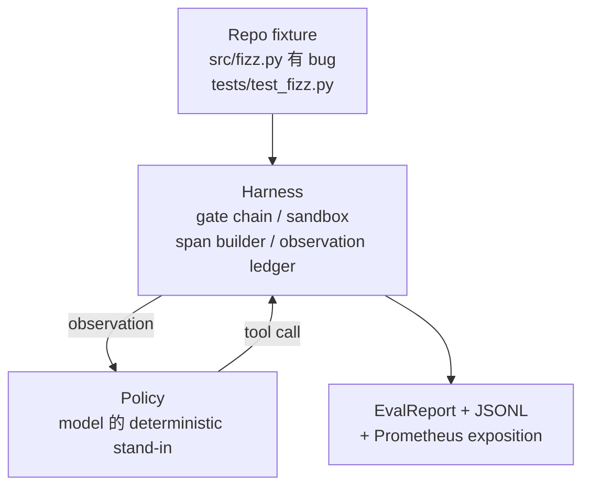
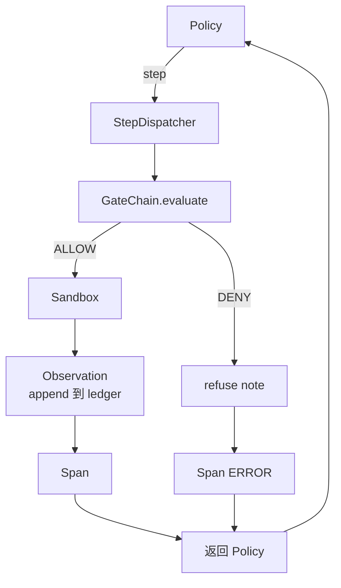

# Capstone  Ders 29: Harness Üst Üst Üstü Kodlama Ajanı

> Track A'nın sonuçları。本课程把门链、砂箱、eval harness 和 OTel spans 串连成一个可工作的编码代理,用于修复一个多文件Python项目中真实的(小型固定规模)bug。 bu ajan, LLM değil, belirleyici politikadır; bu değiştirme kursu geri kazanılmasına neden olur,并说明 harness 才始终是最关键的部分──合同 完全相同:真实模型可以插入政策──

**Type:** Build
**Languages:** Python (stdlib)
**Prerequisites:** Phase 19 · 25 (verification gates), Phase 19 · 26 (sandbox), Phase 19 · 27 (eval harness), Phase 19 · 28 (observability), Phase 14 · 38 (verification gates), Phase 14 · 41 (workbench for real repos), Phase 14 · 42 (agent workbench capstone)
**Time:** ~90 minutes

## Öğrenme Hedefleri

- Kapı zinciri, kum kutusu, uç harnesini ve uzantı yapımcısını bir tek ajan döngüsünü oluşturmak.
- 实现一个使用读_文件、运行_测试 和 write_file 修复 fixture bug 的确定性政策──
- Bir kez biten biten yürürlükte tüm devreye aşama bütçesi ve gözlem token bütçesi zorunlu uygulanması
- "Tüm çalışmaları tamamlamak için, "OTel GenAI izleri ve "Prometheus metrikleri" göndermek için.
- Deney ajanı 12 adımdan az bir süre içinde bir çözüm ayarladı ve yasal araçlar kullanıldı.

## Sorun

Büyük çoğunluklu ajan demoları, yalnız çalışmalar halinde: tek tek kum kutusu, tek tek değerlendirme harnes, tek tek bir uzantı emiten, sorunsuz görünmektedirler.

Kapı zinciri  İZLETİN İZLETİNİ, ama kum kutu çünkü zincir                                                                                                                                                                                                                                                                                                                                                                                                                                                                                                     

Bu ders tüm pistin entegrasyon testidir.Agent, dört şeyi sırayla tamamlamalıdır: projenin okunması, testlerin yürütülmesi, test başarısızlığından sonra hataların tespit edilmesi, yazılı düzeltme, yeniden çalıştırılması, sonra durdurulması.

## Anlaşım



Bir ajanın politikası bir devlet makinesi.

`SURVEY`:agent 读取 proje listing──下一个状态是RUN_TESTS──

`RUN_TESTS`:agent 运行 test komutu。 eğer testler geçerse, state machine 以 başarısı 停止──否则下一个状态 是 INSPECT──

`INSPECT`:agent 读取失败的源文件──下一个状态是 FIX──

`FIX`:agent 写入修正后的文件──下一个状态是 VERIFY──

`VERIFY`:agent 再次运行 test komutu。 eğer testler geçerse, başarıyı durdurun。 yoksa başarısızlıkla durdurun。

Her devlet bir araç çağrısına cevap veriyor. Her araç çağrısı kapı zincirinden geçiyor. Eğer bir araç çağrısı reddedildiyse, ajanın izlenimi sırasında rapor reddediyor ve durdurulmaktadır.

Yapılama hatası `fizz.py`İç İç İç İç İç İç İç İç İç İç İç İç İç İç İç İç İç İç İç İç İç İç İç İç İç İç İç İç İç İç İç İç İç İç İç İç İç İç İç İç İç İç İç İç İç İç İç İç İç İç İç İç İç İç İç İç İç İç İç İç İç İç İç İç İç İç İç İç İç İç İç İç İç İç İç İç İç İç İç İç İç İç İç İç İç İç İç İç İç İç İç İç İç İç İç İç İç İç İç İç İç İç İç İç İç İç İç İç İç İç İç İç İç İç İç İç İç İç İç İç İç İç İç İç İç İç İç İç İç İç İç İç İç İç İç İç İç İç İç İç İç İç İç İç İç İç İç İç İç İç İç İç İç İç İç İç İç İç İç İç İç İç İç İç İç İç İç İç İç İç İç İç İç İç İç İç İç İç İç İç İç İç İç İç İç İç İç İç İç İç İç İç İç İç İç İç İç İç İç İç İç İç İç İç İç İç İç İç İç İç İç İç İç İç İç İç İç İç İç İç İç İç İç İç İç İç İç İç İç İç İç İç İç İç İç İç İç İç İç İç İç İç İç İç İç İç İç İç İç İç İç İç İç İç İç İç İç İç İç İç İç İç İç İç İç İç İç İç İç İç İç İç İç İç İç İç İç İç İç İç İç İç İç İç İç İç İç İç İç İç İç İç İç İç İç İç İç İç İç İç İç İç İç İç İç İç İç İç İç İç İç İç İç İç İç İç İç İç İç İç İç İç İç İç İç İç İç İç İç İç İç İç İç İç İç İç İç İç İç İç İç İç İç İç İç İç İç İç İç İç İç İç İç İç İç İç İç İç İç İç İç İç İç İç İç İç İç İç İç İç İç İç İç İç İç İç İç İç İç İç İç İç İç İç İç İç İç İç İç İç İç İç İç İç İç İç İç İç İç İç İç İç İç İç İç İç İç İç İç İç İç İç İç İç İç İç İç İç İç İç İç İç İç İç İç İç İç İç İç İç İç İç İç İç İç İç İç İç İç İç İç İç İç İç İç İç İç İç İç İç İç İç İç İç İç İç İç İç İç İç İç İç İç İç İç İç İç İç İç İç İç İç İç İç İç İç İç İç İç İç İç İç İç İç İç İç İç İç İç İç İç İç İç İç İç İç İç İç İç İç İç İç İç İç İç İç İç İç İç İç


```figure
cg-harness-weave
```

## Mimarlık



Bu ders kendi kendine kapsamlıdır. Her önceki ders ilkesi var.`main.py`Orta en küçük ölçekte yeniden gerçekleştirilmektedir, bu nedenle bu derslerin birbiriyle tamamıyla uyumlu olması için, bu isimler 25-28 derslerle tamamen uyumludur.

## Ne yapacaksın?

`main.py`提供:

1. İlk sınıflar, isim ve ders 25-28`GateChain`- Evet.`Sandbox`- Evet.`ObservationLedger`- Evet.`SpanBuilder`- Evet.`MetricsRegistry`- Evet.
2. `CodingAgentPolicy`sınıf: içerir beş devletin devlet makinesi
3. `Repo`Bir çizik çırpma hazırlayın, bunlardan bir tane de paketleme cihazı var.
4. `AgentRun`Sınıf: Sürücü politika, harnes gönderisi,并返回 `AgentRunReport`- Evet.
5. Bir paketle bağlanmış bir cihaz`fixture_repo/`), src/fizz.py、test/test_fizz.py'yi içerir, ayrıca eval harness'in beklenen/ ağacını kullanır.
6. Demo:端到端运行 politikası, 打印逐步追踪,断言通过,并打印度──

Bündelleme ayarı ve ders 27'nin görev yapısı  şekli aynı: bir hata dosyası 和 bir test dosyası。 test başarısızlığı mesajı  yeterince bilgi içerir, kararlı politika 能识别 fix。 gerçek LLM 会做同样的工作,只是更慢并拥有更广泛的回忆,但它不会改变利用的期望──

## Neden politika değil LLM

Gerçek LLM  API anahtarı ネットワーク çağrısı, yanı sıra doğrulanamayan stochasticity  harness 才是本课程关心的部分── 替代为确定性政策 能让课程在任何开发者笔记本电脑上运行,零外部依赖,并让测试套件 断言精确的步骤数──

Bu kursun politikası LLM ajanının yaptığı şeylerin ciddi bir parçasıdır.

## Demo 会断言什么

Sonunda demo yapılır. Beş şey söylenir. Test süiti de programlama şeklinde tekrar söylenir.

Politika 12 adımdan az bir süre sonra çözülmüştür.

Gözlem bütçesi 从未超出──

Yasal araçlar,                                                                                                                                                                                                                                                             

Traces.jsonl'de her adımın bir süreliğine göre bir süreliğine göre bir süreliğine göre bir süreliğine göre bir süreliğe göre bir süreliğe göre bir süreliğine göre bir süreliğe göre bir süreliğe göre bir süreliğine göre bir süreliğe göre bir süreliğe göre bir süreliğine göre bir süreliğe göre bir süreliğe göre bir süreliğe göre bir süreliğe göre bir süreliğe göre bir süreliğe göre bir süreliğe göre bir süreliğe göre bir süreliğe sahip.

Prometheus açıklaması 包含一个 `tools_called_total{tool="read_file"}`Giriş ve bir `tool_latency_ms`Istogramı

## Nasıl A'nın kalan kısmıyla birleşti ?

Bu ders birleştirme biçimidir. Ders 25  kapı zinciri yazıyor. Ders 26  sandbox yazıyor. Ders 27  eval harness yazıyor. Ders 28  gözlemliliği yazıyor. Ders 29  bunları bir sistem olarak kanıtlıyor.

## 运行方式

```bash
cd phases/19-capstone-projects/29-end-to-end-coding-task-demo
python3 code/main.py
python3 -m pytest code/tests/ -v
```

demo 会打印 步骤追踪、最終評価報告 和 Prometheus exposition──退出码为零──teses 覆盖政策状态过渡、合成工具通话 上的门拒绝、捆绑固定 上的端到端运行,以及阶段预算变量──
