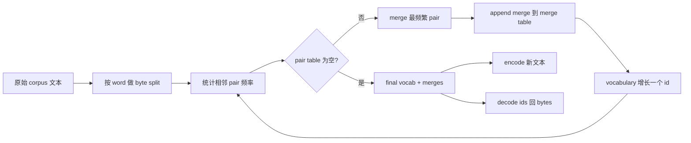
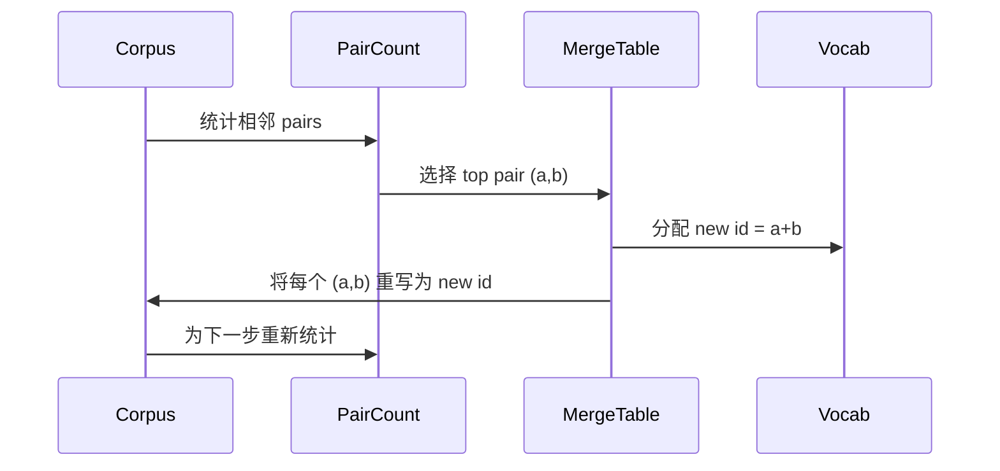

# BPE Tokenizer'i oluşturma

> 字节进, 出, 出, 再返回相同字节──构建每个现代文本模型仍然起步于此的Tokenizer──

**Type:** Build
**Languages:** Python
**Prerequisites:** Phase 04 lessons, Phase 07 transformer lessons
**Time:** ~90 minutes

## Öğrenme Hedefleri
- 通过反复 merge 最频繁的相邻符号对,从原始文体 corpus 训练 Byte-Pair Kodlama sözlükleri。
- 实现确定性融合表,并将其应用到新文本上,生成子字 ids 流──
- İstediğiniz UTF-8 girişini id olarak dönüştürmek ve geri yüklemek ve bilgi kaybetmek zorunda değildir.
- 保留并保护 özel tokenlar`<|endoftext|>`- Evet.`<|pad|>`), onları eğitim ve çözme sırasında değişmeye devam etmelerini sağlayın.
- 推理为什么字节 seviyesindeki alfabet Tokenizer'in tamamiyle kullanımındadır.


```figure
cap-bpe-merge
```

## Çerçeve

Dil modeli 永远看不到文本──它看到是整数──把字符串 映射为整数列并再映射回来东西,就是Tokenizer──这个层做错了,训练运行中每条损失曲线都在衡量错误的东西──

Genel metin modelleri içinde baskın alt kelime Tokenizers 家族 is Byte-Pair Encoding。 идея很小。 bir bilinen alfabeden 开始。 bulmak eğitim korpusunda en sık ortaya çıkan komşu sembol çift。把它合并成一个新符号。重复,直到词汇 达到目标大小──编码 新文本会按同顺序复用相同的合并列。

Biz byte seviyesindeki bir variansı inşa edeceğiz. Alfabe 256 çiğ bayt, Unicode kod noktaları yerine. Bu seçenek Tokenizer'in herhangi bir UTF-8 girişini işleyebilmesini sağlar.

## - Boru hattı



Bu paylaşım bir sözleşmedir. Eğer birleştirme sırasını değiştirirseniz, farklı kimliklerin çıkışını çözüp bulacaksınız.

## Bayt alfabesi

Önceki 256 个ID'leri 0x00'den 0xFF'e kadar çiğ baytlara saklayın. Bu, her giriş satırının herhangi bir birleşimden önce kelime birikimi ile ifade edilebileceğini garanti eder.

Pretokenizer 会在训练中 见体 之前,根据白空 和 符号界限 进行分裂──如果没有这个分裂,BPE merge step 会很乐意学习跨越词界限的合并,词库 会被常见整句短语填满──有这个分裂,会留在词内,结果也更能泛化──

## Eğitim döngüsü

Her eğitim aşamasında, döngü üç şey yapar. Korpusun her kelimesini, mevcut sembollerin her komşu çiftini, ortaya çıkma frekansını, kelimenin kendiliğinden ortaya çıkma frekansını artırır. En yüksek çift saymayı seçer.



Her adımın maliyeti ve korpusu ı simge dizisi listesinin gösterilmesi sırasında büyük bir proje linear ilişki olarak ıııııııııııııııııııııııııııııııııııııııııııııııııııııııııııııııııııııııııııııııııııııııııııııııııııııııııııııııııııııııııııııııııııııııııııııııııııııııııııııııııııııııııııııııııııııııııııııııııııııııııııııııııııııııııııııııııııııııııııııııııııııııııııııııııııııııııııııııııııııııııııııııııııııııııııııııııııııııııııııııııııııııııııııııııııııııııııııııııııııııııııııııııııııııııııııııııııııııııııııııııııııııııııııııııııııııııııııııııııııııııııııııııııııııııııııııııııııııııııııııı

## Yeni metin kodlaması

sonuçlar 调用 merge counter──它按学习到的相同顺序应用 merge table──对于一个新词,encoder从字节分开 开始──它扫描当前序列,寻找排名 最低的 merge(最早学习到且可应用的那个)──它执行该 merge──然后再扫描──当前序列适用任何 merge 时,loop 结束──

順位 排序 順位 排序 排序 排序 排序 排序 排序 排序 排序 排序 排序 排序 排序 排序 排序 排序 排序 排序 排序 排序 排序 排序 排序 排序 排序 排序 排序 排序 排序 排序 排序 排序 排序 排序 排序 排序 排序 排序 排序 排序 排序 排序 排序 排序 排序 排序 排序 排序 排序 排序 排序 排序 排序 排序 排序 排序 排序 排序 排序 排序 排序 排序 排序 排序 排序 排序 排序 排序 排序 排序 排序 排序 排序 排序 排序 排序 排序 排序 排序 排序 排序 排序 排序 排序 排序 排序 排序 排序 排序 排序 排序 排序 排序 排序 排序 排序 排序 排 排 排 排 排 排 排 排 排 排 排 排 排 排 排 排 排 排 排 排 排 排 排 排 排 排 排 排 排 排 排 排 排 排 排 排 排 排 排 排 排 排 排 排 排 排 排 排 排 排 排 排 排 排 排 排 排 排 排 排 排 排 排 排 排 排 排 排 排 排 排 排 排 排 排 排 排 排 排 排 排 排 排 排 排 排 排 排 排 排 排 排 排 排 排 排 排 排 排 排 排 排 排 排 排 排 

## Özel tokenler

Özel tokenler ise bayt akışı 永远无法产生 ids──我们手动保留它们──本课程两个就足够──

- `<|endoftext|>`Önemli bir şekilde, bir yeni belgeyi buradan başlatmak için, önceki bir belgenin bağlamını                                                                                                                                                                                                                                                   
- `<|pad|>`填充短序列,让批可以成为矩形 tensor──Loss mask 会在训练期间藏藏它──

Kodlayıcı  bir bayrak kabul eder, giriş için özel işaretler ortaya çıkar.`<|endoftext|>`和 `<|pad|>`Yazılı olarak yazılınca, baytlar tokenize edilecek. Bayraklar açıldığında, metni ipler, rezerve edilmiş kimliklerine görüntülenecek ve herhangi bir birleşime katılmayacak.

## Dönüş garanti

Kodlama 后再解码 必须精确返回输入字节──decoder 会顺序拼接每个 id 的字节扩展──由于每个 id 要么是原始字节,要么是两个以前已知 id 的连锁,复发式扩展 总会终止于原始字节──decoding 随后返回这些字节 拼出的 UTF-8 字符串──

Bu ders test süiti görünmeyen bir cümle içinde olacak.`<|endoftext|>`Token'ın cümlesi 上检查这个属性──

## Bu ders neyi yapmaz

Bu, en büyük üretim Tokenizers 风格的regex-driven pretokenizer── burada bir küçük beyaz alan ve noktalama bölümü vardır── bu, küçük eğitim korpusunda makul bir birleşim yaratmak için yeterli olur, ayrıca ders zincirinin sonraki bölümünün sözleşmesi ile 保持不变──下一课将将 Tokenizer作为黑盒,并在其上构建滑窗数据集──

Python'da birkaç bin kelimeyle bir çift sayısını paralelleştirmez. Bir saniye içinde tamamlanır.

## Şifreyi nasıl okuyabilirsiniz

`main.py`Dört nesneyi tanımlayın.`BPETokenizer`Sözcük hazinesine sahip, birleşme masası ve özel işaret masası.`train`Bu bir eğitim döngüsü.`encode`Bu bir sonucu yolu.`decode`Bu, bir bayt bağlamasıdır. Bu, bir küçük tokenizer'i oluşturur.`code/tests/test_bpe.py`Testler arasında dönüş özellikleri, özel jeton rezervasyonu ve birleşme siparişleri belirlendi.

运行 demo──然后把 demo 中的目标词汇规模从300 改成600,观察 held-out cümlelerin kodlanmış uzunluğu 如何下降──那条曲线就是 BPE sıkıştırma eğri──
