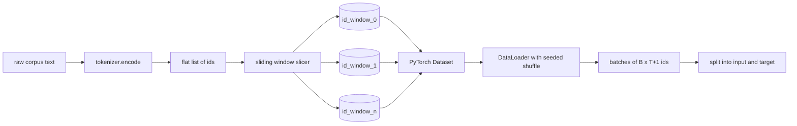
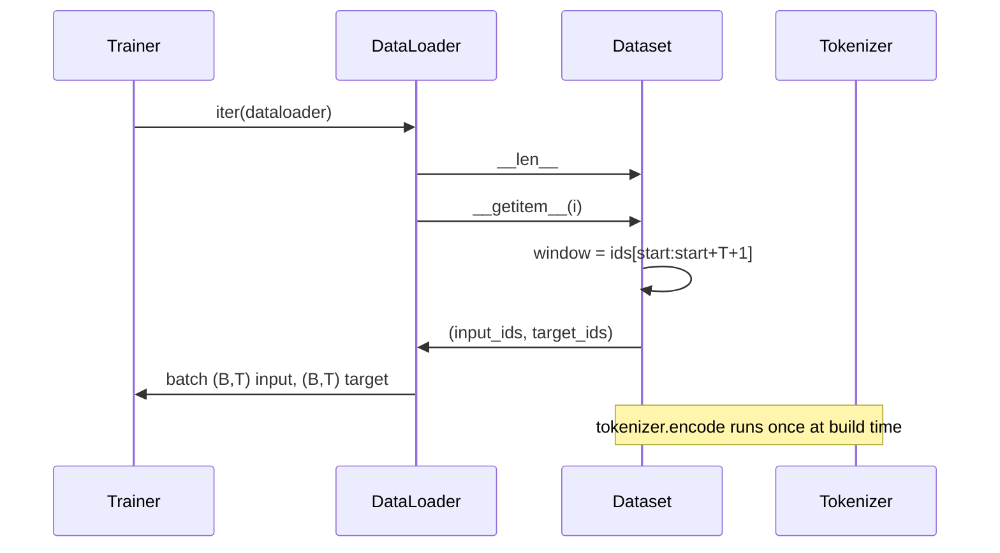

# Slaying Window'ın Tokenized Dataset'i kullan

> Bir kez daha bir kez daha bir kez daha bir kez daha bir kez daha bir kez daha daha daha daha daha daha daha daha daha daha daha daha daha daha fazla bilgi almak için bir kez daha daha daha daha kullanılabilecek bir işlem yapın.

**Type:** Build
**Languages:** Python
**Prerequisites:** Phase 04 lessons, Phase 07 transformer lessons, 本 phase 的 Lesson 30
**Time:** ~90 分钟

## Öğrenme Hedefleri


```figure
cap-sliding-window
```
- 通過只调用一次 Tokenizer,把原始 corpus 转换为 Token ids 流──
- Kullanılabilir yapılandırılabilir yükleme adım, id 流切 into fixed length window──
- Bir PyTorch Verim Satısı oluşturun, bir sonraki belirti tahmin için  geri giriş ve hedef tenzorlar oluşturun.
- Use DataLoader 包装 dataset,并使用按时期 设定种子的确定性混──
- 推理 step、冗余 ve geçerli veri kümesi boyutu  arasındaki 权衡──

## 框架

Bir kez önceden eğitim yapılır, bir kez daha eğitim verilir, bir kez daha bilgi verilir, bir kez daha bilgi verilir, bir kez daha bilgi verilir, bir kez daha bilgi verilir, bir kez daha bilgi verilir, bir kez daha bilgi verilir, bir kez daha bilgi verilir, bir kez daha bilgi verilir, bir kez daha bilgi verilir, bir kez daha bilgi verilir, bir kez daha bilgi verilir, bir kez daha bilgi verilir, bir kez daha bilgi verilir, bir kez daha bilgi verilir, bir kez daha bilgi verilir, bir kez daha bilgi verilir, bir kez daha bilgi verilir, bir kez daha bilgi verilir, bir kez daha bilgi verilir, bir kez daha daha bilgi verilir, bir kez daha daha bilgi verilir, bir kez daha daha bilgi verilebilir, bir kez daha daha bilgi verilebilir`(B, T)`Giriş kimlikleri 和 `(B, T)`hedef idler, hedefleri ise giriş left moved one;; veri borusunun çalışmaları, bu sözleşmeyi oluşturmak için, gerekli ≠ belirlenme ≠ geri dönüşü mümkün olan bir dizi GB'lık bir orijinal metin korpusundan,

Bu ders bu boru hattını oluşturur. Bu ders için Tokenizer, metni uzun bir 平 idler listesi olarak dönüştürür. Sliding Window, bu listeni kesip bir eğitim örneğine dönüştürür.

## 形状 sözleşme

nedençi LM 消费形状为 `(B, T)`Bu isimler arasında`B`Yapılanlar`T`Bu bağlamın uzunluğu.`t`Hedef konum.`t+1`Bu, her bir eğitim örneğini kapsar.`T+1`个原始 ids──window step 控制相邻 之间有多少重叠──



Slicer  asla korpusun sınırlarını aşmaz. Eğer son pencerede yeterli kimlik bulunmazsa  doldurun.`T+1`- Slicer onu terk edecek.`<|pad|>`填充尾部 da geçerli bir seçimdir, ama bu, Kayıp maskesini karmaşık hale getirir.

## Neden Çekilme Penceresi Kullanın

预训体是一条长长的 id流―― model sadece birbiriyle takılmayan pencereleri görürse, her eğitim örneği aynı şekilde öğretir.`T`个边界――调整步骤 会移动这些边界,让模型 看到更多的预测-next-token 任务――

adımlar `T`Çekilmez bir pencere oluşacak.`T // 2`%50'nin bir üzerinde oluşması, geçerli bir veri kümesi oluşturması 倍倍──stride 为 `1`En büyük yükleme oluşacak, ve veri kümesi büyütülecek.`T`倍──代价是每时代 需要更多的计算──收益是边界多样性更高──大多数预训运行使用等于文本长度的步骤,因为体积已经远大于模型 在一个时代内能跑完的规模,所以边界多样性的论点更弱──

## Veritabeler sınıfı

PyTorch Verim Satısı iki gerekli yöntem vardır.`__len__`返回 örnekler 数量。`__getitem__`E1) Tansör biçiminde bir örnek geri getirmek. Bizim veri kümemiz  depo kodlamasından sonra id 流 ve adımlar                                                                                                                                                                                                                                                                                                                                                                                                                                                                                                



Birbirinden bir değişim oluyor.`__getitem__`内部──Data ayarı 返回 `(input, target)`, içinden `input = window[:-1]`- Evet .`target = window[1:]` ikisi de PyTorch uzun tenzorları  antrenman döngüsü  onları temel gerçek olarak görecek

## Deterministik karışıklık

Kullanım`shuffle=True`读取──通过传入一个按时期 设定种子的显式  读取──通过传入一个按时期 设定种子的显式 通过传入一个按时期 设定种子的显式 通过传入一个按时期 设定种子的显式 通过传入一个按时时时的显式 通过传入一个按时时时的显式 通过传入一个按时时时的显式 通过传入一个按时时时的显式 通过传入一个按时时时的显式 通过传入一个按时时的显式 通过传入一个按时时的显式 通过时时时的显式 通过时时时的显式 通过时时时时的数据的显式 通过时时时时的数据的数据的数据的数据的数据的数据的数据的数据的数据的数据的数据的数据的数据的数据的数据的数据的数据的数据的数据的数据的数据的数据的数据的数据的数据的数据的数据的数据的数据的数据的数据的数据的数据的数据的数据的数据的数据的数据的数据的数据的数据的数据的数据的数据的数据的数据的数据的数据的数据的数据的数据的数据的数据的数据的数据的数据是`torch.Generator`, her tekrar çalıştırma sırasında aynı karışıklığı elde edebilirsiniz. İki hiperparametre çalıştırma sırasında, bu özellik önemlidir.

Bu ders için başlık sözleşmesi çok basit.`epoch_seed = base_seed + epoch_index`◊ temel tohumlar, inşaat sırasında ◊ çağlar indeksi tarafından eğitmen tarafından ◊ her dönem ◊ her dönem ◊ her dönem ◊ her dönem ◊ her dönem aynı sırada görülür.

## Satır örneklemesi

PyTorch'un öntanımlı örneklemesi, her zaman göstergeleri seçer.`B`İkinci`__getitem__`Ve sonuçlar bir seri olarak bir araya gelmek için yığılmadı. Çünkü her örnek aynı uzunlukta oluşur, bu yüzden doldurma mantığına gerek yok.

Bu ders basit bir şekilde yapıldı.`num_workers=0`❖ üretim ve iş yürüyüşünde, işçiler bir araya gelir.`__getitem__`Telefonlar için, bu temel olarak işlemizdir çünkü çalışma sadece hafıza tenzorunu bir parça yapmaktır, ancak aynı veri kümesi API'si işçilerin net desteğini sağlayabilir.

## 计算 örnekleri

对于长度为 `N`流 、 bağlam uzunluğu `T`和 adım `S`, örnek numöreler `max(0, 1 + (N - (T + 1)) // S)`本课把这个计算暴露为数据集上的静态方法,这样教练可以不过代代计算每时代的总步骤──

## 本课不做什么

Disk akışından değil, tüm kodlamalarını hafıza içine bırakır ve tek bir tensör olarak 保存 eder. Birkaç milyon ID'nin korpusuna göre, bu yüz MB'den daha düşüktür ve bu da bir ders için uygun bir biçimdir.

Çoklu belgeleri işlemiyor. Korpus bir dizi id akışı olarak görülüyor.`<|endoftext|>`ID'ler, bir sonraki belge sınırını kodlamak için kullanılır.

## Nasıl okuyabilirim?

`main.py`İki sınıf tanımladı ve bir yardımcı.`SlidingWindowDataset`- PyTorch Verim Satısı`make_dataloader` İyi bir DataLoader'e geri dön,                                                                                                                                                                                                                                                         `_encode_corpus_to_ids`Bu, bir kez yapılan Tokenizer çağrısıdır.`code/tests/test_dataset.py`Orta testler pencerelerin sayısını belirledi ∞ bir-bir değişim ∞ bir özellik ∞ bir kararlılık karıştırma ve adımlar değişimi ∞

运行 demo──然后把背景长从16 改为32 ,观察每个时代的例子 数量如何下降──这个数字就是你的阶段预算──
