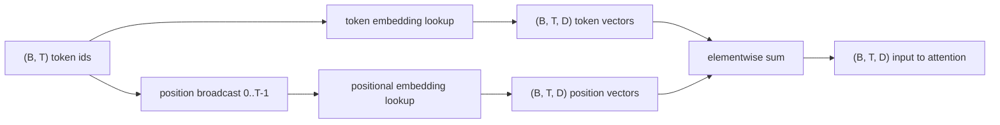
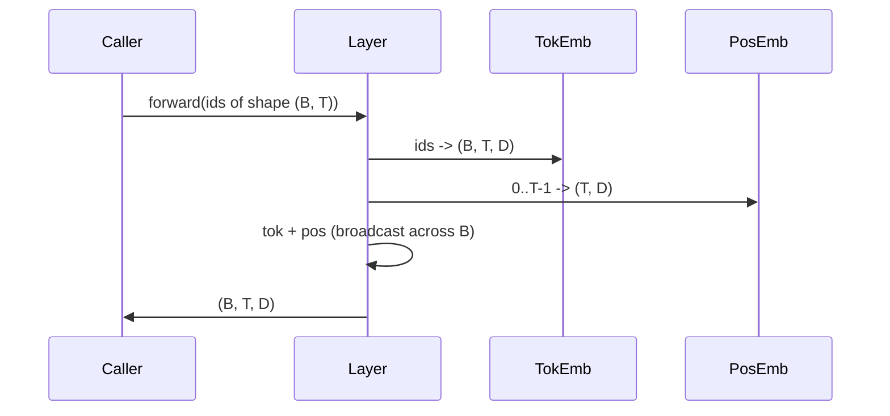

# İşaret ve Pozisyonel Eklemler

> Ids is integer. model 需要 Vector. 两张查找表 位于二者之间,而位置性表的选择会塑造模型 能学到什么.

**Type:** Build
**Languages:** Python
**Prerequisites:** Phase 04 lessons, Phase 07 transformer lessons, 本 phase 的 Lessons 30 和 31
**Time:** ~90 分钟

## Öğrenme Hedefleri


```figure
cc-embedding-lookup
```
- 构建一个标志嵌入式查找表,把词汇IDs 映射到密集向量──
- Build a per position 索引の学習位置-embedding arama tablosu 
-  Konstrüksiyonu                                                                                                                                                                                                                                                            
- Tıklama ve pozisyonsal yerleşimleri 组合成 Transformer blokunun tek girişleri
- Görelim ve sinusoidal yerleşimler arasındaki fark, uzunluk genelleşmesi ve parametreler sayımı ile karşılaştırıldığında.

## 框架

Model ile simge kimliği ile ilk temas, simge içeren Matrix'te satır aramak için yapılır. Bu Matrix Her kelime birikimi kimliği bir satır vardır, her model boyutu bir satır vardır. Aramak bir vektora geri döner. Modelin geri kalan kısmı bu kimliği anlamı olarak görür.

Token ids 本身無序──模型 需要第二信号,告诉它位置一 不同于位置十七──这个信号的两种主流选择是学习的位置嵌入式的嵌入式 (toku ids 本身无序──model 需要第二信号,告诉它位置一 不同于位置十七──这个信号的两种主流选择是学习的位置嵌入式 (toku ids 本身无序──model 需要第二信号,告诉它位置一 不同于位置十七──这个信号的两种主流选择是学习的位置嵌入式的嵌入式) 第二张查找表,每个位置一行) 和固定的 sinusidal positional embedding (Fixed sinusoidal positional embedding) 两个选择将带来后果──学习的表是参数,并且受到模型的限制 训练时最大的背景长度──sinusoidal table 理论上没有参数,公式可以扩展到任何位置,但本课的`SinusoidalPositionalEmbedding`- Evet .`max_context_length`预计算一张固定 table, its `forward`Bu nedenle burada iki modül maksimum bağlam uzunluğu uygulamayı zorlayacak.

Bu ders iki yapı, ve onları simge yerleştirme ile birleştirmek 组合成下一课注意ブロックの単一入力──

## 形状 sözleşme

yerleştirme aşamasının giriş biçimi `(B, T)`Çıkışı ise şekillidir.`(B, T, D)`- Evet.`D`Modelle boyutları: her parti unsuru aynı bağlam uzunluğuna sahiptir.`T` Her pozisyonda aynı vektör boyutu vardır `D`- Evet.



组合方式是 sum,不是连连.`D`Ağda değişmez kalmak, modelin her bir özelliğe dayanarak belirlenmiş bir simge anlamını veya konumunu belirlemek her bir katmanın hangi yönünü belirlemektedir.

## Matrix içeren token

İşaret yerleştirme is a shape for `(V, D)`Parametre tenzorunun,`V`Evet, sözcük büyüklüğü.`nn.Embedding(V, D)`暴露它──init 时入从一个小高西亚 中抽取, Transformer ölçekli modeller için, geleneksel olarak anlamı 为零, standart sapma 约为`0.02`❖ Detak init  o kadar önemli değil, önemli olan farklı çalışmaların arasında uyum sağlamaktır.

Önceden geçmek bir kez indeksileme işlemidir.`(B, T)`int64 kimlikleri 映射为 `(B, T, D)`floats──backward pass  will only put Gradient 累积到前进pass 中被触碰过的行──两行从未出现的批中的行 在此步骤 收到零 Gradient──

Bir ince ayrıntılılık. Bir token yerleştirme ve modelin sonucu çıkış projesi. Sık sık paylaşılmış ağırlıklar.

## Öğrenilen pozisyonsal yerleşim

Öğrenilen pozisyonsal yerleşim, ikinci.`nn.Embedding`, şekli `(max_context_length, D)`❖ izleme  由 konum id `0, 1, 2, ..., T-1`作为键──前进通 会把这个位置 矢量发射到批量维度 上──

Öğrenilen masa'nın eksikliği, eğer model sadece pozisyonuna eğitim `T-1`, pozisyonunu soramaz.`T`那一行不存在──这种方案的生产将把最大的文本长度进入建筑,并拒绝处理更长的输入──

## Sinusoidal pozisyonsal yerleşim

Sinusoidal pozisyonal yerleşim ise konumdan vektörün işlevi.`p``i` oluşur:

```python
angle = p / (10000 ** (2 * (i // 2) / D))
emb[p, 2k]     = sin(angle)
emb[p, 2k + 1] = cos(angle)
```

Bu işlevin parametre yoktur. Her pozisyonda tek bir vektör vardır. Dalga uzunluğu, özellik boyutları arasında değişir.

Zamanında seçim`sin`和 `cos`- Ne var ki? - Ne var ki?`p + k`处的 vektör position `p`处 Vector'ın 线性函数── bu dikkat katmanı 提供一个学习相对位置抵消的简单路径──模型 不需要单独参数来表达向后看五个代币──

Bu ders, inşa sırasında tam sinusoidal tablo hesaplar ve onu bir kez ileriye doğru gösterir.

## 组合

Giriş borusu 按顺序做三件事──读取 Token ids──查找 token vectors──加上位置向量──返回 sum──



Toplam aşama 中的广播 会沿批量维度 复制 `(T, D)`Pozisyonal tensor──PyTorch 会自動処理, çünkü pozisyonal tensor 在不壓縮后形为`(1, T, D)`- Evet.

## Karşılaştırma analizi

Bu ders aynı girişlerde iki çeşit sürümler kullanıyor ve iki teşhis basıyor.

İlk olarak, parametre sayımı. Öğrenilen varyasyon.`max_context_length * D`个参数──sinusoidal variant 增加零个──

İkinci, komşu konumların yerleşimleri arasındaki kozine benzerliği. Sinusoidal varyasyon, bir işlevin devamlı olduğu için düz ve tahmin edilebilir bir düşüşe sahiptir. Başlangıçta, öğrenilen varyasyon, bir dizi bağımsız çekilmiş olduğu için benzer bir benzerlik gösterir.

## 本课不做什么

Bu, dönüşümlü pozisyon kodlamasını (RoPE) veya AliBi'yi oluşturmaz. Transformers'in modern seçeneği üretilmektedir.`(B, T, D)`Vectörlerin  uygulaması pozisyon bağımlılığı dönüşüm), ama onlar giriş değil dikkat-proyeksiyon adımında uygulanır.

Eğitim yaptırmak için eğitim gerekmez. Eğitim için kaybı gerek.

## Nasıl okuyabilirim?

`main.py`定义了三个模块――`TokenEmbedding`包装 `nn.Embedding(V, D)`- Evet.`LearnedPositionalEmbedding`包装 `nn.Embedding(L, D)`- Evet.`SinusoidalPositionalEmbedding`预计算 table,并把它暴露为缓冲.`EmbeddingComposer`Bu nedenle, bu konularda, bir diğer konularda, bir diğer konularda, bir diğer konularda, bir diğer konularda, bir diğer konularda, bir diğer konularda, bir diğer konularda, bir diğer konularda, bir diğer konularda, bir diğer konularda, bir diğer konularda, bir diğer konularda, bir diğer konularda, bir diğer konularda, bir diğer konularda, bir diğer konularda, bir diğer konularda, bir diğer konularda, bir diğer konularda, bir diğer konularda, bir diğer konularda, bir diğer konularda, bir diğer konularda, bir diğer konularda, bir diğer konularda, bir diğer konularda, bir diğer konularda, bir diğer konularda, bir diğer konularda, bir diğer konularda, bir diğer konularda, bir diğer konularda, bir diğer konularda, bir diğer konularda, bir diğer konularda, bir diğer konularda, bir diğer konularda, bir diğer konularda, bir diğer konularda, bir diğer konularda, bir diğer konularda, bir diğer konularda, bir diğer konularda, bir diğer konularda, bir diğer konularda, bir diğer bir diğer konularda, bir diğer konularda, bir diğer konularda, bir diğer bir diğer konularda, bir diğer konularda, bir diğer konularda, bir diğer konularda, bir diğer bir diğer bir diğer konularda, bir diğer konularda, bir diğer bir diğer bir diğer, bir diğer diğer diğer diğer, bir, bir diğer diğer diğer diğer diğer diğer, bir, bir, bir diğer diğer diğer, bir, bir diğer diğer diğer, bir, diğer diğer diğer diğer diğer diğer diğer, diğer, diğer diğer, diğer diğer diğer, diğer, diğer diğer, diğer, diğer diğer diğer diğer, de, diğer diğer diğer diğer diğer diğer, de, diğer diğer diğer, diğer diğer, diğer diğer, de, de, diğer diğer diğer diğer, de, diğer diğer diğer diğer, de, de, diğer diğer diğer, de, de, diğer diğer diğer diğer diğer, de, de, de, de, de, diğer diğer diğer diğer diğer diğer diğer diğer diğer diğer, de de de, de, de, de, de, de, de, de, diğer diğer diğer diğer diğer diğer`code/tests/test_embeddings.py`Ortalama testler şekil, yayın davranışı, parametreler sayısını ve sinusoidal formülü belirledi.

运行 demo──然后把模型 boyutu `D`64 改为 32, sinusoidal dalga boyutları 如何变化──
